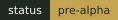
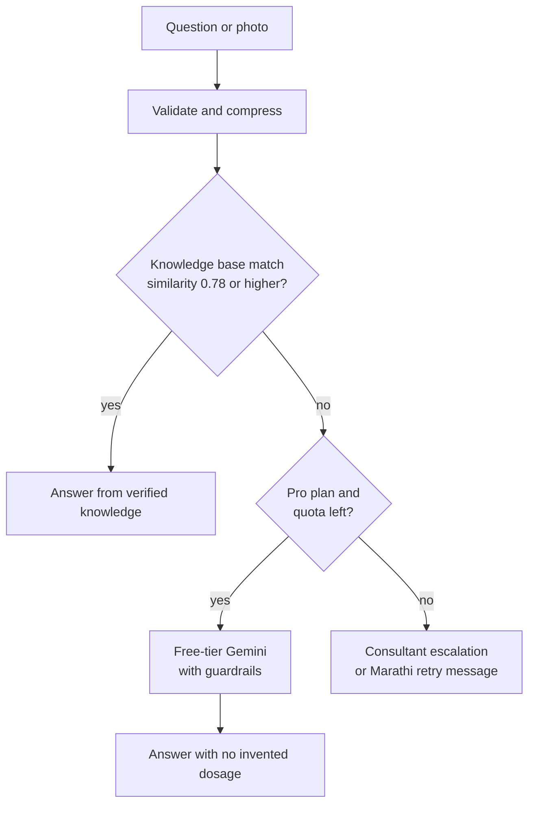
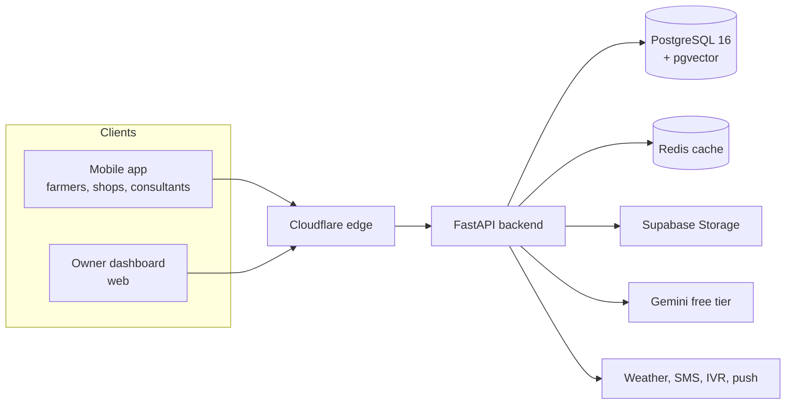

<div align="center">

<picture>
  <source media="(prefers-color-scheme: dark)" srcset="brand/KISAN-MITRA-BRAND/02-Logo-Variations/kisan-mitra-reverse-dark-transparent.svg">
  
</picture>

<br />
<br />

**Your trusted farming companion.**

A Marathi-first agronomy platform for grape growers. Crop schedules, AI diagnosis grounded in verified knowledge, and a direct line to the shop and consultant who advise them.

<br />




[Overview](#overview) &nbsp;·&nbsp; [Features](#features) &nbsp;·&nbsp; [Architecture](#architecture) &nbsp;·&nbsp; [Status](#status) &nbsp;·&nbsp; [Getting started](#getting-started) &nbsp;·&nbsp; [Docs](#documentation)

</div>

<br />

## Overview

Kisan Mitra puts an agronomy advisor in a grape grower's pocket. It tells a farmer what to do on which day of the crop cycle, answers questions in Marathi, diagnoses problems from a photo, and keeps the farmer connected to the shop or consultant they already trust.

Four principles shape every decision in the codebase.

| Principle | What it means |
| :--- | :--- |
| **Knowledge base first** | Answers come from verified viticulture documents. AI never acts as an unanchored oracle, and it never invents a chemical dosage. |
| **The server decides** | The mobile app has no authority over subscriptions or usage quotas. Every entitlement is checked on the backend. |
| **Free by default** | AI runs on free-tier models only. Hitting a limit degrades gracefully. It never escalates to a paid API. |
| **Marathi first** | Marathi UI, Marathi voice, Marathi messages. Voice uses on-device speech, so reading ability is not a barrier. |

<br />

## Features

### Free and Pro

| | Free | Pro (one calendar year) |
| :--- | :---: | :---: |
| Schedule search from a pruning date | Global schedule only | Yes |
| Knowledge-base chat | Yes | Yes |
| Usage allowance | 3 combined uses per month | Daily limits per feature |
| Marathi AI chatbot with Gemini fallback | | Yes |
| Crop photo diagnosis | | 5 per day |
| Ask by voice (on-device Marathi speech) | | Yes |
| Multiple vineyard plots with a primary plot | | Yes |
| Personalised daily schedule | | Yes |
| Medicine directory with pre-harvest intervals | | Yes |
| One automated Marathi call per day | | Yes |
| Weather and rain alerts | | Yes |
| Direct messaging with shop or consultant | | Yes |

Upgrades are owner-assisted. The farmer taps a WhatsApp link, the enquiry is recorded as a lead first, and the owner activates Pro from the dashboard after payment. No payment gateway and no WhatsApp Business API.

### Who uses it

| Role | Surface | What they do |
| :--- | :--- | :--- |
| **Farmer** | Mobile app | Global, shop-managed, or consultant-managed. Follows the schedule, asks questions, sends photos. |
| **Shop partner** | Mobile app | Supports linked farmers, keeps an advisory schedule of their own, and chats with them directly. |
| **Consultant** | Mobile app | Advises linked farmers with their own knowledge base and schedule overrides. A consultant link automatically replaces a shop link. |
| **Owner** | Web dashboard | Activates Pro, manages leads, approves partners, uploads the master knowledge base, reviews AI telemetry. |

### How the AI answers

Every request goes through one router. The knowledge base is always asked first.



An `AI_ENABLED=false` switch turns off every external AI call at once. Non-AI features stay up.

<br />

## Architecture

One backend serves two clients. Row Level Security in Postgres keeps every shop and consultant inside their own data.



### Stack

| Layer | Technology |
| :--- | :--- |
| Backend | Python 3.12, FastAPI |
| Database | PostgreSQL 16 with pgvector, hosted on Supabase, 48 tables with Row Level Security |
| Cache | Redis 7.2 |
| Mobile | React Native with Expo, TypeScript |
| Owner dashboard | Next.js |
| AI | Google Gemini free tier behind a central router |
| Voice | On-device Marathi speech-to-text and text-to-speech |
| Weather | Open-Meteo and IMD |
| Notifications | Firebase Cloud Messaging |
| Edge | Cloudflare |

<br />

## Status

**Pre-alpha.** The specification is complete. Implementation has started with the AI cost-control layer.

Progress is tracked by task ID and status only, following the rules in the [development roadmap](docs/DEVELOPMENT_ROADMAP.md). No dates are promised.

| Module | Tasks | Status |
| :--- | :--- | :--- |
| 1. Core foundation | `KM-FOUND-001` `KM-AUTH-001` `KM-DS-001` | `NOT STARTED` |
| 2. Subscriptions and administration | `KM-SUB-001` `KM-FREE-002` `KM-FREE-003` `KM-PRO-001` `KM-ADMIN-002` `KM-ADM-004` | `NOT STARTED` |
| 3. Agronomy and AI | `KM-AI-001` `KM-AI-002` `KM-FARM-001` | `NOT STARTED` |
| 3. Agronomy and AI | `KM-AIRT-001` free-tier router, usage monitor, Gemini client | `IN PROGRESS` |
| 3. Agronomy and AI | `KM-VIS-001` image validation, compression, hashing | `IN PROGRESS` |
| 4. Multi-role architecture and security | `KM-REL-001` `KM-SEC-001` `KM-UAT-001` | `NOT STARTED` |
| 5. Knowledge management | `KM-KB-001` to `KM-KB-004` | `NOT STARTED` |
| 6. Intelligent RAG and agronomy | `KM-RAG-001` to `KM-RAG-004` `KM-AGR-001` `KM-AGR-002` | `NOT STARTED` |
| 7. Ecosystem and messaging | `KM-REL-004` `KM-REL-005` `KM-CHT-001` `KM-CHT-002` `KM-AICHT-001` `KM-AICHT-002` `KM-ADM-003` | `NOT STARTED` |
| 8. Multi-plot, schedules and calling | `KM-PLOT-001` `KM-IVR-001` `KM-IVR-002` `KM-SCHED-001` `KM-GLB-001` `KM-MED-001` `KM-WTH-002` | `NOT STARTED` |
| 8. Multi-plot, schedules and calling | `KM-MED-002` native Marathi speech service | `IN PROGRESS` |

**What exists in code today**

- `backend/app/services/ai_router.py`: central router. Knowledge base first, free Gemini second, consultant escalation last.
- `backend/app/services/gemini_client.py`: free-tier-only client. A 429 never triggers a paid fallback.
- `backend/app/services/usage_monitor.py`: per-user and platform quotas, rate limits, emergency switch, Marathi limit messages.
- `backend/app/services/image_pipeline.py`: magic-byte validation, resize, compression, SHA-256 hashing for response caching.
- `mobile/src/services/nativeSpeech.ts`: native Marathi speech with a typed-input fallback.

<br />

## Getting started

Only the AI service layer runs today. The full local stack arrives with `KM-FOUND-001`.

**Run the tests**

```bash
git clone https://github.com/swapnilbuilds02/Kisan-Mitra.git
cd Kisan-Mitra

python3 -m venv .venv
source .venv/bin/activate
pip install pytest httpx pillow

python -m pytest backend/tests -q
```

**Configure**

```bash
cp .env.example .env
```

Secrets are backend-only. Never commit `.env` and never ship a key to the mobile app.

| Variable | Default | Purpose |
| :--- | :--- | :--- |
| `AI_ENABLED` | `true` | Master switch. `false` stops every external AI call. |
| `AI_PROVIDER_PRIORITY` | `kb,gemini_free,consultant` | Router order. |
| `AI_KB_THRESHOLD` | `0.78` | Minimum similarity to answer from the knowledge base. |
| `AI_MAX_REQUESTS_PER_DAY` | `5000` | Platform-wide daily ceiling. |
| `AI_MAX_REQUESTS_PER_USER_PER_DAY` | `50` | Per-user daily limit. |
| `AI_MAX_REQUESTS_PER_USER_PER_MINUTE` | `6` | Per-user rate limit. |
| `AI_MAX_IMAGE_BYTES` | `5242880` | Upload ceiling, 5 MB. |
| `AI_MAX_AUDIO_SECONDS` | `60` | Voice clip ceiling. |
| `GEMINI_API_KEY` | | Free-tier key. Paid-only models are rejected at client start. |

<br />

## Repository

```text
.
├── backend/
│   ├── app/services/        AI router, Gemini client, image pipeline, usage monitor
│   └── tests/
├── mobile/
│   └── src/services/        Native Marathi speech
├── brand/                   Official logo and brand pack
└── docs/
    ├── DEVELOPMENT_ROADMAP.md
    ├── AI_COST_OPTIMIZATION_REPORT.md
    └── product-documentation/
```

<br />

## Documentation

| Document | Covers |
| :--- | :--- |
| [Product requirements](docs/product-documentation/01_PRD_KISAN_MITRA.md) | Users, features, business rules |
| [Technical architecture](docs/product-documentation/02_TECHNICAL_ARCHITECTURE_KISAN_MITRA.md) | System design, 48-table schema, API, ADRs |
| [Security and access](docs/product-documentation/03_SECURITY_AND_ACCESS_KISAN_MITRA.md) | Roles, Row Level Security, entitlements |
| [Frontend specification](docs/product-documentation/04_FRONTEND_SPECIFICATION_KISAN_MITRA.md) | Screens and navigation |
| [Feature tickets](docs/product-documentation/05_FEATURE_TICKET_LIST_KISAN_MITRA.md) | Engineering tickets and acceptance criteria |
| [Documentation review](docs/product-documentation/KISAN_MITRA_DOCUMENTATION_FINAL_REVIEW.md) | Audit of the full documentation set |
| [Development roadmap](docs/DEVELOPMENT_ROADMAP.md) | Modules, dependencies, verification |
| [AI cost report](docs/AI_COST_OPTIMIZATION_REPORT.md) | Free-tier AI architecture and limits |

<br />

## How we work

- A task is done only when implementation, testing, verification, and documentation are all finished.
- No task completes ahead of its dependencies unless the owner re-sequences it.
- Database migrations need explicit owner approval before they run.
- Paid services need explicit owner approval. The default configuration is free-tier only.
- Free-tier AI cost controls (`KM-AIRT-001`) must be complete before any feature that calls external AI is enabled.

<br />

## Brand

Logos, app icons, favicons and print files live in [`brand/`](brand/). Usage rules are in [`brand/BRAND.md`](brand/BRAND.md).

| | Name | Hex | Role |
| :---: | :--- | :--- | :--- |
|  | Deep Forest | `#174C38` | Primary |
|  | Agricultural Green | `#34785A` | Secondary |
|  | Harvest Gold | `#C5A451` | Accent, under 5% of any layout |
|  | Warm Ivory | `#F7F7F2` | Background |
|  | Deep Charcoal | `#202923` | Text and dark surfaces |

Typeface: Inter.

<br />

## License

Proprietary and confidential. All rights reserved.

<br />

<div align="center">
<sub>A PRODUCT OF FORGE</sub>
</div>
