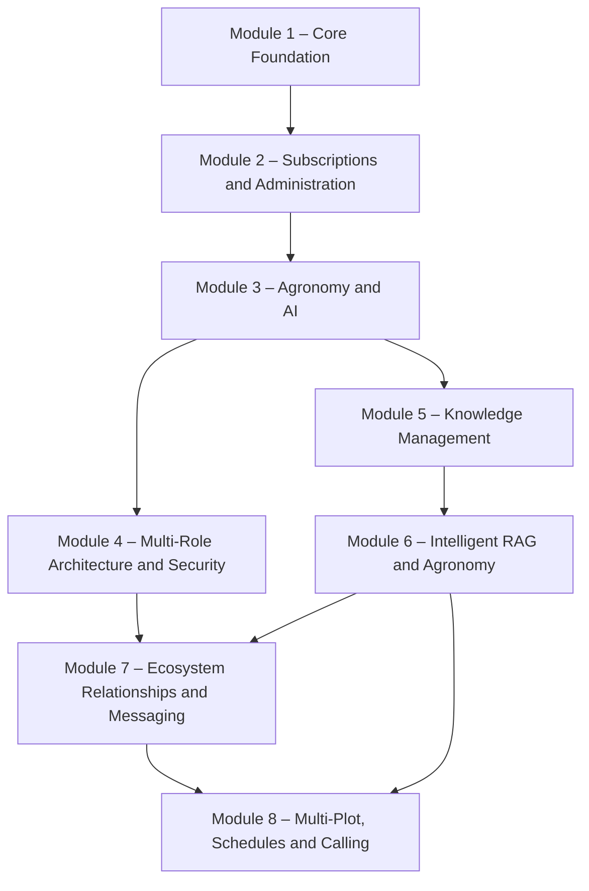

# Kisan Mitra AI – Development Roadmap (Dependency Structure)

For the current code-verified status and proposed execution order, use the [implementation audit](IMPLEMENTATION_AUDIT.md), [phased implementation roadmap](PHASED_IMPLEMENTATION_ROADMAP.md), and [permanent Task Completion Log](TASK_COMPLETION_LOG.md). This document remains a task-ID and dependency inventory; contradictory dependencies are identified in the audit.

---

## Document Control

| Property | Details |
| :--- | :--- |
| **Document Title** | Development Roadmap – Logical Module & Task Dependency Structure |
| **Status** | Active |
| **Classification** | Proprietary & Confidential |

---

## 1. Purpose and Rules

This roadmap defines **what** must be built, **why** it is needed, **how** it depends on other modules, and **how** completion is verified.

### Mandatory Rules

1. No dates, deadlines, sprint durations, weekly or monthly targets, or estimated completion schedules appear anywhere in this document.
2. No Gantt charts, calendar-based roadmaps, or date-based milestone schedules exist in this document.
3. No labels such as Sprint 1, Week 1, Day 1, or time-based Phase labels are used.
4. Work is organized using logical modules, task IDs, and dependency order only.
5. Development speed and completion order are decided entirely by the project owner based on actual progress and available resources.
6. No fixed delivery date is assumed or communicated.
7. Existing task IDs and their logical dependencies are preserved.
8. A task is complete only after **implementation, testing, verification, and documentation** are all finished.

### Reading the Structure

- **Module** = logical grouping of related capabilities.
- **Task ID** = stable identifier used in tickets, commits, and progress reports.
- **Depends On** = tasks that must be complete before this task can finish.
- **Verification** = the evidence required to mark the task complete.

---

## 2. Module Overview

---

## Module 1 – Core Foundation

| Task ID | Task | WHAT / WHY | Depends On | Verification |
| :--- | :--- | :--- | :--- | :--- |
| **KM-FOUND-001** | Monorepo and Database Setup | Establish the single repository containing mobile client, web dashboard, and FastAPI backend, plus the PostgreSQL 16 + pgvector schema. WHY: every later module requires a shared, reproducible foundation. | — | Repository builds locally; database schema applies cleanly; all tables from the technical architecture exist with indexes and constraints. |
| **KM-AUTH-001** | Authentication and DLT OTP Engine | Mobile OTP login, JWT session issuance, and role resolution (farmer / shop / consultant / admin). WHY: all entitlement and data-isolation logic hangs off authenticated identity. | KM-FOUND-001 | OTP request and verification flows pass end-to-end; JWT validates on protected routes; role claims resolve correctly. |
| **KM-DS-001** | Design System and Mobile Shell | Shared UI components, Marathi localization, role-based navigation shell. WHY: consistent farmer-facing experience and correct free/pro gating surfaces. | KM-FOUND-001 | Navigation routes render for each role; Marathi strings display; free-tier screens hide locked entries. |

---

## Module 2 – Subscriptions and Administration

| Task ID | Task | WHAT / WHY | Depends On | Verification |
| :--- | :--- | :--- | :--- | :--- |
| **KM-SUB-001** | One-Year Subscription Engine | Calendar-anniversary validity evaluation with leap-year and month-end handling. WHY: revenue and entitlement correctness. | KM-AUTH-001 | Unit tests cover standard, Feb-29, and month-31 activations; expiry boundary behaves exactly. |
| **KM-ADMIN-002** | Direct Pro Activation | Admin activates existing or unregistered farmers with payment classification and audit logging. WHY: owner-assisted manual payment model. | KM-SUB-001 | Activation writes `subscriptions` + `audit_logs`; pending invitation claim promotes account on first login. |
| **KM-FREE-002** | Free Quota Engine | Combined 3-use monthly quota (`free_usage_counters`) with IST reset. WHY: free tier must never consume AI budget. | KM-SUB-001 | Counter increments atomically; exhaustion returns `FREE_QUOTA_EXHAUSTED`; reinstall does not reset. |
| **KM-FREE-003** | Schedule Search (Free) | Pruning-date input → DAP computation → Global Schedule retrieval. WHY: free-tier taste-of-value feature. | KM-FREE-002 | Valid date returns correct day entry; invalid/future date rejected without quota consumption. |
| **KM-PRO-001** | WhatsApp Direct Link and Enquiry Creation | Pre-create `upgrade_enquiries` lead then open `wa.me` deep link; dynamic owner number. WHY: conversion flow without WhatsApp Business API. | KM-SUB-001 | Lead created before intent fires; 7-day duplicate rule enforced; number read from configuration. |
| **KM-ADM-004** | Dynamic Owner WhatsApp Configuration | Super Admin editable owner WhatsApp number in system configuration. WHY: number changes must not require app rebuilds. | KM-ADMIN-002 | Admin update persists; next enquiry uses updated number. |

---

## Module 3 – Agronomy and AI

| Task ID | Task | WHAT / WHY | Depends On | Verification |
| :--- | :--- | :--- | :--- | :--- |
| **KM-AI-001** | Knowledge Base Ingestion (baseline) | Ingest approved viticulture documents into `knowledge_documents` / `knowledge_chunks` with embeddings. WHY: KB-first guarantee requires indexed content. | KM-FOUND-001 | Documents chunk and embed; similarity search returns relevant chunks. |
| **KM-FARM-001** | Viticulture Crop Stage Engine | Phenological stage calculation from pruning date. WHY: schedules, advisories, and calling all derive from stage. | KM-FOUND-001 | Stage boundaries match POP references for foundation and fruit pruning. |
| **KM-AI-002** | Pro Marathi AI Chatbot | Marathi chat over KB with confidence threshold and controlled free-tier Gemini fallback. WHY: core Pro value; must not hallucinate dosages. | KM-AI-001, KM-SUB-001 | Grounded answers cite KB; below-threshold triggers fallback path; zero dosage fabrication in tests. |
| **KM-VIS-001** | Crop Photo Vision Engine | Image validation → compression → KB symptom check → free-tier Gemini Vision → cache → consultant escalation. WHY: Pro photo diagnosis at 5/day with minimal API cost. | KM-AI-001 | Clear/blurry/mildew/nutrient/unrelated/unsupported image tests pass; identical image served from cache; 429 shows Marathi retry message. |
| **KM-AIRT-001** | Free-Tier AI Cost Controls | Central `AIRouter`, usage monitoring, per-provider limits, emergency AI disable switch. WHY: guarantee no accidental paid billing. | KM-AI-002, KM-VIS-001 | Router selects KB first; quota and RPM limits enforced; `AI_ENABLED=false` short-circuits all external calls; counters reported. |

---

## Module 4 – Multi-Role Architecture and Security

| Task ID | Task | WHAT / WHY | Depends On | Verification |
| :--- | :--- | :--- | :--- | :--- |
| **KM-REL-001** | Shop and Consultant Portals | Role-partitioned mobile dashboards with pending-approval authorization. WHY: partner self-service without web friction. | KM-AUTH-001 | Pending accounts cannot access assigned data; approved accounts see only mapped farmers. |
| **KM-SEC-001** | Security Hardening and RLS Audits | PostgreSQL RLS verification, rate limiting, secret management review, API key backend-only enforcement. WHY: zero-trust multi-tenancy. | KM-REL-001 | RLS policy tests fail cross-tenant reads; no secrets in client bundles or repository. |
| **KM-UAT-001** | Field UAT and Verification | Structured verification of core flows on real devices with Marathi users. WHY: rural device and network reality differs from emulator tests. | KM-SEC-001 | Signed UAT checklist covering login, quota, chat, vision, and voice fallback. |

---

## Module 5 – Knowledge Management

| Task ID | Task | WHAT / WHY | Depends On | Verification |
| :--- | :--- | :--- | :--- | :--- |
| **KM-KB-001** | Master KB Ingestion Desk | Admin upload of Global knowledge files with hash dedup and status pipeline. WHY: authoritative Global KB content. | KM-AI-001 | Upload → hash check → status transitions; duplicate hash rejected. |
| **KM-KB-002** | Consultant KB Isolation | Tenant-isolated consultant knowledge repositories. WHY: consultant-to-consultant secrecy. | KM-KB-001 | Cross-consultant retrieval returns zero rows; RLS denies foreign reads. |
| **KM-KB-003** | 16-Step Pipeline and OCR | Deterministic extraction pipeline with retry and structured JSON output. WHY: schedules and dosage data must be machine-usable. | KM-KB-001 | Job records each step; failure paths set correct status; units preserved. |
| **KM-KB-004** | Dosage Approval Queue | Human review gate for dosage extraction with reviewer notes. WHY: zero ungrounded dosage tolerance. | KM-KB-003 | Unapproved content never reaches published KB; approval writes record. |

---

## Module 6 – Intelligent RAG and Agronomy

| Task ID | Task | WHAT / WHY | Depends On | Verification |
| :--- | :--- | :--- | :--- | :--- |
| **KM-RAG-001** | Multi-Tier RAG Engine | Consultant KB → Master KB → farm history retrieval with 0.78 threshold. WHY: ~95% grounded target. | KM-KB-004 | Retrieval order respected; confidence logged; free tier confined to Global KB. |
| **KM-RAG-002** | Safety Arbiter and Conflict Resolution | Validate recommendations against CIB/NRCG rules; block fabricated dosages. WHY: agronomic safety. | KM-RAG-001 | Conflict cases flagged; dosage-less responses pass; invented actives blocked. |
| **KM-RAG-003** | Gemini Fallback Pipeline | Controlled fallback on free-tier Gemini with guardrail prompt and telemetry. WHY: cover the ~5–10% unindexed questions without paid APIs. | KM-RAG-002, KM-AIRT-001 | Fallback only below threshold; guardrail denies dosage synthesis; 429 never escalates to paid tier. |
| **KM-RAG-004** | AI Telemetry Dashboard | Admin view of grounded rate, fallback rate, token usage, errors, savings. WHY: cost and quality governance. | KM-RAG-003 | Dashboard reflects `ai_response_logs` / `gemini_fallback_logs`; error log visible. |
| **KM-AGR-001** | Personalized Schedule Generation | Multi-factor schedule from variety, pruning date, weather, consultant POP. WHY: Pro daily planner value. | KM-RAG-001, KM-FARM-001 | Generated items carry source attribution; calculations correct for area and dosage. |
| **KM-AGR-002** | Consultant Schedule Customizer | Consultant-specific schedule overrides isolated per tenant. WHY: proprietary advisory differentiation. | KM-AGR-001 | Overrides apply only to linked farmers; revision history recorded. |

---

## Module 7 – Ecosystem Relationships and Messaging

| Task ID | Task | WHAT / WHY | Depends On | Verification |
| :--- | :--- | :--- | :--- | :--- |
| **KM-REL-004** | Consultant Priority Rule | Consultant link auto-unlinks shop with `unlinked_by_priority` and owner notification. WHY: documented precedence rule. | KM-REL-001 | Transition recorded in `farmer_relationship_history`; single active relationship invariant holds. |
| **KM-REL-005** | Data Preservation Boundaries | Expired partner accounts lose access but never lose data. WHY: historical continuity. | KM-REL-004 | Expiry blocks writes/reads; rows remain intact and restorable. |
| **KM-CHT-001** | Direct In-App Messaging | Farmer↔Shop and farmer↔consultant realtime channels. WHY: replaces informal phone churn inside the app. | KM-REL-001 | Channels isolated; only parties can read; status transitions correct. |
| **KM-CHT-002** | Chat Media Pipeline | Image/document/audio attachments with magic-byte validation and retention rules. WHY: safe media exchange. | KM-CHT-001 | Unsupported types rejected; storage paths scoped per tenant. |
| **KM-AICHT-001** | Shared AI Chat View-Only | Partners can view (not act on) farmer AI conversations where permitted. WHY: advisor oversight without impersonation. | KM-AICHT-001 depends on KM-CHT-001, KM-AI-002 | View-only projection returns content; write attempts denied. |
| **KM-AICHT-002** | Farmer Privacy Consent UI | Explicit consent before photos/voice/text leave the device to external AI; free-tier data-training disclosure. WHY: legal and ethical data handling. | KM-AIRT-001 | Consent recorded; requests without consent blocked; disclosure text present. |
| **KM-ADM-003** | Admin Relationship Desk | Owner view and edit of all farmer relationships with audit. WHY: central governance. | KM-REL-004 | Edits write `audit_logs` and notify farmer in-app. |

---

## Module 8 – Multi-Plot, Schedules and Calling

| Task ID | Task | WHAT / WHY | Depends On | Verification |
| :--- | :--- | :--- | :--- | :--- |
| **KM-PLOT-001** | Multi-Plot and Multi-Actor Engine | Pro plot CRUD with four authorized actors, audit, and notification. WHY: real growers manage multiple vineyards. | KM-SUB-001 | Free tier blocked (403); every mutation audited and notified; partners cannot delete. |
| **KM-IVR-002** | Primary Plot Selector and Default | Single `is_primary_plot` driving schedule and calls; first plot defaults. WHY: eliminates calling-plot confusion. | KM-PLOT-001 | Partial unique index enforces one primary; switching realigns schedule and call driver. |
| **KM-MED-001** | Medicine Directory | Searchable CIB-approved medicine info with PHI. WHY: verified input information for Pro users. | KM-KB-001 | Search returns active ingredient, dosage, PHI from approved sources only. |
| **KM-SCHED-001** | Independent 9-Step Schedules | Entity-isolated schedule ingestion pipeline (Shop A → Schedule A). WHY: no schedule cross-contamination. | KM-KB-003 | Uploading Shop A schedule never alters Shop B or Global entries; version history preserved. |
| **KM-IVR-001** | IVR Calling and One-Call Ledger | Daily Marathi call from Primary Plot with atomic 1-call/day ledger and calling-hours window. WHY: cost control and farmer trust. | KM-IVR-002 | Ledger unique index rejects second call same day; opt-out respected; hours enforced. |
| **KM-GLB-001** | Global Farmers Console | Owner console for unassigned farmers: profiles, plots, calls, history. WHY: centrally operated global tier. | KM-ADMIN-002 | Console lists and edits global farmers only within owner authority. |
| **KM-MED-002** | Multi-Modal Voice and Photo | Ask by Voice (native Marathi STT → RAG → native TTS with fallback) and Ask by Photo inside chat. WHY: literacy-independent access at zero speech-API cost. | KM-VIS-001, KM-AI-002 | Marathi voice query returns KB answer played via TTS; iOS without Marathi STT falls back to typed input; no cloud speech dependency. |
| **KM-WTH-002** | Plot Weather and Rain Alerts | GPS-optional plot weather with rain alerts feeding the single daily call. WHY: spray timing safety. | KM-IVR-001 | Alerts fold into the one permitted call; push fallback when call already used. |

---

## 3. Cross-Module Dependency Rules

1. No task may be marked complete out of order against its **Depends On** column unless the project owner explicitly re-sequences it.
2. Free-tier AI cost controls (`KM-AIRT-001`) must be complete before any feature that calls external AI (`KM-RAG-003`, `KM-MED-002`) is enabled in any environment.
3. Security hardening (`KM-SEC-001`) gates field UAT (`KM-UAT-001`); UAT gates promotion to production.
4. Database changes require explicit owner approval; no migration runs without it.
5. Paid API activation requires explicit owner approval; the default configuration is free-tier only.

---

## 4. Definition of Done (applies to every task)

A task is complete only when **all four** are true:

1. **Implementation** – code merged into the repository following existing coding standards.
2. **Testing** – automated tests added and passing, plus manual verification where automation is impossible.
3. **Verification** – acceptance criteria in the task's row demonstrated in a working environment.
4. **Documentation** – task status, affected files, and any decisions recorded without dates or time-based commitments.

---

## 5. Progress Reporting Format

Progress reports list tasks by ID and status only:

| Status | Meaning |
| :--- | :--- |
| `NOT STARTED` | Dependency not yet met or work not begun. |
| `IN PROGRESS` | Implementation underway. |
| `IMPLEMENTED` | Code complete; tests and verification outstanding. |
| `VERIFIED` | Tests passing and acceptance criteria demonstrated. |
| `DONE` | All four Definition-of-Done gates satisfied. |
| `BLOCKED` | Waiting on an owner decision (migration, paid service, production change). |

No report may contain completion dates, duration estimates, or schedule forecasts.
