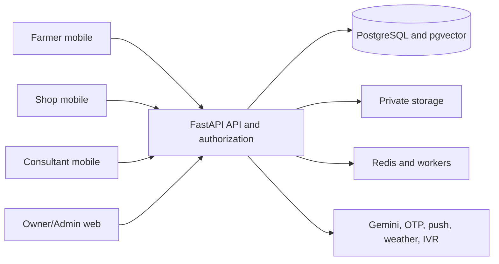

# Kisan Mitra implementation audit

**Audited:** 2026-11-27  
**Scope:** repository documentation and working-tree code; no production account, database, API key, device build, or deployed application was available for verification. This is an implementation audit, not a claim that the proposed system is live.  
**Next:** [Phased implementation roadmap](PHASED_IMPLEMENTATION_ROADMAP.md) · [Permanent task log](TASK_COMPLETION_LOG.md)

## Evidence and current state

The six [product documents](product-documentation/), the existing [dependency roadmap](DEVELOPMENT_ROADMAP.md), [AI cost report](AI_COST_OPTIMIZATION_REPORT.md), root [README](../README.md), [brand rules](../brand/BRAND.md), and holding-site deployment notes were reviewed against the repository. The older [documentation review](product-documentation/KISAN_MITRA_DOCUMENTATION_FINAL_REVIEW.md) verifies *specification coverage*; it does not verify a running application. This audit uses code and runnable tests as implementation evidence. The brand changes from 2026-11-26 are present in the working tree and have not been claimed as deployed.

The intended architecture is one FastAPI backend for a React Native/Expo mobile app (Farmer, Shop, Consultant) and a Next.js owner/admin dashboard. Supabase PostgreSQL plus pgvector is the planned system of record, with Supabase Storage, Redis, Gemini, SMS/OTP, push, weather, and IVR integrations. The repository currently has four backend service modules, one TypeScript speech wrapper, 63 mocked Python unit tests, brand assets, and a static holding site. There is no FastAPI app entry point or route, Next.js or Expo scaffold, package/dependency lockfile, migration, deployed schema, RLS policy, worker, or end-to-end test in the repository. See [technical architecture §§3–9](product-documentation/02_TECHNICAL_ARCHITECTURE_KISAN_MITRA.md), [security matrix](product-documentation/03_SECURITY_AND_ACCESS_KISAN_MITRA.md), and [code inventory](../backend/app/services/).

All connections in this diagram are **planned**. The current service helpers are not wired into an API or a database.

| Area | Verified in repository | Status / missing boundary |
| --- | --- | --- |
| Product specification | PRD, architecture, security, frontend screens, tickets, prior review | Documented, with conflicts below; not a deployed implementation. |
| Holding website | Static Marathi/English pages, local assets, favicon, language script, Vercel and Cloudflare configs | Implemented as files. `VERCEL.md` records an older Vercel snapshot as READY; current working-tree pages and assets are not verified live. |
| Brand | Owner-supplied primary and app logos, generated sizes/variants/symbol/favicon | Completed in working tree; app icon packaging in a real Expo/iOS/Android build is unverified. |
| Backend | `ai_router.py`, `gemini_client.py`, `image_pipeline.py`, `usage_monitor.py` | Partial reusable helpers only. No request auth, entitlements, persistence, tenant-scoped retrieval, API routes, or workers. |
| Mobile | `nativeSpeech.ts` | Partial wrapper only; `NativeModules.KisanSpeech` is not implemented or linked. No mobile app/screens. |
| Owner web | None | Missing. Holding site is not the owner dashboard. |
| Data and security | Schema and RLS examples in Markdown | Missing executable migrations, policies, seeds, backup/restore, and database isolation tests. |
| Integrations | HTTP Gemini client with mocked transport; static `wa.me` requirement | No live Gemini, OTP, Supabase, Redis, push, weather, or IVR integration verified. |
| Tests | `python -m pytest backend/tests -q`: **63 passed** on 2026-11-27 | Unit tests only; no browser, device, API, DB, RLS, provider-contract, or end-to-end tests. |

## End-to-end role workflows

**Owner / Admin, web.** Authenticate with the proper owner or delegated-admin role → inspect leads, farmers, subscriptions, and global accounts → contact the farmer outside the app and record manual payment source/status → activate or renew one-calendar-year Pro access, including pending activation for an unregistered mobile number → approve Shop/Consultant registration and annual access → upload and approve global/entity schedules (9-step) and knowledge documents (16-step) → supervise links, priority transitions, audits, AI telemetry, weather and calling. Each mutation needs server-side role checks and immutable audit records. This complete workflow is **missing**; only designs exist. The exact owner-only versus delegated-admin powers need a decision before RBAC is frozen. Sources: [PRD §§7, 10–11, 15](product-documentation/01_PRD_KISAN_MITRA.md), [security §2](product-documentation/03_SECURITY_AND_ACCESS_KISAN_MITRA.md), [frontend §3.2](product-documentation/04_FRONTEND_SPECIFICATION_KISAN_MITRA.md).

**Shop, mobile.** Register profile → remain `PENDING_APPROVAL` with no farmer access → owner approves/provisions credentials and annual authorization → see only actively assigned Pro farmers, plots, stages and shop schedule → edit assigned plots without delete, with audit and farmer notification → chat in the farmer-shop channel → view farmer AI history only with explicit consent and read-only audit → lose management access on expiry or consultant-priority unlink while historical data remains preserved. This workflow is **missing**. Shop-to-shop and former-shop access isolation must be tested at both API and RLS levels. Sources: [PRD §§10.4–10.6, 13.6](product-documentation/01_PRD_KISAN_MITRA.md), [security §§2–3, 7](product-documentation/03_SECURITY_AND_ACCESS_KISAN_MITRA.md).

**Consultant, mobile.** Register and wait for approval/annual authorization → link an eligible farmer → transactionally replace an active Shop link under the consultant-priority rule, record history, notify only Owner/Admin → see only assigned farmers and consultant knowledge/schedules → log field visits, adjust an assigned plot's schedule, edit plots with audit and farmer notification → use separate direct chat and consented read-only AI view → lose active access on expiry without deleting history. This workflow is **missing**. The two ingestion paths must remain separate: schedule configuration is 9-step; knowledge/OCR/vector ingestion is 16-step. Sources: [PRD §§10.5–10.11, 15 journeys 6–9](product-documentation/01_PRD_KISAN_MITRA.md), [technical architecture §8](product-documentation/02_TECHNICAL_ARCHITECTURE_KISAN_MITRA.md).

**Farmer, mobile.** OTP and profile → Free: pruning-date lookup against Global Schedule and Global-KB-only text chat share exactly three uses per IST calendar month; invalid dates do not charge; no plot, voice, photo, Gemini, or partner messaging access → upgrade lead must be created before `wa.me` opens, with owner number from public config and no public price → Owner/Admin activates Pro for one calendar year → first plot becomes primary, additional plots keep separate schedules, one primary plot drives calls → Pro receives stage/planner/approved knowledge, optional photo/voice, weather, consented partner chat and AI visibility → expiry returns to restricted access without data loss. Only image processing, a generic AI router, and a speech wrapper are **partial**; the actual farmer journey is **missing**. Sources: [PRD §§8–10, 15 journeys 1–4 and 10–12](product-documentation/01_PRD_KISAN_MITRA.md), [frontend navigation](product-documentation/04_FRONTEND_SPECIFICATION_KISAN_MITRA.md).

## Verified business logic and permission gaps

| Priority | Finding | Evidence / required verification |
| --- | --- | --- |
| P0 | No authenticated route or database-backed entitlement exists. None of the promised Free/Pro, partner approval, owner-only, plot, or tenant controls can be enforced end-to-end. | Only `backend/app/services/*.py` exists; no API, migrations, or RLS files. Build authorization and negative access tests before exposing features. |
| P0 | Vision cache lookup precedes the usage/disable check and uses only image hash. A cached result can bypass the emergency switch/quota, and the key omits user, tenant, description, and consent context. | [`ai_router.py`](../backend/app/services/ai_router.py) `route_image`; test cache reuse exists but does not cover cross-user or disabled-cache behavior. |
| P0 | The AI “guardrail” is a prompt plus an escalation phrase check. It does not validate Gemini output against approved sources, dosage/PHI limits, or crop context. | [`ai_router.py`](../backend/app/services/ai_router.py) `_guardrail`; do not enable farmer-facing chemical advice on this evidence. |
| P0 | The code's model allowlist does not prove zero billing: Google's same model has Free and Paid tiers, and eligibility/limits depend on the project. No live key or billing-state check was run. | [`gemini_client.py`](../backend/app/services/gemini_client.py) and [Google's official pricing](https://ai.google.dev/gemini-api/docs/pricing). Treat the AI cost report's absolute “$0/month” statement as a design assumption, not a verified guarantee. |
| P1 | Usage limits default to process memory; check and increment are separate operations, and day counters use a rolling 86,400-second TTL. The code does not implement the combined Free three-per-month quota or Pro photo five-per-day entitlement. | [`usage_monitor.py`](../backend/app/services/usage_monitor.py); verify IST boundaries, concurrency, multi-instance behavior, and durable ledger semantics. |
| P1 | The date-key calculation manually offsets UTC and then uses `date.fromtimestamp`, which depends on host local time. Boundary behavior may differ by server timezone. | [`usage_monitor.py`](../backend/app/services/usage_monitor.py) `_ist_today`; add fixed-clock timezone tests. |
| P1 | KB search is an injected `search(query)` protocol with no actor/tenant scope, approval-state filter, or citation contract. Image “KB first” is based on user description, not actual image content. | [`ai_router.py`](../backend/app/services/ai_router.py); integration tests must prove approved-only Global/Shop/Consultant retrieval. |
| P1 | `route_audio` delegates to text routing and records text usage; the native speech wrapper has no linked native module or screen. | [`ai_router.py`](../backend/app/services/ai_router.py), [`nativeSpeech.ts`](../mobile/src/services/nativeSpeech.ts). |
| P1 | Holding-site production notes disagree: one says nothing deployed, another records an older Vercel production snapshot. Current pages load `lang.js`; `vercel.json` disallows scripts, while `_headers` permits them. | [`site/holding/README.md`](../site/holding/README.md), [`VERCEL.md`](../site/holding/VERCEL.md), [`vercel.json`](../site/holding/vercel.json). Verify actual host and current release before any site change. |

## Specification decisions and inconsistencies

1. **Name and release identity:** [PRD](product-documentation/01_PRD_KISAN_MITRA.md) and the prior review mandate “Kisan Mitra” and decommission “Krushi Mitra AI”; the newly supplied primary artwork reads “Krushi Mitra AI.” Resolve whether the product is being renamed or the artwork is an intentional exception before final UI copy, domain, app-store, and legal text are frozen.
2. **Free informational access:** [PRD §8.1](product-documentation/01_PRD_KISAN_MITRA.md) flags medicine/static articles as owner decision and otherwise restricts Free to two features; [security matrix](product-documentation/03_SECURITY_AND_ACCESS_KISAN_MITRA.md) and [frontend inventory](product-documentation/04_FRONTEND_SPECIFICATION_KISAN_MITRA.md) grant Free access. Pick one rule and propagate it to APIs/screens/tests.
3. **Identity and delegated powers:** OTP is specified for all users, while partner approval also provisions ID/password; owner-exclusive payment/credential powers conflict with some Admin permissions. Define login method, credential reset, and a single owner/admin permission matrix.
4. **Subscription boundaries:** prose examples mix UTC timestamps with “end of anniversary day IST”; define storage instant, inclusive/exclusive expiry, Feb-29 and early-renewal rules before schema and tests.
5. **Schema count and execution:** [architecture §6](product-documentation/02_TECHNICAL_ARCHITECTURE_KISAN_MITRA.md) says 24 tables, the review says 35, and 48 `CREATE TABLE` statements appear in the document. These are numbered groups, not applied migrations. Normalize a single executable schema and count.
6. **Plans and test cases:** [dated ticket Gantt](product-documentation/05_FEATURE_TICKET_LIST_KISAN_MITRA.md) conflicts with the [date-free roadmap](DEVELOPMENT_ROADMAP.md). Some ticket tests still say Free Chat is rejected, contradicting the revised Free KB chat. The earlier roadmap also makes `KM-AIRT-001` depend on AI features while requiring it before external AI is enabled, and `KM-AICHT-001` contains a self-reference. Use the new dependency order in the [phased roadmap](PHASED_IMPLEMENTATION_ROADMAP.md).
7. **Schedule versus knowledge ingestion:** one PRD journey describes a consultant *schedule* going through the 16-step knowledge pipeline; the architecture specifies a separate 9-step schedule pipeline. Preserve the separation and correct acceptance tests.
8. **Other open points:** confirm initial primary-plot default, whether a failed IVR attempt consumes the daily call slot, whether a former partner may read pre-unlink messages, and whether private AI content may be sent to a free-tier external model. These determine database state transitions and consent behavior.

## Audit conclusion

The specification is broad, but the application is not yet a usable multi-role product. The safe first implementation phase is the foundation: reconcile the decisions above, create executable project and database scaffolds, establish authentication/RBAC/RLS, and verify isolation with real API and database tests. Existing AI helper behavior should be preserved as a tested library while its production gates are built. No application implementation was started in this audit.
