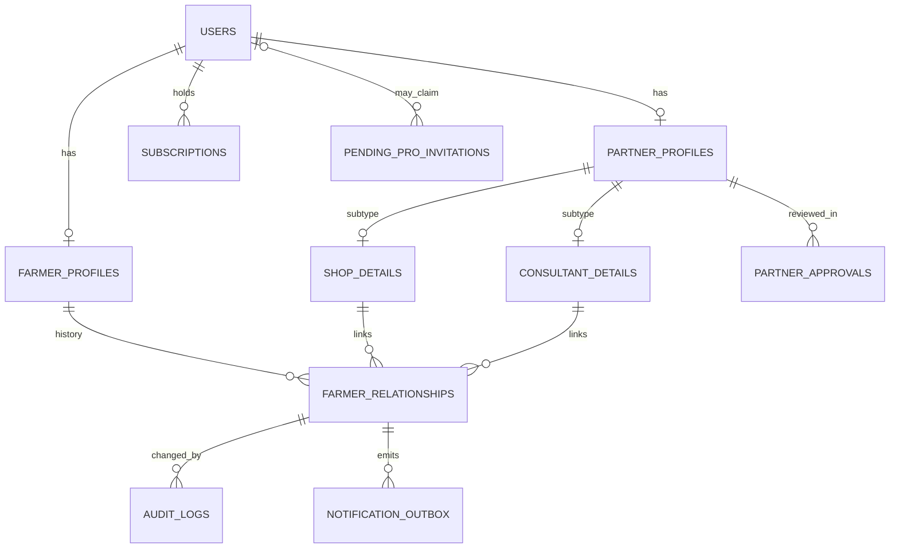

# Farmer and partner management architecture proposal

**Status:** design only, 2026-11-27. No Phase 2 endpoint, migration, relationship, or subscription workflow was implemented. This proposal uses the [PRD](product-documentation/01_PRD_KISAN_MITRA.md), [technical architecture](product-documentation/02_TECHNICAL_ARCHITECTURE_KISAN_MITRA.md), [security rules](product-documentation/03_SECURITY_AND_ACCESS_KISAN_MITRA.md), and [phased roadmap](PHASED_IMPLEMENTATION_ROADMAP.md). The current roadmap puts Free value and owner-assisted conversion in Phase 2, plot/schedule work in Phase 3, and partner relationships in Phase 4. Implementing partner links during Phase 2 would require an approved re-sequencing.

## Identity and lifecycle principles

- A farmer has one canonical `users` identity and one optional `farmer_profiles` row while onboarding. Neither Shop nor Consultant owns that identity. `users.mobile_number` remains unique and normalized; account claiming from `0003_farmer_identity` is the Phase 1 foundation.
- **Global Farmer** means no active partner relationship. It is a derived management category, not a second user type or profile. Owner/Admin can manage Global farmers directly, including manual Pro activation.
- Admin-created farmers remain unverified until the farmer proves control of the mobile number by OTP. Profile completion and privacy acknowledgement are separate from identity verification. Changed-phone correction needs an audited, restricted identity-recovery workflow; it must never be a silent update to the existing mobile number.
- Farmer search is server-side, paginated, and scoped by role. Owner/Admin may filter across verified/pending state, village/taluka/district, Free/Pro state, and management category. Shop/Consultant search is limited to currently assigned farmers. Search results minimize mobile disclosure and must not allow enumeration through public endpoints.
- Pro activation belongs to the farmer's own subscription and never requires a partner link. For an unregistered mobile, an owner-authorized pending invitation is keyed by canonical mobile and claimed after OTP. Activation and renewal are audited transactions; `users.account_tier` is a projection of active entitlement, not a second source of truth. Exact IST expiry instant and payment classification rights remain owner decisions.
- Shop and Consultant accounts use the existing `users` and `partner_profiles` base. Proposed type-specific records extend that profile. Registration, Owner/Admin approval, independent annual subscription, and runtime access are distinct states. Expiry or suspension denies partner data access while keeping profile, relationship, and activity history.

## Proposed data model (no migration yet)

The `PENDING_PRO_INVITATIONS` line represents a future claim by verified mobile; an invitation must also support a mobile with no `users` row, so its actual FK to `users` is nullable or omitted until claim. The diagram is conceptual and is not executable DDL.

| Table / source | Responsibility and proposed keys | Constraints and indexes |
| --- | --- | --- |
| `users` **existing** | Central UUID identity, canonical mobile, role, verification/state | Unique mobile; role/state indexes; no partner-owned farmer identity |
| `farmer_profiles` **existing** | One profile per farmer `user_id` | Unique `user_id`; village/taluka/district search index; retain pending profile state separately from verified mobile |
| `partner_profiles` **existing** | One common partner profile per Shop/Consultant `user_id` | Unique `user_id`; role must agree with `users.role` |
| `shop_details`, `consultant_details` **proposed** | One-to-one type-specific code, license/qualification, geography, schedule binding; PK/FK to `partner_profiles.id` | Unique partner code and subtype FK; no duplicated mobile or login identity |
| `partner_approvals` **proposed** | Immutable reviewer decision, actor, reason, timestamps, prior/new status | FK partner and reviewer user; `(partner_id, decided_at DESC)` index; no self-approval |
| `subscriptions`, `subscription_plans` **documented, not migrated** | Farmer Pro and independent partner annual validity, manual payment classification, start/expiry | FK `user_id` and plan; unique subscription code; index `(user_id,status,expiry_date)`; prevent overlapping active terms transactionally |
| `pending_pro_invitations` **proposed** | Owner direct activation for unregistered canonical mobile, claimed once after OTP | Unique active invitation per canonical mobile; nullable claimed user FK; expiry and actor indexes; idempotent claim |
| `farmer_relationships` **documented, not migrated** | Every Shop/Consultant assignment remains as a historical row; `farmer_id` FK to `farmer_profiles.id`, exactly one partner FK | Check exactly one of `shop_id`/`consultant_id`; partial unique `(farmer_id) WHERE status='active'`; indexes `(shop_id,status,farmer_id)`, `(consultant_id,status,farmer_id)`, `(farmer_id,created_at DESC)`; `ON DELETE RESTRICT` to preserve history |
| `audit_logs` **existing** | Immutable actor, action, target, reason, old/new relationship and subscription state | FK actor and target identifiers; `(target_entity,target_id,created_at DESC)` index; no update/delete grant to runtime role |
| `notification_outbox` **proposed** | Transactional event for Owner/Admin takeover notice and later delivery retries | Unique event/idempotency key; status/next-attempt index; recipient role/user FK; no SMS or push activation in this proposal |

`farmer_relationships` rows plus immutable `audit_logs` form relationship history; a duplicate history table would create competing truths. The existing technical SQL uses `ON DELETE CASCADE` for relationships, which conflicts with mandatory preservation; use `RESTRICT` in the eventual migration. Existing security examples refer to `subscriptions.farmer_id` while the table definition uses `subscriptions.user_id`; settle one FK contract before implementation.

## Relationship state machine

| Current derived state | Authorized transition | Result and records |
| --- | --- | --- |
| Global | Confirmed Shop assignment | Insert one active Shop row; category becomes Shop-linked. |
| Global | Confirmed Consultant assignment | Insert one active Consultant row; category becomes Consultant-linked. |
| Shop-linked | Confirmed Consultant takeover | In **one transaction**, set Shop row to `unlinked_by_priority`, record end time/reason, insert active Consultant row, audit both, queue **Owner/Admin-only** notification. |
| Shop-linked or Consultant-linked | Authorized termination | Mark active row `terminated` or `unlinked_by_admin`; category becomes Global. Preserve rows and content. |
| Consultant-linked | Shop request | Reject while Consultant is active. Only Owner/Admin correction may terminate Consultant and then establish a new Shop row with explicit reason and audit. |
| Any linked state | Partner expiry/suspension | Keep relationship row/history; immediately deny partner dashboard/data access. Schedule fallback behavior needs an owner decision. |
| Historical row | Restoration request | Do not silently reactivate. Owner/Admin creates a new active row linked to the historical case after checking current state; preserve both versions. |

The requester's authority is checked server-side. Recommended default: Owner/Admin may assign or correct; a partner may propose an assignment only with proof of farmer authorization or an Owner/Admin approval. The precise farmer-confirmation method is an owner decision. A Shop or Consultant never changes another partner's active link directly. A consultant takeover may be initiated by an authorized consultant, but activation must satisfy the approved proof/approval rule before the transaction commits.

### Transaction, concurrency, and revocation

1. Start a transaction and lock the `farmer_profiles` row with `FOR UPDATE`. Validate actor role, farmer identity, partner approval, independent subscription, and consent/assignment proof. Use an idempotency key for retried requests.
2. Read and lock the active relationship. Apply the allowed state transition, insert the new row, write immutable `audit_logs` rows, and enqueue notification/cached-permission invalidation events in the **same transaction**. The partial unique active-row index is the final concurrency backstop; retry or return conflict on uniqueness failure.
3. Commit before dispatching notifications. On Consultant takeover, only Owner/Admin recipients are queued; no Shop or Farmer takeover notice is emitted. Failed delivery retries from the outbox without replaying the relationship mutation.
4. Every data query rechecks the current relationship **and** partner approval/subscription state. Cached permission keys include relationship ID/version and are invalidated after commit; cache alone never grants access. An unlinked Shop cannot read new farmer messages, documents, schedules, plots, AI chats, or cached projections. Historic records remain stored for Farmer and Owner/Admin review. Former-partner access to its own historical authored records is an unresolved owner policy and defaults to denied.
5. Terminate or archive an old Shop chat thread on takeover; prevent new sends and media downloads by the old Shop. Bind new Consultant collaboration to the new relationship. Old document/schedule versions remain for audit, while future advisory selection follows the new active relationship. Background jobs must recheck authorization at execution time.

## Permission and RLS design

- Keep the runtime database role without direct sensitive-table privileges. Expose narrow, audited server functions or queries after FastAPI validates RS256 token, session, role, approval, entitlement, and relationship. Avoid trusting a freely settable `app.current_user_role` or `app.current_user_id` as the sole database proof; the illustrative security SQL currently does this and needs a safer final contract.
- Enable RLS on profile, relationship, subscription, message, document, and notification tables with deny-by-default policies. Farmer direct reads: only own profile and authorized own content. Partner reads: only farmers with an **active** matching relationship plus approved, unexpired partner account and per-resource consent. Owner/Admin: explicit delegated policy, not a broad client-side flag. Writes are narrower than reads; partner plot deletion remains forbidden.
- If direct Supabase client access is later used, derive identity from a verified database JWT identity (`auth.uid()` or equivalent) and test it under actual restricted roles. Never expose the migration owner or `km_api` credential to mobile/web clients. Test Shop A/B, Consultant A/B, Global farmers, post-unlink reads/writes, expired partners, and concurrent assignment attempts against PostgreSQL, not only mocked API stores.

## Proposed API contract (not implemented)

| Endpoint | Purpose | Authorization |
| --- | --- | --- |
| `GET /api/v1/admin/farmers` | Paginated search/filter across categories, verification, location, tier | Owner/Admin with delegated search permission; audited bulk access |
| `GET /api/v1/admin/farmers/{farmer_id}` | Full owner desk profile and lifecycle | Owner/Admin; sensitive fields by permission |
| `POST /api/v1/admin/farmers/pre-register` | **Existing Phase 1 route**; prepare pending canonical mobile | Admin/Super Admin; audited reason; no relationship creation |
| `POST /api/v1/admin/farmers/{farmer_id}/subscriptions/activate` | Manual Pro activation/renewal | Owner/Super Admin by default; delegated Admin rights require approval; payment audit |
| `GET /api/v1/partners/me/farmers` | Assigned farmer list for mobile Shop/Consultant | Approved, unexpired partner; active own relationship only |
| `POST /api/v1/admin/shops`, `POST /api/v1/admin/consultants` | Owner desk partner preparation | Owner/Admin provisioning permission; no automatic dashboard access |
| `POST /api/v1/admin/partners/{partner_id}/approval-decisions` | Approve, suspend, revoke with reason | Owner/Super Admin by default; no self-approval |
| `POST /api/v1/farmers/{farmer_id}/relationships/shop` | Assign Shop | Owner/Admin or approved proof-backed workflow; reject active Consultant |
| `POST /api/v1/farmers/{farmer_id}/relationships/consultant` | Assign/take over with Consultant priority | Owner/Admin or approved proof-backed Consultant workflow; atomic Shop unlink |
| `POST /api/v1/farmers/{farmer_id}/relationships/{relationship_id}/terminate` | End active link | Owner/Admin; optional farmer self-unlink requires decision |
| `POST /api/v1/admin/farmers/{farmer_id}/relationships/restore` | Audited correction/restoration as a new row | Owner/Super Admin; reason and prior version required |
| `GET /api/v1/farmers/{farmer_id}/relationships/history` | Active and historic assignment timeline | Owner/Admin or the farmer; former-partner history defaults denied |

All mutations accept an idempotency key, validate the actor again inside the transaction, and return a conflict for stale relationship versions. No endpoint in this table authorizes a Shop to take over a Consultant-linked farmer. Owner/Admin lives on the website; Farmer/Shop/Consultant views live in the single mobile app.

## Acceptance scenarios and decisions before implementation

- Verify direct Owner Pro activation for a Global farmer and a pending mobile without creating a partner relationship; settle IST anniversary/expiry and complimentary/pending payment rights.
- Verify one active relationship under concurrent Shop and Consultant attempts, Consultant priority, no Shop future-data access, historical preservation, and Owner/Admin-only takeover notification.
- Verify partner approval/expiry denies access while relationship rows and farmer data remain intact; verify restoration creates a new version with complete audit.
- Decide who may initiate/confirm a partner assignment, former-partner historical access, expired-partner schedule fallback, owner versus delegated Admin powers, mobile recovery, and whether partner OTP replaces the older issued-password specification. These decisions belong in the decision register before migrations or endpoints are approved.
