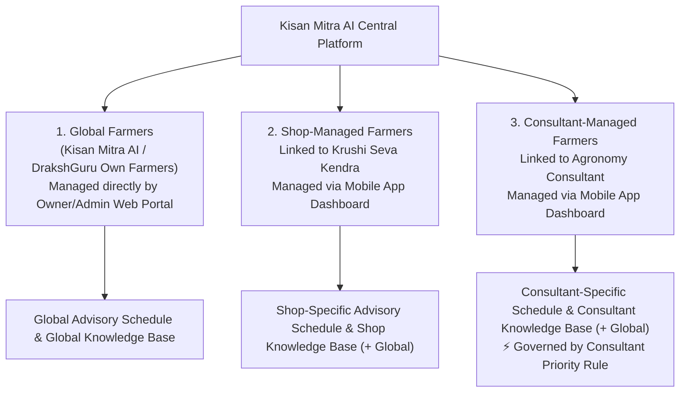

# Product Requirements Document (PRD) – Kisan Mitra AI (formerly DrakshGuru)

---

## 1. Document Control

| Property | Details |
| :--- | :--- |
| **Document Title** | Product Requirements Document (PRD) – Kisan Mitra AI Mobile & Web Platform |
| **Official Platform Name**| **Kisan Mitra AI (formerly DrakshGuru)** |
| **Document Version** | 2.2.0 (Revised Free/Pro Product Model & WhatsApp Direct Enquiry) |
| **Status** | Approved by Engineering Lead / Pending Final Owner Sign-off |
| **Date of Creation** | November 2026 |
| **Product Owner** | Swapnil Pawar |
| **Author Team** | Principal Software Architect, Senior Product Manager, Lead AgriTech Consultant, Mobile & Backend Architects |
| **Category** | AgriTech – AI-Powered Agricultural Advisory & Vineyard Management Platform |
| **Primary Target Market** | Maharashtra, India (Initial focus: Sangli, Tasgaon, Miraj, Solapur grape heartlands) |
| **Initial Target Crop** | Grapes (*Vitis vinifera*) with multi-crop extensible architecture |
| **Classification** | Proprietary & Confidential |

### Revision History

| Version | Date | Author / Role | Description of Changes |
| :--- | :--- | :--- | :--- |
| **1.0.0** | October 2026 | Legacy Architecture Team | Initial Krushi Mitra AI WhatsApp chatbot documentation (Deprecated). |
| **2.0.0** | November 2026 | Senior Product & Engineering Team | Complete re-architecture into **Kisan Mitra**: Standalone Mobile App (Farmer, Shop, Consultant) + Centralized Owner/Admin Web Dashboard. Introduction of strict Free vs. Pro business model, owner-assisted Pro enquiry conversion workflow, Direct Admin-to-Farmer Pro activation, calendar-year subscription engine, Knowledge Base-first RAG with Gemini fallback, and strict role-based data isolation. WhatsApp integrations permanently decommissioned. |
| **2.1.0** | November 2026 | Senior System Architect & Product Team | **Complete Next-Version Platform Expansion:**<br>• Formalized three independent farmer-management categories: **Shop-Managed Farmers**, **Consultant-Managed Farmers**, and **Global Kisan Mitra AI / DrakshGuru Farmers**.<br>• Architected **Independent Advisory Schedule System**: separate, isolated schedules for every Shop, every Consultant, and Global platform, with a safe 9-step configuration-driven file upload pipeline.<br>• Added **Multiple Vineyard Plots Management** per farmer with independent pruning dates, crop stages, and daily advisories.<br>• Instituted strict platform-wide **One Automated Call Per Farmer Per Day Rule**, Calling Plot Selector, and **Default Calling Rule (First Added Plot = Default)**.<br>• Introduced **Automated Voice Calling Engine** (IVR) factoring in plot pruning dates, applicable schedules, weather alerts, calling preferences, and telecom consent.<br>• Established strict architectural **Separation between Schedule Files (When)** and **Knowledge Files (What)**.<br>• Added **Global vs. Entity-Specific Knowledge Base Hierarchy** with context-aware retrieval precedence.<br>• Integrated **Medicine Information Folder**, **Ask by Photo** (agricultural medicine & plant symptoms), and **Ask by Voice** (vernacular Marathi STT/TTS). |
| **2.2.0** | November 2026 | Senior Product Architect & Engineering Team | **Revised Free/Pro Product Model, Plot Gating & WhatsApp Enquiry Integration:**<br>• **Redefined Free Plan:** Free farmers receive strictly 2 features sharing a single combined quota of 3 uses per month: (1) **Schedule Search** (enters pruning date only $\rightarrow$ computes DAP $\rightarrow$ retrieves day's entry from Global Schedule only), and (2) **Limited Knowledge-Base Chat** (text only, Global KB only, no Gemini fallback, no voice/photo). Monthly IST reset (00:00 IST on 1st).<br>• **WhatsApp Direct Enquiry:** Replaced in-app modal enquiry with Premium Upgrade page rendering Marathi CTA and a **WhatsApp वर चौकशी करा** button opening a `wa.me` deep link with pre-filled enquiry text. System creates an `upgrade_enquiries` record (status `NEW`) prior to opening WhatsApp (7-day duplicate check preserved). Owner WhatsApp number configurable by Super Admin. Rule BR-03 updated to allow `wa.me` click-to-chat links while continuing strict prohibition on WhatsApp bots or Business APIs.<br>• **Plot Registration Gated to Pro:** Free farmers cannot register plots. Plot registration and multi-plot setup unlock strictly after Pro activation. Multi-actor plot editing authorized for Farmer, linked Consultant, linked Shop, and Admin, with mandatory audit logging and in-app farmer notifications.<br>• **Calling Plot Simplification:** Eliminated duplicate Calling Plot concept. The single **Primary Plot** (`farms.is_primary_plot`) governs both schedule generation and automated voice calling. First-added plot automatically defaults to Primary Plot. Maximum 1 automated call per farmer per day strictly preserved. |

### Related Documents
- [02_TECHNICAL_ARCHITECTURE_KISAN_MITRA.md](file:///D:/Kisan%20Mitra%20App/docs/product-documentation/02_TECHNICAL_ARCHITECTURE_KISAN_MITRA.md)
- [03_SECURITY_AND_ACCESS_KISAN_MITRA.md](file:///D:/Kisan%20Mitra%20App/docs/product-documentation/03_SECURITY_AND_ACCESS_KISAN_MITRA.md)
- [04_FRONTEND_SPECIFICATION_KISAN_MITRA.md](file:///D:/Kisan%20Mitra%20App/docs/product-documentation/04_FRONTEND_SPECIFICATION_KISAN_MITRA.md)
- [05_FEATURE_TICKET_LIST_KISAN_MITRA.md](file:///D:/Kisan%20Mitra%20App/docs/product-documentation/05_FEATURE_TICKET_LIST_KISAN_MITRA.md)
- [KISAN_MITRA_DOCUMENTATION_FINAL_REVIEW.md](file:///D:/Kisan%20Mitra%20App/docs/product-documentation/KISAN_MITRA_DOCUMENTATION_FINAL_REVIEW.md)

---

## 2. Executive Summary

**Kisan Mitra AI (formerly DrakshGuru)** is a next-generation agricultural technology platform engineered to empower Indian grape growers with precision agronomy, verified crop schedules, real-time weather intelligence, automated voice calling, and artificial intelligence-driven advisory. 

Transitioning from an experimental WhatsApp chatbot (formerly known as Krushi Mitra AI / DrakshGuru), Kisan Mitra AI is conceived and architected as an **independent, enterprise-grade, standalone multi-platform ecosystem** comprising:
1. **A Cross-Platform Mobile Application (Android / iOS)** featuring customized, authenticated, role-based dashboards:
   - **Farmer Mobile Experience:** 
     - **Free Mode:** Streamlined utility featuring strictly **Schedule Search** and **Limited KB Chat** sharing a combined quota of 3 uses per calendar month with a live in-app remaining-uses counter. No plot setup, automated calls, push schedules, or multi-modal AI.
     - **Pro Mode:** Unlocked upon manual subscription activation. Prompts first-time multi-plot setup, displays the Primary Plot switcher, today's personalized guidance, Ask by Photo, Ask by Voice, consultant prescriptions, and primary plot call preferences.
   - **Shop Partner Dashboard:** Integrated directly inside the mobile app; assigned Pro farmer management, plot creation/updates for linked Pro farmers (audited), agronomic stage overviews, and direct human chat; no separate web dashboard required.
   - **Agronomy Consultant Dashboard:** Integrated directly inside the mobile app; assigned Pro vineyard plot creation/updates (audited), custom spray prescriptions, field observation logging, and direct human chat; no separate web dashboard required.
2. **A Centralized Owner / Super-Admin Website Dashboard** operated exclusively by the platform owner, Swapnil Pawar, and authorized platform administrators for comprehensive governance over:
   - **All Farmers across 3 Management Categories:** (1) **Shop-Managed Farmers**, (2) **Consultant-Managed Farmers**, and (3) **Global Kisan Mitra AI Farmers** (unassigned farmers managed directly under the central platform with individual profiles operated by Owner/Admin).
   - **Independent Advisory Schedule System:** Isolated advisory timelines for every Shop (Shop A $\rightarrow$ Schedule A), every Consultant (Consultant A $\rightarrow$ Schedule D), and Global Kisan Mitra AI, powered by a 9-step safe database-driven schedule file ingestion pipeline.
   - **Automated Voice Calling (IVR) System:** Dispatched exclusively to Pro farmers with at least one registered plot; generates schedule reminders, crop-stage updates, and urgent weather alerts based on the farmer's **Primary Plot**, strictly constrained by the platform-wide **One Automated Call Per Farmer Per Day** rule.
   - **Knowledge Base Ingestion & Partitioning:** Separate management for Global Knowledge Files (available to all eligible farmers) and Entity-Specific Knowledge Files (Shop-specific or Consultant-specific).
   - **Weather Intelligence & GPS Verification:** Plot-specific coordinates confirmed with farmer permission driving localized rain alerts and spray efficacy indicators (Pro-exclusive).
   - **Centralized Premium Management:** Absolute administrative authority over Free vs. Pro/Premium entitlements, manual payment classifications (`Paid`, `Pending`, `Complimentary`), WhatsApp enquiry number configuration, and validity expirations.

The platform operates on a sustainable, high-conversion **Freemium business model**:
- **Free Tier (Strict Utility & Taste-of-Value):** 
  - **Schedule Search:** A single search box where the farmer enters **only their pruning date** (no variety or pruning-type questions). The system computes Days After Pruning (DAP) and returns that day's entry from the **Global Advisory Schedule only**. Each search consumes 1 use.
  - **Limited Knowledge-Base Chat:** Text questions only (no photo, no voice). Grounded strictly in the **Global Knowledge Base only** (zero Gemini fallback). If no verified match exists, provides a respectful Marathi advisory suggesting Pro consultation. Each question consumes 1 use.
  - **Combined Monthly Quota:** Maximum **3 total uses per calendar month** (e.g., 2 searches + 1 question), tracked atomically server-side and resetting at 00:00 IST on the 1st of each month. Free farmers cannot register plots or receive automated voice calls.
- **Pro Tier:** Unlocked after owner-assisted manual onboarding:
  - **Plot Registration & Multi-Plot Vineyard Management:** Setup 1, 2, 3+ plots with varieties, pruning dates, and primary plot designation. Can be managed by farmer, linked consultant, linked shop, or admin.
  - **Dual-Tier Agricultural AI Chatbot:** Full multi-source RAG prioritizing Central Master KB and Consultant KB (~95% target) with **Google Gemini API Fallback** (~5–10% target).
  - **AI Crop Photo Diagnosis:** Multi-modal leaf/cluster analysis capped at strictly 5 photo diagnoses per farmer per day.
  - **Multi-Modal Queries:** Ask by Photo (crop symptoms & medicine labels) and Ask by Voice (vernacular Marathi STT/TTS).
  - **Automated Daily Voice Advisory (IVR):** Marathi automated calling based on the Primary Plot (strictly 1 call/day).
  - **Dynamic Daily Farm Planner & Personalized Schedules:** Context-aware spray, irrigation, and fertigation execution tracking.

Conversion from Free to Pro is governed through a **Seamless WhatsApp Enquiry & Owner-Assisted Onboarding Workflow**: when a Free farmer reaches their 3-use quota or attempts any Pro feature, the **Premium Upgrade Page** appears with Marathi copy and a **"WhatsApp वर चौकशी करा"** button. Tapping the button atomically pre-creates an `upgrade_enquiries` lead (status `NEW`) and opens a `wa.me` deep link to the owner's configured number with a pre-filled Devanagari message. The owner conducts personal telephonic/WhatsApp consultation, collects payment manually (Direct, Consultant, or Shop), and executes **Direct Admin-to-Farmer Pro Activation** in the Web Admin. Every paid subscription is governed by a **strict one-calendar-year anniversary validity engine**. All data is authoritatively stored and managed in **Supabase**.

---

## 3. Product Vision, Mission & Principles

### 3.1 Vision
To become India's most trusted, dependable, and farmer-centric digital agricultural companion, eliminating crop yield uncertainty through localized intelligence, verified agronomy, and accessible artificial intelligence.

### 3.2 Mission
Empower grape growers across Maharashtra with vernacular, actionable, day-to-day farming intelligence that reduces chemical input waste, mitigates weather-induced crop loss, accurately diagnoses diseases, and connects farmers directly to expert guidance.

### 3.3 Core Product Principles
1. **Farmer-First Ergonomics:** High contrast, legible typography, minimal touch-depth, icon-accompanied visual cues, and resilient operation over degraded 2G/3G rural networks.
2. **Marathi-First Native Experience:** Complete linguistic localization in authentic Marathi terminology (कृषी मित्र, छाटणी, घड जिरणे, डाऊनी मिल्ड्यू, भुरी, इत्यादी) with seamless English fallback.
3. **Knowledge Base-First AI Integrity (~95% Grounded Target):** AI responses must strictly prioritize the curated Central Master Knowledge Base and approved Consultant-Specific Knowledge Bases before initiating LLM fallback to prevent hallucinations and unverified chemical dosages. Gemini acts as an assistive synthesizer (~5–10% fallback cases), never as an unanchored agronomic oracle.
4. **Dual-Tier Agronomic Personalization:** Crop guidance is individualized to each specific vineyard plot, merging regional university Package of Practices (POP) with the farmer's assigned Consultant's proprietary schedules while enforcing absolute consultant-to-consultant knowledge isolation.
5. **Owner-Assisted Commercial Trust:** Avoid transactional friction and payment distrust in rural demographics by enabling personal owner-to-farmer consultations during subscription onboarding.
6. **Direct Administrative Autonomy:** The application owner possesses absolute operational autonomy to directly assign Pro subscriptions to any farmer without mandatory shop/consultant intermediaries.
7. **Zero WhatsApp Bot or Business API Automation:** Standalone native mobile architecture completely uncoupled from automated WhatsApp bots, third-party messaging aggregators, or Meta Business API webhooks. A direct click-to-chat `wa.me` deep link to the owner's configured number is permitted strictly for high-trust user-initiated enquiry routing.
8. **Strict Server-Side Entitlement & Data Isolation:** Absolute boundary between Free and Pro capabilities enforced at backend database and API gateway layers, coupled with cryptographic data isolation between shops, consultants, and farmers.

### 3.4 Strategic Business Positioning: Digital Assistant, Not Competitor
Kisan Mitra is explicitly **not** designed to disintermediate or replace agricultural shops (*कृषी सेवा केंद्र*) or agricultural consultants (*द्राक्ष सल्लागार*). Instead, it is architected as their indispensable digital assistant:
- **For Agricultural Consultants:** Reduces repetitive communication workload, streamlines daily plot monitoring for assigned growers, and provides an authoritative platform to distribute proprietary schedules.
- **For Agricultural Shops:** Helps retail dealers maintain closer, trusted relationships with their customer-farmers by keeping them informed on crop phenological stages, anticipated input needs, and farmer concerns.
- **For Farmers:** Organizes agricultural activities, provides verified Knowledge Base-grounded AI intelligence, and connects them directly with their trusted local service providers.
- **Ecosystem Goal:** Strengthen and digitize existing local agricultural relationships rather than competing with them or displacing traditional agribusiness networks.

---

## 4. Problem Statement & Market Opportunity

### 4.1 Ground Reality in Maharashtra Viticulture
Grape farming (*द्राक्ष शेती*) in Sangli, Tasgaon, Miraj, Solapur, and Nashik is one of India's most capital-intensive, high-risk agricultural domains:
- **Extreme Weather Sensitivity:** Sudden rainfall, unseasonal hail, temperature swings, and humidity spikes during flowering (*फ्लॉवरिंग*) or fruit-set (*मणी सेटिंग*) can destroy an entire year's crop in 48 hours via Downy Mildew (*केवडा / डाऊनी*) or Powdery Mildew (*भुरी*).
- **Misinformation & Excessive Chemical Overuse:** Farmers frequently over-apply expensive systemic fungicides and plant growth regulators (PGRs) due to panic or commercially biased advice from retail agro-chemical dealers.
- **Scattered Agronomic Information:** Package of practices (POP), pruning calculations (Foundation vs. Fruit pruning), canopy management, and export residue limits (MRL standards) are locked in physical books, PDFs, or university circulars unavailable in the vineyard.
- **Language & Technology Barrier:** Most modern AgriTech applications are built in English or Hindi with complex dashboards, alienating Marathi-speaking generational growers.

### 4.2 The Kisan Mitra Solution
Kisan Mitra provides:
- A structured **Day-by-Day Phenological Stage Guide** calculated from pruning date (*छाटणी तारीख*).
- An offline-capable **Informational Knowledge Base** covering grape cultivation, pest life-cycles, organic solutions, and nutrient deficiency markers free of charge.
- A Pro **Marathi AI Advisory Assistant** grounded in regional university literature and expert farmer practices.
- A transparent, verified ecosystem connecting farmers, local retail shops, and professional agronomists under owner supervision.

---

## 5. Target Market & Geographical Scope

### 5.1 Geographic Roadmap
```
Phase 1 (Immediate MVP) ──► Sangli, Tasgaon, Miraj, Kavthe Mahankal, Vita (Maharashtra Grape Heartlands)
Phase 2 (Q3-Q4 2027)    ──► Solapur, Nashik, Pune (Baramati, Indapur), Ahmednagar
Phase 3 (2028 Expansion)──► Multi-Crop Expansion: Pomegranate (डाळिंब), Sugarcane (ऊस), Onion (कांदा), Soybean
Phase 4 (National)      ──► Karnataka (Vijayapura/Belagavi grape belts), Andhra Pradesh, Telangana
```

### 5.2 Initial Target Crop: Viticulture Focus
- **Primary Varieties:** Thompson Seedless, Manik Chaman, Super Sonaka, Sharad Seedless, Jumbo Seedless, Anushka, Red Globe, 2A Clone.
- **Pruning Cycles:**
  - April / Back Pruning (*खोड छाटणी / खरड छाटणी*) – Vegetative cane development, sub-cane formation.
  - October / Forward Pruning (*गोडी छाटणी / फळ छाटणी*) – Bud sprout, inflorescence emergence, flowering, berry set, berry development, veraison, harvesting.

---

## 6. User Personas & Ecosystem Roles

Kisan Mitra AI supports **three independent farmer-management categories**, alongside Shop Partners, Consultants, and the Central Owner/Admin team:

### 6.1 The Three Farmer Management Categories



1. **Global Kisan Mitra AI / DrakshGuru Farmers:**
   - Farmers who are **not assigned to any Shop or Consultant**.
   - Managed directly under our central platform by Swapnil Pawar and the Owner/Admin team.
   - Each Global Farmer has an individual comprehensive profile in the Owner Web Dashboard containing: farmer info, mobile number, multiple vineyard plots, plot-specific pruning dates, plot-specific advisory schedules, calling settings, call history, knowledge/advisory history, and Premium status.
   - Global Farmers receive the **Global Kisan Mitra AI Advisory Schedule** and the **Global Knowledge Base**.
2. **Shop-Managed Farmers:**
   - Farmers registered and actively linked to an authorized agricultural shop (*कृषी सेवा केंद्र*).
   - Managed by the Shop Partner through their dedicated mobile app interface.
   - Receive the **Shop's Independent Advisory Schedule** (e.g., Shop A $\rightarrow$ Schedule A) and the Shop's specific knowledge files, combined with Global Knowledge.
3. **Consultant-Managed Farmers:**
   - Farmers actively assigned to an authorized viticulture consultant (*द्राक्ष सल्लागार*).
   - Managed by the Consultant through their dedicated mobile app interface.
   - Receive the **Consultant's Independent Advisory Schedule** (e.g., Consultant A $\rightarrow$ Schedule D) and Consultant-specific knowledge files, with consultant recommendations taking precedence over global advice.
   - **Consultant Priority Rule:** If a shop-linked farmer is subsequently added by a Consultant, the Shop relationship is automatically terminated (`unlinked_by_priority`), the Consultant relationship is activated, and only the Owner/Admin receives real-time notification.

### 6.2 Persona Matrix

| Persona / Role | Primary Interface | Category & Access Scope | Primary Motivations |
| :--- | :--- | :--- | :--- |
| **Free Farmer**<br>(*फ्री शेतकरी*) | Mobile App | Unassigned or newly registered grower. Accesses strictly **Schedule Search** and **Limited Text KB Chat** with combined 3 uses/month quota. Cannot register plots or receive automated calls. | Test grape advice by pruning date, sample Marathi agricultural AI, and evaluate Pro upgrade. |
| **Global Pro Farmer**<br>(*ग्लोबल प्रो शेतकरी*) | Mobile App | Unassigned Pro farmer operated centrally by Owner/Admin. Unlocks multi-plot setup, Global Schedule, full AI with Gemini fallback, photo diagnosis, and 1 automated call/day. | Full viticulture precision guidance, multi-plot stage tracking, weather alerts, and automated voice advisory. |
| **Shop-Managed Pro Farmer**<br>(*दुकानदार जोडलेला शेतकरी*) | Mobile App | Linked to verified Krushi Seva Kendra. Receives Shop Schedule, Shop KB + Global KB, partner-assisted plot management, and direct chat with dealer. | Synchronized crop inputs, localized agro-chemical availability, dealer trust, and dealer-curated schedule. |
| **Consultant-Managed Pro Farmer**<br>(*सल्लागार जोडलेला शेतकरी*) | Mobile App | Linked to verified grape consultant. Receives Consultant Schedule, Consultant KB + Global KB, consultant plot management, and direct chat. | High-precision export advisory, custom gibberellic/CPPU dipping schedules, pest resolution, high economic returns. |
| **Shop Partner**<br>(*कृषी सेवा केंद्र*) | Mobile App Only (No Web) | Authorized input dealer. Manages assigned Pro farmers, creates/updates plots for linked Pro farmers (audited), views crop stages, sends direct chat. | Track customer-farmer stages, ensure input stock readiness, maintain customer loyalty without administrative web friction. |
| **Agronomy Consultant**<br>(*द्राक्ष सल्लागार*) | Mobile App Only (No Web) | Verified viticulture agronomist. Manages assigned Pro vineyards, creates/updates plots (audited), issues prescriptions, logs field visits, sends direct chat. | Reduce repetitive phone calls, monitor multiple plots digitally, distribute proprietary viticulture schedules securely. |
| **Platform Admin** | Web Dashboard | Operational personnel managing daily customer enquiries, verifying payments, reviewing file uploads, and supporting users. | Process upgrade leads, monitor automated calling queue, review schedule/knowledge file processing pipeline. |
| **Super Admin / Owner**<br>(Swapnil Pawar) | Web Dashboard | Centralized platform authority over all 3 farmer categories, all shops, all consultants, schedules, calls, and finances. | 360° visibility, unilateral Pro activation, schedule & knowledge file ingestion, calling engine controls, business growth. |

---

## 7. Business Model & Commercial Strategy

### 7.1 Owner-Assisted Conversion, WhatsApp Direct Enquiry & Manual Payment Model
In rural Indian agriculture, automated digital payment gateways (credit cards, recurring UPI mandates) face substantial friction due to low digital trust, high ticket values, and fear of unauthorized recurring deductions. 

Kisan Mitra deploys a **High-Trust, WhatsApp Direct Enquiry & Owner-Assisted Manual Payment Model**:
1. **No Online Payment Gateway Initially:** Kisan Mitra does not implement an online payment gateway or automated payment collection in its initial product scope. All subscription payments and payment confirmations are handled manually under centralized owner/admin authority.
2. **Three Manual Payment Sources:** Subscription payments can be collected manually through three possible sources:
   - **Directly from the Farmer** (via cash, direct personal UPI to owner account, or direct bank transfer).
   - **Through an authorized Consultant** (facilitated on behalf of the farmer during vineyard advisory visits).
   - **Through an authorized Shop Partner** (facilitated via local Krushi Seva Kendra agro-input retail counters).
3. **Strict Price Display Restriction (Rule BR-19):** No Pro subscription fees, amounts, or numerical pricing figures are displayed or mentioned anywhere in the user-facing mobile app, upgrade screens, feature descriptions, or marketing specifications. Pricing discussions are conducted personally and verbally by the owner/admin during onboarding.
4. **Internal Payment Classifications:** Internally within the backend and Owner Web Dashboard, payments are tracked under three explicit statuses:
   - `Paid` – Verified manual payment received and confirmed by admin.
   - `Pending` – Pro subscription active or pending payment clearance.
   - `Complimentary` – Owner-approved complimentary access (promotional, research, or strategic relationship).
   Payment classification is strictly maintained separately from public-facing Pro plan descriptions.
5. **Taste-of-Value Experience (Free Plan):** The farmer registers with their mobile number and accesses strictly two introductory features:
   - **Schedule Search:** Enters pruning date only $\rightarrow$ retrieves that day's milestone from the Global Schedule.
   - **Limited KB Chat:** Text-only queries grounded strictly in the verified Global Knowledge Base (no Gemini fallback).
   - **Combined Usage Quota:** Free farmers share a hard ceiling of **3 total uses per calendar month** (e.g., 2 searches + 1 question). A remaining-uses counter (e.g., *"या महिन्यात ३ पैकी २ वापर उरले"*) is displayed prominently in the UI.
6. **Intent Trigger & Premium Upgrade Page:** When the farmer exhausts their 3 monthly uses or taps any Pro-exclusive feature (e.g., photo diagnosis, voice query, plot registration, personalized schedules, daily planner), navigation is intercepted and renders the **Premium Upgrade Page** displaying:
   > "प्रीमियम घ्या — पुढील सुविधांसाठी प्रो प्लॅन आवश्यक आहे. अधिक माहितीसाठी WhatsApp वर क्लिक करा."
   *(Zero pricing or fee figures are rendered).*
7. **Lead Ingestion Prior to WhatsApp Handoff:**
   - The screen features a prominent, high-contrast green button: **"WhatsApp वर चौकशी करा"**.
   - Upon clicking the button, the mobile app **first dispatches an authenticated API call** (`POST /api/v1/subscriptions/enquiries`) creating an `upgrade_enquiries` lead record with status `NEW` (incorporating the 7-day duplicate prevention rule).
   - Upon receiving the successful lead confirmation, the app immediately launches a `wa.me/<owner_whatsapp_number>?text=...` deep link opening the farmer's native WhatsApp client with a pre-filled, auto-typed Marathi enquiry:
     > *"सस्नेह नमस्कार किसान मित्र टीम, मी माझ्या खात्याला प्रो प्लॅनमध्ये अपग्रेड करण्यास उत्सुक आहे. कृपया मला प्रो प्लॅनची वैशिष्ट्ये, सुविधा आणि माहिती द्यावी.\nनाव: [शेतकऱ्याचे नाव]\nमोबाईल: [नोंदणीकृत नंबर]\nशेतकरी आयडी: [KM-F-XXXX]\nधन्यवाद!"*
   - The target WhatsApp number is dynamically retrieved from platform system configuration (`system_configurations`), enabling Super Admin Swapnil Pawar to update the destination number without rebuilding or deploying the mobile application.
   - **Strict WhatsApp Architecture Rule (Rule BR-03):** This handoff represents strictly an unassisted `wa.me` click-to-chat deep link to the owner's personal/business WhatsApp. The system incorporates **zero WhatsApp Business APIs, zero external WhatsApp bots, and zero automated chat webhooks**.
8. **Administrative Action & Personal Consultation:** The owner (Swapnil Pawar) receives the incoming WhatsApp message and concurrently reviews the recorded lead in the **Owner Web Dashboard Lead Desk**. The owner engages in direct WhatsApp messaging or telephone conversation, explains Pro benefits, and finalizes manual payment collection.
9. **Direct Pro Activation:** Once payment is confirmed, the owner executes **Direct Admin-to-Farmer Pro Activation** in the Web Admin. The mobile app updates instantly via real-time session refresh, immediately guiding the farmer through first-time **Plot Registration**.

```mermaid
sequenceDiagram
    autonumber
    actor Farmer as Free Farmer (Mobile App)
    participant App as Mobile App Client
    participant API as Centralized Backend API
    participant DB as PostgreSQL Database
    participant WA as WhatsApp Client (wa.me)
    actor Owner as Swapnil Pawar (Owner Desk / WhatsApp)

    Farmer->>App: Exhausts 3-use quota OR taps Pro Feature (e.g., Photo Diag)
    App->>Farmer: Displays Premium Upgrade Page with Marathi Notice & "WhatsApp वर चौकशी करा"
    Farmer->>App: Taps "WhatsApp वर चौकशी करा"
    Note over App,API: Pre-Create Lead in DB before launching WhatsApp
    App->>API: POST /api/v1/subscriptions/enquiries (Farmer Profile Data)
    API->>DB: INSERT INTO upgrade_enquiries (status='NEW')
    API-->>App: 201 Created (Enquiry Code generated)
    App->>WA: Launches wa.me/<OwnerNumber>?text=<PreFilledMarathiEnquiry>
    WA->>Owner: Farmer sends pre-filled WhatsApp message
    Owner->>Farmer: One-to-one WhatsApp Chat / Direct Phone Call Consultation
    Farmer-->>Owner: Agrees to Pro Plan & Completes Manual Payment
    Owner->>API: POST /api/admin/subscriptions/direct-activate (Farmer ID, 1-Year Validity, Payment Status)
    API->>DB: INSERT INTO subscriptions & UPDATE account_tier = 'PRO'
    API-->>Owner: 200 OK (Pro Activated)
    App->>API: GET /api/v1/users/me/profile
    API-->>App: Profile Refreshed (AccountTier: PRO, Valid: 1 Calendar Year)
    App->>Farmer: Welcomes Farmer to Pro! Triggers First-Time Plot Registration Screen

---

## 8. Free Plan Specification

### 8.1 Accessible Functionality (Strictly Gated Introductory Tier)
Under the revised product architecture, the Free Plan is intentionally focused on two high-utility introductory capabilities sharing a single combined monthly quota. Free farmers **cannot register plots** or configure farm settings:

| Feature Module | Allowed Capabilities | Quota Consumption |
| :--- | :--- | :--- |
| **Schedule Search**<br>(*वेळापत्रक शोध*) | A dedicated single-input lookup tool where the farmer enters **only their pruning date** (*छाटणी तारीख*). The engine computes Days After Pruning (DAP) and retrieves that specific day's advisory from the **Global Advisory Schedule only** (never Shop or Consultant schedules). Future or invalid dates are rejected without consuming quota. | **1 use per search** |
| **Limited Knowledge-Base Chat**<br>(*मर्यादित कृषी AI चर्चा*) | Direct text-only question answering grounded **exclusively in the Global Knowledge Base** (university POPs, NRCG guidelines). Text input only (**zero photo analysis, zero voice input, zero Ask-by-Photo**). **Zero Gemini LLM fallback**: if semantic vector similarity is below threshold ($\ge 0.78$), the system returns a polite vernacular Marathi advisory: *"या प्रश्नाबाबत अधिकृत माहिती उपलब्ध नाही. सविस्तर माहितीसाठी प्रो प्लॅन अपग्रेड करा किंवा तज्ज्ञांशी संपर्क साधा."* | **1 use per question** |
| **Combined Monthly Quota Engine** | Schedule Search and Limited KB Chat share a unified ceiling of **strictly 3 total uses per calendar month** (e.g., 2 searches + 1 chat question). Tracks usage atomically on the backend per user mobile account (never client-side). Resets automatically at 00:00:00 IST on the 1st of every month. Reinstalling the app or switching devices **never resets the quota**. | Combined limit: **3 uses / month** |
| **In-App Quota Transparency** | The UI displays an active remaining-uses badge on both Schedule Search and Chat entry cards (e.g., *"या महिन्यात ३ पैकी २ वापर उरले"*). When remaining uses reach zero, tapping either card immediately renders the **Premium Upgrade Page**. | Real-time counter |
| **Basic Profile & Settings** | Language selection (Marathi / English), notification opt-in, terms of service, and privacy disclosure. | Unlimited |

> [!NOTE] Open Item for Product Owner
> **Status of Medicine Information Library & Static Knowledge Articles:** The revised Free Plan definition restricts Free farmers strictly to Schedule Search and Limited KB Chat. Static knowledge articles and the Searchable Medicine Information Library (`SCR-MED-01`) are retained in the codebase but flagged as **"Needs owner decision (kept accessible for Pro/Partners, inaccessible for Free unless explicitly instructed otherwise)"**.

### 8.2 Restricted Functionality (Pro-Exclusive Boundaries)
Free farmers receive **none** of the following enterprise viticulture capabilities:
| Feature Category | Hard Restriction Enforcement |
| :--- | :--- |
| **Plot Registration & Setup** | **Strictly Forbidden.** Free farmers cannot register vineyard plots, input acreage, select grape varieties, or map plot GPS. Plot onboarding unlocks strictly after Pro activation. |
| **Automated Schedule Delivery** | **Strictly Forbidden.** No automated daily stage notifications, calendar timelines, or scheduled push advisories are delivered to Free farmers. |
| **Automated Voice Calling (IVR)**| **Strictly Forbidden.** Zero automated Marathi phone calls are dispatched to Free farmers. Calling requires Pro activation and at least one registered Primary Plot. |
| **Crop Photo Vision Diagnosis** | **Strictly Forbidden.** Camera and gallery photo diagnostic uploads are disabled and gated behind the Pro paywall. |
| **Multi-Modal Queries** | **Strictly Forbidden.** Free users cannot use Ask by Photo (crop symptoms or medicine labels) or Ask by Voice (Marathi speech-to-text). |
| **Google Gemini LLM Fallback** | **Strictly Forbidden.** Zero generative LLM calls or fallback reasoning for Free farmers; queries must hit verified Global KB chunks or fail safely. |
| **Dynamic Daily Farm Planner** | **Strictly Forbidden.** Interactive daily task management, spray tracking, and fertigation scheduling are locked. |
| **Personalized Farm Schedules** | **Strictly Forbidden.** Custom multi-factor schedule generation (incorporating variety, rootstock, soil, weather) is reserved for Pro. |
| **Direct Partner Messaging** | **Strictly Forbidden.** Direct in-app human chat with Krushi Seva Kendras or Agronomy Consultants is locked. |
| **Hyperlocal Weather Alerts** | **Strictly Forbidden.** Localized rain alarms, spray window indicators, and weather warning calls are locked. |

### 8.3 Enforcement & Premium Upgrade Page Interception Rules
1. **Quota Interception:** Once a Free farmer consumes their 3 combined monthly uses, any subsequent tap on Schedule Search or KB Chat prevents query execution and renders the **Premium Upgrade Page**.
2. **Pro Feature Tap Interception:** Tapping any locked feature tab or button (e.g., "माझी बाग", "रोग निदान कॅमेरा", "दैनंदिन कामे") immediately intercepts navigation and renders the **Premium Upgrade Page**.
3. **Marathi Upgrade Presentation:** The Premium Upgrade Page renders clear, legible Devanagari copy:
   > **"प्रीमियम घ्या — पुढील सुविधांसाठी प्रो प्लॅन आवश्यक आहे. अधिक माहितीसाठी WhatsApp वर क्लिक करा."**
   *(Strictly zero pricing or numerical figures are rendered, complying with Rule BR-19).*
4. **WhatsApp Lead Conversion Button:** A prominent green button labelled **"WhatsApp वर चौकशी करा"** launches the native WhatsApp client via `wa.me` deep link with a pre-filled enquiry text. Prior to launching WhatsApp, the mobile app creates an `upgrade_enquiries` record in Supabase with status `NEW` (enforcing the 7-day duplicate check).
5. **Backend Gateway Shielding:** Every protected endpoint (`/api/v1/farmer/plots`, `/api/v1/vision/*`, `/api/v1/planner/*`) executes server-side entitlement checks. Free requests are rejected with HTTP `403 Forbidden` (`PRO_ENTITLEMENT_REQUIRED`). When the 3-use quota is exhausted, `/api/v1/free/*` returns HTTP `403 Forbidden` (`FREE_QUOTA_EXHAUSTED`).

---

## 9. Pro Plan Specification

### 9.1 Core Pro Capabilities
| Pro Feature | Specification & SLA |
| :--- | :--- |
| **Vineyard Plot Registration** | Unlocks immediately upon Pro activation. Prompts first-time setup for 1, 2, 3+ plots (acreage, variety, pruning date, optional GPS). Plot records can be created or updated by: (1) the farmer, (2) actively linked Consultant, (3) actively linked Shop, and (4) Admin. Every plot modification writes to `audit_logs` and notifies the farmer in-app. |
| **Single Primary Plot Engine** | The farmer designates one **Primary Plot** (`farms.is_primary_plot`) that simultaneously drives both personalized schedule delivery and daily automated voice calls. The first-registered plot automatically becomes the default Primary Plot. |
| **Automated Voice Calling (IVR)** | Daily Marathi phone calls synthesized via TTS delivering today's spray tasks and urgent weather alerts for the Primary Plot. Dispatched exclusively between 07:00 AM and 07:00 PM IST; strictly limited to **maximum ONE call per farmer per day** via `daily_call_ledger`. |
| **AI Agricultural Chatbot** | Full conversational viticulture assistant with multi-source RAG prioritizing Central Master KB and Consultant KB (~95% target), backed by **Google Gemini API Fallback** (~5–10% target) with strict anti-hallucination guardrails. |
| **AI Crop Photo Diagnosis** | Multi-modal visual disease and pest identification on grapevine leaves, bunches, and canes. Maximum **5 photo diagnoses per farmer per day** enforced server-side. |
| **Multi-Modal Queries** | Vernacular **Ask by Photo** (medicine bottle labels and disease symptoms) and **Ask by Voice** (Marathi speech-to-text input with audio speech playback). |
| **Dynamic Daily Farm Planner** | Automated daily task scheduling factoring in crop age, local micro-climate, weather alerts, and stage requirements. |
| **Personalized Farm Schedules** | Multi-factor agronomic schedules tailored to each plot's grape variety, pruning date, and assigned Consultant's proprietary POP. |
| **Direct In-App Human Chat** | WhatsApp-style 1-to-1 messaging with linked Krushi Seva Kendra or Agronomy Consultant with channel isolation and media support. |
| **Searchable Medicine Library** | Complete access to `SCR-MED-01` viticulture input directory with CIB-approved dosages, active ingredients, and PHI guidelines. |
| **Hyperlocal Weather Intelligence** | Plot-specific 5-day forecasts, rain radar alerts, and stage-sensitive spray efficacy recommendations. |

---

## 10. Mandatory Subscription Engine Rules

### 10.1 The One-Calendar-Year Validity Rule
Every activated paid or complimentary subscription within Kisan Mitra **must be valid for exactly one calendar year** from the official recorded date and time of activation.

$$\text{Expiry Date} = \text{Activation Date} + 1 \text{ Calendar Year}$$

#### Anniversary Calculation Logic & Edge Cases:
1. **Standard Activation:**
   - *Activation:* `2026-12-20T10:30:00Z`
   - *Expiry:* `2027-12-20T23:59:59Z`
2. **Leap Year Edge Case (February 29):**
   - *Activation:* `2028-02-29T14:00:00Z` (Leap Year)
   - *Expiry:* `2029-02-28T23:59:59Z` (Next anniversary on last day of February)
3. **Month-End Edge Case:**
   - *Activation:* `2027-08-31T09:00:00Z`
   - *Expiry:* `2028-08-31T23:59:59Z`
4. **Time Zone Standard:** All subscription start and expiry calculations are normalized to Indian Standard Time (`UTC+05:30`) and stored as `TIMESTAMPTZ` in PostgreSQL.

### 10.2 Renewal Policies
- **Early Renewal (Prior to Expiry):** When an active Pro farmer renews their subscription before the current expiry date, validity is extended by exactly one calendar year from the **current expiry date**, ensuring zero loss of prepaid days.
  $$\text{New Expiry} = \text{Current Expiry Date} + 1 \text{ Calendar Year}$$
- **Lapsed Renewal (After Expiry):** When an expired farmer renews their subscription, validity begins anew on the **new activation date** and extends for one calendar year.
  $$\text{New Expiry} = \text{New Activation Date} + 1 \text{ Calendar Year}$$

### 10.3 Direct Admin-to-Farmer Pro Activation (Mandatory MVP Feature)
The platform owner, Swapnil Pawar, and authorized Super Admins must possess unilateral authority to activate any farmer directly within the Web Admin Dashboard.
1. **Account Scenarios:**
   - **Existing Registered Farmer:** Admin enters the farmer's mobile number, reviews the fetched profile (Name, Taluka, Farmer ID), selects "Farmer Pro", chooses payment status (`Paid`, `Pending`, or `Complimentary`), inputs transaction reference / notes, and confirms activation. The backend immediately activates the subscription.
   - **New / Unregistered Farmer:** Admin enters a mobile number not yet in the system. The system creates a secure `pending_pro_invitation` record tied to that mobile number. When the farmer subsequently installs the app and verifies their mobile number via OTP, the onboarding handler claims the pending invitation and promotes the account to Pro with the predetermined 1-year validity.
2. **Independence from Intermediaries:** Direct activation **must never** require assigning the farmer to a Shop or Consultant. The relationship between owner and farmer is direct and primary.
3. **Mandatory Audit Logging:** Every manual or direct activation permanently logs the executing Admin User ID, timestamp, IP address, payment classification, and justification note in the immutable `audit_logs` table.

### 10.4 Shop and Consultant Annual Subscription & Data Preservation
Both Shop Partners and Agronomy Consultants operate under an independent annual subscription model:
1. **Independent Annual Validity:** Shop and Consultant accounts require annual subscription authorization, tracked independently from farmer plans. Standard validity is one calendar year from the recorded activation date.
2. **Manual Payment Handling:** Subscription fees and renewals are collected and verified manually by the owner/admin. No online payment gateway is integrated.
3. **Automated Expiry Detection:** The backend subscription engine automatically detects when an annual subscription expires.
4. **Access Suspension on Expiry:** When an annual subscription expires, the Shop or Consultant immediately loses access to restricted management and dashboard functionality. The account cannot regain access without explicit owner/admin authorization and manual renewal.
5. **Critical Historical Data Preservation Rule:** When an account expires or access is suspended:
   - Account profiles are **never deleted**.
   - Assigned farmer relationships and farmer data are **never deleted**.
   - Previous activities, field visit logs, consultation notes, and agronomic prescriptions remain **completely intact and preserved** in Supabase.
   - Only the owner/admin dashboard can restore their authorized access upon renewal.

### 10.5 Shop and Consultant Registration vs. Authorization Workflow
A critical architectural boundary separates profile registration from access authorization:
1. **Two Separate Operations:** Profile creation and access authorization are two entirely distinct lifecycle phases. A registered Shop or Consultant is **not** automatically an authorized dashboard user.
2. **Mobile Registration Step:** A Shop or Consultant creates their initial profile using the Kisan Mitra mobile application (entering business/consultant name, license, address, and mobile number).
3. **Pending Authorization State:** Upon registration, the account is placed in a `PENDING_APPROVAL` authorization state. No dashboard access, assigned farmer lists, or administrative capabilities are granted.
4. **Owner/Admin Review & Approval:** The platform owner/admin reviews pending Shop and Consultant applications inside the centralized Owner/Admin Web Dashboard.
5. **Credential Provisioning:** Only after explicit review and approval does the owner/admin provide the Shop or Consultant with their authorized login ID and password.
6. **Centralized Access Control:** The owner/admin retains absolute authority to activate, suspend, restrict, or revoke Shop and Consultant access at any time.
7. **Secure Credential Handling:** Plaintext passwords must never be stored. All credentials use salted bcrypt hashing with secure admin-initiated reset mechanisms. No Shop or Consultant can approve their own account or elevate their own privileges.

### 10.6 Independent Advisory Schedule Architecture & Safe Ingestion Pipeline
Every agricultural entity on Kisan Mitra operates under a strictly **independent advisory schedule**:
- **Shop A** $\rightarrow$ Schedule A
- **Shop B** $\rightarrow$ Schedule B
- **Consultant A** $\rightarrow$ Schedule D
- **Consultant B** $\rightarrow$ Schedule E
- **Global Kisan Mitra AI** $\rightarrow$ Global Schedule

These schedules must **never accidentally overwrite, merge, or mix with one another**.

#### Schedule File Upload & Safe 9-Step Configuration Pipeline
The Owner/Admin Web Dashboard provides dedicated Schedule File Upload interfaces for each individual Shop, each Consultant, and the Global platform. Uploading a schedule file **never injects content into executable source code**. Instead, it passes through a deterministic 9-step configuration pipeline:
1. **File Upload:** Admin uploads document (PDF, DOCX, XLSX, CSV) within the specific entity context.
2. **File Validation:** Magic byte inspection, antivirus/malware scanning, file size check ($\le 25\text{ MB}$).
3. **Content Extraction:** Text and table parsing preserving viticulture units (`gm/L`, `ml/L`, `kg/acre`, `ppm`).
4. **Schedule Information Identification:** Algorithmic recognition of phenological stages, days after pruning (DAP), treatment intervals, and crop operations.
5. **Structured Data Conversion:** Transformation into standardized JSON schedule schema (`schedule_configurations` & `schedule_events`).
6. **Agronomic Validation:** Rigorous checks verifying pruning day chronological order, permissible chemical combinations, CIB/MRL adherence, and temperature/humidity safety windows.
7. **Admin Review & Approval:** Admin inspects the parsed schedule table against original document pages in the verification queue (`SCR-ADM-10`).
8. **Versioned Schedule Publication:** Approved schedule saved with an incremented version number (`v1.0`, `v1.1`), retaining immutable archival of prior versions.
9. **Scheduling Engine Integration:** Dynamically activates for farmers bound to that entity without application restarts, code changes, or downtime.

### 10.7 Multiple Vineyard Plots Management, Primary Plot Architecture & Multi-Actor Editing
Grape growers in Maharashtra frequently cultivate two, three, four, or more distinct vineyard plots with differing soil conditions, rootstocks, grape varieties, and staggered pruning dates. Under the revised product model, **plot registration is strictly available only after Pro activation**.

#### Plot Registration Exclusively for Pro Farmers
1. **Gated Access:** Free farmers cannot create or view vineyard plots. The plot setup flow is unlocked immediately upon manual Pro activation.
2. **First-Time Setup Prompt:** After Pro activation, the app presents a clear first-time setup prompt: number of plots, grape variety, acreage per plot, and pruning date per plot (GPS coordinates remain permission-gated and optional).
3. **Trigger for Automations:** Automated daily schedule delivery and automated voice calling begin **only after at least one plot is registered**.

#### Multi-Actor Plot Creation & Editing Permissions
To support practical rural field operations, vineyard plots for Pro farmers can be created, updated, or maintained by four authorized actors:
1. **The Farmer**, directly from the mobile app Settings (`SCR-PLT-01`, `SCR-PLT-02`).
2. **An Actively Linked Consultant**, on behalf of their assigned Pro farmer via the Consultant Mobile Desk (`SCR-CON-01`).
3. **An Actively Linked Shop Partner**, on behalf of their assigned Pro farmer via the Shop Mobile Desk (`SCR-SHP-01`).
4. **Admin / Super Admin (Swapnil Pawar)**, directly from the Owner Web Dashboard (`SCR-ADM-15`).

**Mandatory Audit Logging & In-App Notification Rule:**
- Every plot creation, update, deletion, or pruning date modification executed by *anyone* must write an immutable row to `audit_logs` capturing: `actor_user_id`, `actor_role`, `target_farmer_id`, `plot_id`, `field_changed`, `old_value`, `new_value`, `timestamp`, and `ip_address`.
- Whenever a Consultant, Shop, or Admin modifies a farmer's plot details or pruning date, the system must immediately dispatch a clear in-app notification to the farmer (e.g., *"तुमच्या सल्लागारांनी (डॉ. देशमुख) प्लॉट १ चा छाटणी दिनांक १५ ऑक्टोबर असा अपडेट केला आहे"*).

#### Primary Plot Simplification (Single Source of Truth)
To prevent architectural confusion, the previous separate "Calling Plot" concept is completely unified into a single **Primary Plot**:
1. **Single Source of Truth:** The plot that drives the farmer's primary advisory schedule **IS** the exact plot that drives automated voice calls.
2. **Database Representation:** Stored strictly as `farms.is_primary_plot = TRUE` (enforced via PostgreSQL unique partial index `idx_single_primary_plot(farmer_id) WHERE is_primary_plot = TRUE`). The legacy redundant fields (`farms.is_calling_plot` and `farmer_calling_settings.calling_plot_id`) are permanently removed.
3. **Default Primary Plot Rule:** When a farmer registers their plots, **the first-added plot automatically becomes the default Primary Plot** (Assumption awaiting final owner confirmation).
4. **Changing Primary Plot:** The Primary Plot can be updated at any time in Settings (`SCR-SET-03`) by the farmer, or by their linked consultant, shop, or admin. Changing the Primary Plot instantly realigns both the primary home schedule view and upcoming automated voice calls.
5. **Continuous Guidance for Secondary Plots:** Secondary plots (Plot 2, Plot 3+) continue receiving full, independent, daily in-app guidance, stage calculations, and planner notifications inside the mobile app switcher (`SCR-FRM-02`).

#### Strict Platform-Wide Business Rule: Maximum ONE Automated Call Per Farmer Per Day
Regardless of how many plots a Pro farmer manages, **the farmer must receive a maximum of ONE automated voice call per calendar day across the entire platform**. 
- Server-side `daily_call_ledger` with unique index `idx_single_daily_call(farmer_id, call_date)` enforces this atomicity.
- The automated call is generated using the **Primary Plot**'s phenological stage.
- If multiple alerts occur on the same day (e.g., Primary Plot stage milestone + urgent rain alert), the calling engine combines both into a single synthesized voice message.
- Free users and Pro users with zero plots **never receive automated calls**.

### 10.8 Automated Voice Calling (IVR) System & Telecom Governance
To overcome literacy hurdles and provide urgent alerts in the field, Kisan Mitra incorporates an automated voice calling system (IVR):
- **Eligibility:** Active Pro farmers with at least one registered Primary Plot and active calling opt-in.
- **Call Triggers:** Schedule-based stage milestones, critical spray reminders, disease infection warnings, and urgent weather alerts for the Primary Plot.
- **Personalized Context:** Calls are synthesized in authentic Marathi using text-to-speech (TTS) referencing the farmer's name, Primary Plot name, current stage, and specific action items.
- **Consent & Telecom Compliance:** Explicit farmer opt-in consent; respects TRAI commercial communication regulations, legal calling hours (07:00 AM – 07:00 PM IST), and instant 1-tap opt-out in Settings (`SCR-SET-03`).
- **Resilience & Retry Policies:** Tracks delivery status (`initiated`, `ringing`, `answered`, `completed`, `busy`, `failed`); maximum 2 retries with exponential backoff on busy/unanswered calls within allowable calling hours.

### 10.9 Plot-Specific GPS Capture & Hyperlocal Weather Intelligence
- **Permission-Gated & Pro-Exclusive:** Plot GPS capture unlocks only during Pro plot registration (`SCR-PLT-02`). GPS coordinates are captured with explicit farmer permission for each plot individually. The system **never assumes the farmer's current phone location represents their vineyard**.
- **Location Confirmation:** Farmers can view and refine their plot pin on an interactive map.
- **Localized Weather Forecasts:** 5-day forecasts, precipitation probability, humidity, and wind speed evaluated specifically for the plot's coordinates.
- **Rain Alert Workflow:** When rainfall probability exceeds 70% within 60 minutes near the Primary Plot:
  1. System checks weather alert thresholds against the Primary Plot's current phenological stage.
  2. Evaluates farmer calling consent and the server-side `daily_call_ledger`.
  3. If eligible (0 calls made today), dispatches an automated voice call: *"किसान मित्र सूचना: पुढील १ तासात आपल्या मुख्य बागेच्या परिसरात पावसाची शक्यता आहे. फवारणी थांबवावी."*
  4. If the daily call quota has already been consumed, dispatches an urgent high-priority push notification instead.
  4. If the daily call quota has already been consumed, dispatches an urgent high-priority push notification instead.

### 10.10 Architectural Separation: Schedule Files vs. Knowledge Files
To guarantee system stability, Kisan Mitra enforces a strict architectural division between **Schedule Files** and **Knowledge Files**:

| Architectural Dimension | Schedule Files ("When to Advise") | Knowledge Files ("What to Advise") |
| :--- | :--- | :--- |
| **Core Purpose** | Governs operational timelines, stage calculations, and automated call triggers. | Provides deep agronomic reference, medicine composition, and problem remedies. |
| **Key Contents** | Days after pruning (DAP), phenological stage milestones, spray/fertigation dates, call schedules. | Chemical active ingredients, pest life cycles, disease symptoms, formulation types, organic recipes. |
| **Ingestion Pipeline** | 9-step configuration pipeline $\rightarrow$ JSON database schema (`schedule_configurations`). | 16-step OCR/chunking pipeline $\rightarrow$ 768-dim vector embeddings (`pgvector`). |
| **Consumption Engine**| Consumed by the `CronScheduler`, `DailyPlannerEngine`, and `IVRCallingService`. | Consumed by the `MultiTierRAGService`, `VisionService`, and `MedicineDirectory`. |
| **Code Isolation** | Configuration-driven; never inserts into executable code. | Retrieval-driven; queried via cosine similarity with safety guardrails. |

### 10.11 Knowledge Base Hierarchy: Global vs. Entity-Specific & Medicine Information Library
Knowledge management is structured into two distinct operational scopes:
1. **Global Knowledge Base:** Shared viticulture repository containing university Packages of Practices (MPKV, NRCG, ICAR), CIB regulations, and standard chemical guides. Available to **all registered farmers** across all categories.
2. **Entity-Specific Knowledge Base:** Isolated proprietary literature uploaded for a specific Shop (Shop A KB) or Consultant (Consultant A KB). Accessible exclusively by farmers actively linked to that entity.

#### Context-Aware Retrieval Precedence
- **Global Farmer:** Queries Global Knowledge Base exclusively.
- **Shop Farmer:** Queries Global Knowledge Base + Assigned Shop Knowledge Base.
- **Consultant Farmer:** Queries Global Knowledge Base + Assigned Consultant Knowledge Base (Consultant proprietary guidelines take precedence over standard global POPs).
- **Isolation Guarantee:** A Shop or Consultant's proprietary knowledge is **never exposed** to unauthorized farmers or competing providers.

#### Searchable Medicine Information Folder
An integrated, in-app agricultural input library accessible to all farmers, displaying:
- Product commercial trade names and CIB registration codes.
- Active technical ingredients and chemical concentration percentages.
- Formulation types (EC, SC, WP, WG, SP) and specific mode of action (systemic, contact, translaminar).
- Verified target pests/diseases, approved crop dosages, and mandatory Pre-Harvest Intervals (PHI).
- Comprehensive source attribution and scientific reference links.

### 10.12 Centralized Premium Subscription Control & Governance
Premium access is controlled centrally and unilaterally by the Owner/Admin team through the Web Dashboard:
- Centralized activation, deactivation, renewal extensions, and tier changes.
- Absolute server-side entitlement enforcement on every API call (zero reliance on client-side state).
- Transparent internal tracking of payment sources (Direct Farmer, Consultant, Shop) and statuses (`Paid`, `Pending`, `Complimentary`).
- Immutable administrative audit logging capturing admin user ID, timestamp, and modification rationales.

---

## 11. Multi-Platform Platform Architecture & Role Dashboards

Kisan Mitra is strictly structured as **One Centralized System with Four Dedicated Interfaces**:

```
                               ┌──────────────────────────────────────────────────────────┐
                               │           CENTRALIZED BACKEND & DATABASE                 │
                               │   FastAPI Services • PostgreSQL (pgvector) • Supabase    │
                               └─────────────┬──────────────────────────────┬─────────────┘
                                             │                              │
                      ┌──────────────────────┴──────┐         ┌─────────────┴──────────────────────┐
                      │                             │         │                                    │
           ┌──────────▼──────────┐       ┌──────────▼─────────▼─────────┐               ┌──────────▼──────────┐
           │   OWNER / ADMIN     │       │     KISAN MITRA MOBILE APP   │               │   SECURITY GATEWAY  │
           │   WEB DASHBOARD     │       │   (React Native / Expo Client│               │   Role-Based Access │
           │   (Website - Next/React)    │   with Role-Driven Nav Router)│               │   PostgreSQL RLS    │
           └─────────────────────┘       └──────────────┬───────────────┘               └─────────────────────┘
                                                        │
                      ┌─────────────────────────────────┼─────────────────────────────────┐
                      │                                 │                                 │
           ┌──────────▼──────────┐           ┌──────────▼──────────┐           ┌──────────▼──────────┐
           │   FARMER DASHBOARD  │           │   SHOP DASHBOARD    │           │ CONSULTANT DASHBOARD│
           │  • Multiple Plots   │           │  • Assigned Farmers │           │  • Assigned Farms   │
           │  • Today's Guidance │           │  • Vineyard Stages  │           │  • Agronomy Logs    │
           │  • Ask Photo/Voice  │           │  • Direct Chat      │           │  • Spray Prescript. │
           │  • Calling Settings │           │  • Read-Only AI View│           │  • Direct Chat      │
           │  • Medicine Library │           │  • (Mobile App Only)│           │  • Read-Only AI View│
           └─────────────────────┘           └─────────────────────┘           └─────────────────────┘
```

### 11.1 Central Owner / Admin Web Dashboard (Website)
The centralized website operated by Swapnil Pawar and platform administrators provides comprehensive management across 12 core domains:
1. **Main Dashboard:** High-level executive analytics, active subscriber gauges, daily call volume, grounded AI rates, and system health.
2. **All Farmers Directory:** Searchable master directory across all three categories (Global, Shop, Consultant) with tier filtering.
3. **Shop Management Console:** Comprehensive management of retail partners:
   - *Overview & Shop Information:* Business details, license numbers, contact info, and authorization state.
   - *Farmers List:* Real-time list of actively linked growers.
   - *Advisory Schedule:* The shop's active independent advisory schedule.
   - *Schedule Files Upload:* Ingestion portal for shop-specific cultivation schedules.
   - *Knowledge Files Upload:* Ingestion portal for shop-specific product and agronomic reference literature.
   - *Premium Management:* View and manage subscription statuses of shop-linked farmers.
   - *Account Settings & Activity History:* Credential management, password resets, and historical audit logs.
4. **Consultant Management Console:** Comprehensive management of agronomy specialists:
   - Dedicated sections for Overview, Consultant Profile, Assigned Farmers, Advisory Schedule, Schedule Files Upload, Knowledge Files Upload, Premium Management, Account Settings, and Activity History.
5. **Global Kisan Mitra AI Farmers Console:**
   - Dedicated management for farmers not assigned to any shop or consultant.
   - Admin can open an individual Global Farmer profile, inspect their multiple vineyard plots, manage schedules, configure automated calling plot settings, and control Premium entitlements directly.
6. **Schedule Files Management:** Central hub overseeing all independent schedules (Shop, Consultant, Global) and reviewing the 9-step conversion pipeline.
7. **Knowledge Files Management:** Master CMS overseeing Global Knowledge Files and entity-specific repositories.
8. **Automated Calling (IVR) Console:** Real-time call dispatch monitor, daily call ledger inspector, failure/retry logs, and telecom compliance oversight.
9. **Weather Intelligence & GPS Desk:** Plot coordinate mapping, weather alert threshold configuration, and active rain alert monitors.
10. **Premium Management Master:** Centralized billing ledger, manual payment confirmation desk, and 1-year anniversary engine.
11. **Reports & Analytics:** Agronomic performance reports, query distribution analytics, and farmer engagement statistics.
12. **Audit Logs & System Settings:** Complete immutable security logs, priority unlinking event history, and role permissions.

### 11.2 Mobile Dashboards (Farmer, Shop, Consultant)
1. **Farmer Mobile App:** Primary client featuring multiple vineyard plots, Today's Guidance, Ask by Photo, Ask by Voice, Medicine Library, and Calling Settings.
2. **Shop Mobile Dashboard:** Fully integrated inside the mobile app for input dealers; manages linked farmers, crop stages, and direct chat. *No separate web portal required.*
3. **Consultant Mobile Dashboard:** Fully integrated inside the mobile app for viticulture specialists; manages assigned plots, prescriptions, observations, and direct chat. *No separate web portal required.*

---

## 12. Complete Product Feature Catalogue

| Module ID | Module Name | Supported Platforms | Description & Business Ownership |
| :--- | :--- | :--- | :--- |
| **MOD-01** | **Authentication & Onboarding** | Mobile & Web | Mobile OTP verification, JWT session rotation, progressive farmer profiling, language selection (Marathi/English). |
| **MOD-02** | **Vineyard Plot Management (Pro Only)** | Mobile (Pro Roles) & Web | Gated to Pro farmers. Post-activation plot registration, acreage, grape variety, rootstock, pruning dates, GPS mapping. Multi-actor editing (Farmer, Consultant, Shop, Admin) with audit logs. |
| **MOD-03** | **Phenological Stage Engine** | Mobile & Web | Algorithmic calculation of crop growth stage based on elapsed days from pruning, variety calibration, and weather adjustments. |
| **MOD-04** | **Static Knowledge Base** | Web & Mobile (Pro/Partners) | Searchable directory of verified viticulture guides, pest/disease life-cycles, organic recipes, and chemical tables in Marathi (status for Free tier: pending owner decision). |
| **MOD-05** | **Premium Upgrade & WhatsApp Lead Interceptor** | Mobile (Free Farmer) | Intercepts locked features and exhausted free quota; displays Marathi copy and launches pre-filled `wa.me` WhatsApp enquiry after pre-creating lead record. |
| **MOD-06** | **Owner-Assisted Lead Engine** | Mobile & Web | Ingests, tracks, and processes upgrade enquiries; notifies owner; tracks statuses (`NEW` to `CONVERTED`). |
| **MOD-07** | **Direct Pro Activation** | Web (Admin Only) | Unilateral owner tool to activate or renew 1-year Pro subscriptions for registered or pending farmer mobile numbers. |
| **MOD-08** | **AI Viticulture Chatbot** | Mobile (Pro Farmer) | Conversational RAG agent grounded in proprietary viticulture database with automated Gemini 1.5/2.0 API fallback. |
| **MOD-09** | **AI Crop Vision Diagnosis** | Mobile (Pro Farmer) | Multi-modal image analysis for grapevine leaves and bunches; detects pests, fungi, and nutrient deficiencies with confidence scoring (Cap: 5/day). |
| **MOD-10** | **Dynamic Daily Planner** | Mobile (Pro Farmer) | Contextual daily task schedules factoring in crop age, local micro-climate, weather alerts, and stage requirements. |
| **MOD-11** | **Hyperlocal Weather Intelligence** | Mobile & Web | 5-day forecasts, rain alerts, dew point calculations, and spray efficacy recommendations based on wind and humidity (Pro-exclusive alerts). |
| **MOD-12** | **Shop Partner Portal** | Mobile (Shop Role) | Management of linked Pro farmers, plot creation/updates for linked Pro growers, crop stage overviews, and direct human chat. |
| **MOD-13** | **Consultant Agronomy Portal** | Mobile (Consultant) | Supervised Pro vineyard plot creation/updates, field visit logging, custom spray/fertigation prescriptions, and direct human chat. |
| **MOD-14** | **Relationship Manager** | Web (Admin Only) | Flexible creation, approval, and termination of Farmer-Shop and Farmer-Consultant associations. |
| **MOD-15** | **Admin Governance & CMS** | Web (Admin Only) | Platform moderation, audit logs, partner authorization, WhatsApp number setting, and subscription governance. |
| **MOD-16** | **Central Master Knowledge Base** | Web (Admin) & Mobile (All) | Curated viticulture documents, NRCG/MPKV POPs, CIB regulations, multi-format upload (PDF/DOC/DOCX/Sheets), and approval queue. |
| **MOD-17** | **Consultant-Specific Knowledge Engine** | Web (Admin) & Mobile (Consultant/Farmer) | Independent proprietary agronomic repositories for authorized consultants, per-acre input dosages, stage programs, and strict tenant isolation. |
| **MOD-18** | **Personalized Farm Schedule Engine** | Mobile (Farmer/Consultant) & Web | Algorithmic generation of plot-specific cultivation schedules factoring in pruning age, variety, micro-climate, soil/water, and consultant customizations. |
| **MOD-19** | **Intelligent RAG & Conflict Resolver** | Mobile (Pro Farmer) & Backend | Multi-source context retrieval, confidence ranking, safety constraint enforcement, conflict detection, and conversational Marathi generation (~95% target). |
| **MOD-20** | **AI Telemetry & Fallback Monitor** | Web (Admin Only) | Real-time monitoring of KB retrieval rate, grounded answer rate, Gemini fallback rate (~5-10% target), token usage, latency, and human review logs. |
| **MOD-21** | **Relationship Manager & Consultant Priority Engine** | Backend & Web (Admin) | Automated Consultant Priority rule enforcement, transactional shop unlinking upon consultant assignment, relationship history, and admin-only change alerts. |
| **MOD-22** | **Direct In-App Chat System** | Mobile (Farmer, Shop, Consultant) | WhatsApp-style direct 1-to-1 messaging between Farmer-Shop and Farmer-Consultant; supports text, vineyard photos, delivery ticks, and strict channel privacy. |
| **MOD-23** | **Shared Farmer AI Chat Visibility (Read-Only Mode)** | Mobile (Shop & Consultant Roles) | Enables linked Shop or Consultant to review their assigned farmer's AI interactions in strict read-only mode, backed by explicit farmer consent and access audit logs. |
| **MOD-24** | **Admin Relationship Supervision & Restoration Desk** | Web (Admin Only) | Super Admin portal for relationship audit trails, priority unlinking history, manual link corrections, and dispute resolution. |
| **MOD-25** | **Global Farmer Central Profile Console** | Web (Admin Only) | Centralized individual profile management for unassigned Global Farmers; inspects multiple plots, manages primary plot settings, and controls Premium. |
| **MOD-26** | **Independent Advisory Schedule Engine** | Web (Admin) & Backend | Manages strictly isolated advisory timelines for each Shop, each Consultant, and Global platform; powered by safe 9-step configuration ingestion pipeline. |
| **MOD-27** | **Multi-Plot Vineyard Management (Pro Only)** | Mobile (Pro Roles) & Backend | Multi-plot registration per Pro grower (2, 3, 4+ plots); independently computes pruning stage, daily timeline, and agricultural records per plot. |
| **MOD-28** | **Primary Plot & 1-Call-Per-Day Quota Engine** | Mobile & Backend | Enforces single Primary Plot governing both schedule delivery and automated voice calling; enforces platform-wide maximum of ONE automated call per farmer per day. |
| **MOD-29** | **Automated Voice Calling (IVR) Engine** | Backend & Telephony Gateway | Dispatches synthesized Marathi voice calls for Primary Plot stage milestones and weather emergencies; respects calling hours, opt-outs, and telecom regulations. |
| **MOD-30** | **Plot-Specific GPS Mapping & Weather Alerts** | Mobile & Backend | Permission-gated plot GPS capture for Pro plots; localized 5-day weather forecasting and stage-sensitive rain alert evaluation. |
| **MOD-31** | **Hierarchical Knowledge Base (Global vs. Entity-Specific)** | Web (Admin) & Mobile | Segregated storage and retrieval: Global Knowledge shared by all; Shop and Consultant proprietary knowledge isolated to authorized assigned farmers. |
| **MOD-32** | **Searchable Medicine Information Library** | Mobile (Pro & Partners) | In-app viticulture input dictionary covering commercial products, active technical ingredients, formulation, mode of action, and CIB dosages. |
| **MOD-33** | **Free Schedule Search Engine** | Mobile (Free Farmer) & Backend | Single-input pruning date lookup tool; computes DAP and returns day's entry from Global Advisory Schedule only. Consumes 1 use per search. |
| **MOD-34** | **Free Combined Usage Quota Engine** | Backend & Mobile | Enforces unified ceiling of 3 total uses/month across Schedule Search and Limited KB Chat; tracks usage server-side per account; displays live in-app counter; monthly IST reset. |

---

## 13. Detailed Functional Requirements

### 13.1 Authentication, Roles & Profile Management

#### `KM-FR-001`: Mobile Number OTP Registration
- **User Role:** All Mobile Users (Farmer, Shop, Consultant).
- **Priority:** P0 (Mandatory MVP).
- **Description:** Users register and authenticate using an Indian mobile number (+91) verified through a 6-digit Time-based One-Time Password (TOTP).
- **Business Rules:** OTP expires in 120 seconds. Maximum 3 OTP requests per mobile number per hour. Rate limit of 5 failed verification attempts before 15-minute lock.
- **Preconditions:** User has active cellular network connectivity to receive SMS.
- **Expected Result:** On successful verification, backend returns JWT authentication tokens (Access Token + Refresh Token) and user role payload.
- **Acceptance Criteria:** Unverified numbers cannot generate sessions; existing users are routed to their respective dashboard; new users are directed to profile setup.
- **Dependencies:** SMS Gateway Provider (e.g., MSG91 / Twilio / Firebase Auth).

#### `KM-FR-002`: Progressive Farmer Profiling (Lightweight Initial Registration)
- **User Role:** Farmer.
- **Priority:** P0 (Mandatory MVP).
- **Description:** Lightweight initial registration requiring only Full Name, Language preference, and Village/Taluka/District. **Vineyard plot registration is strictly not permitted at this stage**; plot setup is deferred until after Pro subscription activation.
- **Business Rules:** Marathi is the default selected language. District defaults to Maharashtra grape hubs (Sangli, Solapur, Nashik, Pune) with auto-complete.
- **Preconditions:** User has completed `KM-FR-001`.
- **Expected Result:** Farmer profile created in database; unique human-readable Farmer ID generated (e.g., `KM-F-2026-0042`); routed directly to Free Home screen with Schedule Search and Limited KB Chat.
- **Acceptance Criteria:** Free farmer is not prompted for plot setup; profile creation initializes `free_usage_counters` for the current month.

#### `KM-FR-003`: Role-Based Navigation Routing
- **User Role:** System / Client App.
- **Priority:** P0 (Mandatory MVP).
- **Description:** Upon application launch and authentication, the mobile client reads the verified user role from the authenticated token and mounts the corresponding navigation stack.
- **Business Rules:** A user cannot switch roles client-side. If a user is registered as `farmer`, they cannot view or navigate to Shop or Consultant screens. Free farmers mount a reduced 3-tab shell (Schedule Search, AI Chat, Upgrade/Profile); Pro farmers mount full 5-tab shell.
- **Acceptance Criteria:** Role tampering in local storage results in immediate token invalidation and logout.

---

### 13.2 Free Tier & Informational Access

#### `KM-FR-004`: Free Schedule Search & Limited Knowledge-Base Chat with Combined Quota
- **User Role:** Free Farmer.
- **Priority:** P0 (Mandatory MVP).
- **Description:** Provides Free farmers with exactly two utility tools sharing a single combined usage quota:
  1. **Schedule Search:** Single date input (pruning date only $\rightarrow$ Day X calculated $\rightarrow$ returns day's entry from Global Advisory Schedule only). Future or invalid dates are rejected without consuming quota.
  2. **Limited KB Chat:** Text-only questions answered strictly from the Global Knowledge Base. No voice, no photo, no Ask-by-Photo, and zero Gemini LLM fallback. If confidence $< 0.78$, returns polite fallback copy in Marathi advising Pro consultation.
- **Business Rules:** Combined quota of **3 total uses per calendar month**. Tracked atomically server-side in `free_usage_counters`. Resets at 00:00:00 IST on the 1st of every month. Reinstalling or switching devices never resets quota.
- **Acceptance Criteria:** UI displays active remaining uses badge (e.g. *"या महिन्यात ३ पैकी २ वापर उरले"*); 4th attempt is blocked with HTTP `403 Forbidden` (`FREE_QUOTA_EXHAUSTED`).

#### `KM-FR-005`: Free Plan Quota Exhaustion & Pro Feature Interception
- **User Role:** Free Farmer.
- **Priority:** P0 (Mandatory MVP).
- **Description:** When a Free farmer consumes their 3-use monthly quota, or taps any Pro-exclusive feature (plot registration, photo vision, voice query, daily planner, personalized schedule), the app intercepts navigation and renders the **Premium Upgrade Page**.
- **Business Rules:** The app **must not** render camera/gallery permissions, plot forms, or voice recorders for Free farmers.
- **Acceptance Criteria:** Zero network requests dispatched to Pro endpoints; Premium Upgrade Page opens with zero latency.

---

### 13.3 Subscription, Upgrade Enquiries & Direct Activation

#### `KM-FR-006`: Premium Upgrade Page Presentation
- **User Role:** Free Farmer.
- **Priority:** P0 (Mandatory MVP).
- **Description:** Dedicated upgrade screen rendered upon quota exhaustion or Pro feature tap, outlining the tangible benefits of the Pro Tier.
- **Business Rules:**
  - Displays standard Marathi copy: **"प्रीमियम घ्या — पुढील सुविधांसाठी प्रो प्लॅन आवश्यक आहे. अधिक माहितीसाठी WhatsApp वर क्लिक करा."**
  - **Zero price or fee figures are displayed anywhere on this screen** (complying strictly with Rule BR-19).
  - Features prominent green call-to-action button: **"WhatsApp वर चौकशी करा"**.
- **Acceptance Criteria:** Renders cleanly with high contrast in bright daylight; no numerical prices shown.

#### `KM-FR-007`: WhatsApp Direct Enquiry & Pre-Created Lead Logging
- **User Role:** Free Farmer.
- **Priority:** P0 (Mandatory MVP).
- **Description:** Bridges the farmer to personal consultation with Owner Swapnil Pawar via WhatsApp, while guaranteeing lead tracking in the platform database.
- **Execution Sequence:**
  1. Farmer taps **"WhatsApp वर चौकशी करा"**.
  2. Mobile app calls `POST /api/v1/subscriptions/enquiries` to create an `upgrade_enquiries` record in Supabase with status `NEW`. If an enquiry was submitted within the last 7 days, existing lead is updated/re-flagged without error.
  3. App retrieves the configured owner WhatsApp number from dynamic system configuration.
  4. App launches `wa.me/<owner_number>?text=...` opening native WhatsApp with pre-filled Devanagari text containing farmer name, mobile number, and unique Farmer ID.
- **Business Rules:** Zero external WhatsApp bots or Meta Business APIs. Strict click-to-chat `wa.me` deep link only.
- **Acceptance Criteria:** Lead appears in Owner Web Admin (`SCR-ADM-02`) within 1 second; WhatsApp client opens reliably with pre-filled Marathi message.

#### `KM-FR-008`: Owner Enquiry Management (Web Admin)
- **User Role:** Admin, Super Admin.
- **Priority:** P0 (Mandatory MVP).
- **Description:** Real-time data table in the Owner Web Dashboard displaying all incoming farmer upgrade enquiries with filtering, search, and status toggles (`NEW`, `CONTACTED`, `DETAILS_SHARED`, `INTERESTED`, `CONVERTED`, `REJECTED`, `CLOSED`).
- **Business Rules:** Owner can log internal follow-up notes and click-to-call the farmer's mobile number.
- **Acceptance Criteria:** Table updates dynamically; status changes are audited with admin user ID and timestamp.

#### `KM-FR-009`: Direct Admin-to-Farmer Pro Activation
- **User Role:** Super Admin (Swapnil Pawar), Admin.
- **Priority:** P0 (Mandatory MVP).
- **Description:** Administrative tool allowing the owner to search any farmer by mobile number and activate a 1-year Pro subscription directly.
- **Business Rules:**
  - If farmer exists: Immediately binds an `ACTIVE` subscription record and elevates account tier to `PRO`.
  - If farmer does not exist: Creates a `PENDING_PRO_ACTIVATION` record. Upon subsequent user registration matching that exact mobile number, Pro is automatically claimed.
  - Payment status must be explicitly tagged: `PAID`, `PENDING`, or `COMPLIMENTARY`.
- **Acceptance Criteria:** Pro entitlements unlock instantly; validity date is set to exactly 1 calendar year; mandatory audit entry generated.

#### `KM-FR-010`: One-Calendar-Year Subscription Expiry Engine
- **User Role:** System Background Service.
- **Priority:** P0 (Mandatory MVP).
- **Description:** Automated backend scheduled job running daily at 00:05 IST to evaluate active subscriptions against their calculated calendar anniversary.
- **Business Rules:** If `CURRENT_TIMESTAMP >= expiry_date`, subscription status transitions from `ACTIVE` to `EXPIRED`, and account tier downgrades to `FREE`.
- **Acceptance Criteria:** Expired users immediately lose access to AI chat and photo diagnosis upon next API request; proactive expiry warning notifications dispatched at Day 30, Day 7, and Day 1 prior to expiration.

---

### 13.4 Pro AI Chatbot & Knowledge Base RAG

#### `KM-FR-011`: Knowledge Base-First RAG Chat Assistant
- **User Role:** Pro Farmer.
- **Priority:** P0 (Mandatory MVP).
- **Description:** Conversational viticulture assistant responding in natural Marathi. 
- **Execution Pipeline:**
  1. User prompt vectorized via embedding model (`text-embedding-004`).
  2. Vector similarity search against curated agricultural chunks in PostgreSQL `pgvector`.
  3. If cosine similarity $\ge 0.78$, assemble context from verified internal chunks.
  4. If cosine similarity $< 0.78$, initiate **Gemini 1.5/2.0 Fallback** injecting strict viticulture system prompt and safety instructions.
  5. Validate output against chemical dosage limits and deliver response with citations/disclaimers.
- **Acceptance Criteria:** Average response latency $< 3.5$ seconds; zero ungrounded chemical dosage fabrications; strict disclaimer appended to all treatment advice.

#### `KM-FR-012`: Pro Crop Disease Photo Diagnosis
- **User Role:** Pro Farmer.
- **Priority:** P0 (Mandatory MVP).
- **Description:** Farmer captures or uploads a photo of an infected grapevine leaf or bunch. The vision engine identifies symptoms, determines probability, and outputs disease name (Marathi & English), severity, and immediate curative measures.
- **Business Rules:** Maximum 5 photo diagnoses per farmer per day. Enforced strictly on the backend across all devices and client sessions. Once five diagnoses are completed in a calendar day (resetting at midnight IST), subsequent photo diagnosis requests are blocked with an informative limit-reached message. Free farmers have zero photo diagnosis access. Images validated for MIME type (`image/jpeg`, `image/png`), file size ($\le 10$ MB), and sanitized of EXIF data.
- **Acceptance Criteria:** Returns diagnosis within 5 seconds; stores processed image and diagnostic record in Supabase Storage and PostgreSQL; blocks 6th request with HTTP 429.

---

### 13.5 Farm Management & Phenological Stage Engine

#### `KM-FR-013`: Grape Farm & Pruning Date Tracking
- **User Role:** Farmer, Shop, Consultant.
- **Priority:** P0 (Mandatory MVP).
- **Description:** Captures plot size, grape variety (Thompson, Sonaka, etc.), pruning type (Foundation vs. Fruit), and exact pruning date.
- **Business Rules:** Pruning date cannot be in the future. Foundation pruning cycles span approximately 120-150 days; Fruit pruning cycles span 130-160 days.
- **Acceptance Criteria:** Calculates current phenological stage (e.g., Bud Swell, Sprouting, 5-Leaf Stage, Inflorescence Emergence, Pre-Bloom, Full Bloom, Berry Set, Pea Stage, Veraison, Harvest) dynamically.

#### `KM-FR-014`: Context-Aware Daily Planner
- **User Role:** Pro Farmer.
- **Priority:** P0 (Mandatory MVP).
- **Description:** Generates recommended vineyard activities based on current pruning day count and forecast weather (e.g., "Day 35: Berry setting stage. High humidity detected. Recommended preventive spray for Downy Mildew").
- **Business Rules:** Farmers can mark activities as Completed, Skipped, or Rescheduled.
- **Acceptance Criteria:** Daily task state persists across app launches.

---

### 13.6 Multi-Role Relationships & Shop/Consultant Portals

#### `KM-FR-015`: Farmer-Shop & Farmer-Consultant Association Governance
- **User Role:** Super Admin (Web Dashboard), Shop, Consultant.
- **Priority:** P0 (Mandatory Core).
- **Description:** Binds a farmer's profile and plot records to an authorized Shop or Consultant account, governing ecosystem collaboration.
- **Business Rules:**
  - A farmer can initially be registered and linked to an agricultural shop.
  - **Consultant Priority Rule:** If an authorized agricultural consultant subsequently adds that same farmer, the consultant receives priority. The system automatically deactivates the farmer's active relationship with the shop, transitions it to `unlinked_by_priority`, and actively links the farmer to the consultant.
  - Farmers cannot independently leave or change their assigned Shop or Consultant relationship in the mobile app.
  - Farmers cannot manually override the Consultant Priority Rule.
  - The relationship change must be executed transactionally and automatically by the backend upon verified consultant addition.
  - **Admin Notification Isolation:** ONLY the Owner/Admin receives a system notification about this relationship change. Neither the former shop nor the farmer receives an alerting unlinking broadcast.
  - **Data Preservation Guarantee:** Automatic unlinking must NOT delete historical data. Historical farming records, past transactions/billing notes, historical chat messages, media, previous relationship logs, and audit entries remain permanently preserved.
  - **Access Boundary Revocation:** Once a Shop loses its active relationship with a farmer, it immediately loses access to that farmer's new private information, new messages, new media, and ongoing crop stage updates.
  - **Owner Restoration Capabilities:** The Owner/Admin has centralized authority in the Web Admin to review relationship history, correct verified operational errors, and restore relationships if needed.
- **Acceptance Criteria:** Shop A **cannot** view farmers assigned to Shop B under any circumstances. Unassigned farmers remain completely invisible to all shops and consultants. Relationship state changes are fully auditable.

#### `KM-FR-016`: Shop Mobile Agronomy Dashboard
- **User Role:** Shop Partner.
- **Priority:** P1 (Essential Core).
- **Description:** Dedicated mobile view showing a list of actively linked farmers, their active grape varieties, pruning dates, current phenological stages, and upcoming inputs requirements.
- **Business Rules:**
  - Shop users can only access farmers with whom they have an `active` relationship.
  - Includes integrated Direct In-App Chat (`SCR-SHP-02`) to exchange text and crop photos with linked farmers.
  - Includes View-Only Farmer AI Chat Viewer (`SCR-SHP-03`) allowing the shop to review what questions the farmer is asking the AI (subject to explicit farmer consent) to provide timely human retail assistance.
  - Shop users CANNOT send messages as the farmer, reply inside the AI conversation, edit, delete, or modify AI chats.
  - Shop users cannot view personal farmer financial data or private conversations between the farmer and a consultant.
- **Acceptance Criteria:** Fast search by farmer name or village; quick filter by crop stage; immediate access revocation when farmer is unlinked.

#### `KM-FR-017`: Consultant Mobile Agronomy Dashboard
- **User Role:** Consultant.
- **Priority:** P1 (Essential Core).
- **Description:** Dedicated mobile interface allowing consultants to review assigned vineyards, record field observation logs, publish written spray/nutrition prescriptions directly to the farmer's planner, and communicate directly with their clients.
- **Business Rules:**
  - Consultant can view only actively assigned farmers.
  - Includes integrated Direct In-App Chat (`SCR-CON-05`) for 1-to-1 agronomic guidance, query resolution, and photo review.
  - Includes View-Only Farmer AI Chat Viewer (`SCR-CON-06`) to monitor farmer AI queries and identify where specialized expert intervention is required (subject to explicit farmer consent).
  - Consultant users have STRICT READ-ONLY access to AI chats; they CANNOT reply inside AI chats, impersonate the farmer, or alter messages.
  - Consultant users cannot access private conversations between the farmer and a shop.
- **Acceptance Criteria:** Consultant logs appear with a distinct "Certified Agronomist Advice" badge on the farmer's mobile app; direct chat messages deliver in real-time.

#### `KM-FR-018`: Shop & Consultant Registration vs. Admin Authorization
- **User Role:** Shop Partner, Agronomy Consultant, Super Admin.
- **Priority:** P0 (Mandatory MVP).
- **Description:** Clear separation of profile creation from dashboard access authorization.
- **Business Rules:**
  - A Shop or Consultant creates their profile in the mobile app.
  - Creation sets account state to `PENDING_APPROVAL`. No administrative or dashboard privileges are granted.
  - Owner/admin reviews profile in the Owner Web Dashboard and explicitly approves or rejects.
  - Upon approval, owner/admin provisions authorized login ID and password.
  - Plaintext passwords must never be stored.
  - The owner/admin can activate, suspend, restrict, or revoke access at any time.
- **Acceptance Criteria:** A newly registered Shop or Consultant cannot view assigned farmers or use any management functionality until owner/admin explicitly approves and provisions credentials.

#### `KM-FR-019`: Shop & Consultant Annual Subscription & Expiry Data Preservation
- **User Role:** Shop Partner, Agronomy Consultant, System Background Service.
- **Priority:** P0 (Mandatory MVP).
- **Description:** Annual subscription tracking for Shops and Consultants with strict historical data preservation upon expiry.
- **Business Rules:**
  - Validity is tracked independently on an annual basis.
  - Payments are verified and recorded manually by the owner/admin (no online payment gateway).
  - When subscription expires, backend automatically suspends dashboard and management access.
  - **Data Preservation Guarantee:** Shop/Consultant profile is NOT deleted. Assigned farmer records and relationships are NOT deleted. Field visits, observation logs, and prescriptions remain intact in Supabase.
  - Only owner/admin renewal approval can reactivate access.
- **Acceptance Criteria:** Expired Shop/Consultant login displays subscription expired notice; all previously logged data remains preserved in database and re-appears when account is reactivated.

#### `KM-FR-028`: Consultant Priority Rule & Automated Shop Unlinking
- **User Role:** Backend Engine, Agricultural Consultant, Owner/Admin.
- **Priority:** P0 (Mandatory Core).
- **Description:** Automated backend workflow that enforces consultant priority over retail shop relationships.
- **Business Rules:**
  - Step 1: Farmer F is actively linked to Shop S (`status = 'active'`).
  - Step 2: Consultant C registers or adds Farmer F using verified farmer mobile number or unique Farmer Code.
  - Step 3: Backend executes an atomic transaction:
    - Sets existing Shop relationship status to `unlinked_by_priority`.
    - Creates or updates Consultant relationship status to `active`.
    - Generates immutable relationship history entry with reason `consultant_priority_override`.
  - Step 4: Dispatches internal alert notification exclusively to Owner/Admin Web Dashboard.
  - Step 5: Farmer's mobile app silently refreshes active provider context without disruptive error dialogues.
  - Step 6: Former Shop S loses real-time visibility into new farmer plots, messages, and AI interactions; historical data remains archived.
- **Acceptance Criteria:** Zero race conditions during concurrent linking; atomic state transition; verified Owner-only alert delivery.

#### `KM-FR-029`: Direct In-App Messaging System (Farmer–Shop & Farmer–Consultant)
- **User Role:** Farmer, Shop Partner, Agronomy Consultant.
- **Priority:** P0 (Mandatory Core).
- **Description:** WhatsApp-style direct 1-to-1 messaging system embedded natively within the Kisan Mitra mobile application.
- **Functional Scope:**
  - **Farmer–Shop Chat:** Actively linked farmers can send text messages, vineyard photos, and crop problem images to their shop; shop can reply, review photos, and maintain customer history.
  - **Farmer–Consultant Chat:** Actively linked farmers can ask agronomic questions, share high-resolution vineyard photos, and receive diagnostic advice; consultant can reply with recommendations.
  - **Message Delivery Status:** Real-time single tick (sent), double tick (delivered), colored double tick (read).
  - **Strict Privacy & Isolation:**
    - Shop can access ONLY actively linked farmers.
    - Consultant can access ONLY actively assigned farmers.
    - Shops can never view private Consultant–Farmer chats.
    - Consultants can never view private Shop–Farmer chats.
    - If a relationship is unlinked, the messaging channel transitions to read-only historical archive; no new messages can be transmitted.
- **Acceptance Criteria:** End-to-end latency $< 500\text{ ms}$; media attachments served via short-lived signed URLs; verified role-based access boundaries.

#### `KM-FR-030`: Farmer AI Chat Shared Visibility in Read-Only Mode (Consent & Privacy)
- **User Role:** Pro Farmer, Linked Shop, Linked Consultant.
- **Priority:** P0 (Mandatory Core).
- **Description:** Allows authorized, actively linked agricultural service providers (Shop or Consultant) to view their farmers' conversations with Kisan Mitra AI in strict read-only mode to enhance human assistance.
- **Functional Scope:**
  - **Visibility Scope:** Linked Shop or Consultant can open the farmer's AI chat thread to observe: what questions the farmer is asking, discussed diseases/pests, crop stages queried, and advice generated by the AI.
  - **Strict View-Only Restrictions:**
    - Provider CANNOT send messages as the farmer.
    - Provider CANNOT post replies or inject text into the AI chat stream.
    - Provider CANNOT edit farmer questions or AI responses.
    - Provider CANNOT delete, hide, or alter conversation history.
    - Provider CANNOT impersonate the farmer or take actions on the farmer's behalf.
    - AI chat remains architecturally and visually separate from direct human chat channels.
  - **Farmer Disclosure & Consent Controls:**
    - During onboarding and inside Profile/Privacy Settings (`SCR-SET-02`), farmers receive clear disclosure: *"तुमच्या बागेची योग्य निगा राखण्यासाठी तुमचे जोडलेले सल्लागार/दुकानदार तुमच्या AI चर्चा पाहू शकतात (केवळ वाचनासाठी)."*
    - Configurable privacy toggles allow farmers to grant or revoke shared visibility per provider type.
  - **Audit Logging:** Every view event by a shop or consultant writes an immutable log (`ai_chat_view_audit_logs`) recording viewer ID, farmer ID, conversation ID, timestamp, and IP address.
  - **Immediate Revocation:** Termination or unlinking of a relationship immediately revokes all future visibility into farmer AI conversations.
- **Acceptance Criteria:** Provider interface displays persistent read-only banner with disabled input field; audit log verified for every session open.

#### `KM-FR-031`: Owner/Admin Relationship Supervision, Unlinking Audit & Restoration Desk
- **User Role:** Super Admin / Owner (Swapnil Pawar).
- **Priority:** P0 (Mandatory Core).
- **Description:** Centralized management console in the Owner Web Dashboard for overseeing all agricultural relationships, priority switches, unlinking logs, and dispute resolutions.
- **Functional Scope:**
  - Real-time notification feed alerting the Owner whenever the Consultant Priority Rule unlinks a Shop.
  - Complete searchable audit ledger of all relationship creations, priority transitions, and terminations.
  - Administrative restoration tool allowing the Owner to reverse an accidental priority switch or reinstate a shop link with verified consent.
  - Oversight of partner AI chat viewing frequency to detect potential privacy overreach.
- **Acceptance Criteria:** Owner can filter priority unlinking events by date, consultant, or shop; 1-click administrative restoration executes atomically with full audit logging.

---

### 13.7 KM – Intelligent Knowledge Management & Personalized Agronomy

#### `KM-FR-020`: Central Master Knowledge Base Administration
- **User Role:** Super Admin (Swapnil Pawar), Platform Admin.
- **Priority:** P0 (Mandatory MVP).
- **Description:** Centralized, immutable agricultural knowledge repository containing Maharashtra grape POPs, NRCG recommendations, CIB chemical databases, and day-by-day phenological guidelines.
- **Business Rules:**
  - Controlled exclusively by the Platform Owner/Admin in the Web Dashboard.
  - Supports ingestion of PDF, DOC, DOCX, and approved spreadsheet formats.
  - Retains source agency, title, version, upload timestamp, approval status, and document hash.
  - Automatically identifies duplicates and prevents redundant indexing.
  - Preserves verified legacy grape viticulture assets (1,879 knowledge units).
- **Acceptance Criteria:** Documents uploaded by admin are queued for processing; only documents in `APPROVED` and `INDEXED` status are exposed to the RAG retrieval engine.

#### `KM-FR-021`: Consultant-Specific Knowledge Repositories & Tenant Isolation
- **User Role:** Consultant, Super Admin (Owner).
- **Priority:** P0 (Mandatory MVP).
- **Description:** Individual, independent agronomic knowledge repositories dedicated to each authorized Consultant.
- **Business Rules:**
  - Consultants can maintain proprietary fertilizer schedules, pesticide tank mixes, per-acre input rates, application instructions, and observation documents.
  - **Strict Knowledge Isolation:** Consultant A cannot view, query, or infer Consultant B's private knowledge assets under any circumstances.
  - **Owner Centralized Visibility:** The platform owner/admin has full administrative oversight to upload, review, approve, replace, or archive documents across all Consultant repositories.
- **Acceptance Criteria:** Database Row Level Security (RLS) strictly partitions consultant documents by `consultant_id`. A query from an assigned farmer retrieves only their specific consultant's approved knowledge.

#### `KM-FR-022`: 16-Step Document Processing & Verification Pipeline
- **User Role:** System Background Service, Super Admin.
- **Priority:** P0 (Mandatory MVP).
- **Description:** End-to-end ingestion pipeline converting uploaded agricultural literature into searchable, vector-indexed knowledge units.
- **Pipeline Stages:**
  1. Document Upload $\rightarrow$ 2. File Validation $\rightarrow$ 3. Malware & Security Scan $\rightarrow$ 4. Document Classification $\rightarrow$ 5. Text Extraction $\rightarrow$ 6. OCR (for scanned PDFs/images) $\rightarrow$ 7. Table & Dosage Extraction $\rightarrow$ 8. Structured Data Parsing $\rightarrow$ 9. Metadata Attachment $\rightarrow$ 10. Semantic Chunking (400–600 tokens) $\rightarrow$ 11. Embedding Generation (`text-embedding-004`) $\rightarrow$ 12. Vector Indexing (`pgvector` HNSW) $\rightarrow$ 13. Duplicate Detection $\rightarrow$ 14. Validation & Human Review $\rightarrow$ 15. Admin Approval $\rightarrow$ 16. Knowledge Base Deployment.
- **Document Lifecycle Statuses:** `UPLOADED`, `PROCESSING`, `EXTRACTION_FAILED`, `REVIEW_REQUIRED`, `PENDING_APPROVAL`, `APPROVED`, `INDEXED`, `ARCHIVED`, `REJECTED`.
- **Integrity Rules:** Original files preserved in Supabase Storage. Measurement units (gm/L, ml/L, kg/acre) and application intervals must be preserved exactly. Never assume a missing dosage or convert ambiguous units. Low-confidence extractions flagged for manual review.
- **Acceptance Criteria:** Unapproved or rejected documents are never returned during farmer RAG retrieval.

#### `KM-FR-023`: Personalized Farm Agronomy Schedule Engine
- **User Role:** Pro Farmer, Agronomy Consultant, System.
- **Priority:** P0 (Mandatory MVP).
- **Description:** Algorithmic generation of plot-specific, stage-synchronized crop cultivation schedules.
- **Input Factors:** Farmer profile, plot identity, geographic location, grape variety, pruning date, elapsed days after pruning (DAP), current phenological stage, irrigation method, soil/water parameters, field observations, disease history, assigned consultant, and central POPs.
- **Schedule Item Schema:** Farm Plot ID, Crop Stage, Activity Date, Input/Product Name, Active Composition, Approved Dosage, Application Method (Drip/Foliar Spray), Plot Area, Total Calculated Quantity (calculated only if plot area and dosage are verified), Estimated Cost (calculated only when verified input price data exists), Source Attribution (Central POP vs. Consultant Prescription), Status (`Planned`, `Completed`, `Rescheduled`).
- **Business Rules:** Schedules are strictly farm-specific; one plot's schedule never spills into another. Consultants can customize items for their assigned farmers. All revisions maintain timestamped version history.
- **Acceptance Criteria:** Generating a schedule for Day 45 of Super Sonaka outputs exact spray/nutrient activities matched to the berry setting stage with source attribution.

#### `KM-FR-024`: Knowledge Base-First Multi-Tier RAG Retrieval (~95% Grounded Target)
- **User Role:** Pro Farmer, AI Service.
- **Priority:** P0 (Mandatory MVP).
- **Description:** Multi-source conversational agronomy engine designed to achieve ~95% Knowledge Base-grounded answers.
- **Retrieval Priority Sequence:**
  1. Authenticate farmer session and verify Pro entitlement.
  2. Identify specific farm plot context (variety, pruning date, phenological stage).
  3. Identify assigned Consultant (if linked).
  4. Query Consultant-Specific Knowledge Base for approved custom schedules and notes.
  5. Query Central Master Knowledge Base for scientific POPs, pest lifecycles, and CIB regulations.
  6. Query farm plot activity logs and observation history.
  7. Rank retrieved contexts by relevance, reliability, stage alignment, and source authority.
  8. Synthesize concise, practical Marathi advisory with clear action steps and source citations.
- **Acceptance Criteria:** Average response latency $< 3.5$ seconds; ~95% target answers grounded in verified knowledge; concise Devanagari Marathi output.

#### `KM-FR-025`: Agronomic Conflict Resolution & Safety Guardrails
- **User Role:** AI Engine, Agronomy Consultant, Admin.
- **Priority:** P0 (Mandatory MVP).
- **Description:** Automated safety arbitration when multiple knowledge sources provide diverging advice.
- **Safety Arbitration Rules:**
  - Scientific safety constraints (CIB banned chemicals, maximum residue limits, Pre-Harvest Intervals) strictly override any custom schedule.
  - If a Consultant schedule recommends a dosage or chemical that contradicts verified safety limits, the AI **must not silently choose a dosage**.
  - The system must explicitly flag the conflict to the farmer and recommend immediate verification with their Consultant or platform agronomist.
  - Chemical dosages must never be fabricated, interpolated, or ungrounded.
- **Acceptance Criteria:** When presented with conflicting dosage inputs, chatbot outputs a safety advisory flagging the divergence and advising caution, without inventing compromises.

#### `KM-FR-026`: Google Gemini Fallback Architecture (~5–10% Target)
- **User Role:** AI Engine, Pro Farmer.
- **Priority:** P0 (Mandatory MVP).
- **Description:** Controlled fallback to Google Gemini 1.5/2.0 API when Knowledge Base retrieval yields insufficient evidence or complex natural language reasoning is required.
- **Fallback Trigger Conditions:** Vector similarity score $< 0.78$, query requires complex multi-step reasoning not explicitly covered in indexed chunks, or conversational clarification is needed.
- **Mandatory Guardrails:** Fallback prompt strictly forbids inventing chemical trade names, synthetic dosages, or PHI windows. If safe information is unavailable, the assistant explicitly states that the query requires expert agronomist review.
- **Acceptance Criteria:** Fallback responses include standard advisory disclaimers and do not exceed ~5–10% of total query traffic in normal operation.

#### `KM-FR-027`: AI Telemetry, Cost & Quality Monitoring
- **User Role:** Super Admin (Swapnil Pawar), Platform Admin.
- **Priority:** P0 (Mandatory MVP).
- **Description:** Real-time observability dashboard tracking AI system quality, operational costs, and grounding metrics.
- **Monitored Telemetry:**
  - Knowledge Base Grounded Answer Rate (Target: ~95%).
  - Gemini Fallback Rate (Target: ~5–10%).
  - Total AI API Request Count & Daily Token Spend.
  - Average End-to-End Response Latency (p50, p90, p99).
  - Retrieval Accuracy & Semantic Confidence Distribution.
  - Unanswered / Human Escalation Query Rate.
  - Daily Photo Vision Diagnostic Volume (Tracked against 5/day cap).
- **Acceptance Criteria:** Telemetry desk updates in near real-time; owner can filter metrics by date, crop stage, and query classification.

---

### 13.8 Platform-Wide Agricultural Intelligence, Calling & Multi-Plot Systems

#### `KM-FR-032`: Global Farmer Central Profile & Management Console
- **User Role:** Super Admin / Owner (Swapnil Pawar), Platform Admin.
- **Priority:** P0 (Mandatory Core).
- **Description:** Centralized individual profile management in the Owner Web Dashboard for unassigned Global Farmers (farmers not connected to any shop or consultant).
- **Functional Scope:**
  - Dedicated "Global Farmers" section in the Owner Web Dashboard.
  - Individual farmer profile view containing: farmer info, mobile number, multiple registered vineyard plots, plot-specific pruning dates, current stages, plot-specific schedules, Calling Plot selection, calling settings, call history, advisory interaction logs, and Premium status.
  - Direct administrative controls: Owner/Admin can adjust plot pruning dates, modify advisory schedules, update calling preferences, inspect call delivery states, and toggle or extend Premium access.
  - Global Farmers receive the **Global Kisan Mitra AI Schedule** and the **Global Knowledge Base**.
- **Acceptance Criteria:** Admin can open any unassigned farmer profile and modify plot or calling parameters without needing shop/consultant impersonation.

#### `KM-FR-033`: Independent Advisory Schedule Pipeline & Multi-Format Ingestion
- **User Role:** Super Admin / Owner, Backend Ingestion Worker.
- **Priority:** P0 (Mandatory Core).
- **Description:** Configuration-driven ingestion and execution system ensuring that every Shop, every Consultant, and the Global platform maintain completely independent, isolated advisory schedules.
- **Business Rules:**
  - Shop A $\rightarrow$ Schedule A; Shop B $\rightarrow$ Schedule B; Consultant A $\rightarrow$ Schedule D; Global $\rightarrow$ Global Schedule.
  - Schedules must never overwrite, merge, or cross-pollinate.
  - Schedule files are uploaded via separate interfaces in the Owner Web Dashboard for each specific entity.
  - **Deterministic 9-Step Pipeline:** 1. File Upload (PDF, DOCX, XLSX, CSV) $\rightarrow$ 2. Validation & Security Scan $\rightarrow$ 3. Content Extraction $\rightarrow$ 4. Stage & Milestone Recognition $\rightarrow$ 5. Structured JSON Conversion $\rightarrow$ 6. Agronomic Interval Validation $\rightarrow$ 7. Admin Review & Verification $\rightarrow$ 8. Versioned Publication (`v1.0`, `v1.1`) $\rightarrow$ 9. Dynamic Engine Binding.
  - Schedule file upload **never inserts into executable source code**. Updates execute safely at runtime without application redeployment or service restarts.
- **Acceptance Criteria:** Activating Schedule B for Shop B immediately updates all linked farmers' daily planners without affecting farmers linked to Shop A or Global farmers.

#### `KM-FR-034`: Pro Multi-Plot Vineyard Management & Multi-Actor Editing
- **User Role:** Pro Farmers (Global, Shop, Consultant), Linked Shops, Linked Consultants, Admin.
- **Priority:** P0 (Mandatory Core).
- **Description:** Enables Pro growers and authorized partners to register and manage multiple vineyard plots (2, 3, 4+ plots) with independent varieties, pruning dates, phenological stages, and daily advisories.
- **Business Rules:**
  - **Gated Exclusively to Pro:** Free farmers cannot create or configure plots. The API rejects plot creation requests from Free users with HTTP `403 Forbidden` (`PRO_ENTITLEMENT_REQUIRED`).
  - **Multi-Actor Plot Creation & Editing:** Plots can be created, updated, or modified by: (1) the farmer via Settings, (2) actively linked Consultant via Mobile Desk, (3) actively linked Shop via Mobile Desk, or (4) Platform Admin via Web Admin.
  - **Mandatory Audit Logging & Alerts:** Every plot creation, update, or pruning date edit writes to `audit_logs` (actor ID, role, old value, new value, timestamp, IP) and sends an immediate in-app notification to the farmer if updated by another party.
  - Each plot maintains independent records: Plot ID, Plot Name, GPS coordinates (permission-gated), Village, Area, Variety (Super Sonaka, Thompson, etc.), Pruning Date, Current Crop Stage, plot-specific agricultural records, and plot-specific guidance history.
  - Crop stage and elapsed Days After Pruning (DAP) are computed independently for each plot based on its pruning date and applicable schedule (Shop/Consultant/Global).
  - Pro farmers can seamlessly switch plots in the mobile app (`SCR-FRM-02`) to inspect today's guidance, pending tasks, and recommendations for each specific plot.
- **Acceptance Criteria:** Backend allows only Pro farmers and their authorized partners to create/update plots; all plot mutations produce audit records; switching plots dynamically renders plot-specific stage advisories.

#### `KM-FR-035`: Primary Plot Architecture & 1-Call-Per-Day Strict Quota Engine
- **User Role:** System Background Service, Telephony Worker.
- **Priority:** P0 (Mandatory Core).
- **Description:** Unified Primary Plot architecture ensuring that a single designated plot drives both schedule generation and automated voice calling, subject to a **strict platform-wide limit of ONE automated voice call per farmer per day**.
- **Business Rules:**
  - **Single Primary Plot:** Exactly one plot per farmer is flagged with `farms.is_primary_plot = TRUE` (enforced via PostgreSQL unique partial index). Separate "Calling Plot" columns are eliminated.
  - **Default Primary Plot Rule (First Added Plot = Default):** When a farmer creates plots, the first-registered plot automatically becomes the default Primary Plot (Assumption awaiting final owner confirmation).
  - **Primary Plot Updating:** Farmer, linked consultant, linked shop, or admin can change the Primary Plot in Settings (`SCR-SET-03`). Changing it realigns both schedule priority and future voice call content.
  - **Daily Limit Enforcement:** The 1-call limit applies across regular schedule calls, pruning-stage calls, weather alerts, and emergency advisories.
  - **Alert Synthesis:** If multiple events occur on the same day (e.g., stage milestone + rain warning for Primary Plot), the calling engine combines the details into a single synthesized voice message.
  - **Server-Side Call Ledger:** Enforced via `daily_call_ledger` in PostgreSQL with row-level locks to prevent duplicate calls under concurrent worker executions.
- **Acceptance Criteria:** Under no circumstances are two automated calls dispatched to the same farmer on the same calendar day (IST); Free farmers and Pro farmers with zero plots receive zero calls.

#### `KM-FR-036`: Automated Voice Calling (IVR) & Telecom Compliance System
- **User Role:** Telephony Service, Pro Farmer, Platform Admin.
- **Priority:** P0 (Mandatory Core).
- **Description:** Automated Marathi voice calling engine delivering critical vineyard milestones, spray alerts, and emergency weather warnings directly to Pro farmers' mobile phones based on their Primary Plot.
- **Functional Scope:**
  - Dynamic TTS voice synthesis in authentic Marathi dialect referencing farmer name, Primary Plot, current crop stage, and actionable advice.
  - Dispatched strictly to active Pro farmers with at least one registered Primary Plot and active calling opt-in. Free farmers never receive calls.
  - Delivery lifecycle tracking: `initiated`, `ringing`, `answered`, `completed`, `busy`, `failed`.
  - Retry logic: Maximum 2 retries with exponential backoff for busy/unanswered calls within permitted hours.
  - Compliance: Respects commercial calling hours (07:00 AM – 07:00 PM IST), TRAI DLT registration templates, and farmer opt-out settings.
- **Acceptance Criteria:** Call connects within 30 seconds of trigger; failed attempts recorded with failure reason; opt-outs strictly suppressed.

#### `KM-FR-037`: Plot-Specific GPS Capture & Hyperlocal Weather Alert Evaluation
- **User Role:** Farmer, Weather Service Engine.
- **Priority:** P0 (Mandatory Core).
- **Description:** Accurate capture of individual vineyard plot coordinates with farmer consent, powering localized weather intelligence and stage-sensitive alerts.
- **Business Rules:**
  - Plot coordinates are captured only with explicit farmer permission; system never assumes user's current phone location represents their vineyard.
  - Interactive map confirmation allows farmers to adjust pin placement to the exact vineyard boundary.
  - Localized 5-day forecasts, precipitation probability, humidity, and wind speed evaluated for the plot's coordinates.
  - **Rain Alert Workflow:** Rain probability $> 70\%$ within 60 minutes triggers evaluation:
    1. Checks Primary Plot current crop stage sensitivity.
    2. Evaluates daily call ledger (0 calls today).
    3. If eligible, triggers automated rain warning call. If daily call quota is exhausted, dispatches high-priority push notification.
- **Acceptance Criteria:** Rain alerts trigger only for plots within the forecasted precipitation zone; alerts respect the 1-call-per-day restriction.

#### `KM-FR-038`: Hierarchical Knowledge Access (Global vs. Entity-Specific) & Medicine Library
- **User Role:** All Farmers, Shops, Consultants, Super Admin.
- **Priority:** P0 (Mandatory Core).
- **Description:** Segregated knowledge repository architecture balancing shared global agricultural science with isolated proprietary provider literature, alongside a searchable viticulture input library.
- **Access Hierarchy:**
  - **Global Knowledge:** Shared across all registered farmers; contains university POPs, NRCG research, and CIB regulations.
  - **Entity-Specific Knowledge:** Shop-specific or Consultant-specific files isolated strictly to authorized assigned growers.
  - **Retrieval Precedence:** Global Farmer $\rightarrow$ Global KB; Shop Farmer $\rightarrow$ Global KB + Shop KB; Consultant Farmer $\rightarrow$ Global KB + Consultant KB (Consultant proprietary tank mixes take precedence).
- **Searchable Medicine Information Library (`SCR-MED-01`):**
  - Searchable directory of viticulture inputs: commercial trade names, technical active ingredients, formulation (EC, SC, WP, WG), mode of action (systemic, contact), approved target pests, verified dosages, and mandatory Pre-Harvest Intervals (PHI).
- **Acceptance Criteria:** Search queries return accurate active ingredient data and CIB dosages; unauthorized farmers cannot access private consultant tank mixes.

#### `KM-FR-039`: Multi-Modal Inputs: Ask by Photo (Product & Symptoms) & Ask by Voice (Marathi)
- **User Role:** Pro Farmer, AI Service.
- **Priority:** P0 (Mandatory Core).
- **Description:** Vernacular multi-modal query engine allowing growers to ask questions via product photographs, plant symptom images, or Marathi voice audio.
- **Workflows:**
  - **Ask by Photo:** Farmer photographs an agro-chemical bottle/label or infected leaf/bunch. System extracts text/visual features $\rightarrow$ searches Knowledge Base first $\rightarrow$ returns verified dosage and safety instructions $\rightarrow$ falls back to Gemini only if unindexed.
  - **Ask by Voice:** Farmer speaks query in Marathi $\rightarrow$ client captures audio $\rightarrow$ Speech-to-Text (STT) converts to Devanagari text $\rightarrow$ executes Knowledge Base-first RAG $\rightarrow$ delivers concise Marathi text response with optional voice playback (TTS).
- **Acceptance Criteria:** Chemical label photos return verified active ingredient and usage within 3 seconds; voice recognition achieves $> 90\%$ Devanagari transcription accuracy on rural viticulture vocabulary.

---

## 14. Non-Functional Requirements (NFRs)

```
┌────────────────────────────────────────────────────────────────────────────────────────┐
│                                NON-FUNCTIONAL REQUIREMENTS                             │
├──────────────────┬──────────────────┬──────────────────┬───────────────────────────────┤
│   PERFORMANCE    │   AVAILABILITY   │     SECURITY     │          LOCALIZATION         │
│  API p95 < 400ms │   99.9% Uptime   │ AES-256 Storage  │       100% Marathi UI         │
│  AI RAG < 3.5s   │ Multi-AZ Hosting │ TLS 1.3 In-Flight│       Unicode Compliant       │
│  Photo AI < 5.0s │ Daily RPO < 1 hr │ OWASP ASVS L2    │       Offline KB Cache        │
└──────────────────┴──────────────────┴──────────────────┴───────────────────────────────┘
```

| Dimension | Target Metric | Engineering Verification Method |
| :--- | :--- | :--- |
| **API Latency** | Core REST APIs: $p_{95} < 400\text{ ms}$; $p_{99} < 800\text{ ms}$. | Locust / k6 load testing under 1,000 concurrent requests. |
| **AI Inference Latency** | RAG retrieval + generation: $p_{90} < 3.5\text{ s}$. Photo analysis: $p_{90} < 5.0\text{ s}$. | Synthetic telemetry probes logging to CloudWatch / Datadog. |
| **System Availability** | $99.9\%$ monthly uptime ($\le 43.8$ minutes downtime/month). | UptimeRobot external pingers hitting health endpoints across multiple regions. |
| **Scalability** | Support 50,000 registered farmers and 5,000 peak concurrent users without architecture degradation. | Stateless container scaling on AWS ECS / Render with managed PostgreSQL connection pooling (PgBouncer). |
| **Network Resilience** | App loads and displays cached knowledge, farm stages, and planner over unstable 2G/3G connections ($< 50\text{ kbps}$ bandwidth, $600\text{ ms}$ latency). | NetLimiter / Chrome Network Throttling profile testing on Android devices. |
| **Data Encryption** | In-transit: TLS 1.3 mandatory. Rest: AES-256 for Supabase PostgreSQL and Supabase Storage buckets. | Qualys SSL Labs A+ rating; automated cloud configuration compliance scanners. |
| **Mobile App Size** | Android APK download size $\le 22\text{ MB}$; installed storage footprint $\le 65\text{ MB}$. | ProGuard / R8 code shrinking, WebP asset compression, and modular bundle splitting. |
| **Disaster Recovery** | Recovery Point Objective (RPO) $\le 1\text{ hour}$; Recovery Time Objective (RTO) $\le 2\text{ hours}$. | Automated point-in-time recovery (PITR) with daily off-site cross-region encrypted database snapshots. |

---

## 15. End-to-End User Journeys

### Journey 1: New Farmer Registration & Free Schedule Search (Taste of Value)
1. Farmer downloads Kisan Mitra AI APK from Google Play Store or receives it via direct rural share.
2. App opens in Marathi by default. Farmer inputs 10-digit mobile number.
3. Secure 6-digit OTP received via SMS; auto-read by mobile app.
4. Farmer enters Name (*नाव*), selects District (*सांगली*), Taluka (*तासगाव*), and Village (*सावळज*).
5. App opens the streamlined Free Mobile Shell. **No vineyard plot creation is requested**, as plot registration is strictly unlocked after Pro activation.
6. The Home screen presents the **Schedule Search** tool alongside the remaining uses counter (*"या महिन्यात ३ पैकी ३ वापर उरले"*).
7. Farmer inputs their October forward pruning date: **15 October 2026**.
8. System computes elapsed Days After Pruning (Day 35: Berry Setting / मणी सेटिंग) and displays today's spray and nutrient advisory from the **Global Advisory Schedule only**.
9. The search consumes 1 use. The counter instantly updates to *"या महिन्यात ३ पैकी २ वापर उरले"*.

### Journey 2: Free Farmer Quota Exhaustion & WhatsApp Enquiry Conversion
1. Free Farmer uses their 2nd search and then submits a text question in Limited KB Chat: *"भुरी रोगाची सुरुवातीची लक्षणे काय आहेत?"*
2. System retrieves verified Global Knowledge Base chunks and returns an authentic Marathi text response (no Gemini fallback).
3. The remaining counter decrements to zero (*"या महिन्यात ३ पैकी ० वापर उरले"*).
4. On the next day, the farmer attempts a 4th query or taps the locked "रोग निदान (Disease Diagnosis)" camera tab.
5. Navigation is intercepted and presents the **Premium Upgrade Page**:
   - Clear Devanagari message: **"प्रीमियम घ्या — पुढील सुविधांसाठी प्रो प्लॅन आवश्यक आहे. अधिक माहितीसाठी WhatsApp वर क्लिक करा."**
   - Highlights Pro features: Multi-Plot Vineyard Management, 1 Automated Daily Voice Call, Full AI Chatbot with Gemini Fallback, and Photo Diagnosis (5/day).
   - Zero prices or numerical fees are shown.
6. Farmer clicks **"WhatsApp वर चौकशी करा"**.
7. Mobile app immediately invokes `POST /api/v1/subscriptions/enquiries` to create an `upgrade_enquiries` lead record with status `NEW`.
8. App retrieves the owner's WhatsApp number from system configuration and launches `wa.me` deep link with pre-filled Devanagari text:
   > *"सस्नेह नमस्कार किसान मित्र टीम, मी माझ्या खात्याला प्रो प्लॅनमध्ये अपग्रेड करण्यास उत्सुक आहे. कृपया मला प्रो प्लॅनची माहिती द्यावी.\nनाव: रमेश पाटील\nमोबाईल: ९८२३४५६७८९\nशेतकरी आयडी: KM-F-2026-0042"*
9. Native WhatsApp opens with the auto-typed message ready to send.
10. Owner Swapnil Pawar receives the WhatsApp lead, reviews the concurrently logged lead in the Web Admin, and initiates direct consultation.

### Journey 3: Owner Contacts Farmer & Directly Activates Pro Subscription
1. Swapnil Pawar opens the **Owner Web Dashboard** on desktop.
2. Enquiries table displays badge: "1 New Enquiry – Ramesh Patil (Tasgaon)".
3. Swapnil clicks the row, reviews Ramesh's 2.5-acre Super Sonaka plot details, and taps the phone icon.
4. Swapnil explains the Pro benefits personally, addresses Ramesh's queries regarding export spray schedules, and receives payment via direct UPI.
5. In the Web Admin, Swapnil navigates to **Farmer Management -> Direct Pro Activation**.
6. Enters Ramesh's mobile number; the system fetches Ramesh's profile and Farmer ID.
7. Swapnil selects Plan: "Farmer Pro Annual (1 Year)", tags Payment Status: `PAID`, enters UPI Reference `UPI-982348123`, and clicks **"Confirm & Activate"**.
8. Backend calculates activation: `2026-11-20T10:00:00Z`, Expiry: `2027-11-20T23:59:59Z`.
9. Status changes to `ACTIVE`. An automated Marathi confirmation SMS is triggered.
10. Ramesh opens his Kisan Mitra app: The Pro badge appears on his home screen, and the AI Chatbot is fully unlocked.

### Journey 4: Pro Farmer Uses AI Photo Disease Diagnosis
1. Pro Farmer notices white powdery spots on grape leaves.
2. Opens app, taps "रोग निदान (Disease Diagnosis)" camera button.
3. Snaps a clear, well-lit photograph of the infected leaf.
4. App compresses image to 1080p, displays loading state with reassuring Marathi message ("द्राक्ष पानाचे विश्लेषण सुरू आहे...").
5. Vision AI detects *Uncinula necator* (Powdery Mildew / भुरी) with 94% confidence.
6. Results screen displays:
   - Disease Name: **भुरी (Powdery Mildew)**.
   - Severity Level: मध्यम (Moderate).
   - Immediate Recommended Measure: "पोटॅशियम बायकार्बोनेट @ ५ ग्रॅम प्रति लिटर किंवा हेक्झाकोनॅझोल ५% ईसी @ १ मिली प्रति लिटर फवारणी करावी."
   - NRCG Export Safety Precaution: "काढणीपूर्वीचा कालावधी (PHI) ३० दिवस पाळावा."
7. Farmer saves diagnostic report to Farm Activity Log.

### Journey 5: Shop Partner Supervises Assigned Vineyard Stages
1. Local Agro-dealer "Krushi Seva Kendra Tasgaon" logs into Kisan Mitra Mobile App with their Shop credentials.
2. App opens the dedicated **Shop Dashboard**.
3. Dealer sees list of 45 registered farmers linked to their store.
4. Dealer filters by "Day 30 to 45 (Flowering & Berry Set)".
5. Clicks on Ramesh Patil's farm: Reviews that Ramesh is at Day 35 with Super Sonaka and has flagged powdery mildew symptoms.
6. Dealer ensures appropriate CIB-approved bio-fungicides and micronutrients are stocked in-store to serve incoming farmer requirements.

### Journey 6: Owner Ingests & Approves Consultant-Specific Schedule in Web Admin
1. Consultant Dr. Deshmukh provides his proprietary 120-day Super Sonaka fertigation and gibberellic acid (GA3) schedule PDF to platform owner Swapnil Pawar.
2. Swapnil opens **Owner Web Dashboard $\rightarrow$ Knowledge Base Management $\rightarrow$ Consultant Knowledge**.
3. Selects Dr. Deshmukh from the verified consultant roster; views his active document inventory.
4. Uploads `Deshmukh_SuperSonaka_FruitPruning_2026.pdf`.
5. Background 16-step processing pipeline triggers: file validation $\rightarrow$ malware scan $\rightarrow$ OCR $\rightarrow$ table & dosage extraction.
6. Status transitions to `PENDING_APPROVAL`. Swapnil reviews the extracted per-acre dosages and stage mappings in the verification queue.
7. Swapnil clicks "Approve & Index". The system chunks the text, computes 768-dim embeddings, updates `pgvector`, and marks status `INDEXED`.
8. The schedule is immediately accessible strictly for farmers assigned to Dr. Deshmukh.

### Journey 7: Pro Farmer Receives Personalized Schedule & Queries AI Assistant
1. Pro Farmer Ramesh Patil (assigned to Consultant Dr. Deshmukh) opens his Kisan Mitra app on Day 42 (Berry Development Stage).
2. App displays his **Personalized Farm Agronomy Schedule**: "Day 42: Dip application with GA3 @ 40 ppm + CPPU @ 1 ppm (Prescribed by Dr. Deshmukh)".
3. Ramesh opens the AI Chatbot and asks: "माझ्या बागेत मणी लांबवण्यासाठी आज काय फवारावे?"
4. Retrieval Pipeline executes:
   - Identifies Ramesh's active plot (Super Sonaka, Day 42) and assigned consultant (Dr. Deshmukh).
   - Queries Consultant Knowledge Base: Retrieves Dr. Deshmukh's approved dipping schedule (Score: 0.91).
   - Queries Central Master KB: Retrieves NRCG export safety standards and maximum permissible concentrations (Score: 0.85).
   - Arbitrates: Confirms no safety or residue conflict exists.
5. AI delivers concise Marathi response citing Dr. Deshmukh's approved schedule, followed by NRCG export water volume guidelines.
6. Gemini fallback is bypassed completely because retrieved confidence ($0.91 \ge 0.78$) satisfies the ~95% grounded requirement.

### Journey 8: Consultant Adds Linked Farmer – Priority Rule & Automated Shop Unlinking
1. Farmer Vitthal Shinde is registered on Kisan Mitra and actively linked to "Jai Kisan Krushi Seva Kendra" (Shop).
2. Vitthal engages Dr. Deshmukh (Consultant) for specialized grape export advisory.
3. Dr. Deshmukh opens his Consultant Mobile App (`SCR-CON-01`) and adds Vitthal using mobile number `+919822114455`.
4. The backend Relationship Service executes an atomic transaction:
   - Evaluates that Vitthal is currently linked to Jai Kisan Krushi Seva Kendra.
   - Automatically transitions the Shop link to `unlinked_by_priority`.
   - Establishes Dr. Deshmukh as the `active` relationship with `relationship_type = 'consultant_farmer'`.
   - Records an immutable row in `farmer_relationship_history`.
5. The backend dispatches a real-time event notification exclusively to the Owner/Admin Web Dashboard (`SCR-ADM-13`): *"शेतकरी विठ्ठल शिंदे: सल्लागार प्राधान्य नियमानुसार कृषी केंद्र लिंक रद्द, सल्लागार डॉ. देशमुख सक्रिय."*
6. Neither the former shop nor the farmer receives an alarming broadcast notification.
7. The former shop can no longer see Vitthal's new plot stages, messages, or AI chats; all historical billing and past records remain securely preserved in Supabase.

### Journey 9: Direct In-App Chat & Read-Only AI Conversation Visibility
1. Pro Farmer Vitthal Shinde notices red rust spots on lower grape leaves.
2. He opens the Kisan Mitra AI Chatbot and asks: *"पानांवर लाल तांबूस ठिपके आहेत, काय उपाय करावा?"*
3. The AI diagnoses possible rust / red spider mite damage and advises a sulfur spray.
4. Vitthal's assigned consultant Dr. Deshmukh opens his Consultant Mobile App and navigates to Vitthal's profile $\rightarrow$ **AI संवाद वाचन कक्ष (`SCR-CON-06`)**.
5. Dr. Deshmukh reads Vitthal's question and the AI's sulfur recommendation in strict read-only mode (input field is disabled with banner *"केवळ वाचनासाठी (Read-Only) - AI संवाद"*).
6. Realizing Vitthal is in flowering stage where sulfur dusting can burn tender caps, Dr. Deshmukh immediately opens **शेतकरी थेट संवाद (`SCR-CON-05`)** (Direct Human Chat).
7. Dr. Deshmukh messages Vitthal: *"विठ्ठलराव, सध्या फुलवरा अवस्था असल्याने गंधकाचा वापर टाळा. त्याऐवजी मी सुचवलेले जैविक कीटकनाशक फवारा."*
8. Vitthal receives a push notification, views the direct message with double-ticks, and thanks Dr. Deshmukh, avoiding crop damage through seamless human-AI synergy.
9. An immutable access audit entry is saved in `ai_chat_view_audit_logs`.

### Journey 10: Pro Farmer with Multiple Plots, Primary Plot Designation & Single Automated Daily Call
1. Farmer Ananda Patil completes Pro upgrade activation via Owner approval.
2. Upon launching the Pro app for the first time, Ananda is guided through the Post-Activation First-Run Plot Setup Screen (`SCR-PLT-00`).
3. Ananda registers Plot 1 (Super Sonaka, 2 acres, pruned Oct 15). The system automatically designates Plot 1 as his default **Primary Plot** (`is_primary_plot = TRUE`) under the single Primary Plot rule.
4. Two weeks later, Ananda adds Plot 2 (Thompson Seedless, 3 acres, pruned Nov 05) via Plot Settings (`SCR-SET-03`). Plot 2 remains a secondary plot.
5. On Day 40 for Plot 1 (Berry Elongation stage), the background calling engine evaluates:
   - Designated Primary Plot: Plot 1 (pruned Oct 15; driving both schedule and automated calls).
   - Global Kisan Mitra AI Schedule: Dip application GA3 + CPPU scheduled for Day 40.
   - Daily Call Ledger: 0 calls made today to Ananda. Calling consent active.
6. At 08:30 AM IST, Ananda receives an automated Marathi voice call: *"नमस्कार आनंदा पाटील, किसान मित्र AI कडून आपल्या मुख्य बाग (प्लॉट १ - सुपर सोनाका) साठी आज मणी फुगवणीचे काम नियोजित आहे. सविस्तर माहितीसाठी किसान मित्र ॲप उघडा."*
7. Ananda answers and listens to the 45-second message. The backend logs `status = 'completed'` in `daily_call_ledger`.
8. Later that afternoon, an alert triggers for Plot 2 (5-leaf stage care). The calling engine checks `daily_call_ledger`, detects that the 1 daily call quota is exhausted, and suppresses the call, dispatching an in-app notification instead.
9. Ananda opens the app and switches between Plot 1 and Plot 2, viewing independent, plot-specific daily timelines.

### Journey 11: Admin Ingests Independent Shop Schedule File via 9-Step Pipeline
1. Platform Owner Swapnil Pawar receives a customized 130-day viticulture schedule spreadsheet from "Jai Kisan Krushi Seva Kendra, Tasgaon".
2. Swapnil opens **Owner Web Dashboard $\rightarrow$ Shop Management $\rightarrow$ Jai Kisan Kendra $\rightarrow$ Schedule Files**.
3. Clicks "Upload Schedule File" and selects `JaiKisan_Grapes_Schedule_2026.xlsx`.
4. The 9-step configuration pipeline triggers:
   - Step 1–3: File validated and scanned against malware.
   - Step 4–6: Phenological stages and DAP intervals extracted; transformed into standardized JSON schema; verified against CIB chemical compatibility rules.
   - Step 7: Swapnil reviews the extracted dosage tables in the Admin Verification Queue.
   - Step 8–9: Swapnil clicks "Approve & Publish (v1.0)". Schedule version incremented and dynamically bound to Jai Kisan Kendra.
5. All 52 farmers actively linked to Jai Kisan Kendra immediately see their daily planners synchronized to this new schedule without requiring code changes, backend redeployment, or mobile app updates.

### Journey 12: Pro Farmer Multi-Modal Query – Knowledge Base First, Gemini Second
1. Pro Farmer Suresh Kadam spots an agro-chemical bottle in his storage shed with faded Marathi text.
2. He taps **Ask by Photo** (`SCR-VIS-01`) and takes a photo of the product label.
3. Client compresses the image; backend OCR extracts product trade name "Nativo" and active ingredients "Tebuconazole 50% + Trifloxystrobin 25% WG".
4. Retrieval Pipeline executes:
   - Queries Knowledge Base first: Global KB + Suresh's assigned Consultant KB.
   - Matches verified NRCG viticulture POP entry with 96% semantic similarity ($0.96 \ge 0.78$).
   - Confirms verified dosage: 0.35 gm/L water for Powdery Mildew and Anthracnose control with 30-day PHI.
5. App immediately renders the verified Knowledge Base answer card with CIB dosage badge. Gemini API fallback is bypassed completely ($0.96 \ge 0.78$), saving API cost and eliminating hallucination risk.
6. Suresh then taps **Ask by Voice** and asks in Marathi: *"हे औषध फुलवरा अवस्थेत चालते का?"*
7. The STT engine converts audio to Marathi text, queries the Knowledge Base, and returns: *"नाही, फुलवरा अवस्थेत कॅप फॉल होत असताना ट्रायझोल गटातील औषधांचा वापर टाळावा."*

---

## 16. MVP Scope Prioritization (MoSCoW)

```
┌────────────────────────────────────────────────────────────────────────────────────────┐
│                                 MVP FEATURE SCOPE                                      │
├────────────────────────────┬────────────────────────────┬──────────────────────────────┤
│       MUST HAVE (P0)       │      SHOULD HAVE (P1)      │       COULD HAVE (P2)        │
│  • Mobile OTP Auth         │  • Multi-Plot Support (Pro)│  • Offline Voice Input (STT) │
│  • Free Schedule Search    │  • Push Notifications (Pro)│  • Multi-Crop Expansion      │
│  • Free KB Chat (3 uses/mo)│  • Shop Mobile Dashboard   │  • Micro-climate IoT Sensors │
│  • Free Paywall Intercept  │  • Consultant Dashboard    │  • Automated Payment Gateway │
│  • WhatsApp Upgrade Link   │  • Export PDF Farm Reports │  • Community Farmer Forum    │
│  • Pre-created Leads Table │  • Marathi Audio Synthesis │  • Marketplace Input Orders  │
│  • Direct Admin Activation │  • NRCG MRL Export Checker │                              │
│  • Pro Plot Setup Screen   │                            │                              │
│  • Primary Plot Engine     │                            │                              │
│  • Multi-Actor Plot Audit  │                            │                              │
│  • 1-Year Validity Engine  │                            │                              │
│  • AI RAG Chatbot (Pro)    │                            │                              │
│  • AI Photo Vision Diag    │                            │                              │
│  • Web Admin Dashboard     │                            │                              │
└────────────────────────────┴────────────────────────────┴──────────────────────────────┘
```

---

## 17. Key Performance Indicators (KPIs)

| KPI Category | Target Metric (Month 6 Post-Launch) | Strategic Importance |
| :--- | :--- | :--- |
| **Farmer Onboarding** | 5,000+ Registered Farmers in Sangli/Tasgaon. | Market penetration and brand awareness in primary grape belt. |
| **Free Tier Quota Engagement**| $\ge 70\%$ of active Free farmers utilize their 3 monthly queries.| Proves utility of Free Schedule Search and KB Chat. |
| **WhatsApp Upgrade Enquiries**| $\ge 15\%$ of quota-exhausted Free farmers tap WhatsApp enquiry. | Demonstrates strong organic purchase intent via frictionless wa.me link. |
| **Enquiry Conversion Rate** | $\ge 35\%$ of contacted enquiries convert to paid Pro. | Validates effectiveness of owner-assisted sales consultation. |
| **Subscription Retention** | $\ge 75\%$ renewal rate at 1-year calendar anniversary. | Measures perceived economic ROI of Pro AI advisory. |
| **AI Diagnostic Accuracy** | $\ge 90\%$ verified agronomic accuracy on grape disease photos.| Ensures farmer trust and protects against crop damage. |
| **KB Grounded Retrieval Rate**| $\ge 95\%$ target answers synthesized from verified KB chunks.| Prevents LLM hallucinations; grounds advice in regional viticulture. |
| **Gemini Fallback Ratio**  | $\le 10\%$ target queries requiring external LLM synthesis (Pro only).| Keeps inference latency $< 3.5\text{s}$ and minimizes token costs. |
| **Ungrounded Dosage Safety**| **0%** fabricated chemical dosages (Zero Hallucination Target).| Strict agricultural guardrails and verification arbiters. |
| **System Uptime** | $99.9\%$ platform availability. | Guarantees operational reliability during critical spray windows. |

---

## 18. Risks, Assumptions & Open Questions

### 18.1 Key Assumptions
1. **Connectivity:** Target farmers have access to Android smartphones (Android 8.0+) and at least intermittent 3G/4G cellular data in rural Maharashtra.
2. **Language:** Farmers in Sangli and Tasgaon overwhelmingly prefer agricultural communication in Marathi over English or Hindi.
3. **Owner Availability:** The application owner (Swapnil Pawar) has the operational capacity to contact incoming upgrade leads telephonically within 24 hours of enquiry creation.
4. **Knowledge Accuracy:** Legacy grape cultivation data and NRCG schedules sourced from agricultural universities are technically accurate and require only structural digitization.
5. **Default Primary Plot:** The first plot registered by a Pro farmer (or by their linked shop/consultant/admin on their behalf) automatically becomes the default Primary Plot (`is_primary_plot = TRUE`).
6. **Free Quota Exemption for Invalid Dates:** Invalid date inputs or future pruning dates in Free Schedule Search are rejected with client/server validation errors and do not decrement the 3-use monthly quota.
7. **Free Schedule Scope:** Free farmers searching schedules access only the central Global Master Schedule; Consultant-specific or Shop-specific schedules are inaccessible on the Free tier.
8. **Medicine Library & Articles Scope:** Kept as-is for Pro and partners; pending explicit product owner decision regarding whether Free farmers receive view-only access or paywall gating.

### 18.2 Risk Register
| Risk Description | Severity | Probability | Mitigation Strategy |
| :--- | :---: | :---: | :--- |
| **AI Chemical Hallucination:** LLM generates dangerous or unapproved pesticide combinations. | **Critical** | Low | Hardcoded Knowledge Base-first RAG architecture. Strict system guardrails forbidding chemical recommendations without NRCG/CIB source validation. Mandatory standard legal disclaimer. Free tier has 0% Gemini fallback. |
| **Rural Network Dropout:** Farmers lose connection while capturing field photos or checking sprays. | **High** | High | Aggressive client-side SQLite caching for knowledge base and phenological schedules. Graceful offline error handling. |
| **Fraudulent Activation Claims:** Users claim complimentary Pro access falsely. | **High** | Low | Server-side cryptographic entitlement enforcement. Strict audit logs tracking Admin User ID for every activation. |
| **Free Quota Abuse via Device Spoofing:** Users clear app storage to bypass the 3-use monthly quota. | **High** | Medium | Quota tracked strictly server-side keyed by authenticated `user_id` and registered mobile number in `free_usage_counters`, immune to client app clears. |
| **LLM Provider API Cost Spikes:** High volume of free-form chat queries increases Gemini token consumption. | **Medium** | Low | Free tier strictly excluded from Gemini fallback. Pro tier uses semantic caching and daily rate limits. |

### 18.3 Open Operational Items for Product Owner (Swapnil Pawar)
1. **SMS Gateway Selection:** Which Indian DLT-compliant SMS provider is preferred for OTP delivery (e.g., MSG91, Textlocal, or Firebase Phone Auth)? *Recommendation: Firebase Phone Auth for MVP due to zero setup fee, migrating to MSG91 with Marathi DLT templates for scale.*
2. **Shop & Consultant Onboarding Process:** Preferred manual verification documentation for agro-dealer licenses and consultant agronomy credentials prior to owner approval in the Web Admin.
3. **Manual Payment Receipt Format:** Desired SMS or in-app receipt confirmation format sent to the farmer once manual payment is recorded by the owner.
4. **Medicine Library & Article Access for Free Tier:** Confirm whether Free farmers can browse static medicine library entries and educational viticulture articles, or if these are restricted to Pro subscribers.
| **Enquiry Conversion Rate** | $\ge 35\%$ of contacted enquiries convert to paid Pro. | Validates effectiveness of owner-assisted sales consultation. |
| **Subscription Retention** | $\ge 75\%$ renewal rate at 1-year calendar anniversary. | Measures perceived economic ROI of Pro AI advisory. |
| **AI Diagnostic Accuracy** | $\ge 90\%$ verified agronomic accuracy on grape disease photos.| Ensures farmer trust and protects against crop damage. |
| **KB Grounded Retrieval Rate**| $\ge 95\%$ target answers synthesized from verified KB chunks.| Prevents LLM hallucinations; grounds advice in regional viticulture. |
| **Gemini Fallback Ratio**  | $\le 10\%$ target queries requiring external LLM synthesis. | Keeps inference latency $< 3.5\text{s}$ and minimizes token costs. |
| **Ungrounded Dosage Safety**| **0%** fabricated chemical dosages (Zero Hallucination Target).| Strict agricultural guardrails and verification arbiters. |
| **System Uptime** | $99.9\%$ platform availability. | Guarantees operational reliability during critical spray windows. |

---

## 18. Risks, Assumptions & Open Questions

### 18.1 Key Assumptions
1. **Connectivity:** Target farmers have access to Android smartphones (Android 8.0+) and at least intermittent 3G/4G cellular data in rural Maharashtra.
2. **Language:** Farmers in Sangli and Tasgaon overwhelmingly prefer agricultural communication in Marathi over English or Hindi.
3. **Owner Availability:** The application owner (Swapnil Pawar) has the operational capacity to contact incoming upgrade leads telephonically within 24 hours of enquiry creation.
4. **Knowledge Accuracy:** Legacy grape cultivation data and NRCG schedules sourced from agricultural universities are technically accurate and require only structural digitization.

### 18.2 Risk Register
| Risk Description | Severity | Probability | Mitigation Strategy |
| :--- | :---: | :---: | :--- |
| **AI Chemical Hallucination:** LLM generates dangerous or unapproved pesticide combinations. | **Critical** | Low | Hardcoded Knowledge Base-first RAG architecture. Strict system guardrails forbidding chemical recommendations without NRCG/CIB source validation. Mandatory standard legal disclaimer. |
| **Rural Network Dropout:** Farmers lose connection while capturing field photos or checking sprays. | **High** | High | Aggressive client-side SQLite caching for knowledge base and phenological schedules. Graceful offline error handling. |
| **Fraudulent Activation Claims:** Users claim complimentary Pro access falsely. | **High** | Low | Server-side cryptographic entitlement enforcement. Strict audit logs tracking Admin User ID for every activation. |
| **LLM Provider API Cost Spikes:** High volume of free-form chat queries increases Gemini token consumption. | **Medium** | Medium | Pro-only gating. Vector DB semantic caching for common viticulture queries. Strict daily rate limiting per Pro subscriber. |

### 18.3 Open Operational Items for Product Owner (Swapnil Pawar)
1. **SMS Gateway Selection:** Which Indian DLT-compliant SMS provider is preferred for OTP delivery (e.g., MSG91, Textlocal, or Firebase Phone Auth)? *Recommendation: Firebase Phone Auth for MVP due to zero setup fee, migrating to MSG91 with Marathi DLT templates for scale.*
2. **Shop & Consultant Onboarding Process:** Preferred manual verification documentation for agro-dealer licenses and consultant agronomy credentials prior to owner approval in the Web Admin.
3. **Manual Payment Receipt Format:** Desired SMS or in-app receipt confirmation format sent to the farmer once manual payment is recorded by the owner.

---
*End of Document 01 – Product Requirements Document (PRD)*
