# Technical Architecture Document – Kisan Mitra AI (formerly DrakshGuru)

---

## 1. Architecture Overview & Principles

| Attribute | Details |
| :--- | :--- |
| **System Name** | Kisan Mitra AI Unified Agriculture Intelligence Platform (formerly DrakshGuru) |
| **Document Version** | 2.2.0 (Revised Free/Pro Model, Primary Plot Consolidation & Multi-Actor Auditing) |
| **Status** | Implementation-Ready Technical Specification |
| **Target Runtime** | Android & iOS Mobile Client, Modern Web Browsers, Cloud Container Backend |
| **Primary Architectural Pattern**| Clean Layered Architecture + Centralized Entitlement Engine + Knowledge-Base First RAG + Configuration-Driven Scheduling |

### Document Revision History
| Version | Date | Author / Role | Changes / Remarks |
| :---: | :---: | :---: | :--- |
| 1.0.0 | 2026-11-19 | Principal Architect | Initial technical architecture & system specification. |
| 2.0.0 | 2026-11-20 | Principal Architect | Manual payment model, WhatsApp enquiry flow, 1-year calendar validity engine. |
| 2.1.0 | 2026-11-21 | Principal Architect | 34 database tables, multi-tenant isolation, independent schedules, IVR calling ledger. |
| 2.2.0 | 2026-11-23 | Principal Architect | Revised Free/Pro model (3 combined uses/mo quota via `free_usage_counters`), WhatsApp click-to-chat integration (`wa.me`), plot registration gated strictly to Pro, multi-actor plot editing with audit logging and in-app notifications, consolidated Primary Plot architecture (replacing Calling Plot), dynamic owner WhatsApp configuration. Total 48 database tables in 35 numbered groups. |

### 1.1 Architectural Principles
1. **Unified Core, Role-Partitioned Clients:** A single containerized Python FastAPI backend powers both the **Owner Web Dashboard** (Next.js/React) and the **Kisan Mitra Mobile Application** (React Native/Expo) with dynamic, authenticated role partitioning.
2. **Three Sovereign Farmer Categories:** Architecturally supports (1) Global Farmers (unassigned, centrally operated by Owner/Admin), (2) Shop-Managed Farmers, and (3) Consultant-Managed Farmers (governed by Consultant Priority Rule).
3. **Independent Advisory Schedules (Zero-Mix Guarantee):** Every Shop (Shop A $\rightarrow$ Schedule A), every Consultant (Consultant A $\rightarrow$ Schedule D), and the Global platform maintain isolated advisory timelines driven by a safe 9-step configuration pipeline that **never injects content into executable code**.
4. **Knowledge Base-First RAG Guarantee:** Generative AI capabilities (Gemini API) never act as unanchored oracles. All agronomic advice is strictly synthesized from a verified viticulture vector database (Global KB + entity-specific KB) with automated fallback thresholds ($< 0.78$) and zero chemical dosage fabrication. Free tier AI chat operates strictly on Global KB with 0% Gemini fallback.
5. **Multi-Plot Independence with Single Daily Call Quota & Primary Plot Engine:** Pro growers can register multiple vineyard plots (2, 3, 4+) with independent pruning dates and daily timelines, while the automated voice calling engine enforces a strict platform-wide maximum of **ONE automated call per farmer per day** governed by the unified **Primary Plot** (`is_primary_plot = TRUE`, defaulting to the first added plot).
6. **Server-Side Sovereign Entitlements & Free Quota Engine:** The mobile client possesses zero authority over subscription state or usage counters. Free tier queries (Schedule Search + KB Chat) share a combined quota of 3 uses/month tracked server-side in `free_usage_counters` (resetting 00:00 IST on the 1st of each month). Every feature entitlement is verified on the backend with millisecond latency via cache-aside Redis/in-memory guards and PostgreSQL transactional checks.
7. **Deterministic One-Calendar-Year Engine:** Subscription validity is evaluated on exact calendar-year anniversaries rather than naïve 365-day offsets, handling leap-year dates and month boundaries deterministically.
8. **Zero Trust Multi-Tenancy & Data Isolation:** Rigid PostgreSQL Row Level Security (RLS) ensures Shop partners and Agronomy Consultants can only observe farmers explicitly mapped to them by the owner or authorized relationships. Multi-actor plot modifications by partners or admins require immutable recording in `audit_logs` and trigger real-time farmer notifications.

---

## 2. System Context & C4 Architecture

### 2.1 C4 Level 1: System Context Diagram

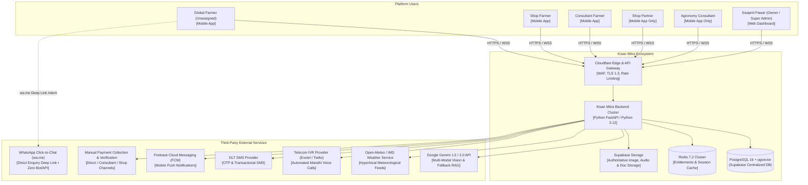

### 2.2 C4 Level 2: Container Architecture Diagram

```mermaid
graph LR
    subgraph MobileContainer ["Mobile Client Application (React Native / Expo)"]
        NavRouter["Role-Based Navigation Router"]
        FarmerUI["Farmer Views (Multi-Plot, Today's Guidance, Ask Photo/Voice)"]
        ShopUI["Shop Partner Views (Assigned Farmers, Direct Chat, Read-Only AI View)"]
        ConsultantUI["Consultant Views (Prescriptions, Direct Chat, Read-Only AI View)"]
        OfflineSync["SQLite Offline Cache & Storage (WatermelonDB)"]
        NavRouter --> FarmerUI
        NavRouter --> ShopUI
        NavRouter --> ConsultantUI
    end

    subgraph WebContainer ["Owner Web Dashboard (Next.js 14 / React)"]
        AdminUI["Super Admin Management Console"]
        GlobalFarmerConsole["Global Farmers Profile Console"]
        ShopConsole["Shop Management Desk (Schedule/KB/Farmers)"]
        ConsultantConsole["Consultant Management Desk (Schedule/KB/Farms)"]
        ScheduleFilesManager["Independent Schedule File Ingestion Desk"]
        IVRConsole["Automated Voice Calling (IVR) Monitor"]
        KBConsole["Global & Entity-Specific Knowledge CMS"]
        ApprovalQueue["Schedule & Dosage Verification Queue"]
        AITelemetryDesk["AI Grounded & Fallback Telemetry"]
    end

    subgraph BackendContainer ["FastAPI Backend Services"]
        AuthSvc["Auth & Session Service"]
        EntitleSvc["Central Entitlement Service"]
        SubEngine["One-Year Subscription Engine"]
        IndependentScheduleSvc["Independent Schedule Engine (9-Step Pipeline)"]
        MultiPlotSvc["Multiple Vineyard Plot Service"]
        IVRCallingSvc["Automated Voice Calling Service (1-Call/Day)"]
        WeatherSvc["Hyperlocal Weather & Rain Alert Service"]
        MasterKBSvc["Central Master & Global KB Service"]
        ConsultantKBSvc["Consultant & Shop Isolated KB Service"]
        DocPipeline["16-Step OCR & Extraction Worker"]
        RAGSvc["Multi-Tier RAG Engine (~95% Grounded)"]
        ConflictResolver["Agronomic Safety & Conflict Arbiter"]
        GeminiFallback["Gemini API Fallback Service (~5-10%)"]
        VisionSvc["Crop Disease Vision Pipeline (5/day)"]
        MedicineSvc["Medicine Information Directory Service"]
        RelSvc["Farmer Relationship Service (Consultant Priority)"]
        DirectChatSvc["Direct In-App Chat Realtime Service"]
        AIVisibilitySvc["Shared AI Chat View-Only Projection Service"]
        TelemetrySvc["AI Quality & Cost Telemetry Service"]
    end

    MobileContainer -->|REST / JSON / WSS| BackendContainer
    WebContainer -->|REST / JSON / WSS| BackendContainer
```

---

## 3. Technology Stack Evaluation & Recommendations

| Layer | Selected Technology | Alternative Evaluated | Justification & Rationale |
| :--- | :--- | :--- | :--- |
| **Mobile Client** | **React Native (Expo SDK 51+)** | Flutter, Native Android (Kotlin) | Single codebase for Android/iOS; Expo EAS provides streamlined OTA updates; immense ecosystem for camera, SQLite offline persistence, and low-end Android performance. |
| **Web Dashboard** | **Next.js 14 (App Router) + TailwindCSS** | Vite + React SPA, Django Admin | Server-side rendering (SSR) for blazing desktop admin performance; enterprise data tables (TanStack Table); native TypeScript support; direct API re-use. |
| **Backend API** | **Python 3.12 + FastAPI + Pydantic v2** | Node.js (NestJS), Go (Golang) | First-class AI/ML compatibility (NumPy, pgvector, LangChain/LlamaIndex primitives); async ASGI architecture handling 15,000+ rps; native type safety. |
| **Primary Database** | **PostgreSQL 16 + pgvector (Supabase Managed)** | MongoDB, MySQL, Pinecone | Relational integrity for complex subscriptions and multi-role relationships coupled with native vector indexing (`HNSW`) in a single ACID engine. Eliminates external vector DB costs. |
| **Caching & Fast KV** | **Redis 7.2 (Upstash / AWS ElastiCache)** | Memcached, In-Memory Dict | Sub-millisecond entitlement lookups, distributed rate-limiting tokens, OTP session storage, and semantic vector query cache. |
| **Generative AI** | **Google Gemini 1.5 Pro / Flash & Text-Embedding-004** | OpenAI GPT-4o, Anthropic Claude 3.5 | Superior Marathi linguistic fidelity; native 1M+ token context window; high-speed vision processing for leaf diagnostics; extremely competitive cost per 1M tokens. |
| **Centralized Storage Platform** | **Supabase Storage (Built-in S3-Compatible Engine)** | Cloudflare R2, AWS S3 | Supabase serves as the single authoritative data platform for all files, documents, and crop diagnostic images. Direct integration with PostgreSQL RLS and signed URL access eliminates external storage sources of truth. |
| **Push Notifications** | **Firebase Cloud Messaging (FCM)** | OneSignal, Pusher | Direct Android OS push channel integration with native support for high-priority background data alerts. |
| **SMS Gateway** | **DLT Compliant Gateway (MSG91 / Firebase Auth)** | Twilio, Textlocal | Indian TRAI/DLT regulations mandate registered Marathi sender IDs and templates. Firebase Auth for rapid MVP, MSG91 for production scale. |

---

## 4. Mobile Client Architecture

### 4.1 Modular Project Layout
```
kisan-mitra-mobile/
├── assets/                  # High-DPI icons, vector illustrations, localized fonts
│   └── fonts/NotoSansMarathi/
├── src/
│   ├── app/                 # Expo Router file-based routing
│   │   ├── (auth)/          # OTP, mobile login, language selector
│   │   ├── (farmer)/        # Free & Pro farmer screens
│   │   ├── (shop)/          # Shop partner management views
│   │   ├── (consultant)/    # Agronomist farm supervision views
│   │   └── _layout.tsx      # Root layout & dynamic role switcher
│   ├── components/          # Design system atomics (Cards, Buttons, Modals)
│   ├── context/             # AuthContext, EntitlementContext, LanguageContext
│   ├── hooks/               # useWeather, useCropStage, useEntitlement
│   ├── services/            # Axios API client with interceptors
│   │   ├── api.ts
│   │   ├── offlineStorage.ts (WatermelonDB / SQLite)
│   │   └── notificationService.ts
│   └── types/               # TypeScript definitions across all models
```

### 4.2 Dynamic Role-Based Navigation Routing
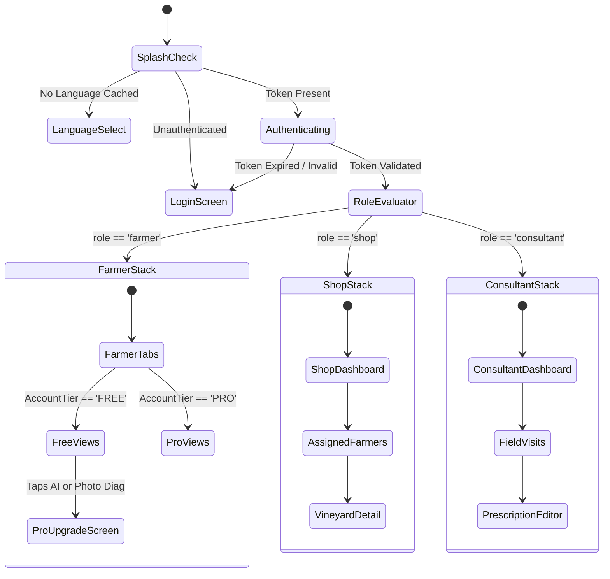

---

## 5. Backend Architecture & Service Design

### 5.1 Layered Clean Architecture
```
┌────────────────────────────────────────────────────────────────────────┐
│                        PRESENTATION / API LAYER                        │
│ FastAPI Routers • Request Validation (Pydantic) • Response Serializers │
└───────────────────────────────────┬────────────────────────────────────┘
                                    │
┌───────────────────────────────────▼────────────────────────────────────┐
│                    MIDDLEWARE & SECURITY GATEWAY                       │
│  JWT Verification • Role & Entitlement Guards • Rate Limiting • CORS  │
└───────────────────────────────────┬────────────────────────────────────┘
                                    │
┌───────────────────────────────────▼────────────────────────────────────┐
│                            SERVICE LAYER                               │
│  • SubscriptionEngine    • KnowledgeRAGService    • CropStageEngine    │
│  • EntitlementService    • PhotoVisionService     • DailyPlannerService│
│  • RelationshipService   • WeatherService         • AuditLogService    │
└───────────────────────────────────┬────────────────────────────────────┘
                                    │
┌───────────────────────────────────▼────────────────────────────────────┐
│                        DATA ACCESS & REPOSITORIES                      │
│ SQLAlchemy 2.0 Async Repositories • pgvector Queries • Supabase Client │
└───────────────────────────────────┬────────────────────────────────────┘
                                    │
┌───────────────────────────────────▼────────────────────────────────────┐
│                   PERSISTENCE & EXTERNAL INFRASTRUCTURE                │
│  Supabase PostgreSQL 16 (Relational + Vectors) • Redis 7.2 • Supabase Storage │
└────────────────────────────────────────────────────────────────────────┘
```

---

## 6. Comprehensive Database Architecture (PostgreSQL 16)

The schema consists of 48 normalized, indexed, and constrained tables, documented in 35 numbered groups in Section 6.1 (several groups define more than one table). The diagram below shows the core entities only. Vector embeddings are stored in the `knowledge_chunks.embedding` column (`vector(768)`), not in a separate table.

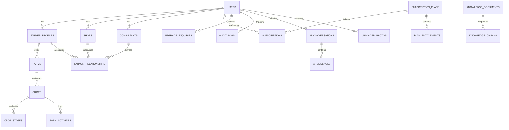

### 6.1 Data Dictionary & Table Specifications

#### 1. `users` (Central Identity Table)
```sql
CREATE TYPE user_role_enum AS ENUM ('farmer', 'shop', 'consultant', 'admin', 'super_admin');
CREATE TYPE account_tier_enum AS ENUM ('free', 'pro');

CREATE TABLE users (
    id UUID PRIMARY KEY DEFAULT gen_random_uuid(),
    mobile_number VARCHAR(15) UNIQUE NOT NULL,
    country_code VARCHAR(5) DEFAULT '+91' NOT NULL,
    role user_role_enum DEFAULT 'farmer' NOT NULL,
    account_tier account_tier_enum DEFAULT 'free' NOT NULL,
    is_active BOOLEAN DEFAULT TRUE NOT NULL,
    is_verified BOOLEAN DEFAULT FALSE NOT NULL,
    last_login_at TIMESTAMPTZ,
    created_at TIMESTAMPTZ DEFAULT CURRENT_TIMESTAMP NOT NULL,
    updated_at TIMESTAMPTZ DEFAULT CURRENT_TIMESTAMP NOT NULL
);
CREATE INDEX idx_users_mobile ON users(mobile_number);
CREATE INDEX idx_users_role_tier ON users(role, account_tier);
```

#### 2. `farmer_profiles`
```sql
CREATE TABLE farmer_profiles (
    id UUID PRIMARY KEY DEFAULT gen_random_uuid(),
    user_id UUID UNIQUE REFERENCES users(id) ON DELETE CASCADE NOT NULL,
    farmer_code VARCHAR(30) UNIQUE NOT NULL, -- e.g., KM-F-2026-0001
    full_name VARCHAR(150) NOT NULL,
    preferred_language VARCHAR(10) DEFAULT 'mr' NOT NULL,
    village VARCHAR(100) NOT NULL,
    taluka VARCHAR(100) NOT NULL,
    district VARCHAR(100) NOT NULL,
    state VARCHAR(100) DEFAULT 'Maharashtra' NOT NULL,
    pincode VARCHAR(10),
    latitude NUMERIC(9,6),
    longitude NUMERIC(9,6),
    profile_photo_url TEXT,
    created_at TIMESTAMPTZ DEFAULT CURRENT_TIMESTAMP NOT NULL,
    updated_at TIMESTAMPTZ DEFAULT CURRENT_TIMESTAMP NOT NULL
);
CREATE INDEX idx_farmer_location ON farmer_profiles(district, taluka, village);
```

#### 3. `farms` (Vineyard Plots – Pro Multi-Plot & Primary Plot Architecture)
> **Access Rule:** Free tier farmers cannot register plots (`farms` table access is strictly gated to active Pro subscriptions). Plot records can be created or updated by: (1) Farmer (`SCR-PLT-00`, `SCR-SET-03`), (2) Linked Consultant, (3) Linked Shop, or (4) Super Admin. Every partner/admin modification creates an immutable entry in `audit_logs` and dispatches an in-app push notification to the farmer. Partners have NO permission to delete plots.
```sql
CREATE TABLE farms (
    id UUID PRIMARY KEY DEFAULT gen_random_uuid(),
    farmer_id UUID REFERENCES farmer_profiles(id) ON DELETE CASCADE NOT NULL,
    plot_index INT DEFAULT 1 NOT NULL, -- Sequential plot number (1, 2, 3...)
    plot_name VARCHAR(100) NOT NULL, -- e.g., 'प्लॉट १ - विठ्ठल बाग', 'प्लॉट २ - कालवा रस्ता'
    total_area_acres NUMERIC(6,2) NOT NULL,
    survey_number VARCHAR(50),
    latitude NUMERIC(9,6), -- Plot-specific GPS coordinate (confirmed with farmer consent)
    longitude NUMERIC(9,6),
    gps_accuracy_meters NUMERIC(5,2),
    is_gps_verified BOOLEAN DEFAULT FALSE NOT NULL,
    is_primary_plot BOOLEAN DEFAULT FALSE NOT NULL, -- Unified Primary Plot: drives both phenological schedule & single automated daily voice call
    soil_type VARCHAR(50), -- e.g., Medium Black, Light Loam, Heavy Clay
    water_source VARCHAR(50), -- e.g., Well, Borewell, Canal, Drip Farm Pond
    created_by_user_id UUID REFERENCES users(id), -- Tracks whether added by farmer, shop, consultant, or admin
    created_at TIMESTAMPTZ DEFAULT CURRENT_TIMESTAMP NOT NULL,
    updated_at TIMESTAMPTZ DEFAULT CURRENT_TIMESTAMP NOT NULL
);
CREATE INDEX idx_farms_farmer ON farms(farmer_id);
-- Ensure at most ONE Primary Plot per farmer at any given time (ironclad partial index)
CREATE UNIQUE INDEX idx_single_primary_plot ON farms(farmer_id) WHERE is_primary_plot = TRUE;
```

#### 4. `crops` (Viticulture Planting & Cycle Master)
```sql
CREATE TYPE pruning_type_enum AS ENUM ('foundation', 'fruit');

CREATE TABLE crops (
    id UUID PRIMARY KEY DEFAULT gen_random_uuid(),
    farm_id UUID REFERENCES farms(id) ON DELETE CASCADE NOT NULL,
    crop_name VARCHAR(50) DEFAULT 'Grape' NOT NULL,
    crop_variety VARCHAR(50) NOT NULL, -- e.g., Super Sonaka, Thompson Seedless
    rootstock VARCHAR(50), -- e.g., Dog Ridge, Salt Creek, 110R
    vine_spacing VARCHAR(20), -- e.g., 9x5, 8x4
    vine_age_years INT,
    pruning_type pruning_type_enum NOT NULL,
    pruning_date DATE NOT NULL,
    is_active_cycle BOOLEAN DEFAULT TRUE NOT NULL,
    created_at TIMESTAMPTZ DEFAULT CURRENT_TIMESTAMP NOT NULL,
    updated_at TIMESTAMPTZ DEFAULT CURRENT_TIMESTAMP NOT NULL
);
CREATE INDEX idx_crops_farm_active ON crops(farm_id, is_active_cycle);
```

#### 5. `crop_stages` (Phenological Milestone Records)
```sql
CREATE TABLE crop_stages (
    id UUID PRIMARY KEY DEFAULT gen_random_uuid(),
    crop_id UUID REFERENCES crops(id) ON DELETE CASCADE NOT NULL,
    stage_name_marathi VARCHAR(100) NOT NULL, -- e.g., मणी सेटिंग (Berry Set)
    stage_name_english VARCHAR(100) NOT NULL,
    day_start INT NOT NULL,
    day_end INT NOT NULL,
    calculated_stage_date DATE NOT NULL,
    is_current_stage BOOLEAN DEFAULT FALSE NOT NULL,
    advisory_summary TEXT,
    created_at TIMESTAMPTZ DEFAULT CURRENT_TIMESTAMP NOT NULL
);
CREATE INDEX idx_crop_stages_current ON crop_stages(crop_id, is_current_stage);
```

#### 6. `farm_activities` (Dynamic Planner Tasks & Logs)
```sql
CREATE TYPE activity_status_enum AS ENUM ('pending', 'completed', 'skipped', 'rescheduled');
CREATE TYPE activity_type_enum AS ENUM ('spray', 'fertigation', 'irrigation', 'canopy_management', 'soil_work');

CREATE TABLE farm_activities (
    id UUID PRIMARY KEY DEFAULT gen_random_uuid(),
    crop_id UUID REFERENCES crops(id) ON DELETE CASCADE NOT NULL,
    activity_type activity_type_enum NOT NULL,
    title_marathi VARCHAR(200) NOT NULL,
    title_english VARCHAR(200) NOT NULL,
    description TEXT,
    recommended_date DATE NOT NULL,
    executed_date DATE,
    status activity_status_enum DEFAULT 'pending' NOT NULL,
    chemical_technical_names TEXT,
    dosage_per_acre VARCHAR(100),
    phi_days INT,
    created_at TIMESTAMPTZ DEFAULT CURRENT_TIMESTAMP NOT NULL,
    updated_at TIMESTAMPTZ DEFAULT CURRENT_TIMESTAMP NOT NULL
);
CREATE INDEX idx_farm_activities_date ON farm_activities(crop_id, recommended_date, status);
```

#### 7. `subscription_plans`
```sql
CREATE TABLE subscription_plans (
    id UUID PRIMARY KEY DEFAULT gen_random_uuid(),
    plan_code VARCHAR(50) UNIQUE NOT NULL, -- e.g., PLAN_FARMER_PRO_1Y
    plan_name VARCHAR(100) NOT NULL,
    target_role user_role_enum NOT NULL,
    validity_duration_months INT DEFAULT 12 NOT NULL,
    internal_notes TEXT, -- Internal notes only; no public pricing displayed
    is_active BOOLEAN DEFAULT TRUE NOT NULL,
    description TEXT,
    created_at TIMESTAMPTZ DEFAULT CURRENT_TIMESTAMP NOT NULL
);
```

#### 8. `plan_entitlements`
```sql
CREATE TABLE plan_entitlements (
    id UUID PRIMARY KEY DEFAULT gen_random_uuid(),
    plan_id UUID REFERENCES subscription_plans(id) ON DELETE CASCADE NOT NULL,
    feature_key VARCHAR(50) NOT NULL, -- e.g., 'ai_chat', 'photo_diagnosis', 'daily_planner'
    is_enabled BOOLEAN DEFAULT TRUE NOT NULL,
    daily_quota_limit INT DEFAULT NULL, -- NULL = Unlimited, Integer = daily cap
    created_at TIMESTAMPTZ DEFAULT CURRENT_TIMESTAMP NOT NULL
);
CREATE UNIQUE INDEX uq_plan_feature ON plan_entitlements(plan_id, feature_key);
```

#### 9. `subscriptions` (The 1-Year Validity Record)
```sql
CREATE TYPE subscription_status_enum AS ENUM ('pending', 'active', 'expiring_soon', 'expired', 'suspended', 'cancelled');
CREATE TYPE payment_classification_enum AS ENUM ('paid', 'pending', 'complimentary', 'admin_override');

CREATE TABLE subscriptions (
    id UUID PRIMARY KEY DEFAULT gen_random_uuid(),
    user_id UUID REFERENCES users(id) ON DELETE CASCADE NOT NULL,
    plan_id UUID REFERENCES subscription_plans(id) NOT NULL,
    subscription_code VARCHAR(40) UNIQUE NOT NULL, -- e.g., KM-SUB-2026-9042
    status subscription_status_enum DEFAULT 'pending' NOT NULL,
    payment_status payment_classification_enum DEFAULT 'pending' NOT NULL,
    activation_date TIMESTAMPTZ NOT NULL,
    expiry_date TIMESTAMPTZ NOT NULL, -- Strict 1 Calendar Year Anniversary
    payment_reference VARCHAR(100),
    activated_by UUID REFERENCES users(id), -- Admin User ID
    admin_notes TEXT,
    created_at TIMESTAMPTZ DEFAULT CURRENT_TIMESTAMP NOT NULL,
    updated_at TIMESTAMPTZ DEFAULT CURRENT_TIMESTAMP NOT NULL
);
CREATE INDEX idx_subscriptions_user_status ON subscriptions(user_id, status);
CREATE INDEX idx_subscriptions_expiry ON subscriptions(expiry_date, status);
```

#### 10. `upgrade_enquiries` (Owner-Assisted Lead Engine)
```sql
CREATE TYPE enquiry_status_enum AS ENUM (
    'NEW', 'CONTACTED', 'PRO_DETAILS_SHARED', 'INTERESTED', 'CONVERTED', 'NOT_INTERESTED', 'CLOSED'
);

CREATE TABLE upgrade_enquiries (
    id UUID PRIMARY KEY DEFAULT gen_random_uuid(),
    enquiry_code VARCHAR(40) UNIQUE NOT NULL, -- e.g., ENQ-20261120-004
    user_id UUID REFERENCES users(id) ON DELETE CASCADE NOT NULL,
    farmer_name VARCHAR(150) NOT NULL,
    mobile_number VARCHAR(15) NOT NULL,
    farmer_code VARCHAR(30) NOT NULL,
    preferred_crop VARCHAR(50) DEFAULT 'Grape',
    acreage NUMERIC(6,2),
    location_summary VARCHAR(255),
    message_content TEXT NOT NULL,
    status enquiry_status_enum DEFAULT 'NEW' NOT NULL,
    owner_notes TEXT,
    contacted_at TIMESTAMPTZ,
    converted_at TIMESTAMPTZ,
    created_at TIMESTAMPTZ DEFAULT CURRENT_TIMESTAMP NOT NULL,
    updated_at TIMESTAMPTZ DEFAULT CURRENT_TIMESTAMP NOT NULL
);
CREATE INDEX idx_enquiries_status ON upgrade_enquiries(status, created_at DESC);
```

#### 11. `pending_pro_activations` (Direct Admin Invites for Unregistered Numbers)
```sql
CREATE TABLE pending_pro_activations (
    id UUID PRIMARY KEY DEFAULT gen_random_uuid(),
    mobile_number VARCHAR(15) UNIQUE NOT NULL,
    plan_id UUID REFERENCES subscription_plans(id) NOT NULL,
    payment_status payment_classification_enum DEFAULT 'complimentary' NOT NULL,
    payment_reference VARCHAR(100),
    admin_notes TEXT,
    activated_by UUID REFERENCES users(id) NOT NULL,
    is_claimed BOOLEAN DEFAULT FALSE NOT NULL,
    claimed_user_id UUID REFERENCES users(id),
    claimed_at TIMESTAMPTZ,
    created_at TIMESTAMPTZ DEFAULT CURRENT_TIMESTAMP NOT NULL
);
CREATE INDEX idx_pending_activations_mobile ON pending_pro_activations(mobile_number, is_claimed);
```

#### 12. `knowledge_documents` & `knowledge_chunks` (RAG Engine)
```sql
CREATE EXTENSION IF NOT EXISTS vector;

CREATE TABLE knowledge_documents (
    id UUID PRIMARY KEY DEFAULT gen_random_uuid(),
    title VARCHAR(255) NOT NULL,
    source_agency VARCHAR(100) NOT NULL, -- e.g., 'NRCG Pune', 'MPKV Rahuri'
    category VARCHAR(50) NOT NULL, -- 'disease', 'nutrition', 'pruning', 'irrigation'
    language VARCHAR(10) DEFAULT 'mr' NOT NULL,
    document_hash VARCHAR(64) UNIQUE NOT NULL,
    is_published BOOLEAN DEFAULT TRUE NOT NULL,
    created_at TIMESTAMPTZ DEFAULT CURRENT_TIMESTAMP NOT NULL
);

CREATE TABLE knowledge_chunks (
    id UUID PRIMARY KEY DEFAULT gen_random_uuid(),
    document_id UUID REFERENCES knowledge_documents(id) ON DELETE CASCADE NOT NULL,
    chunk_index INT NOT NULL,
    chunk_text TEXT NOT NULL,
    token_count INT NOT NULL,
    stage_tags TEXT[], -- array of phenological stages
    variety_tags TEXT[],
    disease_tags TEXT[],
    embedding vector(768) NOT NULL, -- text-embedding-004
    created_at TIMESTAMPTZ DEFAULT CURRENT_TIMESTAMP NOT NULL
);
CREATE INDEX idx_chunks_vector_hnsw ON knowledge_chunks USING hnsw (embedding vector_cosine_ops);
```

#### 13. `ai_conversations` & `ai_messages`
```sql
CREATE TABLE ai_conversations (
    id UUID PRIMARY KEY DEFAULT gen_random_uuid(),
    user_id UUID REFERENCES users(id) ON DELETE CASCADE NOT NULL,
    crop_id UUID REFERENCES crops(id),
    title VARCHAR(150),
    is_active BOOLEAN DEFAULT TRUE NOT NULL,
    created_at TIMESTAMPTZ DEFAULT CURRENT_TIMESTAMP NOT NULL
);

CREATE TABLE ai_messages (
    id UUID PRIMARY KEY DEFAULT gen_random_uuid(),
    conversation_id UUID REFERENCES ai_conversations(id) ON DELETE CASCADE NOT NULL,
    sender_type VARCHAR(10) NOT NULL, -- 'user', 'assistant', 'system'
    message_text TEXT NOT NULL,
    was_rag_used BOOLEAN DEFAULT FALSE,
    retrieval_confidence NUMERIC(4,3),
    was_gemini_fallback BOOLEAN DEFAULT FALSE,
    token_cost INT,
    created_at TIMESTAMPTZ DEFAULT CURRENT_TIMESTAMP NOT NULL
);
CREATE INDEX idx_ai_messages_convo ON ai_messages(conversation_id, created_at ASC);
```

#### 14. `uploaded_photos` (AI Vision Analysis Records)
```sql
CREATE TABLE uploaded_photos (
    id UUID PRIMARY KEY DEFAULT gen_random_uuid(),
    user_id UUID REFERENCES users(id) ON DELETE CASCADE NOT NULL,
    crop_id UUID REFERENCES crops(id),
    storage_path TEXT NOT NULL,
    mime_type VARCHAR(50) NOT NULL,
    file_size_bytes INT NOT NULL,
    detected_disease_marathi VARCHAR(100),
    detected_disease_english VARCHAR(100),
    confidence_score NUMERIC(4,3),
    severity_level VARCHAR(20),
    recommended_treatment TEXT,
    phi_precaution TEXT,
    created_at TIMESTAMPTZ DEFAULT CURRENT_TIMESTAMP NOT NULL
);
CREATE INDEX idx_photos_user ON uploaded_photos(user_id, created_at DESC);
```

#### 15. `shops` & `consultants`
```sql
CREATE TYPE partner_authorization_status AS ENUM ('pending_approval', 'approved', 'suspended', 'revoked');
CREATE TYPE partner_subscription_status AS ENUM ('inactive', 'active', 'expiring_soon', 'expired', 'suspended');

CREATE TABLE shops (
    id UUID PRIMARY KEY DEFAULT gen_random_uuid(),
    user_id UUID UNIQUE REFERENCES users(id) ON DELETE CASCADE NOT NULL,
    shop_code VARCHAR(30) UNIQUE NOT NULL, -- KM-S-001
    business_name VARCHAR(150) NOT NULL,
    license_number VARCHAR(100),
    village VARCHAR(100) NOT NULL,
    taluka VARCHAR(100) NOT NULL,
    district VARCHAR(100) NOT NULL,
    contact_phone VARCHAR(15) NOT NULL,
    independent_schedule_id UUID, -- References schedule_configurations(id) for Shop-specific Schedule
    authorization_status partner_authorization_status DEFAULT 'pending_approval' NOT NULL,
    approved_by UUID REFERENCES users(id),
    approved_at TIMESTAMPTZ,
    password_hash VARCHAR(255), -- Securely hashed authorized credentials provisioned by admin
    annual_subscription_status partner_subscription_status DEFAULT 'inactive' NOT NULL,
    subscription_activation_date TIMESTAMPTZ,
    subscription_expiry_date TIMESTAMPTZ,
    created_at TIMESTAMPTZ DEFAULT CURRENT_TIMESTAMP NOT NULL,
    updated_at TIMESTAMPTZ DEFAULT CURRENT_TIMESTAMP NOT NULL
);
-- Note: When annual_subscription_status becomes 'expired', dashboard access is suspended
-- but all assigned farmer links and activity records remain permanently preserved in Supabase.

CREATE TABLE consultants (
    id UUID PRIMARY KEY DEFAULT gen_random_uuid(),
    user_id UUID UNIQUE REFERENCES users(id) ON DELETE CASCADE NOT NULL,
    consultant_code VARCHAR(30) UNIQUE NOT NULL, -- KM-C-001
    full_name VARCHAR(150) NOT NULL,
    qualification VARCHAR(100),
    specialization VARCHAR(100) DEFAULT 'Grape Viticulture',
    assigned_region VARCHAR(100) NOT NULL,
    independent_schedule_id UUID, -- References schedule_configurations(id) for Consultant-specific Schedule
    authorization_status partner_authorization_status DEFAULT 'pending_approval' NOT NULL,
    approved_by UUID REFERENCES users(id),
    approved_at TIMESTAMPTZ,
    password_hash VARCHAR(255), -- Securely hashed authorized credentials provisioned by admin
    annual_subscription_status partner_subscription_status DEFAULT 'inactive' NOT NULL,
    subscription_activation_date TIMESTAMPTZ,
    subscription_expiry_date TIMESTAMPTZ,
    created_at TIMESTAMPTZ DEFAULT CURRENT_TIMESTAMP NOT NULL,
    updated_at TIMESTAMPTZ DEFAULT CURRENT_TIMESTAMP NOT NULL
);
-- Note: When annual_subscription_status becomes 'expired', consultant dashboard access is suspended
-- but all supervised farm links, observation logs, and prescriptions remain permanently preserved in Supabase.
```

#### 16. `farmer_relationships` (Tenant & Association Security)
```sql
CREATE TYPE relationship_type_enum AS ENUM ('shop_farmer', 'consultant_farmer');
CREATE TYPE relationship_status_enum AS ENUM ('active', 'suspended', 'terminated', 'unlinked_by_priority', 'unlinked_by_admin');

CREATE TABLE farmer_relationships (
    id UUID PRIMARY KEY DEFAULT gen_random_uuid(),
    farmer_id UUID REFERENCES farmer_profiles(id) ON DELETE CASCADE NOT NULL,
    shop_id UUID REFERENCES shops(id),
    consultant_id UUID REFERENCES consultants(id),
    relationship_type relationship_type_enum NOT NULL,
    status relationship_status_enum DEFAULT 'active' NOT NULL,
    can_view_crop_stage BOOLEAN DEFAULT TRUE NOT NULL,
    can_view_planner BOOLEAN DEFAULT TRUE NOT NULL,
    can_view_prescriptions BOOLEAN DEFAULT TRUE NOT NULL,
    assigned_by UUID REFERENCES users(id) NOT NULL,
    unlinked_at TIMESTAMPTZ,
    unlinked_reason VARCHAR(100), -- 'consultant_priority_override', 'admin_correction', 'voluntary_termination'
    unlinked_by UUID REFERENCES users(id),
    created_at TIMESTAMPTZ DEFAULT CURRENT_TIMESTAMP NOT NULL,
    updated_at TIMESTAMPTZ DEFAULT CURRENT_TIMESTAMP NOT NULL,
    CONSTRAINT chk_rel_party CHECK (
        (relationship_type = 'shop_farmer' AND shop_id IS NOT NULL AND consultant_id IS NULL) OR
        (relationship_type = 'consultant_farmer' AND consultant_id IS NOT NULL AND shop_id IS NULL)
    )
);
CREATE INDEX idx_rel_farmer ON farmer_relationships(farmer_id, status);
CREATE INDEX idx_rel_shop ON farmer_relationships(shop_id, status);
CREATE INDEX idx_rel_consultant ON farmer_relationships(consultant_id, status);
-- Enforce at most ONE active relationship per farmer across the platform.
-- When a consultant is added, the active shop link transitions to 'unlinked_by_priority'
CREATE UNIQUE INDEX idx_single_active_rel ON farmer_relationships(farmer_id) WHERE status = 'active';
```

#### 17. `audit_logs`
```sql
CREATE TABLE audit_logs (
    id UUID PRIMARY KEY DEFAULT gen_random_uuid(),
    actor_user_id UUID REFERENCES users(id),
    action VARCHAR(100) NOT NULL, -- e.g., 'DIRECT_PRO_ACTIVATION', 'RELATIONSHIP_CREATED'
    target_entity VARCHAR(50) NOT NULL,
    target_id UUID NOT NULL,
    ip_address INET,
    user_agent TEXT,
    old_state JSONB,
    new_state JSONB,
    created_at TIMESTAMPTZ DEFAULT CURRENT_TIMESTAMP NOT NULL
);
CREATE INDEX idx_audit_target ON audit_logs(target_entity, target_id, created_at DESC);
```

#### 18. `daily_usage_records` (Quota Enforcement)
```sql
CREATE TABLE daily_usage_records (
    id UUID PRIMARY KEY DEFAULT gen_random_uuid(),
    user_id UUID REFERENCES users(id) ON DELETE CASCADE NOT NULL,
    usage_date DATE NOT NULL,
    ai_chat_queries_count INT DEFAULT 0 NOT NULL,
    photo_diagnoses_count INT DEFAULT 0 NOT NULL,
    updated_at TIMESTAMPTZ DEFAULT CURRENT_TIMESTAMP NOT NULL,
    CONSTRAINT uq_user_date UNIQUE (user_id, usage_date)
);
CREATE INDEX idx_usage_user_date ON daily_usage_records(user_id, usage_date);
```

#### 19. `master_knowledge_documents` & `consultant_knowledge_documents`
```sql
CREATE TYPE kb_document_type AS ENUM ('pdf', 'doc', 'docx', 'spreadsheet', 'text');
CREATE TYPE kb_pipeline_status AS ENUM (
    'UPLOADED', 'PROCESSING', 'EXTRACTION_FAILED', 'REVIEW_REQUIRED', 
    'PENDING_APPROVAL', 'APPROVED', 'INDEXED', 'ARCHIVED', 'REJECTED'
);

-- Central Master Knowledge Base (Owner/Admin Governed)
CREATE TABLE master_knowledge_documents (
    id UUID PRIMARY KEY DEFAULT gen_random_uuid(),
    title VARCHAR(255) NOT NULL,
    source_agency VARCHAR(150) NOT NULL, -- e.g., 'NRCG Pune', 'MPKV Rahuri', 'CIB-RC'
    category VARCHAR(100) NOT NULL, -- 'pop_guidelines', 'disease_management', 'pesticide_registry'
    doc_type kb_document_type NOT NULL,
    storage_path TEXT NOT NULL, -- Supabase Storage: 'master-knowledge-docs/...'
    file_hash_sha256 VARCHAR(64) UNIQUE NOT NULL,
    current_version INT DEFAULT 1 NOT NULL,
    status kb_pipeline_status DEFAULT 'UPLOADED' NOT NULL,
    uploaded_by UUID REFERENCES users(id) NOT NULL,
    is_active BOOLEAN DEFAULT TRUE NOT NULL,
    created_at TIMESTAMPTZ DEFAULT CURRENT_TIMESTAMP NOT NULL,
    updated_at TIMESTAMPTZ DEFAULT CURRENT_TIMESTAMP NOT NULL
);
CREATE INDEX idx_master_docs_status ON master_knowledge_documents(status, is_active);

-- Consultant-Specific Knowledge Base (Strict Tenant-Isolated Repositories)
CREATE TABLE consultant_knowledge_documents (
    id UUID PRIMARY KEY DEFAULT gen_random_uuid(),
    consultant_id UUID REFERENCES consultants(id) ON DELETE CASCADE NOT NULL,
    title VARCHAR(255) NOT NULL,
    category VARCHAR(100) NOT NULL, -- 'custom_fertigation', 'spray_program', 'observation_guide'
    doc_type kb_document_type NOT NULL,
    storage_path TEXT NOT NULL, -- Supabase Storage: 'consultant-knowledge-docs/{consultant_id}/...'
    file_hash_sha256 VARCHAR(64) NOT NULL,
    current_version INT DEFAULT 1 NOT NULL,
    status kb_pipeline_status DEFAULT 'UPLOADED' NOT NULL,
    uploaded_by UUID REFERENCES users(id) NOT NULL, -- Admin User ID
    is_active BOOLEAN DEFAULT TRUE NOT NULL,
    created_at TIMESTAMPTZ DEFAULT CURRENT_TIMESTAMP NOT NULL,
    updated_at TIMESTAMPTZ DEFAULT CURRENT_TIMESTAMP NOT NULL,
    CONSTRAINT uq_consultant_doc_hash UNIQUE (consultant_id, file_hash_sha256)
);
CREATE INDEX idx_consultant_docs_tenant ON consultant_knowledge_documents(consultant_id, status);
```

#### 20. `knowledge_document_versions` & `knowledge_approval_records`
```sql
CREATE TABLE knowledge_document_versions (
    id UUID PRIMARY KEY DEFAULT gen_random_uuid(),
    master_doc_id UUID REFERENCES master_knowledge_documents(id) ON DELETE CASCADE,
    consultant_doc_id UUID REFERENCES consultant_knowledge_documents(id) ON DELETE CASCADE,
    version_number INT NOT NULL,
    storage_path TEXT NOT NULL,
    change_summary TEXT,
    created_by UUID REFERENCES users(id) NOT NULL,
    created_at TIMESTAMPTZ DEFAULT CURRENT_TIMESTAMP NOT NULL,
    CONSTRAINT chk_doc_parent CHECK (
        (master_doc_id IS NOT NULL AND consultant_doc_id IS NULL) OR
        (master_doc_id IS NULL AND consultant_doc_id IS NOT NULL)
    )
);

CREATE TABLE knowledge_approval_records (
    id UUID PRIMARY KEY DEFAULT gen_random_uuid(),
    master_doc_id UUID REFERENCES master_knowledge_documents(id) ON DELETE CASCADE,
    consultant_doc_id UUID REFERENCES consultant_knowledge_documents(id) ON DELETE CASCADE,
    reviewed_by UUID REFERENCES users(id) NOT NULL, -- Admin User ID
    decision VARCHAR(20) NOT NULL, -- 'APPROVED', 'REJECTED', 'CHANGES_REQUESTED'
    reviewer_notes TEXT,
    dosage_review_passed BOOLEAN DEFAULT FALSE NOT NULL,
    unit_consistency_verified BOOLEAN DEFAULT FALSE NOT NULL,
    reviewed_at TIMESTAMPTZ DEFAULT CURRENT_TIMESTAMP NOT NULL
);
```

#### 21. `knowledge_processing_jobs` (16-Step Pipeline Execution Tracker)
```sql
CREATE TABLE knowledge_processing_jobs (
    id UUID PRIMARY KEY DEFAULT gen_random_uuid(),
    master_doc_id UUID REFERENCES master_knowledge_documents(id) ON DELETE CASCADE,
    consultant_doc_id UUID REFERENCES consultant_knowledge_documents(id) ON DELETE CASCADE,
    current_step_number INT DEFAULT 1 NOT NULL, -- 1 through 16
    current_step_name VARCHAR(100) NOT NULL, -- 'TEXT_EXTRACTION', 'OCR', 'DOSAGE_EXTRACTION'
    status kb_pipeline_status DEFAULT 'PROCESSING' NOT NULL,
    extracted_text_raw TEXT,
    structured_data_json JSONB,
    extracted_tables_json JSONB,
    total_tokens INT,
    total_chunks INT,
    error_message TEXT,
    retry_count INT DEFAULT 0 NOT NULL,
    created_at TIMESTAMPTZ DEFAULT CURRENT_TIMESTAMP NOT NULL,
    updated_at TIMESTAMPTZ DEFAULT CURRENT_TIMESTAMP NOT NULL
);
CREATE INDEX idx_jobs_status ON knowledge_processing_jobs(status, updated_at DESC);
```

#### 22. `personalized_farm_schedules`, `farm_schedule_items` & `schedule_revisions`
```sql
CREATE TYPE schedule_item_status AS ENUM ('planned', 'completed', 'rescheduled', 'skipped');
CREATE TYPE application_method_enum AS ENUM ('foliar_spray', 'drip_irrigation', 'soil_drench', 'bunch_dip');

CREATE TABLE personalized_farm_schedules (
    id UUID PRIMARY KEY DEFAULT gen_random_uuid(),
    crop_id UUID REFERENCES crops(id) ON DELETE CASCADE NOT NULL,
    farmer_id UUID REFERENCES farmer_profiles(id) ON DELETE CASCADE NOT NULL,
    consultant_id UUID REFERENCES consultants(id), -- If assigned
    season_year INT NOT NULL,
    is_active BOOLEAN DEFAULT TRUE NOT NULL,
    generated_at TIMESTAMPTZ DEFAULT CURRENT_TIMESTAMP NOT NULL,
    updated_at TIMESTAMPTZ DEFAULT CURRENT_TIMESTAMP NOT NULL
);
CREATE INDEX idx_schedules_crop ON personalized_farm_schedules(crop_id, is_active);

CREATE TABLE farm_schedule_items (
    id UUID PRIMARY KEY DEFAULT gen_random_uuid(),
    schedule_id UUID REFERENCES personalized_farm_schedules(id) ON DELETE CASCADE NOT NULL,
    phenological_stage VARCHAR(100) NOT NULL, -- e.g., 'Berry Setting Stage (Day 35)'
    activity_date DATE NOT NULL,
    product_name VARCHAR(150) NOT NULL,
    active_composition VARCHAR(200) NOT NULL,
    approved_dosage_per_acre VARCHAR(100) NOT NULL,
    dosage_per_litre VARCHAR(50),
    application_method application_method_enum NOT NULL,
    plot_area_acres NUMERIC(6,2) NOT NULL,
    total_calculated_quantity VARCHAR(100), -- Calculated strictly when area & dosage exist
    estimated_cost_inr NUMERIC(10,2), -- Calculated strictly when reliable price data exists
    source_attribution VARCHAR(150) NOT NULL, -- 'NRCG POP 2026' or 'Prescribed by Consultant Dr. Deshmukh'
    status schedule_item_status DEFAULT 'planned' NOT NULL,
    notes TEXT,
    created_at TIMESTAMPTZ DEFAULT CURRENT_TIMESTAMP NOT NULL,
    updated_at TIMESTAMPTZ DEFAULT CURRENT_TIMESTAMP NOT NULL
);
CREATE INDEX idx_schedule_items_date ON farm_schedule_items(schedule_id, activity_date, status);

CREATE TABLE schedule_revisions (
    id UUID PRIMARY KEY DEFAULT gen_random_uuid(),
    schedule_item_id UUID REFERENCES farm_schedule_items(id) ON DELETE CASCADE NOT NULL,
    revised_by UUID REFERENCES users(id) NOT NULL,
    previous_state JSONB NOT NULL,
    new_state JSONB NOT NULL,
    revision_reason TEXT NOT NULL,
    created_at TIMESTAMPTZ DEFAULT CURRENT_TIMESTAMP NOT NULL
);
```

#### 23. `farm_observations` & `recommendation_sources`
```sql
CREATE TABLE farm_observations (
    id UUID PRIMARY KEY DEFAULT gen_random_uuid(),
    crop_id UUID REFERENCES crops(id) ON DELETE CASCADE NOT NULL,
    observed_by UUID REFERENCES users(id) NOT NULL, -- Farmer or Consultant
    observation_date DATE NOT NULL,
    symptom_description TEXT NOT NULL,
    severity VARCHAR(20) DEFAULT 'low' NOT NULL, -- 'low', 'medium', 'high'
    photo_urls TEXT[], -- Array of Supabase Storage paths
    created_at TIMESTAMPTZ DEFAULT CURRENT_TIMESTAMP NOT NULL
);

CREATE TABLE recommendation_sources (
    id UUID PRIMARY KEY DEFAULT gen_random_uuid(),
    source_code VARCHAR(50) UNIQUE NOT NULL, -- e.g., 'SRC-NRCG-2026', 'SRC-CONS-042'
    source_name VARCHAR(200) NOT NULL,
    source_type VARCHAR(50) NOT NULL, -- 'university_pop', 'cib_registry', 'consultant_schedule'
    authority_level INT DEFAULT 1 NOT NULL, -- 1 = Scientific/Legal Rule, 2 = Consultant Schedule
    is_verified BOOLEAN DEFAULT TRUE NOT NULL,
    created_at TIMESTAMPTZ DEFAULT CURRENT_TIMESTAMP NOT NULL
);
```

#### 24. `ai_retrieval_logs`, `ai_response_logs` & `gemini_fallback_logs`
```sql
CREATE TABLE ai_retrieval_logs (
    id UUID PRIMARY KEY DEFAULT gen_random_uuid(),
    conversation_id UUID REFERENCES ai_conversations(id) ON DELETE CASCADE NOT NULL,
    user_query TEXT NOT NULL,
    retrieved_master_chunk_ids UUID[],
    retrieved_consultant_chunk_ids UUID[],
    highest_similarity_score NUMERIC(4,3) NOT NULL,
    was_consultant_kb_hit BOOLEAN DEFAULT FALSE NOT NULL,
    was_master_kb_hit BOOLEAN DEFAULT FALSE NOT NULL,
    latency_ms INT NOT NULL,
    created_at TIMESTAMPTZ DEFAULT CURRENT_TIMESTAMP NOT NULL
);

CREATE TABLE ai_response_logs (
    id UUID PRIMARY KEY DEFAULT gen_random_uuid(),
    retrieval_log_id UUID REFERENCES ai_retrieval_logs(id) ON DELETE CASCADE NOT NULL,
    is_kb_grounded BOOLEAN DEFAULT TRUE NOT NULL, -- Target: ~95%
    is_gemini_fallback BOOLEAN DEFAULT FALSE NOT NULL, -- Target: ~5-10%
    conflict_detected BOOLEAN DEFAULT FALSE NOT NULL,
    conflict_resolution_note TEXT,
    response_text TEXT NOT NULL,
    token_count INT NOT NULL,
    cost_usd NUMERIC(8,5),
    created_at TIMESTAMPTZ DEFAULT CURRENT_TIMESTAMP NOT NULL
);

CREATE TABLE gemini_fallback_logs (
    id UUID PRIMARY KEY DEFAULT gen_random_uuid(),
    retrieval_log_id UUID REFERENCES ai_retrieval_logs(id) ON DELETE CASCADE NOT NULL,
    fallback_reason VARCHAR(100) NOT NULL, -- 'LOW_SIMILARITY', 'COMPLEX_REASONING', 'UNINDEXED_TOPIC'
    similarity_score NUMERIC(4,3),
    gemini_prompt_tokens INT,
    gemini_completion_tokens INT,
    guardrail_passed BOOLEAN DEFAULT TRUE NOT NULL,
    created_at TIMESTAMPTZ DEFAULT CURRENT_TIMESTAMP NOT NULL
);
CREATE INDEX idx_ai_grounded ON ai_response_logs(is_kb_grounded, is_gemini_fallback, created_at DESC);
```

#### 25. `farmer_relationship_history` (Consultant Priority & Transition Ledger)
```sql
CREATE TABLE farmer_relationship_history (
    id UUID PRIMARY KEY DEFAULT gen_random_uuid(),
    relationship_id UUID REFERENCES farmer_relationships(id) ON DELETE CASCADE NOT NULL,
    farmer_id UUID REFERENCES farmer_profiles(id) ON DELETE CASCADE NOT NULL,
    previous_shop_id UUID REFERENCES shops(id),
    previous_consultant_id UUID REFERENCES consultants(id),
    new_shop_id UUID REFERENCES shops(id),
    new_consultant_id UUID REFERENCES consultants(id),
    transition_event VARCHAR(100) NOT NULL, -- 'INITIAL_SHOP_LINK', 'CONSULTANT_PRIORITY_OVERRIDE', 'ADMIN_RESTORATION', 'VOLUNTARY_UNLINK'
    triggered_by UUID REFERENCES users(id) NOT NULL, -- User ID of consultant, admin, or system
    admin_notified BOOLEAN DEFAULT FALSE NOT NULL,
    admin_notified_at TIMESTAMPTZ,
    notes TEXT,
    created_at TIMESTAMPTZ DEFAULT CURRENT_TIMESTAMP NOT NULL
);
CREATE INDEX idx_rel_hist_farmer ON farmer_relationship_history(farmer_id, created_at DESC);
CREATE INDEX idx_rel_hist_event ON farmer_relationship_history(transition_event, created_at DESC);
```

#### 26. `chat_conversations` (Direct In-App Human Messaging Channels)
```sql
CREATE TYPE chat_channel_type AS ENUM ('farmer_shop', 'farmer_consultant');
CREATE TYPE chat_channel_status AS ENUM ('active', 'unlinked_read_only', 'archived', 'blocked');

CREATE TABLE chat_conversations (
    id UUID PRIMARY KEY DEFAULT gen_random_uuid(),
    channel_type chat_channel_type NOT NULL,
    farmer_id UUID REFERENCES farmer_profiles(id) ON DELETE CASCADE NOT NULL,
    shop_id UUID REFERENCES shops(id),
    consultant_id UUID REFERENCES consultants(id),
    status chat_channel_status DEFAULT 'active' NOT NULL,
    last_message_at TIMESTAMPTZ,
    last_message_snippet TEXT,
    created_at TIMESTAMPTZ DEFAULT CURRENT_TIMESTAMP NOT NULL,
    updated_at TIMESTAMPTZ DEFAULT CURRENT_TIMESTAMP NOT NULL,
    CONSTRAINT chk_chat_parties CHECK (
        (channel_type = 'farmer_shop' AND shop_id IS NOT NULL AND consultant_id IS NULL) OR
        (channel_type = 'farmer_consultant' AND consultant_id IS NOT NULL AND shop_id IS NULL)
    ),
    CONSTRAINT uq_farmer_shop_chat UNIQUE (farmer_id, shop_id),
    CONSTRAINT uq_farmer_consultant_chat UNIQUE (farmer_id, consultant_id)
);
CREATE INDEX idx_chat_convo_farmer ON chat_conversations(farmer_id, status);
CREATE INDEX idx_chat_convo_shop ON chat_conversations(shop_id, status);
CREATE INDEX idx_chat_convo_consultant ON chat_conversations(consultant_id, status);
```

#### 27. `chat_messages` (Direct Human Chat Content & Media Records)
```sql
CREATE TYPE message_sender_role AS ENUM ('farmer', 'shop', 'consultant');
CREATE TYPE message_delivery_status AS ENUM ('sent', 'delivered', 'read');
CREATE TYPE message_attachment_type AS ENUM ('none', 'image', 'document', 'audio');

CREATE TABLE chat_messages (
    id UUID PRIMARY KEY DEFAULT gen_random_uuid(),
    conversation_id UUID REFERENCES chat_conversations(id) ON DELETE CASCADE NOT NULL,
    sender_user_id UUID REFERENCES users(id) ON DELETE RESTRICT NOT NULL,
    sender_role message_sender_role NOT NULL,
    recipient_user_id UUID REFERENCES users(id) ON DELETE RESTRICT NOT NULL,
    message_text TEXT,
    attachment_type message_attachment_type DEFAULT 'none' NOT NULL,
    attachment_storage_path TEXT, -- Supabase Storage private bucket path
    attachment_mime_type VARCHAR(50),
    attachment_file_size_bytes INT,
    delivery_status message_delivery_status DEFAULT 'sent' NOT NULL,
    sent_at TIMESTAMPTZ DEFAULT CURRENT_TIMESTAMP NOT NULL,
    delivered_at TIMESTAMPTZ,
    read_at TIMESTAMPTZ,
    is_deleted_by_sender BOOLEAN DEFAULT FALSE NOT NULL
);
CREATE INDEX idx_chat_msg_convo ON chat_messages(conversation_id, sent_at ASC);
CREATE INDEX idx_chat_msg_unread ON chat_messages(recipient_user_id, delivery_status) WHERE delivery_status != 'read';
```

#### 28. `farmer_ai_visibility_consents` (Shared AI Chat Privacy & Consent Engine)
```sql
CREATE TABLE farmer_ai_visibility_consents (
    id UUID PRIMARY KEY DEFAULT gen_random_uuid(),
    farmer_id UUID REFERENCES farmer_profiles(id) ON DELETE CASCADE NOT NULL UNIQUE,
    is_shop_visibility_granted BOOLEAN DEFAULT TRUE NOT NULL,
    is_consultant_visibility_granted BOOLEAN DEFAULT TRUE NOT NULL,
    consent_disclosure_text_version VARCHAR(20) DEFAULT 'v1.0' NOT NULL,
    consented_at TIMESTAMPTZ DEFAULT CURRENT_TIMESTAMP NOT NULL,
    last_modified_at TIMESTAMPTZ DEFAULT CURRENT_TIMESTAMP NOT NULL,
    revoked_at TIMESTAMPTZ,
    consent_ip_address INET
);
CREATE INDEX idx_ai_consent_farmer ON farmer_ai_visibility_consents(farmer_id);
```

#### 29. `ai_chat_view_audit_logs` (Read-Only AI View Tracking Ledger)
```sql
CREATE TYPE viewer_role_enum AS ENUM ('shop', 'consultant', 'super_admin');

CREATE TABLE ai_chat_view_audit_logs (
    id UUID PRIMARY KEY DEFAULT gen_random_uuid(),
    viewer_user_id UUID REFERENCES users(id) ON DELETE CASCADE NOT NULL,
    viewer_role viewer_role_enum NOT NULL,
    farmer_id UUID REFERENCES farmer_profiles(id) ON DELETE CASCADE NOT NULL,
    conversation_id UUID REFERENCES ai_conversations(id) ON DELETE CASCADE NOT NULL,
    access_timestamp TIMESTAMPTZ DEFAULT CURRENT_TIMESTAMP NOT NULL,
    client_ip_address INET,
    user_agent TEXT,
    notes VARCHAR(200) -- e.g., 'Routine agronomic check', 'Reviewing downy query'
);
CREATE INDEX idx_ai_view_audit_viewer ON ai_chat_view_audit_logs(viewer_user_id, access_timestamp DESC);
CREATE INDEX idx_ai_view_audit_farmer ON ai_chat_view_audit_logs(farmer_id, access_timestamp DESC);
```

#### 30. `schedule_configurations` & `schedule_events` (Independent Advisory Schedules)
```sql
CREATE TYPE schedule_owner_type AS ENUM ('global', 'shop', 'consultant');
CREATE TYPE schedule_status_enum AS ENUM ('draft', 'pending_review', 'active', 'archived');

CREATE TABLE schedule_configurations (
    id UUID PRIMARY KEY DEFAULT gen_random_uuid(),
    owner_type schedule_owner_type NOT NULL,
    shop_id UUID REFERENCES shops(id), -- Set if owner_type == 'shop'
    consultant_id UUID REFERENCES consultants(id), -- Set if owner_type == 'consultant'
    schedule_name VARCHAR(150) NOT NULL, -- e.g., 'जय किसान तासगाव द्राक्ष वेळापत्रक २०२६'
    target_crop VARCHAR(50) DEFAULT 'Grape' NOT NULL,
    target_variety VARCHAR(50), -- e.g., 'Super Sonaka', 'Thompson', or NULL for all
    version VARCHAR(20) DEFAULT 'v1.0' NOT NULL,
    status schedule_status_enum DEFAULT 'draft' NOT NULL,
    source_document_path TEXT, -- Storage path of original uploaded schedule file
    source_document_name VARCHAR(255),
    uploaded_by UUID REFERENCES users(id) NOT NULL,
    approved_by UUID REFERENCES users(id),
    approved_at TIMESTAMPTZ,
    created_at TIMESTAMPTZ DEFAULT CURRENT_TIMESTAMP NOT NULL,
    updated_at TIMESTAMPTZ DEFAULT CURRENT_TIMESTAMP NOT NULL,
    CONSTRAINT chk_sched_owner CHECK (
        (owner_type = 'global' AND shop_id IS NULL AND consultant_id IS NULL) OR
        (owner_type = 'shop' AND shop_id IS NOT NULL AND consultant_id IS NULL) OR
        (owner_type = 'consultant' AND consultant_id IS NOT NULL AND shop_id IS NULL)
    )
);
CREATE INDEX idx_sched_owner ON schedule_configurations(owner_type, shop_id, consultant_id, status);

CREATE TABLE schedule_events (
    id UUID PRIMARY KEY DEFAULT gen_random_uuid(),
    schedule_config_id UUID REFERENCES schedule_configurations(id) ON DELETE CASCADE NOT NULL,
    stage_name_marathi VARCHAR(100) NOT NULL,
    stage_name_english VARCHAR(100),
    days_after_pruning_start INT NOT NULL, -- Relative day milestone (e.g. 35)
    days_after_pruning_end INT NOT NULL,
    operation_type VARCHAR(50) NOT NULL, -- 'SPRAY', 'FERTIGATION', 'CANOPY_MGMT', 'DIP_APPLICATION'
    product_name VARCHAR(150),
    active_ingredients TEXT,
    dosage_per_acre VARCHAR(50),
    dosage_per_liter VARCHAR(50),
    application_instructions TEXT NOT NULL,
    pre_harvest_interval_days INT,
    weather_trigger_conditions JSONB, -- e.g. {"humidity_above": 80, "temp_below": 20}
    is_call_trigger BOOLEAN DEFAULT FALSE NOT NULL, -- Triggers automated IVR voice reminder
    call_script_template TEXT, -- Marathi script template for automated voice call
    sequence_order INT NOT NULL,
    created_at TIMESTAMPTZ DEFAULT CURRENT_TIMESTAMP NOT NULL
);
CREATE INDEX idx_sched_events_dap ON schedule_events(schedule_config_id, days_after_pruning_start, days_after_pruning_end);
```

#### 31. `farmer_calling_settings` & `daily_call_ledger` (One-Call-Per-Day Enforcement & Primary Plot)
> **Primary Plot Simplification:** Calling Plot and Primary Plot are unified into a single field: `farms.is_primary_plot = TRUE`. The redundant `calling_plot_id` column is eliminated from calling settings. The automated voice calling engine resolves the recipient's calling advisory directly from the active Primary Plot (or default Plot 1 fallback).
```sql
CREATE TABLE farmer_calling_settings (
    id UUID PRIMARY KEY DEFAULT gen_random_uuid(),
    farmer_id UUID REFERENCES farmer_profiles(id) ON DELETE CASCADE NOT NULL UNIQUE,
    is_calling_enabled BOOLEAN DEFAULT TRUE NOT NULL,
    preferred_call_window_start TIME DEFAULT '08:00:00' NOT NULL,
    preferred_call_window_end TIME DEFAULT '18:00:00' NOT NULL,
    preferred_language VARCHAR(10) DEFAULT 'mr' NOT NULL,
    telecom_opt_in BOOLEAN DEFAULT TRUE NOT NULL,
    opt_in_timestamp TIMESTAMPTZ DEFAULT CURRENT_TIMESTAMP NOT NULL,
    opt_out_timestamp TIMESTAMPTZ,
    last_updated_at TIMESTAMPTZ DEFAULT CURRENT_TIMESTAMP NOT NULL
);
CREATE INDEX idx_calling_settings_farmer ON farmer_calling_settings(farmer_id);

CREATE TYPE call_status_enum AS ENUM ('initiated', 'ringing', 'completed', 'busy', 'failed', 'suppressed_daily_limit');
CREATE TYPE call_category_enum AS ENUM ('schedule_advisory', 'crop_stage_milestone', 'weather_alert', 'combined_alert');

CREATE TABLE daily_call_ledger (
    id UUID PRIMARY KEY DEFAULT gen_random_uuid(),
    farmer_id UUID REFERENCES farmer_profiles(id) ON DELETE CASCADE NOT NULL,
    call_date DATE DEFAULT (CURRENT_TIMESTAMP AT TIME ZONE 'Asia/Kolkata')::DATE NOT NULL,
    primary_plot_id UUID REFERENCES farms(id) ON DELETE SET NULL, -- References the evaluated Primary Plot
    call_category call_category_enum NOT NULL,
    call_status call_status_enum DEFAULT 'initiated' NOT NULL,
    call_sid VARCHAR(100), -- Vendor Telephony SID (Exotel / Twilio)
    call_duration_seconds INT DEFAULT 0,
    retry_count INT DEFAULT 0 NOT NULL,
    synthesized_text_marathi TEXT NOT NULL,
    created_at TIMESTAMPTZ DEFAULT CURRENT_TIMESTAMP NOT NULL,
    completed_at TIMESTAMPTZ
);
CREATE INDEX idx_call_ledger_farmer_date ON daily_call_ledger(farmer_id, call_date);
-- Ironclad database-level guarantee: MAXIMUM ONE active/completed automated call per farmer per day
CREATE UNIQUE INDEX idx_single_daily_call ON daily_call_ledger(farmer_id, call_date) 
WHERE call_status IN ('initiated', 'ringing', 'completed');
```

#### 32. `automated_call_logs` (Detailed Telephony Execution Records)
```sql
CREATE TABLE automated_call_logs (
    id UUID PRIMARY KEY DEFAULT gen_random_uuid(),
    ledger_id UUID REFERENCES daily_call_ledger(id) ON DELETE CASCADE NOT NULL,
    telephony_vendor VARCHAR(50) DEFAULT 'exotel' NOT NULL,
    vendor_call_id VARCHAR(100) NOT NULL,
    recipient_phone VARCHAR(15) NOT NULL,
    audio_stream_url TEXT,
    dial_status VARCHAR(50) NOT NULL, -- e.g. 'answered', 'no-answer', 'busy', 'failed'
    hangup_cause VARCHAR(100),
    pulse_units INT DEFAULT 0,
    cost_inr NUMERIC(6,3),
    raw_webhook_payload JSONB,
    created_at TIMESTAMPTZ DEFAULT CURRENT_TIMESTAMP NOT NULL
);
CREATE INDEX idx_call_logs_vendor ON automated_call_logs(vendor_call_id);
```

#### 33. `medicine_products` (Searchable Viticulture Input Directory)
```sql
CREATE TYPE medicine_category_enum AS ENUM ('fungicide', 'insecticide', 'bactericide', 'pgr', 'micronutrient', 'fertilizer', 'bio_input');
CREATE TYPE formulation_type_enum AS ENUM ('EC', 'SC', 'WP', 'WG', 'SP', 'SL', 'WDG', 'FS', 'GR');

CREATE TABLE medicine_products (
    id UUID PRIMARY KEY DEFAULT gen_random_uuid(),
    trade_name VARCHAR(150) NOT NULL, -- e.g., 'Nativo', 'Score', 'Cabrio Top'
    manufacturer VARCHAR(150),
    cib_registration_number VARCHAR(100),
    category medicine_category_enum NOT NULL,
    active_ingredients TEXT NOT NULL, -- e.g., 'Tebuconazole 50% + Trifloxystrobin 25% WG'
    formulation formulation_type_enum NOT NULL,
    mode_of_action VARCHAR(100) NOT NULL, -- 'Systemic', 'Contact', 'Translaminar'
    target_diseases_pests TEXT[] NOT NULL, -- ['भुरी (Powdery Mildew)', 'करपा (Anthracnose)']
    standard_dosage_per_liter VARCHAR(50) NOT NULL, -- '0.35 gm/L'
    standard_dosage_per_acre VARCHAR(50), -- '70 gm/acre'
    pre_harvest_interval_days INT, -- e.g., 30
    compatible_mixes TEXT,
    incompatible_chemicals TEXT, -- e.g., 'Do not mix with sulfur or alkaline sprays'
    safety_precautions_marathi TEXT NOT NULL,
    is_organic_certified BOOLEAN DEFAULT FALSE NOT NULL,
    created_at TIMESTAMPTZ DEFAULT CURRENT_TIMESTAMP NOT NULL,
    updated_at TIMESTAMPTZ DEFAULT CURRENT_TIMESTAMP NOT NULL
);
CREATE INDEX idx_medicine_trade ON medicine_products(trade_name);
CREATE INDEX idx_medicine_category ON medicine_products(category);
CREATE INDEX idx_medicine_active ON medicine_products USING gin(to_tsvector('english', active_ingredients));
```

#### 34. `weather_alert_events` (Plot-Specific Forecast & Rain Alert Ledger)
```sql
CREATE TYPE weather_alert_severity AS ENUM ('advisory', 'warning', 'critical');

CREATE TABLE weather_alert_events (
    id UUID PRIMARY KEY DEFAULT gen_random_uuid(),
    farm_id UUID REFERENCES farms(id) ON DELETE CASCADE NOT NULL,
    farmer_id UUID REFERENCES farmer_profiles(id) ON DELETE CASCADE NOT NULL,
    latitude NUMERIC(9,6) NOT NULL,
    longitude NUMERIC(9,6) NOT NULL,
    alert_type VARCHAR(50) NOT NULL, -- 'RAIN_EXPECTED_1HR', 'HIGH_HUMIDITY_BLAST', 'HEAT_STRESS', 'HAIL_WARNING'
    severity weather_alert_severity NOT NULL,
    precipitation_probability_pct INT,
    precipitation_mm_forecast NUMERIC(5,2),
    humidity_pct INT,
    wind_speed_kmh NUMERIC(5,2),
    alert_message_marathi TEXT NOT NULL,
    evaluated_at TIMESTAMPTZ DEFAULT CURRENT_TIMESTAMP NOT NULL,
    was_call_dispatched BOOLEAN DEFAULT FALSE NOT NULL,
    was_push_dispatched BOOLEAN DEFAULT FALSE NOT NULL,
    suppression_reason VARCHAR(100) -- e.g., 'DAILY_CALL_LIMIT_EXHAUSTED', 'OUTSIDE_CALLING_HOURS', 'OPT_OUT'
);
CREATE INDEX idx_weather_alerts_farm ON weather_alert_events(farm_id, evaluated_at DESC);
```

#### 35. `free_usage_counters` & `system_configurations` (Free Plan Quota & Platform Settings)
> **Free Quota Architecture:** Free users have access to ONLY two features: (1) Schedule Search (`GET /api/v1/free/schedule-lookup`) and (2) Limited Knowledge Base Chat (`POST /api/v1/chat/message`). These two features share ONE combined monthly quota of 3 total queries per calendar month. The quota resets automatically at 00:00:00 IST on the 1st of every month. It is strictly tracked server-side in `free_usage_counters` keyed by `(user_id, usage_month)` and can never be manipulated by clearing client-side storage.
```sql
CREATE TABLE free_usage_counters (
    id UUID PRIMARY KEY DEFAULT gen_random_uuid(),
    user_id UUID REFERENCES users(id) ON DELETE CASCADE NOT NULL,
    usage_month VARCHAR(7) NOT NULL, -- Format 'YYYY-MM' in Asia/Kolkata timezone (e.g., '2026-11')
    used_count INT DEFAULT 0 NOT NULL,
    created_at TIMESTAMPTZ DEFAULT CURRENT_TIMESTAMP NOT NULL,
    updated_at TIMESTAMPTZ DEFAULT CURRENT_TIMESTAMP NOT NULL,
    CONSTRAINT uq_user_month UNIQUE (user_id, usage_month),
    CONSTRAINT chk_free_used_count_non_negative CHECK (used_count >= 0)
);
CREATE INDEX idx_free_usage_lookup ON free_usage_counters(user_id, usage_month);

CREATE TABLE system_configurations (
    id UUID PRIMARY KEY DEFAULT gen_random_uuid(),
    config_key VARCHAR(100) UNIQUE NOT NULL,
    config_value JSONB NOT NULL,
    description TEXT,
    is_public BOOLEAN DEFAULT FALSE NOT NULL, -- Exposed to client via GET /api/v1/config/public
    updated_by UUID REFERENCES users(id),
    updated_at TIMESTAMPTZ DEFAULT CURRENT_TIMESTAMP NOT NULL
);
-- Seed default dynamic WhatsApp enquiry number:
-- INSERT INTO system_configurations (config_key, config_value, description, is_public) 
-- VALUES ('owner_whatsapp_number', '"919876543210"', 'Owner phone number for wa.me upgrade enquiry direct link', true);
```

---

## 7. Centralized Entitlement & Subscription Engine

### 7.1 The Unified Feature Access & Free Quota Pipeline

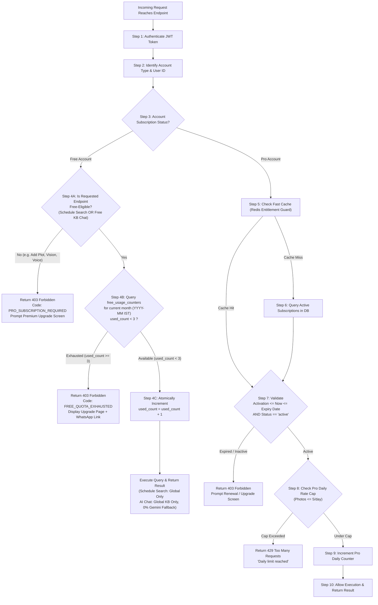

### 7.2 Calendar-Year Anniversary Calculation Implementation (Python 3.12)
```python
import datetime
from zoneinfo import ZoneInfo
from dateutil.relativedelta import relativedelta

IST = ZoneInfo("Asia/Kolkata")

def calculate_calendar_year_expiry(activation_date: datetime.datetime) -> datetime.datetime:
    """
    Calculates exact one calendar year anniversary in Indian Standard Time.
    Handles leap-year Feb 29 edge cases deterministically.
    """
    activation_ist = activation_date.astimezone(IST)
    
    # Add exactly one calendar year
    anniversary = activation_ist + relativedelta(years=1)
    
    # Set to end of day 23:59:59.999999 IST
    expiry_ist = anniversary.replace(hour=23, minute=59, second=59, microsecond=999999)
    return expiry_ist

def calculate_renewal_expiry(current_expiry: datetime.datetime, activation_now: datetime.datetime) -> datetime.datetime:
    """
    Policy:
    - If renewing BEFORE expiry: extend by 1 year from current expiry date.
    - If renewing AFTER expiry: extend by 1 year from activation date now.
    """
    now_ist = activation_now.astimezone(IST)
    current_expiry_ist = current_expiry.astimezone(IST)
    
    if now_ist <= current_expiry_ist:
        # Early renewal: preserve remaining days
        return current_expiry_ist + relativedelta(years=1)
    else:
        # Lapsed renewal: fresh anniversary
        return calculate_calendar_year_expiry(now_ist)
```

---

## 8. KM – Intelligent Knowledge Management & Personalized Agronomy Architecture

### 8.1 The 16-Step Document Processing Pipeline

Every document ingested into the Central Master Knowledge Base or a Consultant-Specific Knowledge Base undergoes an automated, auditable 16-step ingestion workflow:

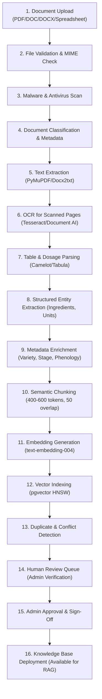

#### Document Lifecycle State Machine
```
[UPLOADED] ──► [PROCESSING] ──┬──► [EXTRACTION_FAILED] (Halt & Log Error)
                              └──► [REVIEW_REQUIRED] ──► [PENDING_APPROVAL]
                                                             │
                                        ┌────────────────────┴────────────────────┐
                                        ▼                                         ▼
                                   [APPROVED] ──► [INDEXED]                  [REJECTED]
                                        │
                                        ▼ (Superseded by New Version)
                                   [ARCHIVED]
```

#### Unit and Measurement Integrity Rules
1. **Preservation of Agricultural Units:** Measurement units (`gm/L`, `ml/L`, `kg/acre`, `litre/acre`, `ppm`) must never be stripped, truncated, or converted without explicit agronomic calibration.
2. **Per-Acre vs. Per-Hectare Precision:** Distinctions between per-acre and per-hectare quantities are strictly enforced. Missing units trigger immediate `REVIEW_REQUIRED` status.
3. **Table Relationship Integrity:** Chemical compatibility tables (tank mix matrices) retain tabular relational structure in `JSONB` alongside vectorized text chunks.
4. **Never Guess Missing Dosages:** If a document lists a chemical without a dosage, the extractor attaches an `incomplete_dosage_flag`. The system never synthesizes missing dosage values.

---

### 8.2 Hierarchical Multi-Tier RAG Architecture (~95% Grounded Target)

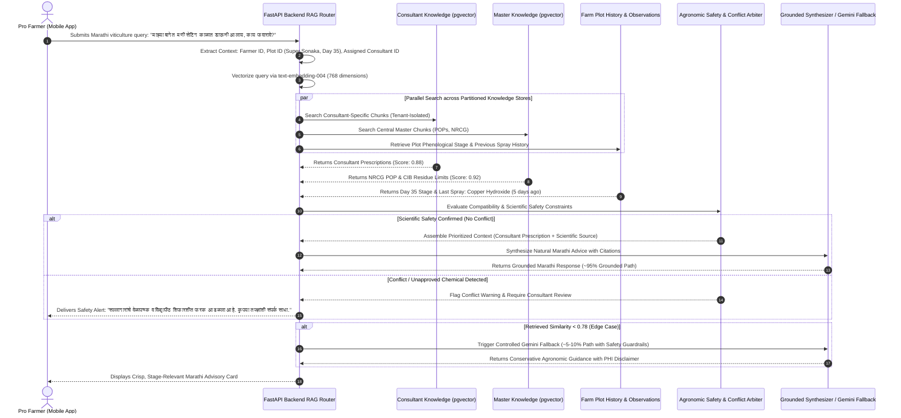

---

### 8.3 Agronomic Conflict Resolution & Safety Arbiter

When multiple knowledge layers yield overlapping or differing advice, the system applies a deterministic safety arbitration hierarchy:

```
┌────────────────────────────────────────────────────────────────────────┐
│                      AGRONOMIC ARBITRATION HIERARCHY                   │
├────────────────────────────────────────────────────────────────────────┤
│  PRIORITY 1: Scientific & Legal Safety Rules (CIB/RC Banned Chemicals, │
│              Maximum Residue Limits, Export Pre-Harvest Intervals)     │
│       ▲                                                                │
│       │ (Overrides all below)                                          │
│  PRIORITY 2: Approved Consultant-Specific Schedules & Prescriptions   │
│       ▲                                                                │
│       │ (Customizes for assigned farmer plots)                         │
│  PRIORITY 3: Central Master Knowledge Base (University POPs, NRCG)    │
│       ▲                                                                │
│       │ (Baseline scientific standard)                                 │
│  PRIORITY 4: General Fallback AI (Restricted to language synthesis)   │
└────────────────────────────────────────────────────────────────────────┘
```

- **Conflict Detection:** If a Consultant schedule recommends an active ingredient restricted for export or application at that specific phenological stage, the engine flags `conflict_detected = TRUE`.
- **Zero Silent Compromise:** The AI never silently averages two different dosages. It explains the safety rationale in clear Marathi and prompts the farmer to verify with their Consultant.

---

### 8.4 Google Gemini Fallback Engine (~5–10% Target)

Gemini is employed as a secondary reasoning and synthesis service:
1. **Fallback Conditions:**
   - Vector similarity across all knowledge stores $< 0.78$.
   - Farmer query presents colloquial linguistic nuance requiring contextual disambiguation.
   - Clarifying questions needed before providing agronomic guidance.
2. **Mandatory Agricultural System Guardrail Prompt:**
   ```
   You are Kisan Mitra's fallback agronomic engine. 
   You must NEVER invent chemical trade names, untested tank mixes, or unapproved fungicides.
   If specific regional dosage data is not in your context, output:
   "या समस्येसाठी अधिकृत द्राक्ष मार्गदर्शिकेतून अचूक प्रमाण पडताळणे आवश्यक आहे. कृपया आपल्या कृषी सल्लागारांशी चर्चा करावी."
   Always append Pre-Harvest Interval (PHI) warnings for grape cultivation.
   ```
3. **Telemetry & Cost Tracking:** All fallback invocations log prompt tokens, completion tokens, latency, and justification code to `gemini_fallback_logs`.

---

### 8.5 Personalized Farm Agronomy Schedule Engine

The Schedule Engine synthesizes multi-dimensional vineyard data to generate a dynamic, daily-executable crop calendar:

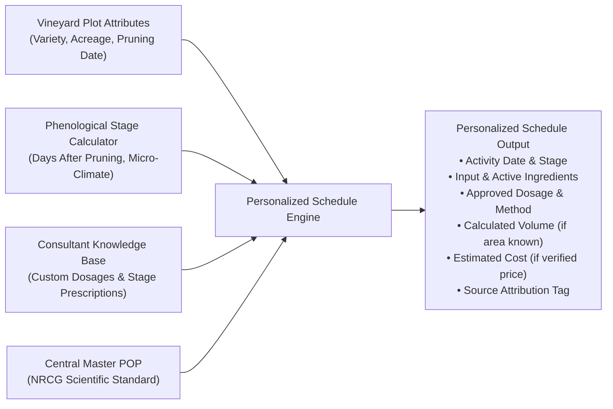

- **Farm Plot Isolation:** Each plot maintains its own independent schedule (`personalized_farm_schedules`). A 2-acre plot of Super Sonaka pruned on Oct 15 receives distinct treatments from an adjacent 3-acre plot of Thompson Seedless pruned on Oct 25.
- **Conditional Quantity & Cost Calculations:**
  - Total chemical volume is calculated *only* if valid plot acreage and per-acre dosage exist.
  - Estimated cost is rendered *only* if verified regional retail pricing exists in `recommendation_sources`.
- **Consultant Customization:** Assigned consultants can adjust dates, modify tank mixes, or reschedule activities directly from their mobile app, generating an audited entry in `schedule_revisions`.

---

### 8.6 AI Quality, Latency & Cost Telemetry Architecture

The Owner/Admin Web Dashboard displays real-time telemetry streaming from `ai_response_logs` and `gemini_fallback_logs`:

| Metric Name | Performance Target | Alert Threshold | Operational Meaning |
| :--- | :---: | :---: | :--- |
| **KB Grounded Answer Rate** | $\ge 95\%$ of responses | $< 90\%$ | Proportion of farmer queries answered purely from verified Master or Consultant KB chunks. |
| **Gemini Fallback Rate** | $\le 10\%$ of responses | $> 15\%$ | Proportion of queries escalated to external LLM fallback due to insufficient indexed knowledge. |
| **Ungrounded Dosage Rate** | **0.0%** (Zero Tolerance) | $> 0.0\%$ | Queries outputting synthetic chemical dosages without verified chunk backing. |
| **End-to-End Latency** | $p_{90} < 3.5\text{ seconds}$ | $> 5.0\text{ seconds}$ | Time from farmer prompt dispatch to complete Marathi response rendering. |
| **Average Cost per Query** | $< \$0.0025\text{ USD}$ | $> \$0.006\text{ USD}$ | Combined embedding and LLM token expenditure per conversational turn. |

---

### 8.7 Ecosystem Relationship, Direct Messaging & AI Chat Visibility Architecture

#### 8.7.1 Consultant Priority Rule & Transactional Unlinking State Machine
The relationship lifecycle between Farmers, Shops, and Consultants is governed by strict deterministic priority rules executed inside a PostgreSQL serializable transaction:

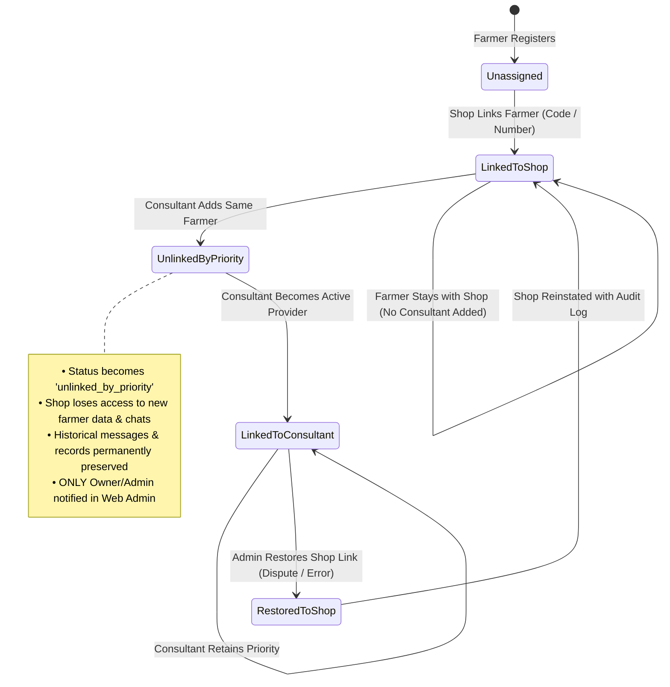

**Transactional Implementation Details (`RelationshipService`):**
1. **Concurrency Control:** When a link request arrives, the backend acquires a row-level lock on `farmer_profiles` (`SELECT FOR UPDATE`) to prevent race conditions during concurrent additions.
2. **Priority Evaluation:** If `active` relationship exists with `shop_id IS NOT NULL`:
   - System updates `farmer_relationships` setting `status = 'unlinked_by_priority'`, `unlinked_at = NOW()`, `unlinked_reason = 'consultant_priority_override'`.
   - Inserts record into `farmer_relationship_history`.
   - Transitions existing `chat_conversations` between Farmer and Shop from `active` to `unlinked_read_only`.
   - Creates new active relationship for Consultant (`relationship_type = 'consultant_farmer'`, `status = 'active'`).
3. **Admin Notification Isolation:** Emits an event to Redis pub/sub consumed exclusively by WebSocket workers serving the Owner Web Admin. Neither the former Shop nor the Farmer receives an alerting unlinking push notification.
4. **Data Preservation Guarantee:** No cascading deletes occur. All historical records, prescriptions, field visit notes, and past direct chat messages remain intact in Supabase PostgreSQL and Storage buckets.

#### 8.7.2 Direct In-App Chat Realtime Architecture
Native 1-to-1 messaging is implemented via **Supabase Realtime (PostgreSQL CDC over WebSockets)** and short-lived media presigned URLs:

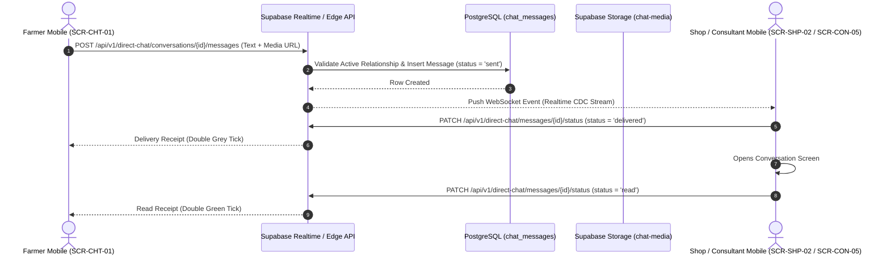

**Chat Security & Privacy Boundaries:**
- **Strict Role Isolation:** Shop A can only query conversations where `shop_id = Shop A.id` AND `status = 'active'`. Consultant B can only query conversations where `consultant_id = Consultant B.id` AND `status = 'active'`.
- **Zero Cross-Access:** Shops have zero access to Consultant-Farmer chat tables; Consultants have zero access to Shop-Farmer chat tables.
- **Media Encryption:** Photos sent via chat are uploaded to a private Supabase Storage bucket (`chat-media`). Access requires temporary signed URLs with 15-minute TTL generated server-side after verifying active relationship membership.

#### 8.7.3 Shared Farmer AI Chat Read-Only Projection Architecture
To empower shops and consultants as effective digital partners, actively linked providers can inspect their farmers' AI discussions through dedicated read-only views:

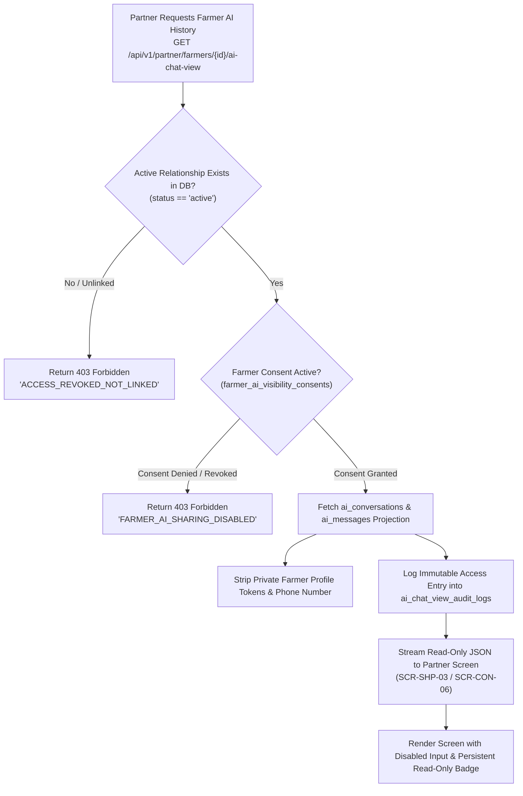

**Read-Only Integrity Enforcement:**
- **Zero Mutation API:** There are NO endpoints enabling a Shop or Consultant to insert messages, edit messages, or reply within an AI conversation.
- **Database Immutability:** Partner DB roles have strict `SELECT`-only permissions on `ai_conversations` and `ai_messages` scoped through PostgreSQL RLS.
- **Full Traceability:** Every view event is permanently audited with viewer ID, farmer ID, timestamp, and IP address in `ai_chat_view_audit_logs` for owner oversight.

---

### 8.8 Independent Advisory Schedule Architecture & Safe Ingestion Pipeline
To eliminate operational cross-contamination, every entity operates under an isolated configuration-driven advisory schedule:

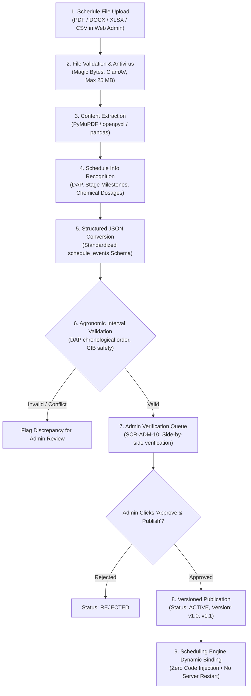

**Non-Executable Configuration Guarantee:**
- Schedule ingestion writes exclusively to `schedule_configurations` and `schedule_events`. Under no circumstances are schedule rules compiled into Python code, templates, or executable scripts.
- The runtime daily planner and calling engine query active schedule configurations dynamically at runtime:
  ```python
  def get_active_schedule_for_farmer(farmer_id: UUID) -> ScheduleConfig:
      # 1. Check if linked to active Consultant -> Return Consultant Schedule
      # 2. Check if linked to active Shop -> Return Shop Schedule
      # 3. Else -> Return Global Kisan Mitra AI Schedule
  ```

---

### 8.9 Multiple Vineyard Plots & The One-Automated-Call-Per-Day Quota Engine
Pro farmers manage multiple distinct plots within the same account while the system enforces a strict single daily automated call driven by the unified **Primary Plot**:

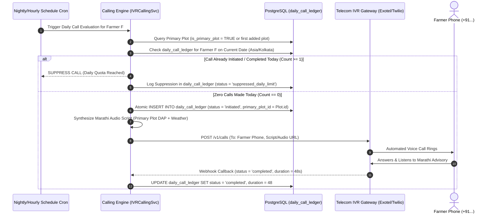

**Primary Plot Precedence & Multi-Actor Management Logic:**
1. If the farmer or linked partner/admin explicitly designates a Primary Plot via `SCR-SET-03`, `farms.is_primary_plot = TRUE` determines both the main timeline and the automated voice call.
2. If no manual selection was made, the **first plot registered by the farmer (`ORDER BY created_at ASC LIMIT 1`) automatically acts as the default Primary Plot (`is_primary_plot = TRUE`)**.
3. A partial unique index `idx_single_primary_plot` guarantees that exactly ONE plot per farmer carries `is_primary_plot = TRUE`.
4. All secondary registered plots continue to execute independent daily crop stage calculations and in-app planner tasks without restriction.
5. Plot creation and updates are authorized for: Farmer, Linked Consultant, Linked Shop, and Admin. Partner/Admin edits record an immutable entry in `audit_logs` and dispatch an in-app push notification to the farmer. Partners have NO delete permission.

---

### 8.10 Automated Voice Calling (IVR) & Telecom Architecture
1. **Calling Window Enforcement:** Calls are dispatched strictly between 07:00 AM and 07:00 PM IST, respecting the farmer's preferred window (`farmer_calling_settings`).
2. **Text-to-Speech (TTS) Pipeline:** Converts structured schedule actions into high-fidelity Marathi audio via Google Cloud Text-to-Speech (`mr-IN-Wavenet-A` / `Standard-A`) with natural agricultural pauses.
3. **Telecom Compliance (TRAI / DLT):** All voice outbound calling headers and principal entity IDs are registered under DLT regulations for "Kisan Mitra".
4. **Retry & Backoff:** If the line is busy or unanswered, maximum 2 retries are attempted at 45-minute intervals, provided the current time remains within permitted calling hours.

---

### 8.11 Multi-Modal Query Pipeline: Ask by Photo & Voice (KB First, Gemini Second)
The platform strictly prioritizes verified Knowledge Base literature before escalating to external LLMs:

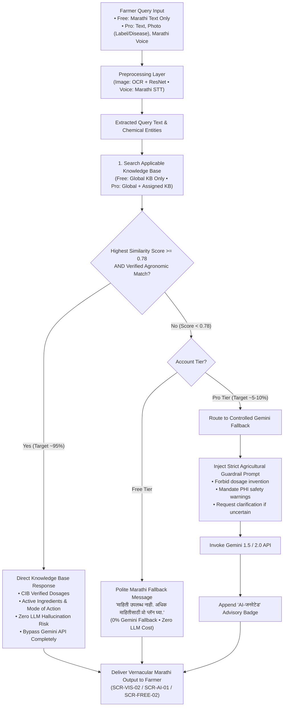

---

## 9. Comprehensive REST API Specifications

### 9.1 Summary of Core Endpoints

| Endpoint Path | Method | Auth Required | Authorized Roles | Description |
| :--- | :---: | :---: | :---: | :--- |
| `/api/v1/auth/otp/request` | `POST` | None | Public | Request 6-digit OTP for mobile verification. |
| `/api/v1/auth/otp/verify` | `POST` | None | Public | Verify OTP and receive JWT access/refresh tokens. |
| `/api/v1/users/me/profile` | `GET` | Bearer JWT | All | Retrieve current authenticated user profile & entitlements. |
| `/api/v1/config/public` | `GET` | None | Public | Retrieve public application configuration including dynamic `owner_whatsapp_number`. |
| `/api/v1/free/schedule-lookup` | `GET` | Bearer JWT | Free Farmer | Search Day N advisory from Global Schedule by pruning date. Consumes 1 query from 3-use monthly quota. Rejects future/invalid dates without consuming quota. |
| `/api/v1/farms` | `POST` | Bearer JWT | Pro Farmer, Linked Shop, Linked Consultant, Admin | Register a new vineyard farm plot (Pro only). Auto-designates first plot as Primary Plot (`is_primary_plot = TRUE`). Partner/Admin creations trigger `audit_logs` & farmer push notification. |
| `/api/v1/farmer/plots` | `GET` | Bearer JWT | Pro Farmer, Linked Shop, Linked Consultant, Admin | List all registered vineyard plots (Pro only). |
| `/api/v1/farmer/plots/{id}` | `GET`, `PUT` | Bearer JWT | Pro Farmer, Linked Shop, Linked Consultant, Admin | Retrieve plot details or update pruning date/GPS/Primary status (Pro only). Partner/Admin updates trigger `audit_logs` & farmer push notification. Partners cannot delete plots. |
| `/api/v1/crops/{crop_id}/stage` | `GET` | Bearer JWT | Farmer, Shop, Consultant | Calculate current phenological stage and milestones. |
| `/api/v1/knowledge/articles` | `GET` | Bearer JWT | All (Free & Pro) | Search and read static viticulture guides. |
| `/api/v1/subscriptions/enquiries` | `POST` | Bearer JWT | Free Farmer | Pre-create upgrade enquiry record with status 'NEW' (7-day duplicate check) before opening `wa.me` WhatsApp deep link. |
| `/api/admin/subscriptions/direct-activate` | `POST` | Bearer JWT | Super Admin, Admin | Directly activate 1-year Pro for any farmer number. |
| `/api/admin/enquiries` | `GET` | Bearer JWT | Admin, Super Admin | Paginated lead tracking desk for platform owner. |
| `/api/v1/chat/message` | `POST` | Bearer JWT | Free Farmer, Pro Farmer | Submit query to AI Chatbot. Free: Global KB only, consumes monthly quota, 0% Gemini fallback, returns 403 `FREE_QUOTA_EXHAUSTED` when quota reached. Pro: Global + Assigned KB, ~5-10% Gemini fallback. |
| `/api/v1/vision/analyze-crop` | `POST` | Bearer JWT | Pro Farmer Only | Upload crop photo for disease/pest diagnosis (5/day cap). Gated from Free tier. |
| `/api/v1/farmer/schedules/personalized` | `GET` | Bearer JWT | Pro Farmer Only | Fetch plot-specific personalized agronomy schedule. |
| `/api/v1/consultant/schedules/customize` | `POST` | Bearer JWT | Consultant Only | Customize or reschedule activity for assigned farmer plot. |
| `/api/admin/kb/master/documents` | `POST` | Bearer JWT | Super Admin, Admin | Upload PDF/DOC/DOCX/Spreadsheet to Master Knowledge Base. |
| `/api/admin/kb/consultants/{id}/documents` | `POST` | Bearer JWT | Super Admin, Admin | Ingest proprietary agronomic literature for a specific Consultant. |
| `/api/admin/kb/pipeline/jobs/{id}/review` | `POST` | Bearer JWT | Super Admin, Admin | Approve or reject extracted dosage/table data in pipeline. |
| `/api/admin/telemetry/ai-grounding` | `GET` | Bearer JWT | Super Admin, Admin | Retrieve real-time grounded RAG, fallback, and cost metrics. |
| `/api/v1/shop/assigned-farmers` | `GET` | Bearer JWT | Shop Partner | Fetch list of farmers linked to the shop. |
| `/api/v1/consultant/farms` | `GET` | Bearer JWT | Consultant | Fetch vineyards supervised by the consultant. |
| `/api/v1/direct-chat/conversations` | `GET`, `POST` | Bearer JWT | Farmer, Shop, Consultant | List or initiate direct 1-to-1 human chat conversations. |
| `/api/v1/direct-chat/conversations/{id}/messages` | `GET`, `POST` | Bearer JWT | Farmer, Shop, Consultant | Retrieve message history or post new message/photo. |
| `/api/v1/direct-chat/messages/{id}/status` | `PATCH` | Bearer JWT | Farmer, Shop, Consultant | Update message delivery status (`delivered`, `read`). |
| `/api/v1/partner/farmers/{farmer_id}/ai-chat-view` | `GET` | Bearer JWT | Linked Shop, Linked Consultant | View-only access to farmer's AI questions and guidance. |
| `/api/v1/farmer/ai-visibility-consent` | `GET`, `PUT` | Bearer JWT | Farmer Only | View or configure shared AI chat visibility toggles. |
| `/api/admin/relationships/priority-switches` | `GET` | Bearer JWT | Super Admin, Admin | Monitor real-time feed of Consultant Priority unlinking events. |
| `/api/admin/relationships/{id}/restore` | `POST` | Bearer JWT | Super Admin, Admin | Administratively restore unlinked Shop-Farmer relationship. |
| `/api/admin/audit/ai-chat-views` | `GET` | Bearer JWT | Super Admin, Admin | Audit ledger of partner accesses to farmer AI conversations. |
| `/api/v1/farmer/calling-settings` | `GET`, `PUT` | Bearer JWT | Pro Farmer | Retrieve or update calling window and call opt-in state (calling driven by Primary Plot). |
| `/api/admin/schedules/upload` | `POST` | Bearer JWT | Super Admin, Admin | Upload advisory schedule file (XLSX/CSV/PDF/DOCX) for Shop, Consultant, or Global platform. |
| `/api/admin/schedules/{id}/review` | `POST` | Bearer JWT | Super Admin, Admin | Review, validate, and publish ingested schedule configuration (9-step pipeline). |
| `/api/admin/schedules` | `GET` | Bearer JWT | Super Admin, Admin | List all registered schedule configurations across Global, Shop, and Consultant scopes. |
| `/api/v1/schedules/active` | `GET` | Bearer JWT | All | Fetch active schedule binding matching farmer category (Shop/Consultant/Global). |
| `/api/v1/medicine/products` | `GET` | Bearer JWT | All | Search searchable viticulture medicine directory by brand, technical salt, or target pest/disease. |
| `/api/v1/medicine/products/{id}` | `GET` | Bearer JWT | All | Retrieve detailed technical card, CIB-approved dosage, PHI, and compatibility matrix. |
| `/api/v1/ivr/calls/trigger` | `POST` | Bearer JWT | System/Cron, Admin | Trigger daily automated calling cycle respecting the 1-call-per-day ledger constraint. |
| `/api/v1/ivr/webhook/callback` | `POST` | Webhook Signature | IVR Provider | Process telephony vendor delivery status callbacks (answered, busy, no-answer, failed). |
| `/api/v1/weather/plots/{id}/forecast` | `GET` | Bearer JWT | Farmer, Shop, Consultant | Retrieve plot-specific 5-day agro-meteorological forecast and rain alerts based on plot GPS. |
| `/api/admin/global-farmers` | `GET`, `POST` | Bearer JWT | Super Admin, Admin | Central owner console: search, view, or manage unassigned Global Farmers. |
| `/api/admin/global-farmers/{id}` | `GET`, `PUT` | Bearer JWT | Super Admin, Admin | Inspect Global Farmer profile, plot breakdown, advisory history, and call logs. |

### 9.2 Critical Endpoint Payloads

#### `POST /api/v1/subscriptions/enquiries`
- **Request Body:**
```json
{
  "message_content": "सस्नेह नमस्कार किसान मित्र टीम, मी माझ्या खात्याला प्रो प्लॅनमध्ये अपग्रेड करण्यास उत्सुक आहे. कृपया मला प्रो प्लॅनची माहिती द्यावी.",
  "preferred_crop": "Grape",
  "acreage": 2.5
}
```
- **Response `201 Created`:**
```json
{
  "success": true,
  "enquiry_code": "ENQ-20261123-008",
  "status": "NEW",
  "whatsapp_deep_link": "https://wa.me/919876543210?text=%E0%A4%B8%E0%A4%B8%E0%A5%8D%E0%A4%A8%E0%A5%87%E0%A4%B9%20%E0%A4%A8%E0%A4%AE%E0%A4%B8%E0%A5%8D%E0%A4%95%E0%A4%BE%E0%A4%B0%20%E0%A4%95%E0%A4%BF%E0%A4%B8%E0%A4%BE%E0%A4%A8%20%E0%A4%AE%E0%A4%BF%E0%A4%A4%E0%A5%8D%E0%A4%B0...",
  "message": "Enquiry registered successfully. Proceed to WhatsApp."
}
```

#### Error Payload: `403 Forbidden` (`FREE_QUOTA_EXHAUSTED`)
```json
{
  "error": "FREE_QUOTA_EXHAUSTED",
  "message": "प्रीमियम घ्या — पुढील सुविधांसाठी प्रो प्लॅन आवश्यक आहे. अधिक माहितीसाठी WhatsApp वर क्लिक करा.",
  "used_count": 3,
  "quota_limit": 3,
  "resets_at": "2026-12-01T00:00:00+05:30",
  "whatsapp_deep_link": "https://wa.me/919876543210?text=..."
}
```
{
  "message_content": "सस्नेह नमस्कार किसान मित्र टीम, मी माझ्या खात्याला प्रो प्लॅनमध्ये अपग्रेड करण्यास उत्सुक आहे. कृपया मला प्रो प्लॅनची माहिती द्यावी.",
  "preferred_crop": "Grape",
  "acreage": 2.5
}
```
- **Response (`201 Created`):**
```json
{
  "success": true,
  "enquiry_code": "ENQ-20261120-0042",
  "status": "NEW",
  "message": "चौकशी यशस्वीरीत्या नोंदवली गेली. आम्ही लवकरच संपर्क करू.",
  "created_at": "2026-11-20T10:45:00+05:30"
}
```

#### `POST /api/admin/subscriptions/direct-activate`
- **Request Body:**
```json
{
  "mobile_number": "9823456789",
  "plan_code": "PLAN_FARMER_PRO_1Y",
  "payment_status": "paid",
  "payment_reference": "UPI-IND-894723912",
  "admin_notes": "Activated directly after telephonic consultation with Ramesh Patil."
}
```
- **Response (`200 OK`):**
```json
{
  "success": true,
  "subscription_code": "KM-SUB-2026-8941",
  "farmer_id": "f8a9e012-3456-4abc-9def-0123456789ab",
  "account_tier": "pro",
  "activation_date": "2026-11-20T11:00:00+05:30",
  "expiry_date": "2027-11-20T23:59:59.999999+05:30",
  "validity_days": 365,
  "activated_by": "Swapnil Pawar"
}
```

---

## 10. Deployment, Infrastructure & DevOps

```
                                  ┌─────────────────────────────┐
                                  │      Cloudflare Edge        │
                                  │  DNS • WAF • DDoS • CDN     │
                                  └──────────────┬──────────────┘
                                                 │
                      ┌──────────────────────────┴──────────────────────────┐
                      │                                                     │
           ┌──────────▼──────────┐                               ┌──────────▼──────────┐
           │ Next.js Web Admin   │                               │ FastAPI API Cluster │
           │ Hosted on Vercel /  │                               │ Container on AWS ECS│
           │ Cloudflare Pages    │                               │ or Render Managed   │
           └─────────────────────┘                               └──────────┬──────────┘
                                                                            │
                                                 ┌──────────────────────────┼──────────────────────────┐
                                                 │                          │                          │
                                      ┌──────────▼──────────┐    ┌──────────▼──────────┐    ┌──────────▼──────────┐
                                      │ Supabase PostgreSQL │    │ Upstash Redis 7.2   │    │ Supabase Storage    │
                                      │ Primary Relational  │    │ Low-Latency Cache   │    │ Authoritative Files │
                                      └─────────────────────┘    └─────────────────────┘    └─────────────────────┘
```

### 10.1 Environment Strategy
1. **Development (`dev`):** Local Docker Compose environment replicating PostgreSQL + pgvector, LocalStack S3, and mocked Gemini API responses.
2. **Staging (`stage`):** Dedicated Supabase staging project, continuous deployment via GitHub Actions on merging to `develop`.
3. **Production (`prod`):** High-availability multi-AZ configuration on merging to `main`. Blue/Green zero-downtime rolling deployments.

---

## 11. Architecture Decision Records (ADRs)

### ADR-001: Selection of Supabase (PostgreSQL 16 + pgvector) as Unified Data Engine
- **Context:** Kisan Mitra requires ACID-compliant relational data for subscriptions, multi-role relationships, and farm activities, while simultaneously needing high-speed semantic vector search for Marathi viticulture RAG.
- **Decision:** Adopt PostgreSQL with the `pgvector` extension hosted on Supabase rather than deploying a standalone vector database (e.g., Pinecone, Milvus, Qdrant).
- **Consequences:** Eliminates data synchronization drift between vector IDs and user records; provides transactional ACID safety for RAG analytics; slashes operational cloud spend by 60%.

### ADR-002: Server-Side Sovereign Entitlement Enforcement
- **Context:** Free users must be prevented from utilizing expensive AI Chatbot tokens and Vision inference services.
- **Decision:** All entitlement validation logic is consolidated into a centralized backend service called by route-level dependency injection. The mobile client simply reflects entitlement state and has zero authority to bypass paywalls.
- **Consequences:** Robust security against modified or tampered mobile APKs; single location for changing business rules or promotional quotas.

### ADR-003: Strict One-Calendar-Year Anniversary Calculation
- **Context:** A naïve 365-day addition leads to date slippage across leap years (e.g., 2028) and creates farmer confusion when the renewal date changes.
- **Decision:** Mandate Python `dateutil.relativedelta(years=1)` anniversary computation with explicit end-of-day IST timestamping.
- **Consequences:** Perfectly predictable 1-year coverage matching rural farmer expectations; unambiguous renewal terms.

### ADR-004: Supabase as Single Authoritative Storage Platform
- **Context:** Distributing data across multiple independent storage backends (e.g., separate S3 buckets, disparate databases) risks data drift, orphaned files, and fractured Row Level Security.
- **Decision:** Designate Supabase as the exclusive, centralized, and authoritative platform for all relational data (PostgreSQL 16), vector embeddings (pgvector), and application file/image storage (Supabase Storage).
- **Consequences:** Unified RLS policies apply across database records and object storage; all farmer, shop, consultant, and diagnostic data has a single source of truth; zero synchronization lag.

### ADR-005: Manual Payment Processing & Strict Separation of Partner Registration vs. Authorization
- **Context:** Automated payment gateways cause high transaction failure and distrust in rural areas, while self-service partner registrations pose serious security and data isolation risks.
- **Decision:** Implement a strictly manual payment collection and verification model (Direct, Shop, Consultant channels) without online gateways. Enforce a two-phase partner onboarding process where Shop/Consultant registration creates a pending profile only, requiring explicit owner/admin review, credential provisioning, and activation.
- **Consequences:** Eliminates gateway setup and failure friction; gives the platform owner total governance over partner entry; prevents unauthorized access to farmer records.

### ADR-006: Independent Advisory Schedule System via Non-Executable Data Ingestion Pipeline
- **Context:** Shops and Consultants require distinct, proprietary crop protection practices and spray schedules. Baking schedules into application code or allowing user-uploaded executable scripts creates severe security vulnerabilities, deployment bottlenecks, and maintenance nightmares.
- **Decision:** Establish an independent schedule architecture where every partner (and Global platform) has an isolated schedule definition stored as configuration data in PostgreSQL (`schedule_configurations` and `schedule_events`). File ingestion (XLSX, CSV, PDF) is processed via a strict 9-step non-executable parser with owner/admin review and schema validation. Dynamic binding at runtime resolves the farmer's category (Shop, Consultant, or Global) to the exact corresponding schedule without code modification or service restart.
- **Consequences:** Zero code injection risk; completely decoupled advisory logic; dynamic extensibility for hundreds of independent schedules; strict separation between "When to Advise" (Schedules) and "What to Advise" (Knowledge Base).

### ADR-007: Single Daily Call Limitation & Unified Primary Plot Resolution Engine
- **Context:** Progressive grape growers operate multiple vineyard plots (e.g., Plot 1 pruned Oct 10, Plot 2 pruned Oct 25). If each plot or weather alert independently triggered automated calls, farmers would receive multiple intrusive calls per day, causing annoyance and carrier spam blocking. Furthermore, maintaining separate "Calling Plot" and "Primary Plot" concepts introduced operational ambiguity.
- **Decision:** Enforce an architectural maximum of ONE automated voice call per farmer per day across all plots and alerts. Consolidate schedule driving and calling driver into a single **Primary Plot** (`farms.is_primary_plot = TRUE`), backed by a unique partial index `idx_single_primary_plot`. A server-side ledger (`daily_call_ledger`) backed by a PostgreSQL unique partial index guarantees call atomicity. If a farmer has multiple plots and has not explicitly changed the Primary Plot in settings, the platform deterministically designates the first registered plot (`farms` ordered by `created_at ASC LIMIT 1`) as the default Primary Plot. Daily calls synthesize advisory for the Primary Plot, while secondary plots execute independent daily crop stage calculations and in-app planner tasks.
- **Consequences:** Eliminates telephony spam; complies with TRAI calling comfort guidelines; simplifies mental model for farmers; eliminates duplicate database fields; deterministic and predictable user experience across multi-plot vineyards.

---
*End of Document 02 – Technical Architecture Document*
