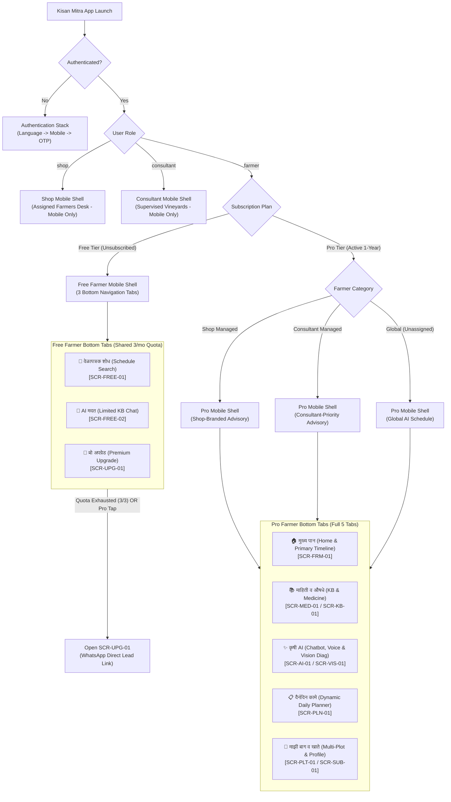

# Frontend Specification Document – Kisan Mitra AI (formerly DrakshGuru)

---

## 1. Brand Identity & Design Language

| Attribute | Specification |
| :--- | :--- |
| **Product Name** | Kisan Mitra AI (formerly DrakshGuru) (किसान मित्र AI) |
| **Document Version** | 2.2.0 (Revised Free/Pro Architecture, WhatsApp Integration & Multi-Actor Plot UI) |
| **Design Philosophy**| Modern Agricultural Utility: Clean, high-contrast, trustworthy, and thumb-friendly. Built specifically for Indian grape growers in bright sunlight conditions with high legibility and Marathi-first typography. |
| **Primary Platforms**| 1. **Cross-Platform Mobile App (Android / iOS)** via React Native / Expo (Serves Farmers, Shop Partners, and Agronomy Consultants)<br>2. **Centralized Web Admin Dashboard** via Next.js 14 / TailwindCSS (Exclusively for Platform Owner / Super Admin Swapnil Pawar) |

### Document Revision History
| Version | Date | Author / Role | Changes / Remarks |
| :---: | :---: | :---: | :--- |
| 1.0.0 | 2026-11-19 | Senior UI/UX Designer | Initial frontend design specification, color palette, and core screens. |
| 2.0.0 | 2026-11-20 | Senior UI/UX Designer | Manual payment flow screens, 1-year validity UI badges, lead tracking desk. |
| 2.1.0 | 2026-11-21 | Senior UI/UX Designer | Independent schedule UI, multi-plot UI (`SCR-PLT-01`), direct chat (`SCR-CHT-01`). |
| 2.2.0 | 2026-11-23 | Senior UI/UX Designer | Revised Free/Pro UI architecture: Free shell partitioned into 3 bottom tabs (Schedule Search `SCR-FREE-01`, Limited AI Chat `SCR-FREE-02`, Premium Upgrade `SCR-UPG-01`) sharing 3-use monthly quota counter. Added WhatsApp Direct Click-to-Chat button (`wa.me`), Post-Activation First-Run Pro Plot Setup (`SCR-PLT-00`), and consolidated Primary Plot settings (`SCR-SET-03`). |

### 1.1 Color Palette

```
┌────────────────────────────────────────────────────────────────────────┐
│                        KISAN MITRA BRAND PALETTE                       │
├─────────────────────┬───────────────────┬──────────────────────────────┤
│ COLOR ROLE          │ HEX CODE          │ INTENDED APPLICATION         │
├─────────────────────┼───────────────────┼──────────────────────────────┤
│ Primary Green       │ `#1B5E20`         │ Primary buttons, header bars │
│ Harvest Gold        │ `#F57F17`         │ Pro badges, highlights, CTA  │
│ Vineyard Leaf       │ `#2E7D32`         │ Success states, healthy crop │
│ Soil Brown / Dark   │ `#1F2937`         │ Primary text, headings       │
│ Surface Neutral     │ `#F9FAFB`         │ Background canvas, cards     │
│ Warning Amber       │ `#D97706`         │ Weather alerts, stage warnings│
│ Danger Red          │ `#DC2626`         │ Disease alerts, errors       │
│ Informational Blue  │ `#0284C7`         │ Weather metrics, knowledge   │
└─────────────────────┴───────────────────┴──────────────────────────────┘
```

### 1.2 Typography & Localization Standards
- **English Font Family:** `Inter`, `system-ui`, `-apple-system`, `sans-serif`.
- **Marathi Font Family:** `Noto Sans Devanagari` (Weights: Regular 400, Medium 500, Semi-Bold 600, Bold 700).
- **Marathi Linguistic Standard:** Formal, respectful, rural-accessible agricultural Marathi (उदा. "सस्नेह नमस्कार", "द्राक्ष बाग व्यवस्थापन", "रोग निदान", "प्रो प्लॅनमध्ये अपग्रेड करा").
- **Font Scale:** Baseline font size is 16px (increased from typical 14px to support older generational farmers in sunlight).

---

## 2. Global Design System & Component Library

```
┌────────────────────────────────────────────────────────────────────────┐
│                        ATOMIC COMPONENT LIBRARY                        │
├───────────────────┬────────────────────────────────────────────────────┤
│ COMPONENT         │ SPECIFICATION & VARIANTS                           │
├───────────────────┼────────────────────────────────────────────────────┤
│ **Buttons**       │ • Primary: Solid `#1B5E20` (Min height 52px)       │
│                   │ • Pro Accent: `#F57F17` with Gold Crown Icon       │
│                   │ • Secondary: Outlined 1.5px border                 │
│                   │ • Disabled: `#E5E7EB` with muted text              │
├───────────────────┼────────────────────────────────────────────────────┤
│ **Input Fields**  │ • 54px touch target; 16px Devanagari font          │
│                   │ • Clear active green focus ring (`#2E7D32`)        │
│                   │ • Error state with persistent helper text in red   │
├───────────────────┼────────────────────────────────────────────────────┤
│ **Cards**         │ • 12px border radius, subtle elevation shadow      │
│                   │ • White background with `#E5E7EB` border           │
├───────────────────┼────────────────────────────────────────────────────┤
│ **Badges**        │ • `FREE` (Slate `#64748B`), `PRO` (Gold `#F57F17`) │
│                   │ • `ACTIVE` (Emerald `#10B981`)                     │
│                   │ • `DEFAULT CALLING PLOT` (Deep Purple `#6D28D9`)   │
├───────────────────┼────────────────────────────────────────────────────┤
│ **Empty States**  │ • Custom agricultural vector illustrations         │
│                   │ • Helpful Marathi instruction & Primary CTA        │
└───────────────────┴────────────────────────────────────────────────────┘
```

---

## 3. Platform Navigation Architecture

### 3.1 Mobile App Dynamic Role & Tier Router



### 3.2 Owner Web Dashboard Navigation (Exclusively for Swapnil Pawar)

```mermaid
graph LR
    subgraph WebAdminSidebar ["Owner Web Admin Desk (Desktop Browser Only)"]
        W1["📊 Overview Dashboard"]
        W2["👥 All Farmers Management"]
        W3["🌐 Global Farmers Console"]
        W4["🏪 Shop Partners Desk"]
        W5["👨‍🔬 Viticulture Consultants Desk"]
        W6["📅 Independent Schedule Files (9-Step Pipeline)"]
        W7["📚 Knowledge Files CMS (16-Step Pipeline)"]
        W8["📞 Automated Calling Desk (1-Call/Day Ledger)"]
        W9["🌦️ Weather Intelligence & Rain Alerts"]
        W10["👑 Premium Management (Manual Direct Activation)"]
        W11["📈 Reports & Agronomic Analytics"]
        W12["🛡️ Audit Logs & System Settings"]
    end
```



---

## 4. Master Screen Inventory & Identification

| Screen ID | Screen Title (Marathi / English) | Platform | Role Visibility | Purpose |
| :--- | :--- | :---: | :---: | :--- |
| `SCR-ONB-01` | भाषा निवडा (Language Selection) | Mobile | Public | Select Marathi or English. |
| `SCR-ONB-02` | मोबाईल लॉगिन (Mobile Login) | Mobile | Public | Enter Indian mobile number. |
| `SCR-ONB-03` | OTP पडताळणी (OTP Verification) | Mobile | Public | 6-digit TOTP verification with auto-read. |
| `SCR-ONB-04` | शेतकरी प्रोफाइल (Farmer Profile Setup)| Mobile | Farmer | Enter name, village, taluka, district. |
| `SCR-FREE-01`| वेळापत्रक शोध - छाटणी दिनांक (Schedule Search) | Mobile | Free Farmer | Enter pruning date, calculate DAP, view Day N entry from Global Schedule (shared 3/mo quota). |
| `SCR-FREE-02`| मर्यादित कृषी AI चर्चा (Free KB-Only Chat) | Mobile | Free Farmer | Text-only query to Global Knowledge Base; zero Gemini fallback (shared 3/mo quota). |
| `SCR-PLT-00` | प्रो बागांची नोंदणी - प्रथम सेटअप (First-Run Pro Plot Setup)| Mobile | Pro Farmer / Partners | First-run mandatory plot setup screen post Pro activation. First plot defaults to Primary Plot. |
| `SCR-FRM-01` | मुख्य पृष्ठ (Farmer Home Dashboard) | Mobile | Pro Farmer | Unified farm summary, active plot selector, crop stage, weather, tasks. |
| `SCR-FRM-02` | माझी द्राक्ष बाग (My Vineyard Plot) | Mobile | Pro Farmer | View plot details, pruning date, acreage. |
| `SCR-FRM-03` | नवीन बाग जोडा (Add Vineyard Plot) | Mobile | Pro Farmer | Form to register plot, variety, pruning date (multi-actor authorized). |
| `SCR-PLT-01` | माझी द्राक्ष बागा - मल्टि-प्लॉट यादी (My Vineyard Plots List)| Mobile | Pro Farmer | Manage multiple plots (Plot 1, Plot 2, 3+), view respective stages & DAP. |
| `SCR-PLT-02` | नवीन प्लॉट नोंदणी व GPS नकाशा (Add Plot & GPS Map Pin)| Mobile | Pro Farmer | Form to register additional plot, select variety, pruning date, and confirm GPS pin. |
| `SCR-SET-03` | मुख्य बाग व फोन कॉल्स सेटिंग्ज (Primary Plot & Call Preferences)| Mobile | Pro Farmer | Designate single Primary Plot (`is_primary_plot = TRUE`), set call window (07:00 AM–07:00 PM), or opt out. |
| `SCR-MED-01` | औषध माहिती दालन - शेती औषधे लायब्ररी (Searchable Medicine Library)| Mobile | Free / Pro | Search viticulture fungicides, insecticides, nutrients by brand or technical name. |
| `SCR-MED-02` | औषध तपशील व सुरक्षितता माहिती (Medicine Details & CIB Dosage Card)| Mobile | Free / Pro | Detailed active ingredient, CIB-approved dosages, target disease, PHI days. |
| `SCR-VCE-01` | आवाज द्वारे विचारा - मराठी व्हाईस इनपुट (Ask by Voice Marathi Interface)| Mobile | Pro Farmer | Tap-to-speak Marathi audio query; audio playback of verified KB response. |
| `SCR-KB-01`  | शेती माहिती दालन (Knowledge Base) | Mobile | Free / Pro | Directory of viticulture articles, pests, diseases. |
| `SCR-KB-02`  | माहिती सविस्तर (Article Details) | Mobile | Free / Pro | In-depth guide with Marathi illustrations. |
| `SCR-UPG-01` | प्रीमियम अपग्रेड व WhatsApp चौकशी (Premium Upgrade Screen)| Mobile | Free Farmer | Interceptor highlighting Pro benefits with direct WhatsApp lead button (`wa.me`). Zero pricing. |
| `SCR-UPG-02` | प्रो चौकशी फॉर्म (Pro Enquiry Form - Pre-Created Lead)| Mobile | Free Farmer | Background/client lead registration prior to WhatsApp launch. |
| `SCR-UPG-03` | चौकशी पोचपावती (Enquiry Confirmation)| Mobile | Free Farmer | Success state with reassuring message. |
| `SCR-AI-01`  | कृषी मित्र AI सल्लागार (AI Chatbot) | Mobile | Pro Farmer | Interactive Marathi RAG chat interface with multi-modal photo & voice options. |
| `SCR-VIS-01` | रोग निदान कॅमेरा (Crop Vision Upload) | Mobile | Pro Farmer | Camera/gallery upload for leaf disease analysis (Cap: 5/day). |
| `SCR-VIS-02` | निदान अहवाल (Diagnostic Report) | Mobile | Pro Farmer | Detected disease, severity, treatment advice. |
| `SCR-PLN-01` | दैनंदिन कृषी दिनदर्शिका (Daily Planner)| Mobile | Pro Farmer | Daily spray, fertigation, and canopy tasks for active plot. |
| `SCR-WTH-01` | हवामान अंदाज (Weather Intelligence) | Mobile | Free / Pro | 5-day forecast, rain radar, spray suitability. |
| `SCR-SUB-01` | माझी वर्गणी (My Subscription) | Mobile | Farmer | Plan name, activation, expiry, days remaining. |
| `SCR-SHP-00` | कृषी केंद्र नोंदणी प्रलंबित (Shop Registration Pending)| Mobile | Shop | Notice explaining account is pending owner/admin approval. |
| `SCR-SHP-01` | कृषी केंद्र मुख्य पान (Shop Mobile Dashboard)| Mobile | Shop | List of assigned farmers, multi-plots, crop stages, and schedules. |
| `SCR-CON-00` | सल्लागार नोंदणी प्रलंबित (Consultant Registration Pending)| Mobile | Consultant | Notice explaining account is pending owner/admin approval. |
| `SCR-CON-01` | सल्लागार मुख्य पान (Consultant Mobile Desk) | Mobile | Consultant | Supervised plots, visit logs, prescriptions. |
| `SCR-EXP-01` | वर्गणी मुदत समाप्ती (Partner Subscription Expired)| Mobile | Shop / Consultant | Suspended dashboard notice; confirms historical records preserved. |
| `SCR-ADM-01` | Admin Overview & Analytics | Web | Super Admin | System-wide statistics and metrics. |
| `SCR-ADM-02` | Pro Upgrade Lead Desk | Web | Admin / Owner| Filter, review, and manage incoming enquiries. |
| `SCR-ADM-03` | Direct Pro Activation Console | Web | Admin / Owner| Directly search mobile and activate 1-year Pro. |
| `SCR-ADM-04` | Subscription Management Master | Web | Super Admin | Complete list of all active/expired subscriptions. |
| `SCR-ADM-05` | Farmer Relationship Directory | Web | Admin / Owner| Manage Shop-Farmer & Consultant-Farmer links. |
| `SCR-ADM-06` | Knowledge Base CMS & Chunks | Web | Admin / Owner| Ingest, edit, and vector-review viticulture docs. |
| `SCR-ADM-07` | Partner Approval & Credential Provisioning | Web | Admin / Owner| Review pending Shop/Consultant applications, approve & issue login. |
| `SCR-ADM-08` | केंद्रीय ज्ञानभांडार व्यवस्थापन (Master Knowledge Base CMS)| Web | Admin / Owner| Ingest, replace, and archive Master POPs and research documents. |
| `SCR-ADM-09` | सल्लागार स्वतंत्र ज्ञान व्यवस्थापन (Consultant KB Desk)| Web | Admin / Owner| Select consultant and upload/manage isolated proprietary literature. |
| `SCR-ADM-10` | दस्तऐवज प्रक्रिया व मंजुरी रांग (16-Step Pipeline & Approval Queue)| Web | Admin / Owner| Review OCR/dosage extraction, approve/reject into vector index. |
| `SCR-ADM-11` | AI विश्लेषण व टेलिमेट्री डॅशबोर्ड (AI Grounding & Fallback Telemetry)| Web | Admin / Owner| Real-time ~95% grounded rate, ~5-10% fallback rate, costs & latency. |
| `SCR-ADM-12` | सर्व शेती वेळापत्रक नियंत्रक (Personalized Schedule Overseer)| Web | Admin / Owner| Oversee all generated plot schedules and consultant customizations. |
| `SCR-ADM-15` | ग्लोबल शेतकरी व्यवस्थापन - DrakshGuru Farmers Console| Web | Admin / Owner| Central management of unassigned Global Farmers, plots, and direct support. |
| `SCR-ADM-16` | स्वतंत्र वेळापत्रक फाईल अपलोड व ९-पायरी प्रक्रिया (Schedule Desk)| Web | Admin / Owner| Ingest Shop, Consultant, and Global schedules via 9-step configuration pipeline. |
| `SCR-ADM-17` | ऑटोमेटेड कॉलिंग नियंत्रण व दैनिक लेजर (Automated Calling & Ledger)| Web | Admin / Owner| Monitor daily automated calling queue, delivery rates, and single-call enforcement ledger. |
| `SCR-PLN-02` | वैयक्तिकृत पीक वेळापत्रक (Personalized Farm Agronomy Schedule)| Mobile | Pro Farmer | Plot-specific daily timeline, inputs, dosages, consultant prescriptions. |
| `SCR-CON-02` | सल्लागार स्वतंत्र ज्ञानभांडार (Consultant Proprietary Knowledge View)| Mobile | Consultant | View own approved schedules, input combinations, and stage guides. |
| `SCR-CON-03` | वेळापत्रक बदल व सुधारणा (Schedule Customizer & Prescriber)| Mobile | Consultant | Adjust dates, dosages, or chemical combinations for assigned plots. |
| `SCR-CON-04` | शेत भेट निरीक्षण नोंद (Farm Observation Log Entry)| Mobile | Consultant | Record vineyard symptoms, pest severity, and diagnostic field notes. |
| `SCR-CHT-01` | शेतकरी थेट संवाद (Farmer Direct In-App Chat) | Mobile | Farmer | WhatsApp-style 1-to-1 messaging with linked Shop or Consultant. |
| `SCR-SET-02` | गोपनीयता व AI संवाद दृश्यमानता (Privacy & AI Consent Settings)| Mobile | Farmer | Transparent disclosure and toggle controls for shared AI view. |
| `SCR-SHP-02` | कृषी केंद्र - शेतकरी थेट संवाद (Shop Direct Chat)| Mobile | Shop | Direct human chat with linked farmers; text and photo review. |
| `SCR-SHP-03` | कृषी केंद्र - AI संवाद वाचन कक्ष (Shop Read-Only AI Viewer)| Mobile | Shop | View-only inspection of farmer AI discussions; disabled input. |
| `SCR-CON-05` | सल्लागार - शेतकरी थेट संवाद (Consultant Direct Chat)| Mobile | Consultant | Direct human chat with assigned farmers; agronomic advice & photos. |
| `SCR-CON-06` | सल्लागार - AI संवाद वाचन कक्ष (Consultant Read-Only AI Viewer)| Mobile | Consultant | View-only inspection of farmer AI discussions; disabled input. |
| `SCR-ADM-13` | नातेसंबंध व प्राधान्य नियंत्रण (Relationship & Priority Switch Desk)| Web | Admin / Owner| Monitor Consultant Priority unlinks, view transition logs, restore links. |
| `SCR-ADM-14` | AI संवाद वाचन तपासणी व सूचना (AI Access Audit & Alerts Desk)| Web | Admin / Owner| Real-time unlinking alerts feed and partner AI view audit ledger. |

---

## 5. Detailed Screen Specifications

### 5.1 `SCR-FREE-01`: वेळापत्रक शोध - छाटणी दिनांक (Schedule Search Screen)

```
┌────────────────────────────────────────────────────────┐
│  किसान मित्र AI                     [ कोटा: ३/३ शिल्लक ]│
├────────────────────────────────────────────────────────┤
│  📅 द्राक्ष वेळापत्रक शोध (Schedule Search)            │
│  आपल्या बागेची छाटणी तारीख टाकून आजचे काम पहा:         │
│                                                        │
│  छाटणी दिनांक निवडा (Select Pruning Date):             │
│  ┌──────────────────────────────────────────────────┐  │
│  │ 📅  १५ / १० / २०२६ (15 Oct 2026)                  │  │
│  └──────────────────────────────────────────────────┘  │
│                                                        │
│  ┌──────────────────────────────────────────────────┐  │
│  │     🔍 वेळापत्रक शोधा (Search Schedule)           │  │
│  └──────────────────────────────────────────────────┘  │
│                                                        │
│  📊 आजचा टप्पा: दिवस क्र. ३९ (DAP 39) - मणी फुगवण      │
│  ┌──────────────────────────────────────────────────┐  │
│  │ 🌿 आजची शिफारस (Global Advisory - Day 39):       │  │
│  │ • दुसरी डीपिंग: GA3 (40 ppm) + CPPU (1 ppm)      │  │
│  │ • पाणी व्यवस्थापन: हलके पाणी, जमिनीतील ओलावा     │  │
│  │ • दक्षता: मणी मऊ पडू नयेत म्हणून योग्य अंतर ठेवा  │  │
│  │ [ संदर्भ: NRCG राष्ट्रीय द्राक्ष संशोधन वेळापत्रक ] │  │
│  └──────────────────────────────────────────────────┘  │
│                                                        │
│  ⚠️ सूचना: मोफत खात्यावर केवळ केंद्रीय वेळापत्रक      │
│  पाहता येते. वैयक्तिकृत फवारणी, हवामान अलर्ट व         │
│  कॉलिंगसाठी प्रो प्लॅन आवश्यक आहे.                     │
│                                                        │
│  ┌──────────────────────────────────────────────────┐  │
│  │   👑 प्रो प्लॅनची माहिती पहा (View Pro Features)  │  │
│  └──────────────────────────────────────────────────┘  │
└────────────────────────────────────────────────────────┘
```

- **Screen ID:** `SCR-FREE-01`
- **User Role:** Free Farmer.
- **Quota Impact:** 1 successful search = 1 use consumed from the combined 3-use monthly quota (`free_usage_counters`).
- **Validation:** Future or invalid dates are rejected with Marathi prompt *"कृपया आजची किंवा मागील वैध छाटणी तारीख निवडा"* without consuming quota.
- **Quota Exhaustion Behavior:** When remaining quota reaches 0, search button is replaced with modal banner: *"या महिन्यातील ३ मोफत शोध संपले आहेत. पुढील माहितीसाठी प्रो प्लॅन घ्या."* and routes to `SCR-UPG-01`.

---

### 5.2 `SCR-FREE-02`: मर्यादित कृषी AI चर्चा (Free KB-Only Chat Screen)

```
┌────────────────────────────────────────────────────────┐
│  ← मागे            कृषी AI (मोफत)   [ कोटा: २/३ शिल्लक ]│
├────────────────────────────────────────────────────────┤
│  🤖 शेतकरी मित्र AI सल्लागार (केवळ केंद्रीय ज्ञानभांडार)│
│                                                        │
│  [शेतकरी]: पानांवर पांढरी बुरशी दिसत आहे, काय करावे?   │
│                                                        │
│  [AI सल्लागार]:                                        │
│  द्राक्ष बागेत पांढरी बुरशी ही 'भुरी' (Powdery Mildew) │
│  रोगाची लक्षणे असू शकतात.                              │
│  शिफारस (CIB मंजूर):                                   │
│  • हेक्झाकोनॅझोल ५% EC @ १ मिली प्रति लिटर पाणी किंवा  │
│  • पाण्यात मिसळणारा गंधक ८०% WDG @ २ ग्रॅम/लिटर        │
│  (टीप: फुलवरा अवस्थेत फवारणी करताना काळजी घ्या)        │
│                                                        │
│  [ संदर्भ: NRCG द्राक्ष मार्गदर्शक तत्वे - POP ]       │
│                                                        │
│  [शेतकरी]: रासायनिक खतांचा डोस सांगा?                 │
│  [AI सल्लागार]: माहिती उपलब्ध नाही. कृपया अचूक शब्द    │
│  वापरा किंवा अधिक माहितीसाठी प्रो प्लॅन घ्या.          │
│                                                        │
│  ┌──────────────────────────────────────────────────┐  │
│  │ आपला शेती प्रश्न येथे टाईप करा...            [➤] │  │
│  └──────────────────────────────────────────────────┘  │
│  (मोफत आवृत्तीत फोटो व व्हॉईस इनपुट उपलब्ध नाही)       │
└────────────────────────────────────────────────────────┘
```

- **Screen ID:** `SCR-FREE-02`
- **User Role:** Free Farmer.
- **Scope & Constraints:** Text query only; searches Global Master Knowledge Base only. 0% Gemini fallback.
- **Polite Fallback:** If retrieval score $< 0.78$, returns polite Marathi message without LLM hallucination.
- **Quota Impact:** Consumes 1 use per submitted question from the combined 3-use monthly quota. Reaching 3 uses renders `SCR-UPG-01`.

---

### 5.3 `SCR-UPG-01`: प्रीमियम अपग्रेड व WhatsApp चौकशी (Premium Upgrade Screen)

```
┌────────────────────────────────────────────────────────┐
│  ← मागे (Back)                       [मदत / Help]      │
├────────────────────────────────────────────────────────┤
│                                                        │
│             👑 किसान मित्र प्रो (PRO)                  │
│        तुमच्या द्राक्ष बागेसाठी आधुनिक AI तंत्रज्ञान   │
│                                                        │
│  ┌──────────────────────────────────────────────────┐  │
│  │ 🤖 २४/७ मराठी कृषी AI सल्लागार (अमर्याद प्रश्न)  │  │
│  │    कोणत्याही प्रश्नाचे त्वरित व अचूक उत्तर        │  │
│  ├──────────────────────────────────────────────────┤  │
│  │ 📸 कॅमेऱ्याने अचूक रोग व कीड निदान (५ फोटो/दिवस) │  │
│  │    पानाचे फोटो काढून भुरी, डाऊनीचे त्वरित निदान  │  │
│  ├──────────────────────────────────────────────────┤  │
│  │ 📅 हवामानावर आधारित वैयक्तिकृत फवारणी वेळापत्रक │  │
│  │    खतांचा व औषधांचा योग्य वापर, खर्चात मोठी बचत  │  │
│  ├──────────────────────────────────────────────────┤  │
│  │ 📞 रोज सकाळी मुख्य बागेसाठी ऑटोमेटेड फोन कॉल     │  │
│  │    आजचे काम व हवामानाचा अलर्ट मराठी आवाजात        │  │
│  ├──────────────────────────────────────────────────┤  │
│  │ 🍇 मल्टि-प्लॉट व्यवस्थापन (सर्व बागांची नोंद)    │  │
│  │    प्रत्येक बागेचे स्वतंत्र वेळापत्रक व नियोजन   │  │
│  └──────────────────────────────────────────────────┘  │
│                                                        │
│  प्रीमियम घ्या — पुढील सुविधांसाठी प्रो प्लॅन          │
│  आवश्यक आहे. अधिक माहितीसाठी WhatsApp वर क्लिक करा.   │
│                                                        │
│  ┌──────────────────────────────────────────────────┐  │
│  │   💬 WhatsApp वर चौकशी करा                       │  │
│  └──────────────────────────────────────────────────┘  │
│  (हिरवे बटण #25D366 • थेट WhatsApp ओपन होईल)          │
└────────────────────────────────────────────────────────┘
```

- **Screen ID:** `SCR-UPG-01`
- **User Role:** Free Farmer (Triggered when quota is exhausted or when tapping any Pro-restricted feature).
- **Exact Marathi Copy:** *"प्रीमियम घ्या — पुढील सुविधांसाठी प्रो प्लॅन आवश्यक आहे. अधिक माहितीसाठी WhatsApp वर क्लिक करा."*
- **Primary CTA:** Sticky green WhatsApp button `#25D366`: `[ 💬 WhatsApp वर चौकशी करा ]`.
- **Action Sequence:**
  1. Client calls `POST /api/v1/subscriptions/enquiries` to pre-create/refresh lead record (`status = 'NEW'`, 7-day duplicate check).
  2. Client dynamically reads `owner_whatsapp_number` from public configuration (`system_configurations`).
  3. Client launches mobile deep link intent: `https://wa.me/<owner_number>?text=<devanagari_prefilled_text>`.
- **Zero Pricing Disclosure:** No fee amounts, currency figures, or numeric charges appear anywhere on this screen (BR-19 compliance).

---

### 5.4 `SCR-PLT-00`: प्रो बागांची नोंदणी - प्रथम सेटअप (First-Run Pro Plot Setup)

```
┌────────────────────────────────────────────────────────┐
│  👑 किसान मित्र प्रो मध्ये आपले स्वागत आहे!           │
├────────────────────────────────────────────────────────┤
│  आपला प्रो प्लॅन सक्रिय झाला आहे.                      │
│  दैनंदिन वेळापत्रक व कॉलिंगसाठी पहिली बाग जोडा:        │
│                                                        │
│  बागेचे नाव (Plot Name):                               │
│  [ प्लॉट १ - विठ्ठल बाग                              ] │
│                                                        │
│  द्राक्ष जात (Grape Variety):                          │
│  [ सुपर सोनाका (Super Sonaka)                      ▼ ] │
│                                                        │
│  क्षेत्र (एकरात / Area in Acres):                      │
│  [ २.५                                              ] │
│                                                        │
│  छाटणी दिनांक (Pruning Date):                          │
│  [ 📅 १५ / १० / २०२६                                ] │
│                                                        │
│  जीपीएस स्थान (GPS Location):                          │
│  [ 📍 १७.०४२३° N, ७४.७२१४° E (पडताळणी झाली)         ] │
│                                                        │
│  ┌──────────────────────────────────────────────────┐  │
│  │ ℹ️ ही पहिली बाग आपली मुख्य बाग (Primary Plot)    │  │
│  │    म्हणून निश्चित केली जाईल आणि रोजचा फोन कॉल    │  │
│  │    या बागेच्या कामावर आधारित असेल.               │  │
│  └──────────────────────────────────────────────────┘  │
│                                                        │
│  ┌──────────────────────────────────────────────────┐  │
│  │      🍇 बाग जतन करा व पुढे जा (Save & Proceed)   │  │
│  └──────────────────────────────────────────────────┘  │
└────────────────────────────────────────────────────────┘
```

- **Screen ID:** `SCR-PLT-00`
- **User Role:** Pro Farmer (Triggered on first launch after Pro activation), Linked Consultant, Linked Shop, Admin.
- **Functionality:** Registers initial vineyard plot; automatically designates `is_primary_plot = TRUE`.
- **Multi-Actor Logging:** If filled by linked shop, consultant, or admin on behalf of the farmer, an immutable entry is saved in `audit_logs` and an in-app push notification is sent to the farmer.

---

### 5.5 `SCR-UPG-02`: Pro Enquiry Form (Pre-Created Lead Background Engine)

```
┌────────────────────────────────────────────────────────┐
│  ← मागे (Back)                       किसान मित्र प्रो  │
├────────────────────────────────────────────────────────┤
│  खालील माहितीची खात्री करा व चौकशी पाठवा:              │
│                                                        │
│  शेतकऱ्याचे नाव:                                       │
│  [ रमेश विठ्ठल पाटील                              ]    │
│                                                        │
│  नोंदणीकृत मोबाईल नंबर:                                │
│  [ +91 98234 56789 (पडताळणी झालेला)               ]    │
│                                                        │
│  शेतकरी ओळख क्रमांक (Farmer ID)(optional):                       │
│  [ KM-F-2026-0042                                 ]    │
│                                                        │
│  गाव / तालुका / जिल्हा:                                 │
│  [ सावळज, तासगाव, सांगली                          ]    │
│                                                        │
│  द्राक्ष बाग क्षेत्र (Acres):                           │
│  [ २.५ एकर (Super Sonaka)                         ]    │
│                                                        │
│  संदेश (आपोआप तयार केलेला):                            │
│  ┌──────────────────────────────────────────────────┐  │
│  │ सस्नेह नमस्कार किसान मित्र टीम,                  │  │
│  │ मी माझ्या खात्याला प्रो प्लॅनमध्ये अपग्रेड       │  │
│  │ करण्यास उत्सुक आहे. कृपया मला प्रो प्लॅनची       │  │
│  │ वैशिष्ट्ये व activation प्रक्रिया सांगावी.       │  │
│  └──────────────────────────────────────────────────┘  │
│                                                        │
│  ┌──────────────────────────────────────────────────┐  │
│  │     📩 चौकशी पाठवा (Submit Enquiry)              │  │
│  └──────────────────────────────────────────────────┘  │
└────────────────────────────────────────────────────────┘
```

- **Screen ID:** `SCR-UPG-02`
- **Data Bindings:** Auto-fetches Farmer Profile data from local state/cache (`name`, `mobile_number`, `farmer_code`, `taluka`, `district`).
- **Validation:** Ensures registered phone number is valid; disables submit button while API call is in progress.
- **API Dispatched:** `POST /api/v1/subscriptions/enquiries`.
- **Success Transition:** Routes to `SCR-UPG-03`.

---

### 5.3 `SCR-ADM-03`: Direct Pro Activation Console (Owner Web Dashboard)

```
┌──────────────────────────────────────────────────────────────────────────────────────────────┐
│  KISAN MITRA ADMIN  │  ⚡ Direct Farmer Pro Activation (थेट प्रो सक्रियकरण)                   │
├──────────────────────────────────────────────────────────────────────────────────────────────┤
│                                                                                              │
│  1. शेतकरी मोबाईल नंबर शोधा (Search Farmer Mobile):                                          │
│  ┌──────────────────────────────────────────────┐  ┌──────────────────────────────────────┐  │
│  │ 9823456789                                   │  │ 🔍 शेतकरी शोधा (Search)              │  │
│  └──────────────────────────────────────────────┘  └──────────────────────────────────────┘  │
│                                                                                              │
│  ┌── शेतकरी तपशील (Profile Found) ────────────────────────────────────────────────────────┐  │
│  │ नाव: रमेश विठ्ठल पाटील                   शेतकरी आयडी: KM-F-2026-0042                   │  │
│  │ पत्ता: मु.पो. सावळज, ता. तासगाव, जि. सांगली    सद्यस्थिती: FREE सदस्य (नोव्हेंबर २०२६)        │  │
│  │ नोंदणीकृत बाग: २.५ एकर (Super Sonaka - गोडी छाटणी)                                     │  │
│  └────────────────────────────────────────────────────────────────────────────────────────┘  │
│                                                                                              │
│  2. वर्गणी तपशील निवडा (Subscription Configuration):                                         │
│  प्लॅन निवडा (Plan):           [ Farmer Pro Annual - 1 Year                      ▼ ]         │
│  सक्रियकरण दिनांक (Start Date):[ 20 November 2026 (आजचा दिनांक)                  📅 ]         │
│  वैधता समाप्ती (Expiry Date):  [ 20 November 2027 (पूर्ण १ वर्ष - आपोआप)          🔒 ]         │
│  पेमेंट स्थिती (Payment Status): (•) पूर्ण भरले (Paid)   ( ) प्रलंबित (Pending)   ( ) मोफत      │
│  पेमेंट संदर्भ (UPI / Ref No): [ UPI-IND-894723912                                ]         │
│  नोंद / शेरा (Admin Notes):   [ तासगाव बागेच्या चर्चेनंतर थेट फोनवर सक्रिय केले. ]         │
│                                                                                              │
│  ┌────────────────────────────────────────────────────────────────────────────────────────┐  │
│  │   ✅ प्रो वर्गणी थेट सक्रिय करा (Confirm & Activate Pro Subscription)                   │  │
│  └────────────────────────────────────────────────────────────────────────────────────────┘  │
└──────────────────────────────────────────────────────────────────────────────────────────────┘
```

- **Screen ID:** `SCR-ADM-03`
- **Platform:** Owner Web Dashboard (Next.js / TailwindCSS).
- **Access Rule:** Strictly limited to `super_admin` (Swapnil Pawar) and authorized `admin`.
- **Functionality:**
  - Fast mobile search with debounce.
  - If mobile is not registered, allows creating a `pending_pro_invitation`.
  - Calculates 1-year calendar anniversary automatically.
  - Submits to `POST /api/admin/subscriptions/direct-activate`.
  - Displays instant toast confirmation and logs to immutable `audit_logs`.

---

### 5.4 `SCR-AI-01`: Pro AI Chatbot (Interactive Marathi Advisory)

```
┌────────────────────────────────────────────────────────┐
│  ← मागे (Back)      🤖 कृषी मित्र AI      [इतिहास]     │
├────────────────────────────────────────────────────────┤
│  [प्लॉट: २.५ एकर Super Sonaka • दिवस ३५ (Berry Set)]   │
├────────────────────────────────────────────────────────┤
│                                                        │
│  (AI): सस्नेह नमस्कार रमेशजी! मी तुमचा कृषी मित्र AI.  │
│        तुमच्या २.५ एकर सुपर सोनाका बागेबद्दल विचारा.  │
│        १०:३० AM                                        │
│                                                        │
│             (शेतकरी): माझ्या बागेत पानांवर पांढरे डाग  │
│                       दिसत आहेत, काय फवारावे?          │
│                       १०:३१ AM                         │
│                                                        │
│  (AI): विश्लेषण: हे भुरी (Powdery Mildew) चे लक्षण असू │
│        शकते. सध्या दिवस ३५ असल्याने त्वरित उपाय करा:   │
│                                                        │
│        १. पोटॅशियम बायकार्बोनेट @ ४ ते ५ ग्रॅम/लिटर    │
│        २. तीव्र प्रादुर्भाव असल्यास हेक्झाकोनॅझोल      │
│           ५% ईसी @ १ मिली प्रति लिटर.                  │
│                                                        │
│        ⚠️ खबरदारी: काढणीपूर्वीचा कालावधी (PHI) ३० दिवस │
│        पाळावा. तापमान ३५°C पेक्षा जास्त असताना फवारणी │
│        टाळावी.                                         │
│        (संदर्भ: NRCG द्राक्ष मार्गदर्शिका २०२६)       │
│        १०:३२ AM                                        │
│                                                        │
├────────────────────────────────────────────────────────┤
│  ┌───────────────────────────────────┐ ┌────────────┐  │
│  │ येथे तुमचा शेतीविषयक प्रश्न विचारा...│ │ 🎤   ➤   │  │
│  └───────────────────────────────────┘ └────────────┘  │
└────────────────────────────────────────────────────────┘
```

- **Screen ID:** `SCR-AI-01`
- **Platform:** Mobile App.
- **Entitlement Guard:** Accessible strictly when `account_tier == 'pro'`.
- **Components:**
  - `ContextBanner`: Shows currently active plot name, variety, and pruning day count.
  - `MessageThread`: Scrollable chat bubbles with distinct styling for User, Assistant, and Disclaimers.
  - `ReferencePill`: Shows verified NRCG / Knowledge Base source tag.
  - `InputBar`: Text composer with Marathi keyboard support and voice input microphone trigger.

---

### 5.5 `SCR-SHP-01`: Shop Mobile Dashboard (Assigned Farmers Overview)

```
┌────────────────────────────────────────────────────────┐
│  कृषी सेवा केंद्र, तासगाव                [प्रोफाइल]    │
├────────────────────────────────────────────────────────┤
│  माझ्याशी जोडलेले शेतकरी: ४५ शेतकरी                    │
│  [🔍 शेतकरी किंवा गाव शोधा...                        ] │
│                                                        │
│  ┌── फिल्टर ────────────────────────────────────────┐  │
│  │ [सर्व] [०-३० दिवस] [३१-६० दिवस] [६१-९० दिवस]     │  │
│  └──────────────────────────────────────────────────┘  │
│                                                        │
│  ┌── शेतकरी कार्ड ──────────────────────────────────┐  │
│  │ रमेश विठ्ठल पाटील (सावळज)        [Super Sonaka]  │  │
│  │ दिवस ३५: मणी सेटिंग अवस्था      क्षेत्र: २.५ एकर  │  │
│  │ संभाव्य गरज: पोटॅशियम बायकार्बोनेट, सल्फर         │  │
│  │ [तपशील पहा (View Farm)]  [फोन करा (Call)]        │  │
│  └──────────────────────────────────────────────────┘  │
│                                                        │
│  ┌── शेतकरी कार्ड ──────────────────────────────────┐  │
│  │ संभाजी सूर्यवंशी (चिंचणी)         [Thompson]      │  │
│  │ दिवस ५२: मणी विकास (8-10 mm)    क्षेत्र: ४.० एकर  │  │
│  │ संभाव्य गरज: 0:0:50, बोरॉन                        │  │
│  │ [तपशील पहा (View Farm)]  [फोन करा (Call)]        │  │
│  └──────────────────────────────────────────────────┘  │
└────────────────────────────────────────────────────────┘
```

- **Screen ID:** `SCR-SHP-01`
- **Role Visibility:** Shop Partner.
- **Data Isolation:** Displays only farmers bound via `farmer_relationships` where `shop_id == user.shop_id`.
- **Features:** Rapid search by name or village; filter by phenological stage; click-to-call integration.

---

### 5.6 `SCR-SHP-00` / `SCR-CON-00`: Partner Registration Pending Approval Screen

```
┌────────────────────────────────────────────────────────┐
│  ← मागे (Back)                       किसान मित्र        │
├────────────────────────────────────────────────────────┤
│                                                        │
│                    ⏳ नोंदणी प्रलंबित                  │
│               (Registration Under Review)              │
│                                                        │
│  ┌──────────────────────────────────────────────────┐  │
│  │ नमस्कार! आपली नोंदणी यशस्वीरीत्या प्राप्त झाली.   │  │
│  │                                                  │  │
│  │ व्यवसाय / सल्लागार नाव:                          │  │
│  │ [ श्री समर्थ कृषी सेवा केंद्र, तासगाव          ]  │  │
│  │                                                  │  │
│  │ नोंदणीकृत मोबाईल: +91 98220 XXXXX                │  │
│  │ अर्ज क्रमांक: REG-20261120-0089                  │  │
│  │ सद्यस्थिती: पडताळणी प्रलंबित (Pending Approval)  │  │
│  └──────────────────────────────────────────────────┘  │
│                                                        │
│  महत्त्वाची सूचना:                                      │
│  सुरक्षा नियमांनुसार, प्रोफाइल तयार केल्याने थेट डॅशबोर्ड│
│  प्रवेश मिळत नाही. ॲडमिन/मालकांद्वारे आपल्या कागदपत्रांची│
│  पडताळणी झाल्यानंतर आपल्याला अधिकृत लॉगिन आयडी व पासवर्ड│
│  प्रदान केला जाईल.                                     │
│                                                        │
│  काही अडचण असल्यास संपर्क साधा:                        │
│  [ 📞 ॲडमिनशी संपर्क करा (Call Support) ]               │
│                                                        │
└────────────────────────────────────────────────────────┘
```

- **Screen ID:** `SCR-SHP-00` (Shop) / `SCR-CON-00` (Consultant).
- **User Role:** Newly Registered Shop Partner or Agronomy Consultant (`authorization_status == 'pending_approval'`).
- **Purpose:** Informs the applicant that profile creation does not grant administrative privileges and explains the owner-managed credential provisioning process.
- **Actions:** Click-to-call administrative support; check approval status refresh.

---

### 5.7 `SCR-ADM-07`: Partner Approval & Credential Provisioning (Owner Web Admin)

```
┌──────────────────────────────────────────────────────────────────────────────────────────────┐
│  KISAN MITRA ADMIN  │  🏪 Shop & Consultant Approval & Credential Desk                       │
├──────────────────────────────────────────────────────────────────────────────────────────────┤
│  प्रलंबित अर्ज (Pending Applications - 3):                                                    │
│  ┌────────────────────────────────────────────────────────────────────────────────────────┐  │
│  │ [दुकान] श्री समर्थ कृषी सेवा केंद्र, तासगाव • परवाना: KSK-8942 • संपर्क: 9822012345    │  │
│  │ अर्ज दिनांक: 20 Nov 2026 • सद्यस्थिती: PENDING_APPROVAL                                │  │
│  │                                                                                        │  │
│  │ अधिकृत लॉगिन आयडी:      [ KM-SHOP-TASGAON-01                                     ]     │  │
│  │ तात्पुरता पासवर्ड सेट करा: [ ************                                         ] 👁️  │  │
│  │ वार्षिक वर्गणी कालावधी:   [ 1 Year (20 Nov 2026 to 20 Nov 2027)                     ]     │  │
│  │ पेमेंट स्थिती:             (•) Paid   ( ) Pending   ( ) Complimentary                   │  │
│  │                                                                                        │  │
│  │ [ ❌ अर्ज नाकारा (Reject) ]                       [ ✅ मंजूर करा व क्रेडेंशियल पाठवा ]     │  │
│  └────────────────────────────────────────────────────────────────────────────────────────┘  │
└──────────────────────────────────────────────────────────────────────────────────────────────┘
```

- **Screen ID:** `SCR-ADM-07`
- **Platform:** Owner Web Dashboard.
- **Access Rule:** Super Admin (Swapnil Pawar) / Authorized Admin only.
- **Functionality:**
  - Owner reviews business license / consultant qualification.
  - Provisions system-generated unique Partner ID and initial password (stored as bcrypt hash).
  - Approves annual subscription validity and assigns payment classification (`Paid`, `Pending`, `Complimentary`).
  - Activates account status to `approved`.

---

### 5.8 `SCR-EXP-01`: Shop & Consultant Subscription Expired Screen

```
┌────────────────────────────────────────────────────────┐
│  ← मागे (Back)                       किसान मित्र        │
├────────────────────────────────────────────────────────┤
│                                                        │
│                 🔒 वर्गणी मुदत समाप्त                  │
│               (Annual Subscription Expired)            │
│                                                        │
│  ┌──────────────────────────────────────────────────┐  │
│  │ आपल्या खात्याची वार्षिक वर्गणी मुदत संपलेली आहे. │  │
│  │                                                  │  │
│  │ खाते: श्री समर्थ कृषी सेवा केंद्र                 │  │
│  │ समाप्त दिनांक: 20 नोव्हेंबर 2027                 │  │
│  │ सद्यस्थिती: डॅशबोर्ड तात्पुरता स्थगित (Suspended)│  │
│  └──────────────────────────────────────────────────┘  │
│                                                        │
│  🛡️ आपला शेतकरी डेटा १००% सुरक्षित आहे:              │
│  आपल्याशी जोडलेले सर्व शेतकरी, त्यांच्या बागांचे      │
│  तपशील, पीक नोंदी आणि जुने सल्ला अहवाल पूर्णपणे       │
│  सुरक्षित ठेवण्यात आले आहेत. कोणताही डेटा नष्ट झालेला │
│  नाही.                                                 │
│                                                        │
│  खाते पूर्ववत सुरू करण्यासाठी कृपया ॲडमिनशी संपर्क साधा:│
│                                                        │
│  ┌──────────────────────────────────────────────────┐  │
│  │    📞 वर्गणी नूतनीकरणासाठी संपर्क करा (Renew)     │  │
│  └──────────────────────────────────────────────────┘  │
└────────────────────────────────────────────────────────┘
```

- **Screen ID:** `SCR-EXP-01`
- **User Role:** Shop Partner or Agronomy Consultant with `annual_subscription_status == 'expired'`.
- **Purpose:** Blocks access to active management features while reassuring the partner that all historical records, assigned farmer links, and consultation notes are preserved in Supabase.
- **Actions:** Direct click-to-call link to platform owner Swapnil Pawar for manual subscription renewal.

---

### 5.9 `SCR-ADM-08` & `SCR-ADM-09`: Knowledge Base Management & Consultant Ingestion (Web Admin)

```
┌──────────────────────────────────────────────────────────────────────────────────────────────┐
│  KISAN MITRA ADMIN  │  📚 Knowledge Base & Document Management System                        │
├──────────────────────────────────────────────────────────────────────────────────────────────┤
│  [ केंद्रीय ज्ञानभांडार (Master KB) ]    [ (•) सल्लागार ज्ञानभांडार (Consultant KB) ]           │
├──────────────────────────────────────────────────────────────────────────────────────────────┤
│  1. सल्लागार निवडा (Select Consultant):                                                      │
│  [ डॉ. बी. व्ही. देशमुख (द्राक्ष सल्लागार, तासगाव)                                    ▼ ]     │
│  एकूण दस्तऐवज: ६ फाइल्स  •  जोडलेले शेतकरी: ३८  •  स्थिती: ACTIVE वर्गणी                      │
│                                                                                              │
│  2. नवीन दस्तऐवज अपलोड (Upload Proprietary Literature):                                       │
│  ┌────────────────────────────────────────────────────────────────────────────────────────┐  │
│  │   📄 फाईल येथे ड्रॅग करा किंवा निवडा (Drag & Drop PDF, DOC, DOCX, Spreadsheets)         │  │
│  │   कमाल मर्यादा: 25 MB  •  समर्थित: PDF (स्कॅन केलेले चालतील), Word, Excel                │  │
│  └────────────────────────────────────────────────────────────────────────────────────────┘  │
│  दस्तऐवज शीर्षक: [ सुपर सोनाका १२५ दिवस विशेष फवारणी व संजीवके वेळापत्रक २०२६            ]   │
│  श्रेणी (Category): [ खत व संजीवके नियोजन (Fertigation & PGR)                          ▼ ]   │
│                                                                                              │
│  ┌────────────────────────────────────────────────────────────────────────────────────────┐  │
│  │  सध्याचे दस्तऐवज (Active Documents - 6):                                               │  │
│  │  1. Deshmukh_SuperSonaka_Fruit_2026.pdf • Ver 2 • 48 Chunks • [ INDEXED ] • [बदला]     │  │
│  │  2. Special_Gibberellic_Schedule.docx • Ver 1 • 24 Chunks • [ INDEXED ] • [बदला]       │  │
│  │  3. Organic_Fungicide_Mix_2026.pdf • Ver 1 • 12 Chunks • [ PENDING_APPROVAL ] • [पहा]  │  │
│  └────────────────────────────────────────────────────────────────────────────────────────┘  │
└──────────────────────────────────────────────────────────────────────────────────────────────┘
```

- **Screen ID:** `SCR-ADM-08` (Master) / `SCR-ADM-09` (Consultant).
- **Platform:** Owner Web Dashboard.
- **Access Rule:** Super Admin (Swapnil Pawar) and authorized Admins only.
- **Functionality:** Centralized multi-format file uploader; filter by consultant; tenant-isolated storage path mapping; version incrementer and archive actions.

---

### 5.10 `SCR-ADM-10`: 16-Step Processing Monitor & Dosage Approval Queue (Web Admin)

```
┌──────────────────────────────────────────────────────────────────────────────────────────────┐
│  KISAN MITRA ADMIN  │  ⚙️ 16-Step Pipeline Monitor & Dosage Verification Queue               │
├──────────────────────────────────────────────────────────────────────────────────────────────┤
│  दस्तऐवज: Deshmukh_SuperSonaka_Fruit_2026.pdf (सल्लागार: डॉ. बी. व्ही. देशमुख)               │
│  प्रक्रिया प्रगती (Step 14/16): [██████████████████████░░░░] 87% • REVIEW_REQUIRED           │
│                                                                                              │
│  निष्कर्षित घटक व प्रमाण तपासणी (Extracted Dosages & Table Review):                          │
│  ┌────────────────────────────────────────────────────────────────────────────────────────┐  │
│  │ दिवस व अवस्था    │ घटक / औषधाचे नाव          │ निष्कर्षित प्रमाण     │ स्थिती           │  │
│  ├──────────────────┼───────────────────────────┼───────────────────────┼──────────────────┤  │
│  │ दिवस ३५ (Berry)  │ GA3 + CPPU (Dipping)      │ GA3 @ 40 ppm, CPPU 1  │ [✅ अचूक / OK]   │  │
│  │ दिवस ४२ (Thin)   │ पोटॅशियम शोभेट (0:0:50)    │ ५ ग्रॅम / लिटर        │ [✅ अचूक / OK]   │  │
│  │ दिवस ५० (Vera)   │ कार्बेन्डाझिम (Bavistin)  │ १.५ ग्रॅम / लिटर      │ [⚠️ CIB मर्यादा] │  │
│  └────────────────────────────────────────────────────────────────────────────────────────┘  │
│  ⚠️ चेतावणी: दिवस ५० वर कार्बेन्डाझिम युरोपियन युनियन निर्यात निकषांनुसार (MRL) प्रतिबंधित    │
│  आहे. सल्लागारांच्या विशेष नोंदीमध्ये "केवळ स्थानिक बाजारासाठी" नमूद आहे.                     │
│                                                                                              │
│  [ ❌ बदल सुचवा / नाकारा (Reject) ]                    [ ✅ पडताळणी मंजूर करा (Approve & Index) ]│
└──────────────────────────────────────────────────────────────────────────────────────────────┘
```

- **Screen ID:** `SCR-ADM-10`
- **Platform:** Owner Web Dashboard.
- **Purpose:** Prevents incorrect OCR or dosage extractions from poisoning the vector database. Enforces human verification of per-acre, per-liter, and ppm measurements before making chunks queryable.

---

### 5.11 `SCR-ADM-11`: AI Grounding, Fallback & Cost Telemetry Dashboard (Web Admin)

```
┌──────────────────────────────────────────────────────────────────────────────────────────────┐
│  KISAN MITRA ADMIN  │  🤖 AI Retrieval Grounding & Performance Telemetry                     │
├──────────────────────────────────────────────────────────────────────────────────────────────┤
│  आजचे एकूण प्रश्न: ३,४२० प्रश्न  •  सरासरी वेग (Latency): २.६ सेकंद  •  एकूण खर्च: $६.८५     │
│                                                                                              │
│  ┌── ज्ञानभांडार आधारित उत्तरे (Target: ~95%) ───────────────┬── जेमिनी फॉलबॅक (Target: ~5-10%)──┐ │
│  │                                                           │                                   │ │
│  │   ९४.८% (३,२४२ प्रश्न) - सत्यापित ज्ञानातून अचूक उत्तर    │   ५.२% (१७८ प्रश्न) - Fallback    │ │
│  │   • मास्टर ज्ञानभांडार (NRCG/POP): ६८.२%                  │   • कमी साम्य (Low Score): ३.१%  │ │
│  │   • सल्लागार ज्ञानभांडार (Consultant): २६.६%             │   • भाषा स्पष्टीकरण: २.१%        │ │
│  └───────────────────────────────────────────────────────────┴───────────────────────────────────┘ │
│                                                                                              │
│  सत्यापित नसलेले रासायनिक प्रमाण (Ungrounded Dosage Rate): ०.०% [सुरक्षित - शून्य चूक]      │
│                                                                                              │
│  ताजे फॉलबॅक प्रश्न (Recent Fallback Queries Requiring Human Audit):                         │
│  ┌────────────────────────────────────────────────────────────────────────────────────────┐  │
│  │ १. "द्राक्षाच्या बागेत गांडूळ खतासोबत ट्रायकोडर्मा कसा वापरावा?" (Score: 0.74)          │  │
│  │ २. "गोडी छाटणीनंतर ८ व्या दिवशी पाणी किती तास द्यावे?" (Score: 0.71)                    │  │
│  │ [तपशील पहा व नवीन ज्ञान जोडा (Add to Master KB)]                                       │  │
│  └────────────────────────────────────────────────────────────────────────────────────────┘  │
└──────────────────────────────────────────────────────────────────────────────────────────────┘
```

- **Screen ID:** `SCR-ADM-11`
- **Platform:** Owner Web Dashboard.
- **Purpose:** Gives Swapnil Pawar real-time oversight into AI safety, ensuring the system hits the ~95% KB-grounded target and maintains a 0% ungrounded chemical dosage rate.

---

### 5.12 `SCR-PLN-02`: Farmer's Personalized Farm Agronomy Schedule (Mobile App)

```
┌────────────────────────────────────────────────────────┐
│  ← मागे (Back)      📅 वैयक्तिकृत वेळापत्रक            │
├────────────────────────────────────────────────────────┤
│  [प्लॉट १: २.५ एकर Super Sonaka • दिवस ४२ • मणी विकास] │
│  सल्लागार: डॉ. बी. व्ही. देशमुख (प्रमाणित वेळापत्रक)   │
├────────────────────────────────────────────────────────┤
│                                                        │
│  आजचे नियोजित काम (Today - Day 42):                    │
│  ┌──────────────────────────────────────────────────┐  │
│  │ 🍇 मणी लांबवण व फुगवण (Berry Elongation)         │  │
│  │                                                  │  │
│  │ औषध / खत: GA3 + CPPU (बंच डिपिंग)                │  │
│  │ घटक: Gibberellic Acid 0.001% + CPPU 0.1%         │  │
│  │ प्रमाणित प्रमाण: GA3 @ ४० ppm + CPPU @ १ ppm       │  │
│  │ वापर पद्धत: घड बुडवणे (Bunch Dipping)             │  │
│  │ क्षेत्र: २.५ एकर (अंदाजे २०० लिटर द्रावण)        │  │
│  │                                                  │  │
│  │ 🏷️ स्त्रोत: डॉ. देशमुख विशेष वेळापत्रक २०२६       │  │
│  │ ⚠️ PHI: ६० दिवस पाळावा (निर्यात योग्य)          │  │
│  │                                                  │  │
│  │ [ ✅ काम पूर्ण झाले (Mark Done) ] [ ⏱️ पुढे ढकला ] │  │
│  └──────────────────────────────────────────────────┘  │
│                                                        │
│  उद्याचे काम (Tomorrow - Day 43):                       │
│  ┌──────────────────────────────────────────────────┐  │
│  │ 💧 ठिबक सिंचन: 0:0:50 @ ५ किलो प्रति एकर          │  │
│  │    सकाळी ६ ते ८ (२ तास ड्रिप)                    │  │
│  └──────────────────────────────────────────────────┘  │
└────────────────────────────────────────────────────────┘
```

- **Screen ID:** `SCR-PLN-02`
- **User Role:** Pro Farmer.
- **Data Source:** Fetched from `personalized_farm_schedules` and `farm_schedule_items`.
- **Functionality:** Real-time plot switcher; displays active input composition, application method, area calculations, consultant attribution tag, and PHI precautions. Allows marking tasks as completed or rescheduled.

---

### 5.13 `SCR-CHT-01` / `SCR-SHP-02` / `SCR-CON-05`: Direct In-App Human Chat (WhatsApp-Style)

```
┌────────────────────────────────────────────────────────┐
│  ← मागे    👤 डॉ. बी. व्ही. देशमुख (सल्लागार)   [📞 कॉल] │
├────────────────────────────────────────────────────────┤
│  [🔒 किसान मित्र सुरक्षित १-ते-१ संवाद एन्क्रिप्शन]     │
│                                                        │
│  ┌───────────────────────────────────────────────┐     │
│  │ 👤 विठ्ठल शिंदे (शेतकरी)             १०:१५ AM │     │
│  │ [📷 पान_रोग_फोटो.jpg]                         │     │
│  │ नमस्कार साहेब, कालच्या पावसानंतर खालच्या      │     │
│  │ पानांवर असे लाल तांबूस डाग दिसू लागले आहेत.  │     │
│  │ काय फवारणी करावी?                      ✓✓    │     │
│  └───────────────────────────────────────────────┘     │
│                                                        │
│         ┌────────────────────────────────────────────┐ │
│         │ 👨‍🌾 डॉ. देशमुख (सल्लागार)          १०:२२ AM │ │
│         │ विठ्ठलराव, फोटो पाहिला. हा भुरी रोगाचा     │ │
│         │ सुरुवातीचा प्रादुर्भाव आहे. सध्या फुलवरा   │ │
│         │ असल्याने गंधक टाळा. त्वरित जैविक           │ │
│         │ ट्रायकोडर्मा @ ३ मिली/लिटर फवारा.          │ │
│         └────────────────────────────────────────────┘ │
│                                                        │
│  ┌───────────────────────────────────────────────┐     │
│  │ 👤 विठ्ठल शिंदे                       १०:२५ AM │     │
│  │ धन्यवाद साहेब, लगेच संध्याकाळी फवारणी घेतो.   │     │
│  │                                        ✓✓   │     │
│  └───────────────────────────────────────────────┘     │
│                                                        │
├────────────────────────────────────────────────────────┤
│  [ 📎 ] [ 📷 ] [ संदेश टाईप करा...          ] [ 🎤 ] [ ➤ ]│
└────────────────────────────────────────────────────────┘
```

- **Screen IDs:** `SCR-CHT-01` (Farmer View), `SCR-SHP-02` (Shop View), `SCR-CON-05` (Consultant View)
- **Role Access:** Farmer with active provider; Shop with active farmer; Consultant with active farmer.
- **Functionality:** Real-time message stream with Supabase Realtime; camera capture and image upload via Supabase Storage; double-tick delivery & read receipts; native call shortcut.
- **Access Rule:** If unlinked, input field is replaced with persistent notice: *"नातेसंबंध समाप्त झाल्यामुळे नवीन संदेश पाठवता येत नाहीत (केवळ जुना इतिहास उपलब्ध)."*

---

### 5.14 `SCR-SHP-03` / `SCR-CON-06`: Partner View-Only Farmer AI Conversation Viewer

```
┌────────────────────────────────────────────────────────┐
│  ← मागे      🤖 शेतकरी AI संवाद (केवळ वाचन कक्ष)       │
├────────────────────────────────────────────────────────┤
│  शेतकरी: विठ्ठल शिंदे • Super Sonaka • दिवस ४२         │
│  [ 👁️ केवळ वाचनासाठी (Read-Only) • बदल करता येत नाहीत ] │
├────────────────────────────────────────────────────────┤
│                                                        │
│  ┌──────────────────────────────────────────────────┐  │
│  │ 👤 शेतकरी प्रश्न (काल रात्री ०९:४०):             │  │
│  │ "माझ्या बागेत मणी लांबवण्यासाठी आज काय फवारावे?"│  │
│  └──────────────────────────────────────────────────┘  │
│                                                        │
│  ┌──────────────────────────────────────────────────┐  │
│  │ 🤖 किसान मित्र AI उत्तर:                          │  │
│  │ "तुमच्या बागेतील दिवस ४२ (मणी विकास अवस्था)      │  │
│  │ नुसार खालील प्रमाणित उपचार लागू पडतो:            │  │
│  │                                                  │  │
│  │ • GA3 @ ४० ppm + CPPU @ १ ppm घड बुडवणे          │  │
│  │ • संदर्भ: डॉ. देशमुख प्रमाणित वेळापत्रक २०२६     │  │
│  │ • दक्षता: ६० दिवसांचा PHI पाळावा."               │  │
│  └──────────────────────────────────────────────────┘  │
│                                                        │
│  ℹ️ टीप: शेतकरी काय विचारत आहेत हे समजून घेण्यासाठी   │
│  केवळ ही सुविधा दिली आहे. यात तुम्ही उत्तरे देऊ शकत    │
│  नाही. मदतीसाठी 'शेतकरी थेट संवाद' (Direct Chat) वापरा.│
├────────────────────────────────────────────────────────┤
│  [ 🔒 इनपुट अक्षम आहे • केवळ वाचन अधिकार (Read-Only) ]  │
└────────────────────────────────────────────────────────┘
```

- **Screen IDs:** `SCR-SHP-03` (Shop View), `SCR-CON-06` (Consultant View)
- **Role Access:** Linked Shop or Consultant having an `active` relationship with the farmer AND farmer consent active.
- **Functionality:** Streams historical farmer-AI conversations; highlights questions, phenological context, and AI answers; completely disables keyboard and message input; writes immutable audit record to `ai_chat_view_audit_logs`.

---

### 5.15 `SCR-SET-02`: Farmer Privacy & AI Shared Visibility Consent Settings

```
┌────────────────────────────────────────────────────────┐
│  ← मागे              🛡️ गोपनीयता व डेटा शेअरिंग        │
├────────────────────────────────────────────────────────┤
│                                                        │
│  🤖 AI संवाद दृश्यमानता (AI Chat Visibility)           │
│  तुमच्या बागेची अधिक चांगल्या प्रकारे काळजी घेण्यासाठी   │
│  तुमचे जोडलेले कृषी सेवा केंद्र किंवा सल्लागार तुमचे   │
│  AI बरोबर झालेले संभाषण फक्त वाचू शकतात.                │
│                                                        │
│  ┌──────────────────────────────────────────────────┐  │
│  │ कृषी सेवा केंद्रास AI संवाद दाखवा                 │  │
│  │ (Allow Shop to view AI conversations)            │  │
│  │ [ सुरु / ON  🟩 ]                                │  │
│  └──────────────────────────────────────────────────┘  │
│                                                        │
│  ┌──────────────────────────────────────────────────┐  │
│  │ द्राक्ष सल्लागारास AI संवाद दाखवा                 │  │
│  │ (Allow Consultant to view AI conversations)      │  │
│  │ [ सुरु / ON  🟩 ]                                │  │
│  └──────────────────────────────────────────────────┘  │
│                                                        │
│  🔒 सुरक्षितता हमी:                                    │
│  • दुकानदार किंवा सल्लागार तुमच्या AI चॅटमध्ये बदल     │
│    करू शकत नाहीत किंवा उत्तरे लिहू शकत नाहीत.          │
│  • ते केवळ वाचनासाठी (Read-Only) पाहू शकतात.           │
│  • आपण हे अधिकार कधीही बंद (OFF) करू शकता.              │
│                                                        │
│  [ 💾 बदल जतन करा (Save Preferences) ]                 │
└────────────────────────────────────────────────────────┘
```

- **Screen ID:** `SCR-SET-02`
- **User Role:** Farmer.
- **Functionality:** Granular consent toggles persisted to `farmer_ai_visibility_consents`; provides unambiguous vernacular explanation of read-only scope; instant revocation propagation to backend RLS.

---

### 5.16 `SCR-ADM-13` & `SCR-ADM-14`: Relationship Supervision, Priority Monitor & AI Audit Desk

```
┌────────────────────────────────────────────────────────────────────────────────────────┐
│  KISAN MITRA ADMIN PORTAL  │  RELATIONSHIP & CONSULTANT PRIORITY SUPERVISION DESK       │
├────────────────────────────────────────────────────────────────────────────────────────┤
│  🔔 Real-time Priority Unlinking Alerts Feed:                                          │
│  • [11:15 AM] ⚠️ PRIORITY SWITCH: Farmer Ramesh Patil (KM-F-042) unlinked from       │
│               Shop 'Jai Kisan Kendra' -> Assigned to Consultant 'Dr. B.V. Deshmukh'    │
│  • [09:30 AM] ⚠️ PRIORITY SWITCH: Farmer Suresh Mane (KM-F-108) unlinked from         │
│               Shop 'Krushi Vikas' -> Assigned to Consultant 'Dr. Patil Viticulture'    │
├────────────────────────────────────────────────────────────────────────────────────────┤
│  Farmer Relationships Directory: [ Search Farmer / Phone / Code: ______________ ]      │
├────────────┬───────────────┬───────────────────┬────────────────────┬──────────┬───────┤
│ Farmer ID  │ Farmer Name   │ Active Consultant │ Previous Shop      │ Status   │ Action│
├────────────┼───────────────┼───────────────────┼────────────────────┼──────────┼───────┤
│ KM-F-0042  │ Ramesh Patil  │ Dr. Deshmukh      │ Jai Kisan Kendra   │ Priority │ [Undo]│
│ KM-F-0089  │ Vitthal Kadam │ None              │ Balaji Krushi Seva │ Active   │ [Edit]│
│ KM-F-0108  │ Suresh Mane   │ Dr. Patil         │ Krushi Vikas       │ Priority │ [Undo]│
├────────────┴───────────────┴───────────────────┴────────────────────┴──────────┴───────┤
│  AI View Audit Logs (SCR-ADM-14):                                                      │
│  • 10:45 AM - Consultant Dr. Deshmukh viewed AI Chat of Farmer Ramesh Patil (IP: 49.36)│
│  • 08:30 AM - Shop Jai Kisan Kendra viewed AI Chat of Farmer Vitthal Kadam (IP: 157.44)│
└────────────────────────────────────────────────────────────────────────────────────────┘
```

- **Screen IDs:** `SCR-ADM-13` (Relationship & Priority Monitor) and `SCR-ADM-14` (AI Access Audit)
- **User Role:** Super Admin / Owner (Swapnil Pawar).
- **Functionality:** Real-time stream of priority unlinking events; searchable relationship table with active vs unlinked status; 1-click administrative undo/restoration action for verified disputes; full access audit log of partner AI views.

### 5.17 `SCR-SET-03`: मुख्य बाग व फोन कॉल सेटिंग्ज (Primary Plot & Call Preferences)

```
┌────────────────────────────────────────────────────────┐
│ ◄ मुख्य बाग व फोन कॉल सेटिंग्ज (Primary Plot Settings) ⚙️│
├────────────────────────────────────────────────────────┤
│  ऑटोमेटेड फोन कॉल सुविधा (Automated Voice Advisory)    │
│  दिवसातून जास्तीत जास्त १ फोन कॉल (१-Call/Day Limit)   │
│                                                        │
│  [X] रोज सकाळी मार्गदर्शन फोन कॉल सुरू ठेवा (Active)    │
├────────────────────────────────────────────────────────┤
│  मुख्य बाग निवडा (Select Primary Plot):                │
│  (वेळापत्रक व फोन कॉल या मुख्य बागेनुसार कार्यान्वित   │
│  होतील. एका वेळी केवळ एकच मुख्य बाग असू शकते.)         │
│                                                        │
│  (•) प्लॉट १ - थॉमसन सीडलेस (३.५ एकर)                │
│      छाटणी: १५ ऑक्टोबर २०२६ (DAP: ३८)                  │
│      [ ⭐ मुख्य बाग (Primary Plot) - डीफॉल्ट ]         │
│                                                        │
│  ( ) प्लॉट २ - सोनाका (२.० एकर)                        │
│      छाटणी: ०१ नोव्हेंबर २०२६ (DAP: २१)                │
│                                                        │
│  ( ) प्लॉट ३ - माणिक चमन (१.५ एकर)                    │
│      छाटणी: १२ नोव्हेंबर २०२६ (DAP: १०)                │
├────────────────────────────────────────────────────────┤
│  पसंतीची कॉलिंग वेळ (Preferred Call Hours):            │
│  [ ०७:३० AM - ०८:३० AM ]  ▼                           │
│  (कॉलिंग वेळ: सकाळी ०७:०० ते संध्याकाळी ०७:०० दरम्यान) │
├────────────────────────────────────────────────────────┤
│  टीप: इतर बागांच्या महत्त्वाच्या नोंदी कॉलिंगच्या शेवटी │
│  थोडक्यात सांगितल्या जातील व संपूर्ण वेळापत्रक अॅपमध्ये │
│  'माझी बाग' विभागात उपलब्ध असेल.                      │
├────────────────────────────────────────────────────────┤
│  [  बदल जतन करा / Save Settings  ] (Green Button)      │
└────────────────────────────────────────────────────────┘
```

- **Screen ID:** `SCR-SET-03`
- **User Role:** Pro Farmer Only.
- **Functionality:** Radio list allowing farmer (or linked consultant/shop) to designate single active Primary Plot (`farms.is_primary_plot = TRUE`); default badge on Plot 1; preferred calling time slot picker (07:00 AM – 07:00 PM IST); opt-out master toggle. If updated by partner or admin, logs to `audit_logs` and sends farmer in-app push notification.

### 5.18 `SCR-MED-01` & `SCR-MED-02`: Searchable Viticulture Medicine Library (Mobile App)

```
┌────────────────────────────────────────────────────────┐
│ ◄ औषध माहिती दालन (Viticulture Medicine Directory) 🔍  │
├────────────────────────────────────────────────────────┤
│  [ 🔍 औषधाचे नाव, घटक किंवा रोगाचे नाव शोधा...       ] │
├────────────────────────────────────────────────────────┤
│  [ सर्व ] [ बुरशीनाशक ] [ कीटकनाशक ] [ खते / संजीवके ] │
├────────────────────────────────────────────────────────┤
│  शोध परिणाम:                                           │
│                                                        │
│  ┌──────────────────────────────────────────────────┐  │
│  │ कस्टोडिया (Custodia) - Fungicide                  │  │
│  │ घटक: Azoxystrobin 11% + Tebuconazole 18.3% SC     │  │
│  │ मुख्य नियंत्रण: भुरी (Powdery Mildew), करपा      │  │
│  │ प्रमाण: १.५ ते २.० मिली / लिटर पाणी              │  │
│  │ PHI (तोडणी पूर्व अंतर): ३० दिवस                  │  │
│  │ [ सविस्तर माहिती पहा (View Details) ➔ ]           │  │
│  └──────────────────────────────────────────────────┘  │
│  ┌──────────────────────────────────────────────────┐  │
│  │ नॅटिव्हो (Nativo 75 WG) - Fungicide                │  │
│  │ घटक: Tebuconazole 50% + Trifloxystrobin 25% WG    │  │
│  │ मुख्य नियंत्रण: करपा, भुरी व डाऊनी मिल्ड्यू       │  │
│  │ प्रमाण: ०.३५ ते ०.४० ग्रॅम / लिटर पाणी           │  │
│  │ PHI: २५ दिवस                                      │  │
│  │ [ सविस्तर माहिती पहा (View Details) ➔ ]           │  │
│  └──────────────────────────────────────────────────┘  │
├────────────────────────────────────────────────────────┤
│  ℹ️ महत्त्वाची सूचना: हे दालन केवळ शास्त्रीय माहिती व    │
│  योग्य मार्गदर्शनासाठी आहे. अॅपमधून खरेदी विक्री नाही. │
└────────────────────────────────────────────────────────┘
```

- **Screen IDs:** `SCR-MED-01` (Searchable Directory) and `SCR-MED-02` (Product Detail Card).
- **User Role:** Free Farmers, Pro Farmers, Shops, Consultants.
- **Functionality:** Instant fuzzy search by Marathi or English brand name, active chemical molecule, or target pest; filter chips; technical dosage rates, application warnings, and pre-harvest intervals; explicit zero-ecommerce notice.

### 5.19 `SCR-ADM-15`: Global Farmers Profile Console (Owner Web Admin)

```
┌────────────────────────────────────────────────────────────────────────────────────────┐
│  KISAN MITRA AI - GLOBAL FARMERS CONSOLE (SCR-ADM-15)               👤 Swapnil Pawar  │
├────────────────────────────────────────────────────────────────────────────────────────┤
│  [ 🔍 Search by Name, Mobile, Village, or Plot ID: _________________________________ ]│
│  Filters: [ All Districts ▼ ] [ Variety: All ▼ ] [ Plan: Free & Pro ▼ ] [ Export CSV ] │
├────────────┬───────────────┬────────────┬──────────┬──────────┬──────────┬─────────────┤
│ Farmer ID  │ Farmer Name   │ Mobile     │ District │ Plots    │ Calling  │ Action      │
├────────────┼───────────────┼────────────┼──────────┼──────────┼──────────┼─────────────┤
│ GLB-F-0012 │ Santosh Shinde│ 9822114455 │ Sangli   │ 2 Plots  │ Plot 1   │ [View/Edit] │
│ GLB-F-0019 │ Dnyaneshwar B.│ 9765432100 │ Tasgaon  │ 3 Plots  │ Plot 1   │ [View/Edit] │
│ GLB-F-0034 │ Popat More    │ 9423556677 │ Miraj    │ 1 Plot   │ Plot 1   │ [View/Edit] │
├────────────┴───────────────┴────────────┴──────────┴──────────┴──────────┴─────────────┤
│  Selected Farmer Details: Santosh Shinde (GLB-F-0012)                                  │
│  • Account Tier: PRO (Expires: 15 Oct 2027) | Managed Directly by Kisan Mitra Platform│
│  • Active Schedule Binding: Global DrakshGuru Master Schedule v2.4 (Independent)       │
│  • Plot Breakdown:                                                                     │
│    - Plot 1: 3.0 Acres | Thompson Seedless | Pruned: 08-Oct-2026 (DAP 45) [CALLING PLOT│
│    - Plot 2: 1.5 Acres | Super Sonaka       | Pruned: 24-Oct-2026 (DAP 29)             │
│  • Automated Call Status: Today's Call Delivered at 07:42 AM (Duration: 58 sec)       │
│  • [ Direct Activate 1-Year Pro ]  [ Send Custom SMS Advisory ]  [ Download Dossier ]  │
└────────────────────────────────────────────────────────────────────────────────────────┘
```

- **Screen ID:** `SCR-ADM-15`
- **User Role:** Platform Owner / Super Admin (Swapnil Pawar).
- **Functionality:** Dedicated management desk for unassigned Global Farmers; inspect multi-plot distribution; monitor active schedule binding and automated calling delivery; direct entitlement activation.

### 5.20 `SCR-ADM-16`: Independent Schedule File Ingestion Desk (Owner Web Admin)

```
┌────────────────────────────────────────────────────────────────────────────────────────┐
│  INDEPENDENT ADVISORY SCHEDULE INGESTION DESK (SCR-ADM-16)          👤 Swapnil Pawar  │
├────────────────────────────────────────────────────────────────────────────────────────┤
│  Upload New Schedule File:                                                             │
│  Schedule Scope: (•) Global Platform   ( ) Specific Shop   ( ) Specific Consultant     │
│  Select Partner: [ Dr. B.V. Deshmukh Viticulture (CON-004) ▼ ]                        │
│  Schedule Name:  [ Deshmukh 120-Day Export Thompson Schedule 2026-27                 ] │
│  File Upload:    [ 📎 Browse XLSX / CSV / PDF File (Max 25 MB)...                    ] │
│  [ Start 9-Step Ingestion & Validation Pipeline ] (Blue Button)                        │
├────────────────────────────────────────────────────────────────────────────────────────┤
│  9-Step Pipeline Processing Status:                                                    │
│  [✓] 1. Upload & Antivirus Scan      [✓] 2. Format & Magic Byte Check                  │
│  [✓] 3. Schema Structure Normalizer  [✓] 4. DAP Timeline Sequence Validation           │
│  [✓] 5. Chemical Dosage Safety Check [✓] 6. Cross-Tenant Isolation Tagging             │
│  [✓] 7. Database Staging Ready       [⏳] 8. Admin Human Review & Approval Required     │
│  [ ] 9. Active Farmer Runtime Dynamic Binding                                          │
├────────────────────────────────────────────────────────────────────────────────────────┤
│  Extracted Schedule Table Preview (Stage: Flowering & Fruit Set - DAP 35 to 55):       │
│  • DAP 38: Nativo (0.4 g/L) + Boron 20% (1 g/L) - Target: Inflorescence Protection     │
│  • DAP 45: Custodia (1.5 ml/L) + GA3 (10 ppm)   - Target: Berry Elongation Stage       │
│  [ Reject / Re-upload ]   [ Approve & Publish Schedule Configuration ] (Green Button)  │
└────────────────────────────────────────────────────────────────────────────────────────┘
```

- **Screen ID:** `SCR-ADM-16`
- **User Role:** Platform Owner / Super Admin (Swapnil Pawar).
- **Functionality:** Upload independent schedules for any Shop, Consultant, or Global platform; visual progress monitor of the 9-step non-executable ingestion pipeline; table preview of parsed DAP milestones and chemical recommendations; 1-click publishing.

---

## 6. Accessibility & Degraded Network Engineering

1. **Sunlight Legibility:** All text elements adhere strictly to WCAG AA contrast ratio ($\ge 4.5:1$). Primary buttons feature a minimum height of 52px and generous touch padding.
2. **Offline Knowledge Cache:** All visited Knowledge Base articles and the current season's phenological stage guides are cached locally in SQLite (via WatermelonDB). If network drops in the vineyard, farmers can still view critical dosage tables.
3. **Optimistic UI Updates:** Daily planner task completions update the UI immediately with a local SQLite write before queuing background sync to the backend API.

---
*End of Document 04 – Frontend Specification Document*
