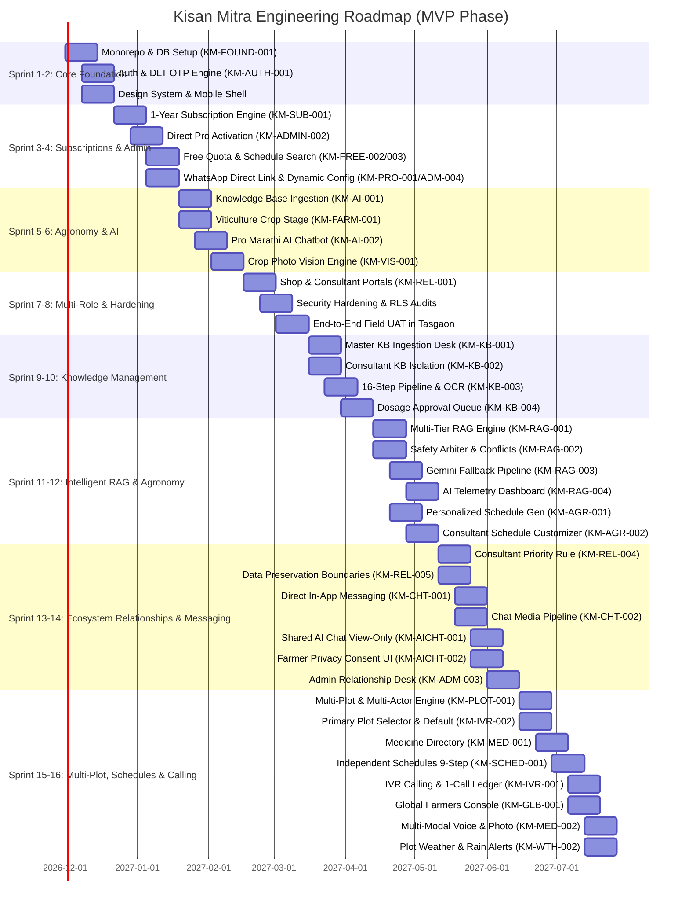

# Feature Ticket List & Engineering Execution Plan – Kisan Mitra AI (formerly DrakshGuru)

---

## 1. Document Control & Sprint Organization

| Property | Details |
| :--- | :--- |
| **Document Title** | Agile Feature Ticket Catalog & Implementation Work Breakdown Structure – Kisan Mitra AI (formerly DrakshGuru) |
| **Document Version** | 2.2.0 (Revised Free/Pro Model, WhatsApp Integration & Multi-Actor Auditing) |
| **Status** | Approved Engineering Backlog |
| **Execution Framework**| 2-Week Agile Sprints (P0 MVP target: 8 Sprints / 16 Weeks, Foundation + Advanced Extensions: 16 Sprints) |
| **Tracking System** | JIRA / Linear Compatible Schema |
| **Ticket Hierarchy** | Epic $\rightarrow$ Feature $\rightarrow$ User Story $\rightarrow$ Engineering Ticket $\rightarrow$ Subtasks |

### Document Revision History
| Version | Date | Author / Role | Changes / Remarks |
| :---: | :---: | :---: | :--- |
| 1.0.0 | 2026-11-19 | Technical Lead | Initial feature ticket backlog, story points, and sprint sequence. |
| 2.0.0 | 2026-11-20 | Technical Lead | Manual payment tickets, lead desk, 1-year calendar engine tickets. |
| 2.1.0 | 2026-11-21 | Technical Lead | Multi-plot tickets (`KM-PLOT-001`), IVR calling tickets (`KM-IVR-001/002`), 46 test assertions. |
| 2.2.0 | 2026-11-23 | Technical Lead | Revised Free/Pro scope tickets: added `KM-FREE-002` (Free Usage Quota Engine), `KM-FREE-003` (Schedule Search), `KM-ADM-004` (Dynamic WhatsApp Config); updated `KM-PRO-001` (WhatsApp Direct Link with pre-created lead), `KM-PLOT-001` (Pro Plot Registration & Multi-Actor Plot Editing with Audit Logs), and `KM-IVR-002` (Primary Plot Architecture). Expanded test suite from 46 to 54 test assertions. |

---

## 2. Master Epic Inventory

```
┌────────────────────────────────────────────────────────────────────────────────────────┐
│                                   MASTER EPIC INVENTORY                                │
├────────────────────────────┬────────────────────────────┬──────────────────────────────┤
│ 1. Project Foundation      │ 11. Farm Management        │ 21. Shop Management          │
│ 2. Design System & UI Kit  │ 12. Crop Management        │ 22. Consultant Management   │
│ 3. Authentication & OTP    │ 13. Crop Stage Engine      │ 23. Owner Web Admin Portal   │
│ 4. Farmer Profiling        │ 14. AI Knowledge Base RAG  │ 24. Payment Classification   │
│ 5. Free Informational CMS  │ 15. AI Viticulture Chatbot │ 25. System Telemetry & KPIs  │
│ 6. Free Plan Restrictions  │ 16. Gemini LLM Fallback    │ 26. Application Security     │
│ 7. Pro Upgrade Experience  │ 17. Crop Photo Vision Diag │ 27. Automated QA & Testing   │
│ 8. Pro Enquiry Lead Desk   │ 18. Weather Intelligence   │ 28. Cloud DevOps & CI/CD     │
│ 9. Subscription Management │ 19. Dynamic Daily Planner  │ 29. Monitoring & SRE         │
│ 10. One-Year Validity Eng  │ 20. Push Notifications     │ 30. KB Management (KM-KB)    │
├────────────────────────────┼────────────────────────────┼──────────────────────────────┤
│ 31. Multi-Tier RAG (KM-RAG)│ 32. Personalized Agronomy  │ 33. Consultant Priority Eng  │
│                            │     (KM-AGR)               │     (KM-REL)                 │
│ 34. Direct In-App Chat     │ 35. Shared AI Visibility   │ 36. Admin Supervision Desk   │
│     (KM-CHT)               │     (KM-AICHT)             │     (KM-ADM)                 │
├────────────────────────────┼────────────────────────────┼──────────────────────────────┤
│ 37. Global Farmer Console  │ 38. Independent Schedules  │ 39. Multi-Plot Management    │
│     (KM-GLB)               │     (KM-SCHED)             │     (KM-PLOT)                │
│ 40. Automated Voice Calls  │ 41. Medicine Directory     │                              │
│     (KM-IVR)               │     (KM-MED)               │                              │
└────────────────────────────┴────────────────────────────┴──────────────────────────────┘
```

---

## 3. High-Priority Engineering Tickets (P0 - Mandatory MVP)

### Epic 01: Project Foundation & Environment

#### `KM-FOUND-001`: Monorepo Structure & Containerized Local Environment
- **Module:** Core Infrastructure
- **Feature:** Repository Scaffold & Multi-Platform Bootstrap
- **User Story:** As an engineering team, we need a unified monorepo with containerized development dependencies so we can build the backend, mobile app, and web dashboard in parallel.
- **Priority:** P0 | **Complexity:** 5 SP (Medium) | **Dependencies:** None
- **Tasks:**
  - *Backend:* Initialize FastAPI app with Python 3.12, Poetry/Pipenv, Ruff, and Pytest.
  - *Mobile:* Initialize Expo SDK 51+ project with TypeScript and Expo Router.
  - *Web Admin:* Initialize Next.js 14 App Router with TailwindCSS.
  - *DevOps:* Setup `docker-compose.yml` for PostgreSQL 16 + pgvector and Redis 7.2.
- **Acceptance Criteria:** `docker compose up` starts PostgreSQL with pgvector enabled; API root returns `{"status": "ok"}`; mobile and web clients run locally.
- **Definition of Done (DoD):** Code reviewed, linting passes in CI, README setup documented.

---

### Epic 03: Authentication & Onboarding

#### `KM-AUTH-001`: Mobile Number DLT OTP Verification Engine
- **Module:** Identity & Access Management (IAM)
- **Feature:** Indian Mobile Number Verification
- **User Story:** As a mobile user (Farmer, Shop, Consultant), I want to log in using my 10-digit mobile number and an SMS OTP so I can access the app securely without passwords.
- **Priority:** P0 | **Complexity:** 8 SP (Large) | **Dependencies:** `KM-FOUND-001`
- **Tasks:**
  - *Backend:* Implement `/api/v1/auth/otp/request` and `/api/v1/auth/otp/verify`.
  - *Database:* Configure `users` table; integrate Redis with 120s TTL for OTP caching.
  - *Security:* Enforce rate limits (max 3 OTP requests/hour per number); apply Refresh Token Rotation (RTR).
  - *Mobile:* Build `SCR-ONB-02` (Login) and `SCR-ONB-03` (OTP Input) with auto-read SMS permissions.
- **Acceptance Criteria:** Valid OTP issues 15-minute JWT Access Token + 30-day Refresh Token; invalid OTP after 5 tries locks account for 15 minutes.
- **DoD:** 95%+ unit test coverage for token generation and rotation; end-to-end integration test passing.

---

### Epic 06 & 07: Free Plan Scope, Quota Engine & Pro Upgrade Interceptor

#### `KM-FREE-002`: Free Usage Quota Engine (3 Combined Uses/Month)
- **Module:** Subscription & Entitlements
- **Feature:** Server-Side Atomic Free Quota Tracker (`free_usage_counters`)
- **User Story:** As the Platform Owner, I want Free farmers to be strictly limited to a combined 3 uses per month across Schedule Search and Limited KB Chat, resetting on the 1st of each month at 00:00 IST, so they experience the product's value while generating strong upgrade conversion intent.
- **Priority:** P0 (Mandatory Core) | **Complexity:** 5 SP (Medium) | **Dependencies:** `KM-AUTH-001`
- **Tasks:**
  - *Database:* Create `free_usage_counters` table with composite unique constraint on `(user_id, usage_month)` where `usage_month` is formatted `'YYYY-MM'` in `Asia/Kolkata`.
  - *Backend:* Implement atomic quota check and increment middleware:
    `UPDATE free_usage_counters SET used_count = used_count + 1 WHERE user_id = :uid AND usage_month = :month AND used_count < 3 RETURNING used_count;`
  - *Error Handling:* If `used_count >= 3`, return HTTP `403 Forbidden` (`FREE_QUOTA_EXHAUSTED`) with payload including reset timestamp and WhatsApp upgrade details.
  - *Security:* Ensure quota cannot be reset by client cache clearing, reinstalling, or device spoofing.
- **Acceptance Criteria:** Free farmer gets exactly 3 combined queries per month; 4th query is blocked with HTTP `403`; quota auto-resets at 00:00:00 IST on 1st of month.
- **DoD:** Unit tests for concurrent requests, IST boundary transitions, and zero client bypass.

#### `KM-FREE-003`: Free Schedule Search Screen & Endpoint
- **Module:** Mobile Client & Scheduling Service
- **Feature:** Pruning Date Look-up & DAP Advisory Card (`SCR-FREE-01`)
- **User Story:** As a Free Farmer, I want to enter only my pruning date and view today's grape schedule from the central Global Schedule, so I can see what viticulture practices are recommended today.
- **Priority:** P0 (Mandatory Core) | **Complexity:** 5 SP (Medium) | **Dependencies:** `KM-FREE-002`
- **Tasks:**
  - *Mobile:* Build `SCR-FREE-01` featuring remaining quota counter (`कोटा: ३/३ शिल्लक`), native date picker for pruning date, search button, and DAP result card.
  - *Backend:* Implement `GET /api/v1/free/schedule-lookup?pruning_date=YYYY-MM-DD`.
  - *Logic:* Compute $\text{DAP} = \text{Current Date} - \text{Pruning Date}$. If DAP $< 0$ or date is invalid, reject with 400 Bad Request without decrementing quota. If valid, decrement free quota and return Day N Global Schedule event.
  - *Interception:* When quota is 0, render premium upgrade banner prompting user to upgrade.
- **Acceptance Criteria:** Free users can search pruning date and see Global schedule; each search consumes 1 quota use; future dates rejected without consuming quota.
- **DoD:** E2E test verifying date validation, quota consumption, and schedule rendering.

#### `KM-PRO-001`: Premium Upgrade Page & WhatsApp Direct Link
- **Module:** Subscription & Entitlements
- **Feature:** In-App Paywall & WhatsApp Direct Click-to-Chat (`SCR-UPG-01`)
- **User Story:** As a Free Farmer, when my quota is exhausted or when I tap a Pro feature, I want to see an upgrade screen with an instant WhatsApp button so I can contact the owner directly for upgrade assistance.
- **Priority:** P0 (Mandatory Core) | **Complexity:** 5 SP (Medium) | **Dependencies:** `KM-FREE-002`
- **Tasks:**
  - *Mobile:* Build `SCR-UPG-01` featuring Marathi copy: *"प्रीमियम घ्या — पुढील सुविधांसाठी प्रो प्लॅन आवश्यक आहे. अधिक माहितीसाठी WhatsApp वर क्लिक करा."* (Zero pricing displayed).
  - *WhatsApp Action:* Implement primary green button `[ 💬 WhatsApp वर चौकशी करा ]` (#25D366).
  - *Pre-Created Lead:* On button tap, client calls `POST /api/v1/subscriptions/enquiries` to create/refresh lead in `upgrade_enquiries` with status `NEW` (7-day duplicate check).
  - *Deep Link:* Client reads dynamic `owner_whatsapp_number` from public config and launches `https://wa.me/<owner_number>?text=<devanagari_prefilled_text>`.
- **Acceptance Criteria:** Tapping WhatsApp button registers lead on backend and opens WhatsApp with pre-filled Marathi message (Name, Mobile, Farmer ID); zero prices visible.
- **DoD:** Mobile E2E test verifying lead pre-creation, URL encoding, and intent launch.

#### `KM-ADM-004`: Dynamic WhatsApp Number Setting in Web Admin
- **Module:** Web Admin & Platform Configuration
- **Feature:** Dynamic Owner WhatsApp Number Management
- **User Story:** As Swapnil Pawar (Owner), I want to update the platform's WhatsApp enquiry phone number from the Web Admin dashboard without needing to redeploy the mobile app.
- **Priority:** P0 (Mandatory Core) | **Complexity:** 3 SP (Small) | **Dependencies:** `KM-FOUND-001`
- **Tasks:**
  - *Database:* Configure `system_configurations` key `owner_whatsapp_number`.
  - *Backend:* Implement `GET /api/v1/config/public` (returns public config) and `PUT /api/admin/config/whatsapp` (admin only).
  - *Web Admin:* Add WhatsApp number input field to Admin System Settings with validation for Indian mobile numbers (+91).
- **Acceptance Criteria:** Changing number in Web Admin instantly updates the target number for all subsequent mobile WhatsApp deep links without app release.
- **DoD:** Integration test verifying admin update and public endpoint reflection.

#### `KM-ENQ-001`: Owner-Assisted Pro Upgrade Enquiry Pipeline
- **Module:** Lead Generation & CRM
- **Feature:** 1-Tap Pro Upgrade Enquiry Pre-Creation & Tracking
- **User Story:** As the Platform Owner, I want enquiry records automatically pre-created when farmers tap the WhatsApp button so I have a reliable CRM database of interested farmers.
- **Priority:** P0 | **Complexity:** 5 SP (Medium) | **Dependencies:** `KM-PRO-001`
- **Tasks:**
  - *Backend:* Implement `POST /api/v1/subscriptions/enquiries` with status `NEW`.
  - *Validation:* Enforce 7-day duplicate suppression rule.
  - *Lead Metadata:* Capture user ID, farmer name, mobile number, farmer code, acreage, and timestamp.
- **Acceptance Criteria:** Lead successfully created in `upgrade_enquiries`; duplicate within 7 days updates timestamp rather than creating duplicate row.
- **DoD:** Integration tests verify database insertion and rate-limiting against lead spam.

---

### Epic 08 & 23: Owner Web Admin & Lead Management

#### `KM-ADMIN-001`: Owner Web Lead Desk & Enquiry Management
- **Module:** Owner Web Dashboard
- **Feature:** Real-Time Enquiry Processing Desk
- **User Story:** As Swapnil Pawar (Owner), I want to view all incoming farmer upgrade enquiries in a web table so I can call them personally and manage conversion statuses.
- **Priority:** P0 | **Complexity:** 8 SP (Large) | **Dependencies:** `KM-ENQ-001`
- **Tasks:**
  - *Web Admin:* Build `SCR-ADM-02` using Next.js 14, TailwindCSS, and TanStack Table.
  - *Backend:* Implement `GET /api/admin/enquiries` and `PATCH /api/admin/enquiries/{id}/status`.
  - *Features:* Status dropdown (`NEW`, `CONTACTED`, `DETAILS_SHARED`, `INTERESTED`, `CONVERTED`, `CLOSED`), click-to-call link, and internal follow-up notes.
- **Acceptance Criteria:** Leads table updates dynamically; status changes update timestamp and record admin user ID.
- **DoD:** Tested with 1,000 synthetic enquiry records for smooth scrolling and fast filtering.

---

### Epic 09 & 10: Subscription Engine & Direct Pro Activation

#### `KM-SUB-001`: One-Calendar-Year Anniversary Subscription Engine
- **Module:** Subscription Engine
- **Feature:** Deterministic 1-Year Validity & Expiry Calculation
- **User Story:** As the platform owner, I need every activated subscription to remain valid for exactly one calendar year, handling leap years and month boundaries accurately.
- **Priority:** P0 | **Complexity:** 8 SP (Large) | **Dependencies:** `KM-FOUND-001`
- **Tasks:**
  - *Backend Service:* Implement `calculate_calendar_year_expiry()` and `calculate_renewal_expiry()` using Python `dateutil.relativedelta`.
  - *Cron Service:* Build Celery/APScheduler background job running daily at 00:05 IST to transition expired subscriptions (`ACTIVE` $\rightarrow$ `EXPIRED`) and downgrade users to `FREE`.
  - *Database:* Setup `subscriptions` table with triggers validating `expiry_date > activation_date`.
- **Acceptance Criteria:** Leap-year activation on Feb 29, 2028 sets expiry to Feb 28, 2029 23:59:59 IST. Renewal prior to expiry adds 1 calendar year to current expiry.
- **DoD:** Unit tests covering standard, leap-year, month-end, and early renewal edge cases with 100% pass rate.

#### `KM-ADMIN-002`: Direct Admin-to-Farmer Pro Activation
- **Module:** Owner Web Dashboard
- **Feature:** Direct Unilateral Pro Activation by Mobile Number
- **User Story:** As Swapnil Pawar (Owner), I want to enter any farmer's mobile number into the Web Admin and activate their 1-year Pro subscription directly without requiring a shop or consultant.
- **Priority:** P0 | **Complexity:** 8 SP (Large) | **Dependencies:** `KM-SUB-001`
- **Tasks:**
  - *Web Admin:* Build `SCR-ADM-03` (Direct Activation Console) with mobile search, profile preview, payment classification toggle (`Paid`, `Pending`, `Complimentary`), and reference input.
  - *Backend:* Create `POST /api/admin/subscriptions/direct-activate`.
  - *Logic:* If farmer exists, activate immediately; if farmer is not yet registered, insert into `pending_pro_activations` for auto-claim upon signup.
  - *Audit:* Write immutable record to `audit_logs`.
- **Acceptance Criteria:** Farmer account transitions to Pro immediately upon activation; mobile client refreshes entitlements on next poll/app open.
- **DoD:** End-to-end integration test verifying direct activation for both existing and unregistered mobile numbers.

---

### Epic 14, 15 & 16: AI Viticulture Chatbot & Knowledge Base RAG

#### `KM-AI-001`: Viticulture Knowledge Base Ingestion & Vector Indexing
- **Module:** AI & Data Architecture
- **Feature:** Chunking and pgvector Storage
- **User Story:** As an AgriTech engineer, I need curated Marathi grape cultivation literature split into semantic chunks and embedded in PostgreSQL so the AI can retrieve accurate answers.
- **Priority:** P0 | **Complexity:** 8 SP (Large) | **Dependencies:** `KM-FOUND-001`
- **Tasks:**
  - *Pipeline:* Build document ingestion script parsing grape POPs, pest life cycles, and NRCG guidelines into 400-600 token chunks with 50-token overlap.
  - *Vectorization:* Generate 768-dimensional embeddings using Google `text-embedding-004`.
  - *Database:* Populate `knowledge_documents` and `knowledge_chunks` with `HNSW` vector index.
- **Acceptance Criteria:** Vector similarity queries execute in $< 50\text{ ms}$; chunk metadata includes crop stage and disease tags.
- **DoD:** 1,800+ grape viticulture chunks verified, deduplicated, and indexed.

#### `KM-AI-002`: Pro Marathi AI Chatbot with Knowledge Base RAG & Gemini Fallback
- **Module:** AI & Chat
- **Feature:** Grounded Viticulture Advisory Assistant
- **User Story:** As a Pro Farmer, I want to ask questions about grape diseases and fertilizers in Marathi and receive instant, verified answers so I can protect my vineyard.
- **Priority:** P0 | **Complexity:** 13 SP (Extra Large) | **Dependencies:** `KM-AI-001`, `KM-SUB-001`
- **Tasks:**
  - *Backend:* Implement RAG retrieval pipeline: Vector search $\rightarrow$ evaluate confidence score.
  - *Logic:* If score $\ge 0.78$, assemble context from internal chunks; if $< 0.78$, invoke Gemini 1.5 with agricultural guardrail prompt.
  - *Safety:* Validate chemical dosages against CIB rules; append mandatory PHI precautions and legal disclaimer.
  - *Mobile:* Build `SCR-AI-01` (Chatbot UI) with context banner showing current plot age and variety.
- **Acceptance Criteria:** Responds within 3.5 seconds; free users strictly blocked; advice grounded in verified viticulture practice.
- **DoD:** Automated evaluation suite of 100 benchmark Marathi grape questions achieves $> 92\%$ agronomic accuracy.

---

### Epic 17: Pro Crop Disease Photo Vision Diagnosis

#### `KM-VIS-001`: Multi-Modal AI Crop Disease Photo Analysis
- **Module:** Computer Vision & AI
- **Feature:** Leaf & Cluster Pest Diagnosis
- **User Story:** As a Pro Farmer, I want to photograph an infected grape leaf and receive an instant diagnosis with recommended remedies so I can stop disease spread immediately.
- **Priority:** P0 | **Complexity:** 13 SP (Extra Large) | **Dependencies:** `KM-SUB-001`
- **Tasks:**
  - *Mobile:* Build `SCR-VIS-01` (Camera Interface) with compression to 1080p and image validation.
  - *Storage:* Generate pre-signed PUT URLs for Supabase Storage bucket (`crop-diagnostics`).
  - *Backend:* Verify MIME type and magic bytes; strip EXIF metadata; dispatch to Gemini 1.5 Flash Vision.
  - *Output:* Return structured diagnosis (Disease Name in Marathi/English, Severity, Curative Spray, PHI Precaution).
  - *Quota:* Enforce hard daily limit of **5 photo diagnoses per farmer per day** via atomic Redis counter. Subsequent requests return HTTP 429.
- **Acceptance Criteria:** Returns diagnosis within 5 seconds; stores image in Supabase Storage; blocks Free users; blocks 6th request per calendar day.
- **DoD:** Field-tested against downy mildew, powdery mildew, and anthracnose test image datasets.

---

### Epic 11, 12 & 13: Farm Management & Phenological Stage Engine

#### `KM-FARM-001`: Vineyard Plot Setup & Dynamic Phenological Stage Engine
- **Module:** Viticulture Agronomy
- **Feature:** Grape Stage Calculation from Pruning Date
- **User Story:** As a Farmer, I want to enter my plot's pruning date and grape variety so the app automatically tells me my current vineyard growth stage.
- **Priority:** P0 | **Complexity:** 8 SP (Large) | **Dependencies:** `KM-AUTH-001`
- **Tasks:**
  - *Backend:* Implement `CropStageEngine` calculating elapsed days from pruning date and variety calibration (e.g., Foundation vs. Fruit pruning).
  - *Database:* Schema for `farms`, `crops`, and `crop_stages`.
  - *Mobile:* Build `SCR-FRM-02` and `SCR-FRM-03` for plot creation and stage milestone visualization.
- **Acceptance Criteria:** Day 35 correctly identifies "Berry Setting Stage (मणी सेटिंग अवस्था)" for Super Sonaka with corresponding physiological care advice.
- **DoD:** Unit tests validating stage transitions across 160 days for all primary grape varieties.

---

### Epic 21 & 22: Shop & Consultant Mobile Dashboards

#### `KM-REL-001`: Multi-Role Mobile Navigation & Tenant-Isolated Dashboards
- **Module:** Multi-Tenancy & Relationships
- **Feature:** Dedicated Mobile Portals for Shops and Consultants
- **User Story:** As a Shop Partner or Agronomy Consultant, I want to log in and see only the farmers assigned to me so I can track their vineyard progress without seeing unrelated platform data.
- **Priority:** P1 | **Complexity:** 8 SP (Large) | **Dependencies:** `KM-FARM-001`
- **Tasks:**
  - *Mobile:* Build `SCR-SHP-01` (Shop Dashboard) and `SCR-CON-01` (Consultant Dashboard).
  - *Backend:* Implement `/api/v1/shop/assigned-farmers` and `/api/v1/consultant/farms`.
  - *Security:* Enforce PostgreSQL Row Level Security (RLS) ensuring Shop A cannot view Shop B's farmers.
- **Acceptance Criteria:** Shop login loads only linked farmers; farmer AI chats and financial data remain strictly inaccessible.
- **DoD:** RLS penetration test verifies that spoofed queries across tenant IDs return zero rows.

#### `KM-REL-002`: Partner Registration vs. Owner Authorization & Credential Provisioning
- **Module:** Multi-Tenancy & Governance
- **Feature:** Two-Phase Partner Onboarding & Credential Issuance
- **User Story:** As the Platform Owner, I want all newly registered Shops and Consultants placed in a pending state until I review their credentials and provision their authorized login ID and password.
- **Priority:** P0 (Mandatory MVP) | **Complexity:** 8 SP (Large) | **Dependencies:** `KM-AUTH-001`
- **Tasks:**
  - *Mobile:* Build `SCR-SHP-00` and `SCR-CON-00` (Pending Approval notices).
  - *Web Admin:* Build `SCR-ADM-07` for reviewing applications, approving/rejecting, and provisioning login ID and bcrypt-hashed password.
  - *Backend:* Set default `authorization_status = 'pending_approval'`; block unapproved accounts from accessing dashboard endpoints with HTTP 403.
  - *Security:* Enforce secure password handling, zero plaintext storage, and admin-controlled credential revocation.
- **Acceptance Criteria:** Unapproved Shop or Consultant cannot access dashboard; approved account can log in using owner-provisioned credentials.
- **DoD:** Integration tests verify registration $\rightarrow$ pending state $\rightarrow$ admin approval $\rightarrow$ successful authenticated access.

#### `KM-REL-003`: Shop & Consultant Annual Subscription & Expiry Data Preservation
- **Module:** Multi-Tenancy & Subscriptions
- **Feature:** Annual Partner Validity & Historical Record Preservation
- **User Story:** As the Platform Owner, I need Shop and Consultant accounts to expire after one calendar year and suspend access without deleting their historical records or assigned farmer links.
- **Priority:** P0 (Mandatory MVP) | **Complexity:** 8 SP (Large) | **Dependencies:** `KM-SUB-001`
- **Tasks:**
  - *Backend:* Extend subscription cron to evaluate `annual_subscription_status` for shops and consultants.
  - *Mobile:* Render `SCR-EXP-01` when an expired partner attempts to access the dashboard.
  - *Database:* Enforce data preservation guarantee: Ensure no cascading deletes affect `farmer_relationships`, `farms`, or activity logs when a partner subscription expires.
- **Acceptance Criteria:** Expired partner sees renewal notice; all assigned farmer links and observation logs remain completely preserved in Supabase.
- **DoD:** Automated test verifies that account expiry suspends access but leaves relationship rows intact.

### Epic 24: Manual Payment Processing & Management

#### `KM-PAY-001`: Manual Subscription Payment Management Desk
- **Module:** Commercial Administration
- **Feature:** Multi-Source Manual Payment Classification
- **User Story:** As the Platform Owner, I want to manually record and categorize payments from Farmers, Shops, and Consultants as Paid, Pending, or Complimentary without an automated payment gateway.
- **Priority:** P0 (Mandatory MVP) | **Complexity:** 5 SP (Medium) | **Dependencies:** `KM-SUB-001`
- **Tasks:**
  - *Web Admin:* Add payment source selector (Direct Farmer / Through Consultant / Through Shop) and status toggle (`Paid`, `Pending`, `Complimentary`) in `SCR-ADM-03`.
  - *Backend:* Record transaction reference, manual confirmation notes, and admin ID in `subscriptions`.
  - *Validation:* Ensure no public-facing pricing or fee figures are rendered on client devices.
- **Acceptance Criteria:** Admin can save payment classification; payment updates do not require or trigger third-party gateway webhooks.
- **DoD:** Unit and integration tests verify payment status updates and audit logging.

---

### Epic: KM-KB – Knowledge Base Management & Ingestion

#### `KM-KB-001`: Central Master Knowledge Base Multi-Format Ingestion Desk
- **Module:** Knowledge Management
- **Feature:** Admin Document Ingestion (PDF, Word, Spreadsheets)
- **User Story:** As Swapnil Pawar (Owner), I want to upload central viticulture guidelines, university POPs, and NRCG documents into the Master KB so the AI can ground answers in verified literature.
- **Priority:** P0 (Mandatory MVP) | **Complexity:** 8 SP (Large) | **Dependencies:** `KM-FOUND-001`
- **Tasks:**
  - *Web Admin:* Build `SCR-ADM-08` file uploader supporting drag-and-drop for PDF, DOC, DOCX, and XLSX files up to 25 MB.
  - *Backend:* Implement `POST /api/admin/kb/master/documents` with SHA-256 deduplication and metadata extraction.
  - *Storage:* Store original documents in Supabase Storage bucket (`master-knowledge-docs`).
- **Acceptance Criteria:** Uploaded document is queued with status `UPLOADED`; duplicate files are rejected with informative hash collision notice.
- **DoD:** Unit and integration tests verifying multi-format file uploads and deduplication.

#### `KM-KB-002`: Consultant-Specific Knowledge Repositories & Tenant Isolation
- **Module:** Knowledge Management
- **Feature:** Isolated Consultant Agronomy Repositories
- **User Story:** As an Agronomy Consultant, I want my proprietary spray and fertigation schedules securely stored in an isolated repository so other consultants cannot access my intellectual property.
- **Priority:** P0 (Mandatory MVP) | **Complexity:** 8 SP (Large) | **Dependencies:** `KM-KB-001`, `KM-REL-002`
- **Tasks:**
  - *Web Admin:* Build `SCR-ADM-09` enabling the Owner to select a consultant and upload proprietary literature on their behalf.
  - *Database:* Schema for `consultant_knowledge_documents` partitioned by `consultant_id`.
  - *Security:* Enforce strict PostgreSQL Row Level Security (RLS) ensuring zero cross-tenant knowledge exposure.
- **Acceptance Criteria:** Consultant A's queries never return Consultant B's documents; owner has centralized management across all repositories.
- **DoD:** RLS penetration test verifying cross-tenant vector isolation.

#### `KM-KB-003`: 16-Step Document Processing Pipeline & OCR Engine
- **Module:** Knowledge Processing
- **Feature:** Automated Text & OCR Extraction Worker
- **User Story:** As an AI System, I need uploaded scanned and digital agricultural documents converted into clean text, tables, and embeddings so they can be searched accurately.
- **Priority:** P0 (Mandatory MVP) | **Complexity:** 13 SP (Extra Large) | **Dependencies:** `KM-KB-001`
- **Tasks:**
  - *Worker:* Implement 16-step Celery/Async worker pipeline: validation $\rightarrow$ malware scan $\rightarrow$ classification $\rightarrow$ PyMuPDF extraction $\rightarrow$ OCR (Tesseract) $\rightarrow$ chunking (400–600 tokens) $\rightarrow$ `text-embedding-004` generation.
  - *Integrity:* Preserve unit notations (`gm/L`, `ml/L`, `kg/acre`, `ppm`) without loss; flag incomplete dosages.
  - *Status:* Update `knowledge_processing_jobs` through the 9 lifecycle statuses.
- **Acceptance Criteria:** Successfully extracts text and tables from both scanned PDFs and Word documents; creates vector embeddings in Supabase `pgvector`.
- **DoD:** Benchmark extraction on 20 legacy grape POP documents achieves $> 95\%$ text and dosage fidelity.

#### `KM-KB-004`: Dosage Table Extraction & Human Approval Verification Queue
- **Module:** Knowledge Quality
- **Feature:** Admin Dosage Verification Queue
- **User Story:** As Swapnil Pawar (Owner), I want to review extracted chemical dosage tables in an approval queue before they are indexed so that no incorrect dosages enter the vector database.
- **Priority:** P0 (Mandatory MVP) | **Complexity:** 8 SP (Large) | **Dependencies:** `KM-KB-003`
- **Tasks:**
  - *Web Admin:* Build `SCR-ADM-10` dosage approval queue comparing extracted JSON tables against source document pages.
  - *Backend:* Implement `POST /api/admin/kb/pipeline/jobs/{id}/review` with approval, rejection, and edit actions.
  - *Logic:* Only mark document status as `APPROVED` and `INDEXED` after explicit human admin confirmation.
- **Acceptance Criteria:** Unapproved chunks are blocked from vector similarity queries; approval immediately transitions chunks to active RAG retrieval.
- **DoD:** End-to-end test verifying that unapproved documents return zero vector search hits.

---

### Epic: KM-RAG – Intelligent Multi-Tier AI Retrieval & Grounding

#### `KM-RAG-001`: Multi-Tier Context Retrieval & Source Ranking Engine (~95% Grounded)
- **Module:** AI & RAG
- **Feature:** Hierarchical Multi-Source Retrieval
- **User Story:** As a Pro Farmer, I want the AI chatbot to prioritize my assigned Consultant's approved schedule and regional POPs so that 95% of answers come directly from verified agricultural knowledge.
- **Priority:** P0 (Mandatory MVP) | **Complexity:** 13 SP (Extra Large) | **Dependencies:** `KM-KB-004`, `KM-SUB-001`
- **Tasks:**
  - *Backend:* Build multi-tier retriever querying: (1) Assigned Consultant KB, (2) Central Master KB, and (3) Farm plot history in parallel.
  - *Ranking:* Score and filter chunks by cosine similarity, phenological stage alignment, and authority level.
  - *Marathi Generation:* Prompt Gemini 1.5/2.0 with assembled verified context to generate crisp, natural Devanagari Marathi output with source citations.
- **Acceptance Criteria:** Target $\ge 95\%$ of queries answered purely from verified chunks; average latency $< 3.5\text{ seconds}$; citations explicitly included.
- **DoD:** Evaluation suite of 100 viticulture test queries achieves $\ge 95\%$ grounded retrieval rate.

#### `KM-RAG-002`: Agronomic Safety Arbiter & Conflict Resolution Service
- **Module:** AI Safety
- **Feature:** Scientific Safety Rule Enforcement & Conflict Detection
- **User Story:** As a Viticulture Specialist, I need the AI to detect when a recommendation conflicts with CIB export safety rules or residue limits and flag the conflict instead of giving an unsafe dosage.
- **Priority:** P0 (Mandatory MVP) | **Complexity:** 8 SP (Large) | **Dependencies:** `KM-RAG-001`
- **Tasks:**
  - *Backend:* Implement deterministic `AgronomicSafetyArbiter` validating retrieved chemical recommendations against CIB/NRCG banned lists, MRLs, and PHI periods.
  - *Conflict Handler:* If a Consultant schedule and university POP disagree, flag `conflict_detected = TRUE` and output an advisory warning the farmer to consult their agronomist rather than silently picking a dosage.
- **Acceptance Criteria:** Zero ungrounded or banned chemical combinations output; conflicting recommendations produce safety warnings.
- **DoD:** Test suite of 25 intentionally conflicting dosage scenarios correctly triggers conflict warnings in 100% of cases.

#### `KM-RAG-003`: Controlled Gemini Fallback Pipeline (~5–10% Target) & Guardrails
- **Module:** AI Fallback
- **Feature:** Secondary Language & Reasoning Fallback
- **User Story:** As an AI System, when indexed agricultural knowledge is insufficient for a farmer's complex query, I want to use Gemini as a fallback with strict safety guardrails.
- **Priority:** P0 (Mandatory MVP) | **Complexity:** 8 SP (Large) | **Dependencies:** `KM-RAG-001`
- **Tasks:**
  - *Backend:* Route queries with similarity $< 0.78$ to the Gemini Fallback pipeline.
  - *Guardrails:* Inject agricultural system prompt strictly forbidding the synthesis of unverified chemical trade names or dosages; mandate PHI warnings.
  - *Disclaimers:* Automatically append standard verified agronomy disclaimers.
- **Acceptance Criteria:** Fallback responses remain constrained to ~5–10% of total query volume; zero ungrounded chemical fabrications.
- **DoD:** Penetration testing verifies that adversarial prompts cannot coerce Gemini into fabricating banned chemical mixtures.

#### `KM-RAG-004`: AI Grounding, Fallback & Cost Telemetry Dashboard
- **Module:** Observability & Governance
- **Feature:** Real-Time AI Quality & Telemetry Desk
- **User Story:** As Swapnil Pawar (Owner), I want to view real-time metrics on KB grounded answer rates, fallback percentages, token costs, and latencies in the Web Admin.
- **Priority:** P0 (Mandatory MVP) | **Complexity:** 5 SP (Medium) | **Dependencies:** `KM-RAG-001`
- **Tasks:**
  - *Web Admin:* Build `SCR-ADM-11` telemetry dashboard displaying: Grounded Answer Rate (~95% gauge), Fallback Rate (~5-10% gauge), Token Spend, Latency, and Ungrounded Dosage Rate (0.0%).
  - *Backend:* Implement `GET /api/admin/telemetry/ai-grounding` querying `ai_response_logs` and `gemini_fallback_logs`.
- **Acceptance Criteria:** Dashboard updates dynamically; alerts if grounded rate drops below 90% or fallback exceeds 15%.
- **DoD:** Synthetic telemetry benchmark verifies sub-second dashboard rendering over 50,000 log records.

---

### Epic: KM-AGR – Personalized Farm Agronomy Schedule Engine

#### `KM-AGR-001`: Multi-Plot Personalized Farm Agronomy Schedule Generator
- **Module:** Agronomy Engine
- **Feature:** Plot-Specific Daily Crop Care Calendar
- **User Story:** As a Pro Farmer, I want a personalized day-by-day agronomy schedule for each of my vineyard plots based on variety, pruning date, current stage, and weather so I know exactly what to spray and fertilize.
- **Priority:** P0 (Mandatory MVP) | **Complexity:** 13 SP (Extra Large) | **Dependencies:** `KM-FARM-001`, `KM-KB-004`
- **Tasks:**
  - *Backend:* Build `PersonalizedScheduleEngine` mapping elapsed days after pruning (DAP) to phenological milestones, university POPs, and assigned Consultant schedules.
  - *Output Schema:* Populate `farm_schedule_items` with plot area, approved dosage per acre/litre, application method, calculated volume (if area known), and estimated cost (if price verified).
  - *Mobile:* Build `SCR-PLN-02` interactive schedule screen with completed/rescheduled action buttons.
- **Acceptance Criteria:** Plot 1 (Super Sonaka, Day 42) renders bunch dipping with GA3 + CPPU citing consultant source; Plot 2 (Thompson, Day 20) renders 5-leaf stage canopy care.
- **DoD:** Unit tests validating personalized schedule generation across 5 grape varieties and all phenological stages.

#### `KM-AGR-002`: Consultant Schedule Customizer & Field Observation Logger
- **Module:** Consultant Agronomy
- **Feature:** Mobile Schedule Customization & Observation Desk
- **User Story:** As an Agronomy Consultant, I want to customize spray dates and dosages for my assigned farmers' plots and log field visit observations directly in my mobile app.
- **Priority:** P0 (Mandatory MVP) | **Complexity:** 8 SP (Large) | **Dependencies:** `KM-AGR-001`, `KM-REL-001`
- **Tasks:**
  - *Mobile:* Build `SCR-CON-03` (Schedule Customizer) and `SCR-CON-04` (Field Observation Logger).
  - *Backend:* Implement `POST /api/v1/consultant/schedules/customize` and log audit entry into `schedule_revisions`.
  - *Sync:* Instantly update the farmer's mobile schedule view with an explicit "Consultant Prescription" badge.
- **Acceptance Criteria:** Customized schedule reflects in the farmer's mobile app immediately; changes logged in revision history.
- **DoD:** Integration test verifying consultant schedule revision, farmer app update, and revision history persistence.

---

### Epic: KM-REL – Ecosystem Relationship & Consultant Priority Engine

#### `KM-REL-004`: Consultant Priority Rule & Transactional Unlinking Engine
- **Module:** Multi-Tenancy & Relationships
- **Feature:** Automated Consultant Priority & Atomic Shop Unlinking
- **User Story:** As the Platform Owner, I need the system to automatically grant priority to an Agricultural Consultant whenever they add a farmer who is already linked to a Shop, unlinking the Shop and alerting only the Owner/Admin.
- **Priority:** P0 (Mandatory Core) | **Complexity:** 8 SP (Large) | **Dependencies:** `KM-FOUND-001`, `KM-REL-001`
- **Tasks:**
  - *Backend:* Build atomic transaction inside `RelationshipService`: lock farmer record, detect active shop link, set status to `unlinked_by_priority`, insert consultant active link.
  - *Ledger:* Write transition event into `farmer_relationship_history`.
  - *Admin Alert:* Emit real-time notification to Owner Web Admin WebSocket feed (`SCR-ADM-13`).
  - *Security:* Ensure neither the former shop nor the farmer receives an alerting broadcast notification.
- **Acceptance Criteria:** Adding a consultant to a shop-linked farmer transitions shop to `unlinked_by_priority`; unique active constraint enforced; zero concurrency collisions.
- **DoD:** Concurrency test simulating simultaneous linking requests maintains database integrity and triggers single unlinking event.

#### `KM-REL-005`: Relationship Transition History & Data Preservation Boundaries
- **Module:** Data Governance & Audit
- **Feature:** Historical Data Preservation on Unlink
- **User Story:** As an Agricultural Shop, when a farmer is unlinked from my account, I want my historical sales, visit notes, and past messages preserved, while losing access to the farmer's future private data.
- **Priority:** P0 (Mandatory Core) | **Complexity:** 5 SP (Medium) | **Dependencies:** `KM-REL-004`
- **Tasks:**
  - *Database:* Ensure no cascading deletes on `farmer_relationships`, `chat_conversations`, or `farm_activities`.
  - *Security:* PostgreSQL RLS policies block unlinked shop from querying new farmer plots, messages, or AI chats created after `unlinked_at`.
- **Acceptance Criteria:** Past direct messages and notes remain visible to former shop; new farm activities and messages return HTTP 403.
- **DoD:** Automated test verifying historical record availability and new-data access blocking.

---

### Epic: KM-CHT – Direct In-App Human Messaging System

#### `KM-CHT-001`: Direct In-App 1-to-1 Messaging Engine (WhatsApp-Style)
- **Module:** Real-Time Communications
- **Feature:** Farmer-Shop and Farmer-Consultant Direct Chat
- **User Story:** As a Farmer, I want to exchange text messages and vineyard photos directly with my linked Shop or Consultant inside the app so I can receive personalized advice without leaving Kisan Mitra.
- **Priority:** P0 (Mandatory Core) | **Complexity:** 13 SP (Extra Large) | **Dependencies:** `KM-AUTH-001`, `KM-REL-004`
- **Tasks:**
  - *Backend:* Implement `/api/v1/direct-chat/conversations` and `/api/v1/direct-chat/conversations/{id}/messages` endpoints.
  - *Realtime:* Configure Supabase Realtime CDC over WebSockets for instant message delivery and double-tick status sync (`sent`, `delivered`, `read`).
  - *Mobile:* Build `SCR-CHT-01` (Farmer), `SCR-SHP-02` (Shop), and `SCR-CON-05` (Consultant) chat views.
  - *Privacy:* Enforce strict channel separation: Shop cannot view Consultant-Farmer chats; Consultant cannot view Shop-Farmer chats.
- **Acceptance Criteria:** Message round-trip latency $< 500\text{ ms}$; delivery status ticks update in real-time; unlinked channels lock new message sending.
- **DoD:** End-to-end integration test of 1-to-1 chat flow passing across iOS and Android test runners.

#### `KM-CHT-002`: Chat Media Attachment Pipeline & Signed URL Security
- **Module:** Media Infrastructure
- **Feature:** Vineyard Photo Sharing & Storage
- **User Story:** As a Farmer, I want to take a photo of an infected leaf or cluster and send it directly in my chat with my agronomist or shop dealer.
- **Priority:** P0 (Mandatory Core) | **Complexity:** 8 SP (Large) | **Dependencies:** `KM-CHT-001`
- **Tasks:**
  - *Mobile:* Image compression to 1080p, preview thumbnail generation, and background upload progress bar.
  - *Storage:* Upload to private Supabase Storage bucket (`chat-media`).
  - *Backend:* Validate magic bytes, strip EXIF metadata, and issue 15-minute signed URLs for authorized chat participants.
- **Acceptance Criteria:** Only active participants in the specific conversation can load photo URLs; expired URLs return 403.
- **DoD:** Security penetration test verifying that unauthorized users cannot guess or access chat media URLs.

---

### Epic: KM-AICHT – Shared Farmer AI Chat Visibility (Read-Only)

#### `KM-AICHT-001`: Partner Read-Only Farmer AI Chat Projection & Audit Logging
- **Module:** Partner Collaboration & AI Governance
- **Feature:** View-Only Farmer AI Conversation Viewer
- **User Story:** As a Shop Partner or Agronomy Consultant, I want to view my linked farmers' conversations with Kisan Mitra AI in read-only mode so I can understand their concerns and provide better human assistance.
- **Priority:** P0 (Mandatory Core) | **Complexity:** 8 SP (Large) | **Dependencies:** `KM-AI-002`, `KM-REL-004`
- **Tasks:**
  - *Mobile:* Build `SCR-SHP-03` and `SCR-CON-06` featuring persistent read-only banner, question/answer cards, and disabled input bar.
  - *Backend:* Implement `GET /api/v1/partner/farmers/{farmer_id}/ai-chat-view`.
  - *Security:* Validate active relationship and active farmer consent. Strictly prevent message insertions or modifications.
  - *Audit:* Write immutable access log to `ai_chat_view_audit_logs` on every view event.
- **Acceptance Criteria:** Partner can read questions and AI answers; partner CANNOT post messages or modify conversations; audit log records viewer ID, timestamp, and IP.
- **DoD:** Automated test verifying that POST/PATCH requests to AI chat from partner roles are rejected with HTTP 403.

#### `KM-AICHT-002`: Farmer Privacy & AI Visibility Consent Settings
- **Module:** Privacy & User Control
- **Feature:** Granular Shared AI Visibility Controls
- **User Story:** As a Farmer, I want transparent disclosure and toggles to control whether my linked Shop or Consultant can view my AI chats.
- **Priority:** P0 (Mandatory Core) | **Complexity:** 5 SP (Medium) | **Dependencies:** `KM-AICHT-001`
- **Tasks:**
  - *Mobile:* Build `SCR-SET-02` with clear Marathi disclosure copy and independent toggles for Shop and Consultant visibility.
  - *Backend:* Implement `GET /api/v1/farmer/ai-visibility-consent` and `PUT /api/v1/farmer/ai-visibility-consent`.
  - *Database:* Persist preferences in `farmer_ai_visibility_consents`.
- **Acceptance Criteria:** Toggling off visibility immediately blocks partner access via RLS.
- **DoD:** Unit test verifying instant access blocking upon consent revocation.

---

### Epic: KM-ADM – Owner Administration & Relationship Supervision

#### `KM-ADM-003`: Owner/Admin Relationship Supervision, Priority Alerts & Restoration Desk
- **Module:** Owner Web Administration
- **Feature:** Centralized Relationship Management & Priority Switch Console
- **User Story:** As Swapnil Pawar (Owner), I want to receive real-time alerts whenever the Consultant Priority Rule unlinks a shop, view relationship transition history, and restore links if an error occurs.
- **Priority:** P0 (Mandatory Core) | **Complexity:** 8 SP (Large) | **Dependencies:** `KM-REL-004`
- **Tasks:**
  - *Web Admin:* Build `SCR-ADM-13` (Relationship Management & Priority Monitor) and `SCR-ADM-14` (AI Access Audit Ledger).
  - *Backend:* Implement `/api/admin/relationships/priority-switches` and `/api/admin/relationships/{id}/restore`.
  - *Logic:* 1-click administrative restoration reinstates former shop link with full audit logging.
- **Acceptance Criteria:** Priority switches appear instantly in Owner feed; 1-click restoration executes atomically.
- **DoD:** End-to-end test verifying unlinking alert generation, admin review, and successful relationship restoration.

---

### Epic: KM-GLB – Global Farmer Central Management

#### `KM-GLB-001`: Global Farmer Central Profile & Admin Management Console
- **Module:** Owner Web Administration & Backend API
- **Feature:** Unassigned Global Farmer Governance & Profile Console (`SCR-ADM-15`)
- **User Story:** As Swapnil Pawar (Owner), I want a dedicated console to inspect and manage unassigned Global Farmers, view their registered plots, advisory history, and automated calling performance.
- **Priority:** P0 (Mandatory Core) | **Complexity:** 8 SP (Large) | **Dependencies:** `KM-ADMIN-002`
- **Tasks:**
  - *Web Admin:* Construct `SCR-ADM-15` (Global Farmers Console) with search by mobile/village/plot, multi-plot breakdown cards, and direct Pro activation controls.
  - *Backend:* Implement `/api/admin/global-farmers` (`GET`, `POST`) and `/api/admin/global-farmers/{id}` (`GET`, `PUT`).
  - *Logic:* Filter farmers where `shop_id IS NULL` and `consultant_id IS NULL`; bind directly to Global DrakshGuru Master Schedule.
- **Acceptance Criteria:** Admin can view all Global Farmers, search by mobile, and inspect plot stages without interference from shop or consultant data filters.
- **DoD:** Integration test verifying Global Farmer retrieval, plot inspection, and schedule binding.

---

### Epic: KM-SCHED – Independent Advisory Schedules

#### `KM-SCHED-001`: Independent Advisory Schedule 9-Step Ingestion Engine
- **Module:** Schedule Ingestion Service & Owner Web Admin
- **Feature:** Configuration-Driven 9-Step Schedule File Ingestion Pipeline (`SCR-ADM-16`)
- **User Story:** As Swapnil Pawar (Owner), I want to safely upload proprietary advisory schedule files for any Shop, Consultant, or Global platform, validate DAP milestones, and publish configurations without redeploying code.
- **Priority:** P0 (Mandatory Core) | **Complexity:** 13 SP (Epic/X-Large) | **Dependencies:** `KM-FOUND-001`
- **Tasks:**
  - *Web Admin:* Build `SCR-ADM-16` with file upload (XLSX, CSV, PDF), scope selector (Global/Shop/Consultant), and interactive DAP milestone preview table.
  - *Backend:* Build `IndependentScheduleSvc` executing 9 pipeline steps: upload, format validation, schema normalization, DAP sequence check, dosage bounds validation, multi-tenant tagging, staging write, admin review, and dynamic runtime binding.
  - *Security:* Strip formula prefixes (`=`, `+`, `-`, `@`); prevent SQL or executable script injection.
- **Acceptance Criteria:** Schedule files parse cleanly into `schedule_configurations` and `schedule_events`; dynamic runtime binding delivers correct schedule matching farmer category.
- **DoD:** End-to-end test ingesting a 120-day grape schedule spreadsheet, validating DAP stages, and verifying runtime delivery to assigned farmers.

---

### Epic: KM-PLOT – Multi-Plot Vineyard Management

#### `KM-PLOT-001`: Pro Plot Registration & Multi-Actor Plot Editing with Audit Logs
- **Module:** Mobile Client, Farm Service & Audit Engine
- **Feature:** Pro-Gated Plot Registration, First-Run Setup (`SCR-PLT-00`), Multi-Actor Editing & In-App Notification
- **User Story:** As an active Pro Farmer (or their linked Shop/Consultant/Admin), I want to register and update multiple vineyard plots with automatic Primary Plot designation, so that accurate viticulture timelines and calls are generated while keeping the farmer informed of any partner edits.
- **Priority:** P0 (Mandatory Core) | **Complexity:** 8 SP (Large) | **Dependencies:** `KM-FARM-001`, `KM-SUB-001`
- **Tasks:**
  - *Mobile:* Build `SCR-PLT-00` (First-Run Pro Setup), `SCR-PLT-01` (Plot List), and `SCR-PLT-02` (Add Plot with GPS pin); add plot switcher dropdown to `SCR-FRM-01` (Home) and `SCR-PLN-01` (Planner).
  - *Backend:* Implement `/api/v1/farmer/plots` (`GET`, `POST`) and `/api/v1/farmer/plots/{id}` (`GET`, `PUT`). Restrict creation strictly to active Pro subscribers; return 403 `PRO_SUBSCRIPTION_REQUIRED` to Free tier users.
  - *Multi-Actor RBAC:* Authorize Farmer (own), Linked Shop (assigned Pro), Linked Consultant (assigned Pro), and Admin (all) to INSERT and UPDATE plots. Strictly forbid DELETE by partners.
  - *Audit & Notification:* If plot is created or updated by a partner or admin, automatically write immutable record in `audit_logs` and dispatch in-app push notification to the farmer.
  - *Primary Plot Assignment:* First plot registered automatically receives `is_primary_plot = TRUE`.
- **Acceptance Criteria:** Free users cannot register plots; Pro users and authorized partners can add multiple plots; partner edits trigger audit log and farmer notification; exactly one Primary Plot is maintained.
- **DoD:** Unit and integration tests verifying Pro gating, multi-actor permissions, audit log generation, and notification delivery.

---

### Epic: KM-IVR – Automated Voice Calling & Quota

#### `KM-IVR-001`: Automated Voice Calling (IVR) Engine & 1-Call-Per-Day Ledger
- **Module:** Telephony Worker & Database
- **Feature:** Daily Marathi IVR Dispatcher & Database-Enforced Single Call Quota (`SCR-ADM-17`)
- **User Story:** As a Farmer, I want to receive a concise Marathi voice call with today's grape spray and weather guidance for my Primary Plot, strictly limited to maximum 1 call per day.
- **Priority:** P0 (Mandatory Core) | **Complexity:** 13 SP (Epic/X-Large) | **Dependencies:** `KM-PLOT-001`, `KM-SCHED-001`
- **Tasks:**
  - *Worker:* Build `IVRCallingSvc` cron running daily between 07:00 AM and 07:00 PM IST; synthesize Marathi voice audio via Google Cloud TTS.
  - *Backend:* Implement `/api/v1/ivr/calls/trigger` and `/api/v1/ivr/webhook/callback`.
  - *Database:* Enforce single call per day via `daily_call_ledger` with unique index `idx_single_daily_call(farmer_id, call_date)`.
- **Acceptance Criteria:** No farmer ever receives more than 1 call per calendar day across all plots and alerts; failed calls retry up to 2 times within 2 hours.
- **DoD:** Concurrency test verifying that 5 simultaneous call trigger requests result in exactly 1 call dispatched and 4 ledger conflicts.

#### `KM-IVR-002`: Primary Plot Architecture & Default Plot 1 Fallback
- **Module:** Mobile Client & Backend API
- **Feature:** Primary Plot Settings & Unified Driver Fallback (`SCR-SET-03`)
- **User Story:** As a Pro Farmer with multiple vineyard plots, I want a single Primary Plot that drives both my main app timeline and daily voice calls, with Plot 1 selected by default.
- **Priority:** P0 (Mandatory Core) | **Complexity:** 5 SP (Medium) | **Dependencies:** `KM-PLOT-001`
- **Tasks:**
  - *Mobile:* Build `SCR-SET-03` with radio list of registered plots, Primary Plot badge, call hour picker (07:00 AM–07:00 PM), and call opt-out toggle.
  - *Backend:* Implement `/api/v1/farmer/calling-settings` (`GET`, `PUT`) and update Primary Plot via `farms.is_primary_plot = TRUE` (enforcing partial unique index `idx_single_primary_plot`).
  - *Logic:* Resolve advisory and calls from the Primary Plot. If no plot was explicitly designated, query `farms ORDER BY created_at ASC LIMIT 1` as default Primary Plot.
- **Acceptance Criteria:** The first added plot automatically becomes the default Primary Plot; changing Primary Plot updates both timeline and voice call driver; duplicate calling plot concepts eliminated.
- **DoD:** Integration test verifying default plot fallback when settings row is absent, and verified update when farmer or partner saves new preference.

---

### Epic: KM-MED – Medicine Directory & Multi-Modal Input

#### `KM-MED-001`: Searchable Viticulture Medicine & Input Directory
- **Module:** Mobile Client & Backend API
- **Feature:** Searchable Viticulture Input Directory & CIB Dosage Cards (`SCR-MED-01`, `SCR-MED-02`)
- **User Story:** As a Farmer, I want to search for grape medicines by trade name or technical active ingredient, and view verified CIB dosages, target diseases, and pre-harvest intervals.
- **Priority:** P0 (Mandatory Core) | **Complexity:** 8 SP (Large) | **Dependencies:** `KM-FOUND-001`
- **Tasks:**
  - *Mobile:* Build `SCR-MED-01` (Searchable Directory with category filter chips) and `SCR-MED-02` (Product Detail Card).
  - *Backend:* Implement `/api/v1/medicine/products` (`GET`) and `/api/v1/medicine/products/{id}` (`GET`).
  - *Database:* Seed `medicine_products` with viticulture fungicides, insecticides, and PGRs with verified CIB dosages and PHI.
  - *Governance:* Explicit zero-ecommerce disclaimer displayed on all cards; read-only access for users.
- **Acceptance Criteria:** Farmers can fuzzy search medicines in Marathi and English; dosage cards display verified CIB rates; no purchase buttons.
- **DoD:** Automated test verifying search latency $< 200$ms and accuracy across 50 grape protection chemicals.

#### `KM-MED-002`: Multi-Modal Inputs: Ask by Photo (Product) & Ask by Voice (Marathi)
- **Module:** AI Engine & Mobile Client
- **Feature:** Multi-Modal Knowledge Retrieval: Ask by Product Photo & Ask by Voice (`SCR-VCE-01`, `SCR-AI-01`)
- **User Story:** As a Pro Farmer, I want to take a photo of a medicine bottle or speak my question in Marathi, and receive verified KB guidance.
- **Priority:** P0 (Mandatory Core) | **Complexity:** 8 SP (Large) | **Dependencies:** `KM-AI-002`, `KM-MED-001`
- **Tasks:**
  - *Mobile:* Add microphone button to `SCR-AI-01` launching `SCR-VCE-01` (Marathi STT recorder + audio response player); add camera icon to capture medicine labels.
  - *Backend:* Connect STT audio transcription to Marathi vector embedding pipeline; connect label OCR to `medicine_products` fuzzy matcher; search KB first.
- **Acceptance Criteria:** Farmers can ask questions via voice or photo; verified KB knowledge returned; Gemini called only if confidence $< 0.78$.
- **DoD:** Field test verifying Marathi voice recognition in rural outdoor environments and accurate medicine bottle OCR recognition.

---

### Epic: KM-WTH – Weather Intelligence

#### `KM-WTH-002`: Plot-Specific GPS Capture & Stage-Sensitive Rain Alert Dispatcher
- **Module:** Weather Service & Push/Calling Worker
- **Feature:** GPS Coordinate Registration & Weather Evaluation Engine
- **User Story:** As a Farmer, I want rain warnings tailored to each plot's GPS coordinates, taking into account the crop stage of my Calling Plot without exceeding my 1-call-per-day limit.
- **Priority:** P0 (Mandatory Core) | **Complexity:** 8 SP (Large) | **Dependencies:** `KM-PLOT-001`, `KM-IVR-001`
- **Tasks:**
  - *Mobile:* Capture GPS on `SCR-PLT-02` with map pin confirmation and precision rounding.
  - *Backend:* Query Open-Meteo / IMD API using plot GPS coordinates; calculate precipitation risk against phenological stage sensitivity (e.g. flowering stage downy risk).
  - *Calling Integration:* Incorporate rain alert into daily automated call if uncalled today; send push notification if call already completed.
- **Acceptance Criteria:** Rain alerts reflect specific plot coordinates; voice call dispatch honors the 1-call-per-day limit.
- **DoD:** Simulation test verifying rain warning generation and adherence to single-call constraint.

---

## 4. Master Development Sequence & Milestone Schedule



---

## 5. Critical Subscription & Access Test Cases

Every automated release build must execute and pass the following 54 core validation assertions:

| Test ID | Test Scenario Description | Expected Outcome | Verification Level |
| :---: | :--- | :--- | :---: |
| **TC-SUB-01** | Free Farmer taps AI Chatbot floating icon. | Request intercepted; no API call dispatched; `SCR-UPG-01` displayed. | Mobile E2E |
| **TC-SUB-02** | Free Farmer attempts direct POST to `/api/v1/chat/message`. | Backend rejects with HTTP `403 Forbidden` (`PRO_ENTITLEMENT_REQUIRED`). | Backend Integration |
| **TC-SUB-03** | Free Farmer attempts photo upload for disease diagnosis. | Camera blocked; Pro upgrade screen displayed; Supabase upload ticket denied. | Mobile & API |
| **TC-SUB-04** | Free Farmer clicks "Upgrade to Pro" and confirms enquiry. | Unique enquiry record created in DB with status `NEW`; confirmation shown. | API & Database |
| **TC-SUB-05** | Owner views Lead Desk in Web Admin. | Newly submitted enquiry appears dynamically with farmer details. | Web Integration |
| **TC-SUB-06** | Owner changes enquiry status from `NEW` to `CONTACTED`. | DB updates status; audit log records Admin ID and timestamp. | Web & API |
| **TC-SUB-07** | Owner executes Direct Pro Activation for registered mobile number. | 1-Year subscription created; account tier updated to `pro`; audit logged. | API & Database |
| **TC-SUB-08** | Owner executes Direct Activation for unregistered mobile number. | `pending_pro_activations` record created; auto-claimed upon user signup. | API & Database |
| **TC-SUB-09** | Pro subscription validity calculation on Feb 29, 2028. | Expiry calculated as Feb 28, 2029 23:59:59 IST (Exact 1-Year Anniversary). | Unit Test |
| **TC-SUB-10** | Pro Farmer renews subscription 15 days before current expiry. | New expiry date = Current Expiry Date + 1 Calendar Year (No lost days). | Unit Test |
| **TC-SUB-11** | Nightly subscription cron runs on expired account. | Subscription status transitions to `EXPIRED`; user tier reverts to `FREE`. | Background Worker |
| **TC-SUB-12** | Client tampers with local storage token to set `"tier": "pro"`. | Backend validates signed JWT claims; tampered token rejected with `401`. | Security Penetration |
| **TC-SUB-13** | Shop A attempts to query farmers assigned to Shop B. | PostgreSQL RLS policy filters result set; query returns 0 rows. | Database Security |
| **TC-SUB-14** | Pro Farmer exceeds daily photo diagnostic quota (5/day). | 6th request rejected with HTTP `429 Too Many Requests` ("Daily limit reached"). | API Gateway |
| **TC-SUB-15** | Newly registered Shop/Consultant attempts to access dashboard. | Request rejected with HTTP `403 Forbidden` (`PENDING_APPROVAL` status). | API Integration |
| **TC-SUB-16** | Expired Shop/Consultant attempts to access dashboard. | Access suspended; `SCR-EXP-01` rendered; historical records preserved in DB. | Mobile & API |
| **TC-KB-01** | Owner uploads PDF to Master KB via `SCR-ADM-08`. | Document queued with status `UPLOADED`; 16-step pipeline processing begins; `knowledge_processing_jobs` row created. | Web & API |
| **TC-KB-02** | Unapproved document queried via RAG vector search. | Vector similarity query returns zero results; unapproved chunks are excluded from retrieval index. | Backend Integration |
| **TC-KB-03** | Consultant A queries Consultant B's private knowledge documents. | PostgreSQL RLS policy filters result set; query returns 0 rows; zero cross-tenant knowledge exposure. | Database Security |
| **TC-KB-04** | Pro Farmer with assigned Consultant queries AI chatbot. | Multi-tier retriever returns Consultant-specific schedule first, then Master KB; source citations include Consultant name. | Backend Integration |
| **TC-KB-05** | Consultant schedule dosage conflicts with CIB safety rule (MRL/PHI). | `AgronomicSafetyArbiter` sets `conflict_detected = TRUE`; farmer sees advisory warning to consult agronomist; no silent dosage compromise. | Backend Integration |
| **TC-KB-06** | Pro Farmer query grounded in Master KB verified chunk. | AI response includes inline source citation with document title, section, and confidence score; response marked `source_type = 'kb_grounded'`. | Backend Integration |
| **TC-KB-07** | Low similarity query (score $< 0.78$) triggers Gemini fallback. | Gemini invoked with safety guardrail prompt; response contains no ungrounded chemical dosages; disclaimer badge appended; logged in `gemini_fallback_logs`. | Backend Integration |
| **TC-REL-01** | Farmer initially linked to Shop A. | Active relationship established (`status = 'active'`, `relationship_type = 'shop_farmer'`); Shop A views farmer in dashboard. | API & Database |
| **TC-REL-02** | Consultant B subsequently links farmer already with Shop A. | Backend transaction automatically transitions Shop A to `unlinked_by_priority`; Consultant B relationship becomes `active`. | Backend Transaction |
| **TC-REL-03** | Consultant Priority Rule executes. | Unlinking notification event emitted EXCLUSIVELY to Owner Web Admin; zero alerting push notifications sent to former shop or farmer. | Notification & WS |
| **TC-REL-04** | Farmer attempts manual override / dissociation from app. | API rejects request with HTTP `403 Forbidden` (`FARMER_RELATIONSHIP_MUTATION_RESTRICTED`). | Security & API |
| **TC-REL-05** | Former Shop A attempts to query newly created plot or chat messages after unlinking. | API / RLS blocks query; returns zero rows for new data while past historical messages remain readable. | Database RLS |
| **TC-CHT-01** | Farmer sends direct message & photo to actively linked Shop/Consultant. | Message inserted into `chat_messages`, photo stored in private bucket with signed URL, status updates to `sent` $\rightarrow$ `delivered`. | Realtime & Storage |
| **TC-CHT-02** | Shop A attempts to read messages in Consultant-Farmer conversation. | RLS policy evaluates zero access; returns HTTP `403` or zero rows; strict cross-channel isolation verified. | Security Penetration |
| **TC-AICHT-01** | Actively linked Consultant opens Farmer AI Conversation View (`SCR-CON-06`). | Server streams farmer questions & AI answers; UI renders read-only banner; input field is disabled; audit log written. | Mobile & Backend |
| **TC-AICHT-02** | Partner attempts POST/PATCH to farmer's AI conversation thread. | API gateway rejects request with HTTP `405 Method Not Allowed` / `403 Forbidden`; DB RLS blocks non-farmer insertions. | Security & Gateway |
| **TC-AICHT-03** | Farmer toggles OFF Shop AI Visibility in `SCR-SET-02`. | Linked Shop attempt to open AI view returns HTTP `403 Forbidden` (`FARMER_AI_SHARING_DISABLED`). | API & RLS |
| **TC-ADM-01** | Owner reverses accidental priority unlinking via Admin Console (`SCR-ADM-13`). | Relationship restored atomically to `active`; transition logged in `farmer_relationship_history` with full audit trail. | Web & Database |
| **TC-PLOT-01** | Farmer registers second vineyard plot (Plot 2) with different pruning date. | Plot registered successfully; independent phenological stage and DAP calculated; both plots visible in `SCR-PLT-01`. | API & Mobile |
| **TC-PLOT-02** | Farmer registers first plot without setting Primary Plot. | First plot automatically tagged `is_primary_plot = TRUE` as default Primary Plot; `SCR-SET-03` reflects Plot 1 as default. | Database & API |
| **TC-PLOT-03** | Farmer deletes or deactivates active Primary Plot. | Next active plot ordered by `created_at ASC` automatically promoted to default Primary Plot (`is_primary_plot = TRUE`). | Business Logic |
| **TC-CALL-01** | Calling cron runs for farmer with 3 registered plots. | Exactly 1 voice call dispatched synthesizing advisory for Primary Plot; `daily_call_ledger` records entry. | Telephony Worker |
| **TC-CALL-02** | Simultaneous weather alert attempts second automated call on same calendar day. | Database partial unique index on `daily_call_ledger` rejects insert; voice call blocked; fallback to push notification. | Database Security |
| **TC-CALL-03** | Telephony call fails due to farmer phone busy or out of coverage. | System retries twice with exponential backoff (within 2 hours); stops after 2 retries; call status logged `failed`. | IVR Service |
| **TC-CALL-04** | Farmer enables call opt-out in `SCR-SET-03`. | Daily calling job skips farmer; zero telephony calls dispatched; ledger records `opted_out`. | Worker & Preferences |
| **TC-SCHED-01** | Owner uploads 120-day grape schedule spreadsheet via `SCR-ADM-16`. | 9-step pipeline parses stages, strips formula triggers, validates DAP sequences, and stages configuration for review. | Web & Pipeline |
| **TC-SCHED-02** | Malicious schedule file containing Excel formula `=cmd|'/c calc'!A0` uploaded. | Formula trigger stripped or flagged by step 2 sanitization; script execution rejected; admin alerted. | Pipeline Security |
| **TC-SCHED-03** | Farmer assigned to Shop A requests today's advisory. | Runtime binding dynamically resolves Shop A's active schedule configuration; returns Shop A spray schedule. | Runtime Engine |
| **TC-MED-01** | Farmer searches "भुरी" (Powdery Mildew) in Medicine Library (`SCR-MED-01`). | Returns verified fungicides (Custodia, Nativo) with CIB dosages; zero purchase buttons; latency $< 200$ms. | Mobile & API |
| **TC-MED-02** | Pro Farmer submits Marathi voice query "डाऊनी साठी काय फवारावे?". | STT converts voice to text; KB searched first; verified downy mildew advisory synthesized to Marathi speech playback. | AI & Multi-Modal |
| **TC-FREE-01** | Free Farmer executes Schedule Search with valid pruning date (e.g., Oct 15). | DAP calculated; Day N advisory from Global Schedule rendered; `free_usage_counters.used_count` incremented by 1 (1/3 used). | API & Mobile |
| **TC-FREE-02** | Free Farmer submits future date or invalid format in Schedule Search. | Client and API reject with 400 validation error; `free_usage_counters` is NOT incremented (0/3 used). | Unit & API |
| **TC-FREE-03** | Free Farmer asks viticulture question in Limited AI Chat (`SCR-FREE-02`). | Response synthesized strictly from Global KB; 0% Gemini fallback; `free_usage_counters.used_count` incremented by 1. | Backend Integration |
| **TC-FREE-04** | Free Farmer reaches 3 combined uses (e.g. 2 searches + 1 chat) in current month. | 4th request returns HTTP 403 `FREE_QUOTA_EXHAUSTED`; mobile app immediately displays `SCR-UPG-01` with WhatsApp CTA. | API & Mobile E2E |
| **TC-PLOT-04** | Free Farmer attempts to register plot via `POST /api/v1/farms`. | Request rejected with HTTP 403 `PRO_SUBSCRIPTION_REQUIRED`; zero rows inserted into `farms`. | Security & RLS |
| **TC-PLOT-05** | Newly activated Pro Farmer opens app and completes first-run setup (`SCR-PLT-00`). | Plot 1 created; automatically marked `is_primary_plot = TRUE`; partial unique index verified. | Database & E2E |
| **TC-PLOT-06** | Assigned Consultant/Shop creates or edits plot for assigned Pro farmer; partner attempts DELETE. | INSERT/UPDATE succeeds and creates entry in `audit_logs` + in-app push notification to farmer; DELETE request rejected with HTTP 403. | Security & Audit |
| **TC-WA-01** | Free Farmer taps "WhatsApp वर चौकशी करा" on `SCR-UPG-01`. | Background API pre-creates lead in `upgrade_enquiries` with status `NEW` (7-day duplicate check verified); external `wa.me` intent launched with pre-filled Devanagari text. | Mobile E2E & CRM |

---

## 6. Definition of Done (DoD) Criteria

A ticket is considered **Done** and eligible for sprint closure only when:
1. **Code Completeness:** Clean, modular code committed to Git following established conventions.
2. **Type Safety & Linting:** Passes strict TypeScript (`tsc --noEmit`) and Python (`ruff check`) linting without warnings.
3. **Automated Test Coverage:** Minimum 85% branch coverage on backend business logic; all regression tests passing.
4. **Security Review:** Zero high/critical vulnerabilities identified by static application security testing (SAST).
5. **Database Integrity:** Migrations are reversible, non-destructive, and include required indexes and RLS policies.
6. **Localization Verification:** All new user-facing strings verified in authentic Devanagari Marathi.
7. **Documentation:** API endpoints documented in OpenAPI (Swagger); architecture changes logged in ADRs.
8. **Product Owner Sign-Off:** Demonstrated to Product Owner Swapnil Pawar on staging environment.

---
*End of Document 05 – Feature Ticket List*
